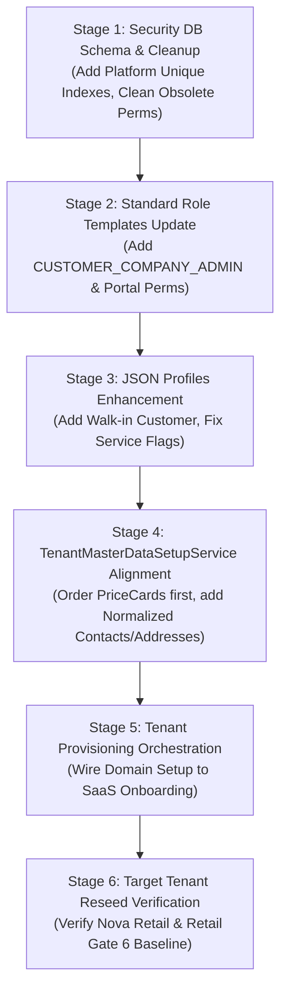

# ApexERP — Bootstrap Seeding & Development Database Alignment Audit Report

**Audit Date:** November 20, 2026  
**Auditor:** ApexERP Architecture & Security Agent  
**Audit Scope:** Bootstrap Seeding Architecture, Domain Database, Security Database, Platform Database, Cross-Database Consistency, JSON Profiles, Authorization Alignment, and Sales Channel Readiness  
**Execution Mode:** STRICTLY READ-ONLY (No code, database, migration, or configuration modifications performed)

---

## A. Executive Summary

A comprehensive, read-only audit of ApexERP's bootstrap and seeding architecture was conducted across all three database boundaries: **PlatformDB**, **SecurityDB**, and **DomainDB**, comparing code definitions, EF Core models, migration histories, JSON industry profiles, and actual development database records hosted on `(localdb)\MSSQLLocalDB`.

### Key Readiness Assessments

| Boundary / Capability | Status | Assessment Summary |
|---|---|---|
| **Overall Bootstrap Architecture** | ⚠️ **Partial / Fragmented** | Platform, Security, and Domain have separate, partially disconnected bootstrap lifecycles. Tenant creation in Platform/Security does not initialize Domain master data. Multiple legacy/obsolete seeders remain in the repository. |
| **Platform Database (`PlatformDB`)** | 🟢 **Healthy** | All 13 migrations applied. Subscriptions, plans, parameters, and limits seeded correctly. 25 tenant records present with proper configuration records. |
| **Security Database (`SecurityDB`)** | ⚠️ **Action Required** | All 3 migrations applied. All 197 catalogue permissions exist. However, 19 obsolete legacy permissions remain in DB; duplicate Platform users exist due to unconstrained filtered indexes; 4 legacy tenant users remain assigned to global roles; and Customer Portal roles (`CUSTOMER_COMPANY_ADMIN`) are created ad-hoc with 0 permissions. |
| **Domain Database (`DomainDB`)** | ⚠️ **Action Required** | All 33 migrations applied. Core entities, currencies, categories, brands, UOMs, and products seeded. However, `TenantMasterDataSetupService` bypasses normalized `Address` and `Contact` architecture; Customers and Suppliers lack default Price Card links; service products in `service.json` are incorrectly forced to `StockItem` with inventory tracking; and walk-in cash customer is absent. |
| **Cross-Database Consistency** | 🟡 **Partially Aligned** | 0 cross-tenant leaks or foreign orphan records. However, out of 25 Platform tenants, only 16 have been provisioned with Domain master data; 9 tenants exist only as shell registrations in PlatformDB/SecurityDB with 0 companies, branches, or products in DomainDB. |
| **Sales Channel Readiness** | 🔴 **Blocked** | E-commerce, Direct Company Sales, and Sales Quotations cannot proceed reliably without correcting: (1) missing customer contacts and addresses, (2) missing Walk-in cash customer, (3) unassigned default sales/purchase price cards, and (4) absence of Customer Portal permissions and role templates. |

---

## B. Environment Identification

The audit positively verified that all three application DbContexts connect exclusively to the local development environment:

- **Host Instance:** `(localdb)\MSSQLLocalDB` (Named Pipe: `np:\\.\pipe\LOCALDB#60F25A8A\tsql\query`)
- **Database Provider:** Microsoft SQL Server (v17.0.4025.3 — SQL Server 2022 Express LocalDB)
- **Host User / Environment:** `UNICOMTIC\UT011647` (Windows Integrated Authentication, Trusted Connection)
- **Configuration Source:** `Backend/ERP/API/appsettings.json`

### Database Targets & Migration Status

| Database Logical Name | Actual Database Name | DbContext | Migration Project | Migrations in Code | Migrations in DB | Pending Migrations |
|---|---|---|---|:---:|:---:|:---:|
| **Platform Database** | `PlatformDB` | `SaaSDbContext` | `SaaS` | 13 | 13 | 0 |
| **Security Database** | `SecurityDB` | `SecurityDbContext` | `Security` | 3 | 3 | 0 |
| **Domain Database** | `DomainDB` | `DomainDbContext` | `Domain` | 33 | 33 | 0 |
| **AI Database** | `AIDatabase` | `AIDbContext` | `ERP.AI.Infrastructure` | N/A | N/A | Inactive |

*Confirmation: All active connections point strictly to development databases. No production or remote environments are referenced.*

---

## C. Seeder Inventory & Bootstrap Architecture

ApexERP contains several bootstrap entry points and seed mechanisms spanning multiple layers and execution lifecycles:

| # | Seeder Class / Component | Project | Target DB | Entry Point / Invocation | Execution Timing | Idempotency | Current Status |
|---|---|---|---|---|---|---|---|
| 1 | `SubscriptionSeed` | `SaaS` | `PlatformDB` | `Program.cs` (line 244) | Application Startup | ✅ Safe (checks `ExistsByCode`, `ExistsByKey`) | **Active** |
| 2 | `PermissionCatalogueSeeder` | `Security` | `SecurityDB` | `SecurityBootstrapService.EnsurePlatformRbacAsync` & `EnsureDomainPermissionsAsync` | Application Startup | ✅ Safe (upserts definitions, preserves names) | **Active (Authoritative)** |
| 3 | `PlatformPermissionSeed` | `Security` | `SecurityDB` | `SecurityBootstrapService.EnsurePlatformRbacAsync` | Application Startup | ✅ Safe | **Redundant** (superseded by catalogue) |
| 4 | `PlatformRoleSeed` | `Security` | `SecurityDB` | `SecurityBootstrapService.EnsurePlatformRbacAsync` | Application Startup | ⚠️ Flawed (causes duplicate platform roles) | **Active (Defective)** |
| 5 | `PlatformRolePermissionSeed` | `Security` | `SecurityDB` | `SecurityBootstrapService.EnsurePlatformRbacAsync` | Application Startup | ✅ Safe (checks existing assignments) | **Active** |
| 6 | `EnsurePlatformAdminAsync` / `EnsurePlatformUserAsync` | `Security` | `SecurityDB` | `SecurityBootstrapService.EnsurePlatformRbacAsync` | Application Startup | ⚠️ Flawed (causes duplicate platform users) | **Active (Defective)** |
| 7 | `TenantAdminRolePermissionSeed` | `Security` | `SecurityDB` | `SecurityBootstrapService.EnsureDomainPermissionsAsync` | Application Startup | ✅ Safe (checks existing assignments) | **Active (Legacy Global Role)** |
| 8 | `SecurityBootstrapService.EnsureTenantStandardRolesAsync` | `Security` | `SecurityDB` | Startup (`UpgradeExistingTenantsAsync`) & Tenant Provisioning | Startup & On-demand | ✅ Safe (additive, versioned, preserves custom) | **Active (Authoritative)** |
| 9 | `SecurityBootstrapService.UpgradeExistingTenantsAsync` | `Security` | `SecurityDB` | `Program.cs` (line 265) | Application Startup | ⚠️ Partial (only migrates `Tenant Admin`) | **Active** |
| 10 | `TenantOrganizationSetupService` | `ERP.Application` | `DomainDB` | `POST api/tenant-setup/initialize-organization` | Manual / API | ⚠️ Conditional (creates duplicate main company if code differs) | **Active** |
| 11 | `TenantUserSetupService` | `Security` | `SecurityDB` | `POST api/tenant-setup/initialize-users` | Manual / API | ✅ Safe (checks existing username) | **Active** |
| 12 | `TenantMasterDataSetupService` | `ERP.Application` | `DomainDB` | `POST api/tenant-setup/initialize-master-data` | Manual / API | ⚠️ Partial (skips addresses/contacts; inserts daily exchange rates) | **Active** |
| 13 | `TenantProvisioningService` | `SaaS` | `PlatformDB` & `SecurityDB` | `POST api/saas/tenants/{id}/provision` | Tenant Onboarding | ✅ Safe (compensating transaction on failure) | **Active** |
| 14 | `CustomerRegistrationService` | `API` | `DomainDB` & `SecurityDB` | `POST api/portal/auth/register` | Customer Self-Registration | ⚠️ Ad-hoc (creates role with 0 permissions) | **Active** |
| 15 | `DomainPermissionSeeder` | `Security` | `SecurityDB` | None | None | ⚠️ Obsolete | **Dead Code** (uncalled) |
| 16 | 26 Module Permission Seeders (`PurchaseOrderPermissionSeed`, etc.) | `Security` | `SecurityDB` | None | None | ⚠️ Obsolete | **Dead Code** (superseded by catalogue) |
| 17 | `AIBootstrapSeeder` | `ERP.AI.Infrastructure` | `AIDatabase` | None | None | ⚠️ Inactive | **Unregistered** |
| 18 | `seed_customer_supplier_demo_data.sql` | Solution Root | `DomainDB` & `SecurityDB` | Manual SQL script | Ad-hoc Developer Run | ⚠️ Ad-hoc (hardcoded to tenant `25ADAB1D...`) | **Ad-hoc Script** |

---

## D. Domain Database Findings

### 1. Bypassing Normalized Contact and Address Architecture
In Clean Architecture (Master Data Step 4), `CustomerService` and `SupplierService` use `CustomerPersistenceCoordinator` and `SupplierPersistenceCoordinator` to persist to normalized relational tables (`Addresses`, `CustomerAddresses`, `SupplierAddresses`, `Contacts`, `CustomerContacts`, `SupplierContacts`) alongside entity flat columns.
However, `TenantMasterDataSetupService.SeedSuppliersAsync` and `SeedCustomersAsync` bypass application services and directly execute `_db.Suppliers.AddAsync(...)` and `_db.Customers.AddAsync(...)`.
- **Database Evidence:**
  - `Suppliers`: 29 records in `DomainDB`, but `SupplierAddresses`: **0 records**.
  - `Customers`: 23 records in `DomainDB`, but `CustomerAddresses`: **only 2 records**.
  - `CustomerContacts`: only 9 records across 23 customers.
  - `SupplierContacts`: only 11 records across 29 suppliers.
- **Impact:** Any feature (e.g. Sales Orders, Purchase Orders, Quotations, Dispatch, Invoicing) querying normalized customer/supplier addresses or contacts fails or returns empty lists for seeded tenants.

### 2. Missing Default Price Card Assignment on Customers & Suppliers
In `TenantMasterDataSetupService.SetupMasterDataAsync`, execution order is:
```csharp
await SeedSuppliersAsync(tenantId, root, result);   // Step 10
await SeedCustomersAsync(tenantId, root, result);   // Step 10
await SeedPriceCardsAsync(tenantId, root, result);  // Step 11
```
Because Suppliers and Customers are seeded *before* Price Cards, `Customer.DefaultSalesPriceCardId` and `Supplier.DefaultPurchasePriceCardId` are left `NULL` for every tenant initialized via the bootstrap service.
- **Database Evidence:** In `DomainDB`, all customers across all tenants have `DefaultSalesPriceCardId = NULL`, and all suppliers have `DefaultPurchasePriceCardId = NULL`, EXCEPT tenant `25ADAB1D-6E1A-4820-A078-DD7AAE6AA7F0` where they were manually patched via `seed_customer_supplier_demo_data.sql`.
- **Impact:** When Sales Orders, Direct Company Sales, or Sales Quotations are created, pricing resolution cannot resolve the customer's default price card, causing transaction creation to fail or require manual override.

### 3. Missing Walk-in / Cash Customer Foundation
None of the 5 JSON profiles (`retail.json`, `wholesale.json`, `manufacturing.json`, `pharmacy.json`, `service.json`) define a generic Walk-in or Cash Customer (e.g. `CUST-WALKIN` / `CUST-CASH` with `IMMEDIATE` payment term). Each profile defines only a single commercial customer (e.g. `Cargills Supermarkets PLC` in retail).
- **Impact:** Direct Company Sales, POS counter sales, and walk-in sales cannot function out of the box without manually authoring a customer first.

### 4. Service Products Incorrectly Forced as Stock Items with Inventory Tracking
In `TenantMasterDataSetupService.cs` (lines 405–407):
```csharp
isStockTracked: true,
productType: ProductType.StockItem,
```
All products across all industry profiles are hardcoded to `ProductType.StockItem` and `isStockTracked = true`. In `service.json`, products such as `SRV-001` ("Equipment Installation") and `SRV-002` ("Equipment Preventive Maintenance") are services with UOMs `JOB` and `VISIT`.
- **Domain Entity Invariant:** `Product.ValidateCapabilitiesAndTracking` explicitly enforces:
  ```csharp
  if (productType == ProductType.Service && isStockTracked)
      throw new InvalidOperationException($"Service product '{productCode}' cannot be configured as a stock-tracked item.");
  ```
- **Impact:** The bootstrap seeder bypasses the domain invariant by misclassifying service products as `StockItem`. This forces service operations into warehouse inventory, putaway, and valuation ledgers where they do not belong.

### 5. Unmapped and Obsolete JSON Properties
- `taxCode` (e.g. `"taxCode": "VAT-18"`): Defined on every product in all 5 JSON profiles, but ignored by `TenantMasterDataSetupService` because the `Product` entity does not have a `TaxCodeId` or `TaxCode` property.
- `barcode` on Packagings: Defined in `packagings` arrays (e.g. `"barcode": "14792001001015"`), but ignored by `TenantMasterDataSetupService` and does not exist on `ProductPackaging`. It is never registered into `ProductIdentifiers`.
- `isBase` on Currencies: Defined in JSON (e.g. `"isBase": true`), but `Currency` entity has no `IsBase` property (base currency is defined at the `Company` level in `DomainDB`).

### 6. Hardcoded Windows Absolute Path
In `TenantMasterDataSetupService.LoadProfileJsonAsync` (line 134):
```csharp
Path.Combine("Z:\\ERP\\Backend\\ERP\\ERP.Application\\Features\\Setup\\Profiles", $"{code}.json")
```
This hardcodes a development workstation drive letter into application code, which will fail if deployed to any other drive or environment (Linux/Docker/CI).

---

## E. Security Database Findings

### 1. Duplicate Platform Users Due to Filtered Unique Indexes
In `SecurityDB.dbo.Users`, the unique indexes on `Username` and `Email` are filtered:
```sql
IX_Users_TenantId_Email: UNIQUE (TenantId, Email) WHERE ([TenantId] IS NOT NULL)
IX_Users_TenantId_Username: UNIQUE (TenantId, Username) WHERE ([TenantId] IS NOT NULL)
```
When `TenantId IS NULL` (Platform users), **no unique constraint exists**.
Furthermore, in `SecurityBootstrapService.EnsurePlatformAdminAsync` and `EnsurePlatformUserAsync`:
- Early migrations inserted users with email as username: `admin@platform.local`, `platformstaff@platform.local`, etc.
- Current code queries `x.Username == "admin"` and `x.Username == "platformstaff"`.
- Failing to find `"admin"`, the seeder created duplicate users.
- **Database Evidence:**
  - `admin@platform.local`: **3 duplicate user accounts** (`3B05FA74...`, `71EB7C9C...`, `FDBF5E91...`).
  - `platformstaff@platform.local`: **2 duplicate accounts**.
  - `securitymanager@platform.local`: **2 duplicate accounts**.
  - `audituser@platform.local`: **2 duplicate accounts**.

### 2. Duplicate Platform Roles Due to Filtered Unique Index
In `SecurityDB.dbo.Roles`, the uniqueness constraint is also filtered:
```sql
IX_Roles_TenantId_Name: UNIQUE (TenantId, Name) WHERE ([TenantId] IS NOT NULL)
```
When `TenantId IS NULL`, role names are not constrained to be unique.
- **Database Evidence:** `Platform Admin` role exists **twice** (`EE6204A7-4888-40B8-8E04-25E534E1332E` and `12B0B4A8-D0E7-4836-9767-0F96E4A3E448`).

### 3. Obsolete Legacy Permission Codes in Database
The central `PermissionCatalogue.All` contains **197 canonical permissions** (10 Platform, 187 Tenant).
However, `SecurityDB.dbo.Permissions` contains **213 permissions**. The following **18 legacy permission codes** exist in the database from early migrations but are completely absent from `PermissionCatalogue`:
- `CUSTOMER_CREATE`, `CUSTOMER_UPDATE`, `CUSTOMER_VIEW`
- `PRODUCT_CREATE`, `PRODUCT_UPDATE`, `PRODUCT_VIEW`
- `USER_CREATE`, `USER_EDIT`, `USER_VIEW`
- `Role_Create`, `Role_View`
- `Tenant_Create`, `Tenant_View`
- `Permission_View`
- `SUBSCRIPTION_CREATE`, `SUBSCRIPTION_DELETE`, `SUBSCRIPTION_EDIT`, `SUBSCRIPTION_VIEW`

These legacy permissions are still assigned to deprecated global roles (`Tenant User`, `Tenant Manager`, `Tenant Viewer`, `Platform_Staff`, etc.).

### 4. Legacy Tenant Users Assigned to Deprecated Global Roles
`SecurityBootstrapService.UpgradeExistingTenantsAsync` loops through tenants and migrates legacy assignments for `Tenant Admin` (`TenantId IS NULL`) to the tenant's scoped `TENANT_ADMIN` role.
However, it **only** checks `legacyTenantAdminRole`. It ignores legacy global roles `Tenant User`, `Tenant Manager`, and `Tenant Viewer`.
- **Database Evidence:** 4 tenant users remain assigned to global roles (`TenantId IS NULL`):
  1. `abcuser.erp.lk` (Tenant `7D61559D...`) -> `Tenant User` (Global)
  2. `xyzuser.erp.lk` (Tenant `DDCA51A5...`) -> `Tenant User` (Global)
  3. `abcmanager.erp.lk` (Tenant `7D61559D...`) -> `Tenant Manager` (Global)
  4. `abcviewer.erp.lk` (Tenant `7D61559D...`) -> `Tenant Viewer` (Global)

### 5. Customer Portal Role (`CUSTOMER_COMPANY_ADMIN`) Created with Zero Permissions
In `CustomerRegistrationService.cs` (lines 163–179), when a customer registers via the portal, the service dynamically creates a tenant-scoped role named `CUSTOMER_COMPANY_ADMIN`:
```csharp
customerRole = new Role
{
    Id = Guid.NewGuid(),
    TenantId = request.TenantId,
    Name = "CUSTOMER_COMPANY_ADMIN",
    Description = "Customer Company Administrator (Portal)",
    TemplateKey = "CUSTOMER_COMPANY_ADMIN",
    TemplateVersion = 1
};
```
However:
1. `CUSTOMER_COMPANY_ADMIN` is **not registered** in `StandardRoleTemplates.All`.
2. It is **never assigned any permissions** (0 `RolePermission` records created).
3. `SecurityBootstrapService.EnsureTenantStandardRolesAsync` does not manage it.
4. `PermissionCatalogue` defines zero customer portal permissions.
- **Security Impact:** Customer portal authentication relies purely on token claim checks (`IsCustomer`), while the role assigned to the customer user has 0 effective permissions.

---

## F. Platform Database Findings

### 1. Disconnected Tenant Provisioning Lifecycle
`TenantProvisioningService` in the `SaaS` project provisions:
- `TenantDomain` (in `PlatformDB`)
- `TenantDatabase` (in `PlatformDB`)
- `TenantConfiguration` (in `PlatformDB`)
- `Tenant Admin` user & standard roles (in `SecurityDB` via `TenantAdminProvisioningService`)

It **never invokes** `TenantOrganizationSetupService` or `TenantMasterDataSetupService` to initialize `DomainDB`.
- **Database Evidence:**
  - 25 tenants exist in `PlatformDB`.
  - 25 tenants exist in `SecurityDB`.
  - But only **16 tenants** have companies/branches/products in `DomainDB`.
  - **9 tenants** (`B460F9CC...`, `E92976D5...`, `C821740C...`, `EAD6BA8B...`, `644FBA2E...`, `F60F445F...`, `61E94509...`, etc.) exist as empty shells with 0 companies, 0 branches, and 0 master data records in `DomainDB`.
- **Architectural Consequence:** Tenant creation and tenant master data setup are completely decoupled without an orchestrated onboarding pipeline.

### 2. DTO and Entity Property Alignment in SaaS
In `Tenant` entity in `PlatformDB`:
- Columns: `Id`, `Name`, `Code`, `IsActive`, `Subdomain`, `AdminUsername`, `AdminEmail`, `CreatedAt`, `CreatedBy`, `ModifiedAt`, `ModifiedBy`.
- `Status` and `StorageMode` are properties on `Subscription`, not on `Tenant`. Queries attempting to read `Status` directly from `Tenants` table will fail with invalid column name errors.

---

## G. Cross-Database Consistency Findings

A complete cross-database comparison of all 25 development tenants was performed across `PlatformDB`, `SecurityDB`, and `DomainDB`:

```
+---------------------------------------------------------------------------------------------------+
| PlatformDB (Tenants: 25)  <---->  SecurityDB (Tenants: 25)  <---->  DomainDB (Tenants: 16)        |
+---------------------------------------------------------------------------------------------------+
| • 25 / 25 provisioned in PlatformDB & SecurityDB                                                  |
| • 16 / 25 initialized in DomainDB (9 shell tenants missing DomainDB master data)                  |
| • 0 orphaned tenants in DomainDB (all DomainDB tenant records map to PlatformDB tenants)          |
| • 0 orphaned tenants in SecurityDB (all SecurityDB tenant records map to PlatformDB tenants)      |
| • 0 cross-tenant role assignments in SecurityDB                                                   |
+---------------------------------------------------------------------------------------------------+
```

### Detailed Tenant Audit Matrix (Sample of Key Operational & Demo Tenants)

| Tenant ID | Code | Name | Subdomain | PlatformDB Status | SecurityDB Users | DomainDB Companies | DomainDB Products | DomainDB Customers | DomainDB Suppliers | Alignment Assessment |
|---|---|---|---|:---:|:---:|:---:|:---:|:---:|:---:|---|
| `25ADAB1D-6E1A-4820-A078-DD7AAE6AA7F0` | `TEN-25ADAB1D` | Nova Retail Solutions (Pvt) Ltd | `nova` | Active | 15 | 1 | 5 | 3 | 3 | 🟢 **Fully Provisioned** (Target Demo Tenant) |
| `10000000-0000-0000-0000-000000000001` | `RETAIL` | Lanka Retail Mart | `retail` | Active | 1 | 1 | 0 | 0 | 0 | 🟡 **Partial** (Org created, Master Data missing) |
| `DDCA51A5-246F-4EAB-A0A0-7D51C6D52896` | `TEN-DDCA51A5` | xyz company pvt ltd | `ten-ddca51a5` | Active | 7 | 2 | 12 | 8 | 7 | 🟢 **Active Dev Tenant** |
| `7D61559D-1B1C-4D2C-A8EE-DBF4F16ABC57` | `TEN-7D61559D` | ABC Company PVT LTD | `ten-7d61559d` | Active | 4 | 2 | 4 | 1 | 3 | 🟢 **Active Dev Tenant** |
| `A752C072-0DA0-4BCC-826B-A9B5F8432F7B` | `TEN-A752C072` | APEXTEST | `apextest` | Active | 12 | 1 | 5 | 1 | 3 | 🟢 **Test Tenant** |
| `D81B6860-11A5-4804-B888-DD159113D8D1` | `TEN-D81B6860` | PWTEST | `pwtest` | Active | 12 | 1 | 5 | 1 | 1 | 🟢 **Playwright Test Tenant** |
| `E0146DAD-306E-4855-B195-CA70F35B8C26` | `TEN-E0146DAD` | Apex QA | `apex-qa` | Active | 12 | 1 | 5 | 1 | 1 | 🟢 **QA Tenant** |
| `D6BC8282-3048-4799-BA95-C4A0043DA714` | `TEN-D6BC8282` | APXWHOLE | `apxwhole` | Active | 12 | 1 | 5 | 1 | 1 | 🟢 **Wholesale Test Tenant** |
| `81307250-B0A9-466C-AB9F-0A52AAFBE52C` | `TEN-81307250` | APXMAN | `apxman` | Active | 12 | 1 | 5 | 1 | 1 | 🟢 **Manufacturing Test Tenant** |
| `B460F9CC-555D-4829-9EB9-63AE6ACE8822` | `TEN-B460F9CC` | test company | `ten-b460f9cc` | Active | 1 | 0 | 0 | 0 | 0 | 🔴 **Shell Only** (DomainDB uninitialized) |
| `E92976D5-7511-4E07-B7CC-7E3BD14E9B2E` | `TEN-E92976D5` | Acme Manufacturing 2026 | `ten-e92976d5` | Active | 1 | 0 | 0 | 0 | 0 | 🔴 **Shell Only** (DomainDB uninitialized) |
| `C821740C-F877-45C0-BF2A-794F5A3EADBF` | `TEN-C821740C` | My Manufacturing Co | `ten-c821740c` | Active | 1 | 0 | 0 | 0 | 0 | 🔴 **Shell Only** (DomainDB uninitialized) |

---

## H. JSON Profile Findings

All 5 JSON profiles in `Backend/ERP/ERP.Application/Features/Setup/Profiles/` were audited:

| Profile Name | Products | Categories | Brands | UOMs | Conversions | Warehouses | Suppliers | Customers | Reference Integrity | Key Deficiencies |
|---|:---:|:---:|:---:|:---:|:---:|:---:|:---:|:---:|:---:|---|
| `retail.json` | 10 | 6 | 3 | 13 | 4 | 2 | 3 | 1 | ✅ Valid | Only 1 customer; no walk-in cash customer; no customer contacts/addresses; packaging barcodes unmapped; taxCode unmapped. |
| `manufacturing.json` | 10 | 5 | 5 | 11 | 4 | 2 | 1 | 1 | ✅ Valid | Only 1 customer; only 1 supplier; `IsManufacturable` & `CanConsumeInProduction` flags absent. |
| `wholesale.json` | 10 | 5 | 5 | 12 | 4 | 2 | 1 | 1 | ✅ Valid | Only 1 customer; only 1 supplier; bulk packaging conversions limited. |
| `pharmacy.json` | 10 | 5 | 5 | 12 | 4 | 2 | 1 | 1 | ✅ Valid | Only 1 customer; only 1 supplier; batch tracking enabled on medicines but missing storage condition attributes. |
| `service.json` | 10 | 5 | 3 | 6 | 0 | 0 | 1 | 1 | ✅ Valid | No warehouse block (handled safely); **Service products forced to `StockItem` with inventory tracking**. |

### Profile-to-Entity Mapping Summary

| JSON Section / Field | Destination Entity | Field Status | Observation |
|---|---|---|---|
| `currencies[].isBase` | `Company.BaseCurrencyId` | ⚠️ Misaligned | Base currency is stored on Company in DomainDB, not on Currency entity. |
| `products[].taxCode` | `Product` | ⚠️ Ignored | Product entity has no TaxCode property. Property in JSON is dead data. |
| `products[].packagings[].barcode` | `ProductPackaging` | ⚠️ Ignored | ProductPackaging has no Barcode property; seeder does not create `ProductIdentifier`. |
| `products[].reorderLevel` | `Product.ReorderLevel` | ⚠️ Hardcoded | Hardcoded to `20` in service code regardless of JSON. |
| `products[].reorderQuantity` | `Product.ReorderQuantity` | ⚠️ Hardcoded | Hardcoded to `50` in service code regardless of JSON. |
| `customers[].creditLimit` | `Customer.CreditLimit` | ⚠️ Hardcoded | Hardcoded to `500,000` in service code regardless of JSON. |
| `priceCards[].lines[].minimumQuantity` | `PriceCardLine.MinimumQuantity`| ⚠️ Hardcoded | Hardcoded to `1` in service code regardless of JSON. |
| `customers[].defaultPriceCard` | `Customer.DefaultSalesPriceCardId` | ❌ Missing | Missing from JSON; seeder never sets foreign key. |
| `suppliers[].defaultPriceCard` | `Supplier.DefaultPurchasePriceCardId` | ❌ Missing | Missing from JSON; seeder never sets foreign key. |

---

## I. Permissions & Role Mapping Findings

### 1. Permission Alignment Verification
- **Catalogue Total:** 197 canonical permissions (10 Platform, 187 Tenant).
- **Controllers Total:** 172 distinct permissions enforced via `[RequirePermission("...")]`.
- **Controller Codes Missing from Catalogue:** **0** (100% of controller permission attributes match the catalogue).
- **Catalogue Codes Unused in Controllers:** **23** permissions (e.g. `*.DELETE`, `*.SOFT_DELETE`, `PRICE_CARD.OVERRIDE`, `AUDIT.VIEW`, `SUPPLIER_PRICE.CREATE/EDIT`). These are intended for transaction-level checks or upcoming features.
- **Database Total:** 213 permissions (**19 obsolete codes** from early migrations).

### 2. Standard Role Template Verification
`StandardRoleTemplates` defines **19 standard roles** (Version 7):
1. `TENANT_ADMIN` ("Tenant Admin" — receives all 187 tenant permissions except `PRICE_CARD.OVERRIDE`)
2. `TENANT_AUDITOR` ("Tenant Read-only Auditor" — all View permissions)
3. `MASTER_DATA_MANAGER`
4. `PRODUCT_CATEGORY_OFFICER`
5. `UOM_PACKAGING_OFFICER`
6. `SUPPLIER_CUSTOMER_OFFICER`
7. `PRICING_OFFICER` (includes `PRICE_CARD.OVERRIDE`)
8. `FINANCE_CONFIGURATION_OFFICER`
9. `WAREHOUSE_CONFIGURATION_OFFICER`
10. `MASTER_DATA_VIEWER`
11. `PROCUREMENT_MANAGER`
12. `PROCUREMENT_OFFICER`
13. `PROCUREMENT_VIEWER`
14. `INVENTORY_MANAGER`
15. `INVENTORY_OFFICER`
16. `INVENTORY_VIEWER`
17. `SALES_MANAGER`
18. `SALES_OFFICER`
19. `SALES_VIEWER`

### 3. Least-Privilege & Boundary Enforcement Evaluation
- **Tenant Scope:** Verified. Roles are provisioned per-tenant (`Role.TenantId = tenantId`).
- **Segregation of Duties:** Procurement Officer cannot approve POs; Inventory Officer cannot post stock counts; Sales Officer cannot confirm orders or invoices.
- **Auditor Role:** Strictly read-only across all modules.
- **Customer / Supplier Isolation Defect:** Customer Portal users are given role `CUSTOMER_COMPANY_ADMIN` which has 0 permissions; Customer Portal permissions are completely absent from `PermissionCatalogue` and `StandardRoleTemplates`.

---

## J. Idempotency and Data Safety Findings

| Seeder Component | Idempotency Check | Risk Assessment | Verdict |
|---|---|---|---|
| `SubscriptionSeed.Seed` | Checks `ExistsByCode` & `ExistsByKey`. | Low | ✅ Idempotent |
| `PermissionCatalogueSeeder.SeedAsync` | Upserts definitions by code; updates metadata; never deletes. | Low | ✅ Idempotent |
| `SecurityBootstrapService.EnsureTenantStandardRolesAsync` | Uses `TemplateKey` & `Version`. Additive only. Preserves custom roles. | Low | ✅ Idempotent |
| `SecurityBootstrapService.EnsurePlatformAdminAsync` | Checks `x.Username == "admin"`. | **Medium** — creates duplicate user if `admin@platform.local` exists. | ⚠️ Defective |
| `SecurityBootstrapService.EnsurePlatformUserAsync` | Checks `x.Username == username`. | **Medium** — creates duplicate user if email was previously used as username. | ⚠️ Defective |
| `TenantOrganizationSetupService` | Checks code; falls back to first company. | Low | ✅ Idempotent |
| `TenantUserSetupService` | Checks username collision per tenant. | Low | ✅ Idempotent |
| `TenantMasterDataSetupService` | Checks natural keys for products, UOMs, categories, etc. | **Medium** — `SeedExchangeRatesAsync` checks `EffectiveDate == today`. Running on different dates inserts duplicate exchange rates across dates. | ⚠️ Partially Idempotent |
| `CustomerRegistrationService` | Checks user email uniqueness and deduplication service. | Low | ✅ Idempotent |

---

## K. Sales Channel Readiness Evaluation

The foundational bootstrap and seed data was evaluated against the requirements of the three planned sales channels:

### 1. Direct Company Sales
- **Ready:** Selling Company, Branch, Warehouses, Currencies, Tax Codes, Standard Products, Sales Roles (`SALES_MANAGER`, `SALES_OFFICER`).
- **Missing / Blocking:**
  - **No Walk-in / Cash Customer:** Direct company sales requires an immediate-settlement cash customer (`CUST-WALKIN`) with payment term `IMMEDIATE`.
  - **No Default Price Card Linked:** `Customer.DefaultSalesPriceCardId` is `NULL`. Price calculation engines cannot automatically resolve customer prices.
  - **Customer Addresses Missing:** Invoices and deliveries requiring customer addresses will fail to resolve shipping/billing records.

### 2. Sales Quotation
- **Ready:** `SalesQuotations` and `SalesQuotationItems` tables applied in `DomainDB` (migration `20261120050836_AddSalesQuotationCore`); permissions `SALES_QUOTATION.*` defined in catalogue and assigned to `SALES_MANAGER` and `SALES_OFFICER`.
- **Missing / Blocking:**
  - Quotation lines depend on products and price card rates. Price card links to customers are unassigned.
  - Customer contact records are missing, preventing quotation email dispatch and customer acknowledgment workflows.

### 3. E-commerce Sales
- **Ready:** `EcommerceProducts` table applied in `DomainDB` (migration `20261120075340_AddEcommerceProductCore`); permissions `ECOMMERCE_PRODUCT.*` defined in catalogue and assigned to `MASTER_DATA_MANAGER` and `PRODUCT_CATEGORY_OFFICER`.
- **Missing / Blocking:**
  - `EcommerceProducts` table has **0 rows** in development DB; no bootstrap seeder exists to publish demo products to the online catalogue.
  - Customer registration through the portal assigns `CUSTOMER_COMPANY_ADMIN` role with **0 permissions**, leaving customer portal authorization unanchored in the security model.

---

## L. Detailed Findings & Recommended Corrections

### Critical Severity

#### [FINDING-CRIT-01] Missing Uniqueness Constraint for Platform Identity Records
- **Severity:** Critical
- **Database:** `SecurityDB`
- **Location:** `Security.Infrastructure.Persistence.Configurations.UserConfiguration` & `RoleConfiguration`
- **Tables Affected:** `Users`, `Roles`
- **Current Behaviour:** Uniqueness indexes `IX_Users_TenantId_Email`, `IX_Users_TenantId_Username`, and `IX_Roles_TenantId_Name` have filter `([TenantId] IS NOT NULL)`. When `TenantId IS NULL`, no uniqueness is enforced.
- **Evidence:** 3 duplicate `admin@platform.local` accounts and 2 duplicate `Platform Admin` roles exist in `SecurityDB`.
- **Expected Behaviour:** Unique constraints must enforce uniqueness for Platform users (`WHERE TenantId IS NULL`) as well as Tenant users (`WHERE TenantId IS NOT NULL`).
- **Recommended Correction:** Add filtered unique indexes for platform records:
  - `IX_Users_Platform_Email: UNIQUE (Email) WHERE ([TenantId] IS NULL)`
  - `IX_Users_Platform_Username: UNIQUE (Username) WHERE ([TenantId] IS NULL)`
  - `IX_Roles_Platform_Name: UNIQUE (Name) WHERE ([TenantId] IS NULL)`
- **Migration Required:** Yes (`SecurityDbContext`).

---

### High Severity

#### [FINDING-HIGH-01] Customer Portal Role (`CUSTOMER_COMPANY_ADMIN`) Created with Zero Permissions
- **Severity:** High
- **Database:** `SecurityDB`
- **Location:** `API.Features.Portal.Services.CustomerRegistrationService.cs` (lines 163–179), `StandardRoleTemplates.cs`, `PermissionCatalogue.cs`
- **Current Behaviour:** Customer self-registration creates `CUSTOMER_COMPANY_ADMIN` role ad-hoc per tenant with 0 permissions. The role is not in `StandardRoleTemplates` and `PermissionCatalogue` has no customer portal permissions.
- **Expected Behaviour:** A formal standard role template `CUSTOMER_COMPANY_ADMIN` should be defined with dedicated customer portal permissions (`PORTAL.PROFILE.VIEW`, `PORTAL.QUOTATION.REQUEST`, `PORTAL.ORDER.VIEW`, etc.) and kept strictly segregated from internal employee permissions.
- **Recommended Correction:**
  1. Add customer portal permissions to `PermissionCatalogue.Tenant`.
  2. Add `CUSTOMER_COMPANY_ADMIN` to `StandardRoleTemplates.All` with least-privilege customer permissions.
  3. Ensure `CustomerRegistrationService` uses the template copy managed by `EnsureTenantStandardRolesAsync`.
- **Migration Required:** No (seed/catalogue update).

#### [FINDING-HIGH-02] Incomplete Master Data Seeding: Missing Normalized Addresses and Contacts
- **Severity:** High
- **Database:** `DomainDB`
- **Location:** `ERP.Application.Features.Setup.TenantMasterDataSetupService.cs` (`SeedCustomersAsync`, `SeedSuppliersAsync`)
- **Tables Affected:** `Addresses`, `CustomerAddresses`, `SupplierAddresses`, `Contacts`, `CustomerContacts`, `SupplierContacts`
- **Current Behaviour:** Direct insertion into `_db.Customers` and `_db.Suppliers` bypasses `CustomerService` and `SupplierService`. No records are inserted into normalized address and contact tables.
- **Expected Behaviour:** Customers and suppliers must have corresponding `Address`, `CustomerAddress`, `Contact`, and `CustomerContact` records created.
- **Recommended Correction:** Update `SeedCustomersAsync` and `SeedSuppliersAsync` to invoke `CustomerService` and `SupplierService` (or replicate normalized address/contact creation) so relational tables are fully populated.
- **Migration Required:** No (seed code update).

#### [FINDING-HIGH-03] Customers and Suppliers Seeded Without Default Price Cards
- **Severity:** High
- **Database:** `DomainDB`
- **Location:** `ERP.Application.Features.Setup.TenantMasterDataSetupService.cs`
- **Tables Affected:** `Customers.DefaultSalesPriceCardId`, `Suppliers.DefaultPurchasePriceCardId`
- **Current Behaviour:** Price cards are seeded after customers and suppliers; `DefaultSalesPriceCardId` and `DefaultPurchasePriceCardId` are left `NULL`.
- **Expected Behaviour:** Seeded customers should be linked to the default sales price card (`SPC-RETAIL-STD`), and suppliers should be linked to their purchase price cards (`PPC-SUP-RET-001`).
- **Recommended Correction:** Move `SeedPriceCardsAsync` before `SeedCustomersAsync` and `SeedSuppliersAsync`, and pass the resolved PriceCard IDs to `Customer.Create` and `Supplier.Create`.
- **Migration Required:** No (seed code update).

#### [FINDING-HIGH-04] Service Products Misclassified as Stock Items with Inventory Tracking
- **Severity:** High
- **Database:** `DomainDB`
- **Location:** `ERP.Application.Features.Setup.TenantMasterDataSetupService.cs` (lines 405–407)
- **Tables Affected:** `Products.ProductType`, `Products.IsStockTracked`
- **Current Behaviour:** Hardcoded `productType: ProductType.StockItem` and `isStockTracked: true` for all products, forcing service items in `service.json` to become inventory items.
- **Expected Behaviour:** Products should parse `productType` and `isStockTracked` from JSON. Services must be `ProductType.Service` with `isStockTracked: false`.
- **Recommended Correction:** Support `productType` and `isStockTracked` properties in profile JSON and map them in `SeedProductsAsync`.
- **Migration Required:** No (seed code update).

#### [FINDING-HIGH-05] Missing Automated Domain Master Data Onboarding in Tenant Provisioning
- **Severity:** High
- **Database:** `PlatformDB` / `DomainDB`
- **Location:** `SaaS.Application.Services.TenantProvisioningService.cs`
- **Current Behaviour:** Provisioning a tenant creates PlatformDB and SecurityDB records, but leaves DomainDB completely empty. 9 tenants currently exist as empty shells in DomainDB.
- **Expected Behaviour:** Tenant provisioning should either automatically orchestrate organization and master data setup, or explicitly record a pending onboarding step.
- **Recommended Correction:** Introduce an onboarding orchestrator or background job that triggers `TenantOrganizationSetupService` and `TenantMasterDataSetupService` upon successful tenant provisioning.
- **Migration Required:** No (application service orchestration).

---

### Medium Severity

#### [FINDING-MED-01] Missing Walk-in / Cash Customer Foundation Across All Profiles
- **Severity:** Medium
- **Database:** `DomainDB`
- **Location:** `Profiles/*.json` (all 5 profiles)
- **Current Behaviour:** Profiles only define 1 commercial customer. No counter / walk-in cash customer exists.
- **Expected Behaviour:** Every profile should include a default walk-in customer (e.g. `CUST-WALKIN`) with payment term `IMMEDIATE`.
- **Recommended Correction:** Add `CUST-WALKIN` to `retail.json` and other relevant profiles.
- **Migration Required:** No (JSON profile update).

#### [FINDING-MED-02] Obsolete Legacy Permissions in Security Database
- **Severity:** Medium
- **Database:** `SecurityDB`
- **Location:** `SecurityDB.dbo.Permissions`
- **Current Behaviour:** 18 legacy permissions (`USER_CREATE`, `CUSTOMER_VIEW`, etc.) remain in the database from initial migrations.
- **Expected Behaviour:** Obsolete permissions not in `PermissionCatalogue` should be cleaned up or marked inactive.
- **Recommended Correction:** Implement an idempotent cleanup migration/script in `SecurityBootstrapService` to delete or deactivate unmapped permissions and remove their role assignments.
- **Migration Required:** Optional (data migration script).

#### [FINDING-MED-03] Partial Migration of Legacy Global Tenant Roles
- **Severity:** Medium
- **Database:** `SecurityDB`
- **Location:** `Security.Services.SecurityBootstrapService.UpgradeExistingTenantsAsync`
- **Current Behaviour:** Only migrates global `Tenant Admin` assignments. 4 tenant users remain assigned to global `Tenant User`, `Tenant Manager`, and `Tenant Viewer`.
- **Expected Behaviour:** All legacy global tenant role assignments should be migrated to tenant-owned standard role copies.
- **Recommended Correction:** Extend `UpgradeExistingTenantsAsync` to migrate `Tenant User`, `Tenant Manager`, and `Tenant Viewer` assignments.
- **Migration Required:** No (service code update).

#### [FINDING-MED-04] Hardcoded Workstation Drive Letter in LoadProfileJsonAsync
- **Severity:** Medium
- **Database:** Domain (Application Layer)
- **Location:** `ERP.Application.Features.Setup.TenantMasterDataSetupService.cs` (line 134)
- **Current Behaviour:** Hardcoded path `"Z:\\ERP\\Backend\\ERP\\..."`.
- **Expected Behaviour:** Paths should be strictly relative to `AppContext.BaseDirectory` or assembly resources.
- **Recommended Correction:** Remove hardcoded drive path and rely on embedded assembly resources or `AppContext.BaseDirectory`.
- **Migration Required:** No (code cleanup).

#### [FINDING-MED-05] Redundant and Dead Permission Seeders in Solution
- **Severity:** Medium
- **Database:** `SecurityDB`
- **Location:** `Security/Boostrap/Permissions/Domain/*.cs` (26 files), `DomainPermissionSeeder.cs`, `PlatformPermissionSeed.cs`
- **Current Behaviour:** 26 individual permission seeders and `DomainPermissionSeeder` are completely uncalled and dead code. `PlatformPermissionSeed` is redundant with `PermissionCatalogueSeeder`.
- **Expected Behaviour:** Single authoritative permission catalogue.
- **Recommended Correction:** Safely archive or remove uncalled seeders; remove redundant `PlatformPermissionSeed.SeedAsync` call.
- **Migration Required:** No (code cleanup).

---

### Low Severity

#### [FINDING-LOW-01] Typo in Security Project Directory Name
- **Severity:** Low
- **Location:** `Backend/ERP/Security/Boostrap/`
- **Observation:** Folder is named `Boostrap` (missing 't').
- **Recommended Correction:** Rename directory to `Bootstrap` during a maintenance refactoring window.

#### [FINDING-LOW-02] Misleading Exception Message in LoadProfileJsonAsync
- **Severity:** Low
- **Location:** `TenantMasterDataSetupService.cs` (line 146)
- **Observation:** Throws `"Supported profiles: 'retail' (Retail Gate 6 Baseline)"` even though 4 other valid profile files exist.
- **Recommended Correction:** Update error message to list all supported profiles: `retail`, `manufacturing`, `wholesale`, `pharmacy`, `service`.

---

## M. Recommended Safe Correction Sequence

To align the bootstrap and database structures cleanly without risk of data loss, the following staged correction sequence is recommended:



### Corrections Requiring EF Core Database Migrations
1. **[FINDING-CRIT-01]** Adding filtered unique indexes on `Users` and `Roles` for `TenantId IS NULL` in `SecurityDbContext`.

### Corrections Requiring Seed / Code / Profile Changes Only (No Migrations)
1. **[FINDING-HIGH-01]** Adding customer portal permissions to `PermissionCatalogue` and `StandardRoleTemplates`.
2. **[FINDING-HIGH-02]** Updating `TenantMasterDataSetupService` to create normalized `Address` and `Contact` records.
3. **[FINDING-HIGH-03]** Reordering `SeedPriceCardsAsync` before customer/supplier seeding and linking default price cards.
4. **[FINDING-HIGH-04]** Supporting `ProductType.Service` and `isStockTracked: false` in `TenantMasterDataSetupService` and `service.json`.
5. **[FINDING-HIGH-05]** Orchestrating Domain setup in `TenantProvisioningService`.
6. **[FINDING-MED-01]** Adding `CUST-WALKIN` cash customer to JSON profiles.
7. **[FINDING-MED-03]** Migrating remaining global tenant role assignments in `UpgradeExistingTenantsAsync`.
8. **[FINDING-MED-04]** Removing hardcoded `Z:\` path in `TenantMasterDataSetupService`.
9. **[FINDING-MED-05]** Deprecating uncalled permission seeder files.

---

## N. Items Requiring Explicit Business Decisions

Before implementing corrections, the following business decisions should be confirmed:

1. **Customer Portal Permissions Baseline:** Should Customer Portal users have access to direct Quotation requests (`PORTAL.QUOTATION.REQUEST`), Sales Order viewing (`PORTAL.ORDER.VIEW`), and Invoice viewing (`PORTAL.INVOICE.VIEW`) out of the box in the `CUSTOMER_COMPANY_ADMIN` role?
2. **Standard Walk-in / Cash Customer Policy:** Should every newly provisioned retail and wholesale tenant automatically receive a system-standard `CUST-WALKIN` customer with `IMMEDIATE` payment terms, or should this be an opt-in profile toggle?
3. **Automated Onboarding vs Staged Setup:** Should `TenantProvisioningService` in SaaS automatically execute `initialize-organization` and `initialize-master-data` with a default profile (e.g. `retail`), or should tenant onboarding remain a multi-step administrative wizard in the UI?
4. **Obsolete Database Permissions Cleanup:** Should the 18 legacy permissions (`USER_CREATE`, `CUSTOMER_VIEW`, etc.) in `SecurityDB` be permanently deleted via a clean-up data script, or simply set to `IsActive = false`?

---

*End of Audit Report.*
