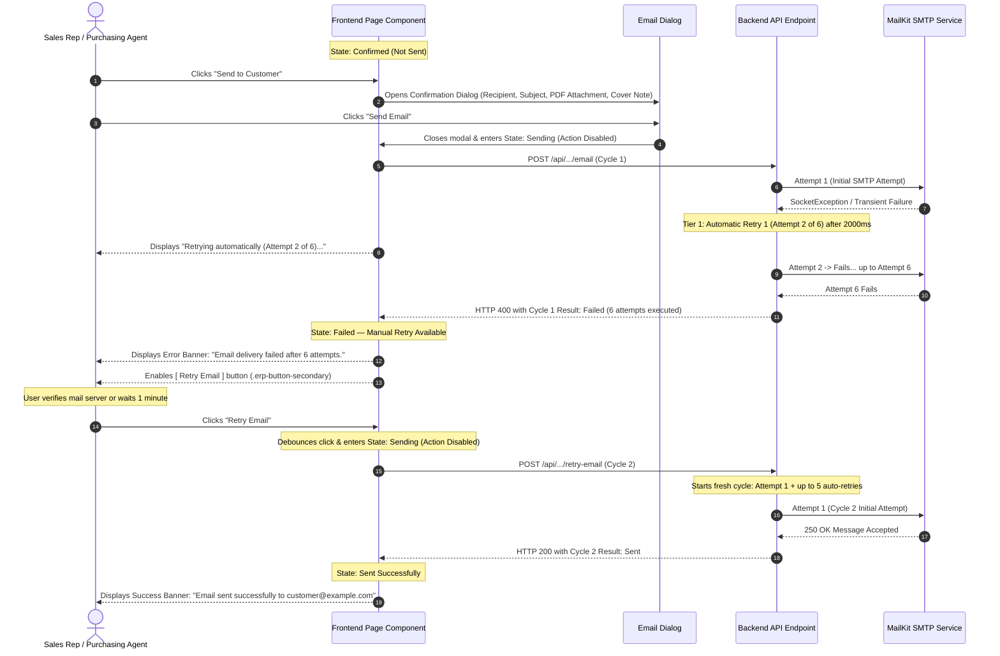

# ApexERP — Frontend UI Standards & Design System Reference

**Document Version:** 1.2.0  
**Status:** Approved Reference Standard (Based on Inspection of Sales Order & Purchase Order)  
**Target Project:** `Frontend/Web` (Angular 18+, TypeScript, Fluent-Inspired SCSS Tokens)  
**Design Direction:** Clean Enterprise Fluent-Inspired UI — **No New PrimeNG Components**  
**Related Documents:**
- [Sales-Quotation-Workflow.md](file:///z:/ERP/Sales-Quotation-Workflow.md)
- [Shared-Email-Retry-Architecture.md](file:///z:/ERP/Shared-Email-Retry-Architecture.md)
- [Web Agent Instructions](file:///z:/ERP/Frontend/Web/AGENTS.md)
- [Root Agent Instructions](file:///z:/ERP/AGENTS.md)

---

## 1. Inspection Scope & Reference Screens

This standard is established by thoroughly inspecting active production-grade transaction screens across two core enterprise modules: **Sales Order** and **Purchase Order**.

### 1.1 Primary Reference Files Inspected

| Category | Sales Order (Primary Design Pattern) | Purchase Order (Comparative Implementation) |
|---|---|---|
| **List / Register Component** | [sales-order-register.component.ts](file:///z:/ERP/Frontend/Web/src/app/features/domain/workspace/sales/sales-order-register.component.ts)<br>[sales-order-register.component.html](file:///z:/ERP/Frontend/Web/src/app/features/domain/workspace/sales/sales-order-register.component.html)<br>[sales-order-register.component.scss](file:///z:/ERP/Frontend/Web/src/app/features/domain/workspace/sales/sales-order-register.component.scss) | [purchase-order.component.ts](file:///z:/ERP/Frontend/Web/src/app/features/domain/workspace/procurement/purchase-order.component.ts)<br>[purchase-order.component.html](file:///z:/ERP/Frontend/Web/src/app/features/domain/workspace/procurement/purchase-order.component.html)<br>[purchase-order.component.scss](file:///z:/ERP/Frontend/Web/src/app/features/domain/workspace/procurement/purchase-order.component.scss) |
| **Create / Edit / Detail Page** | [sales-order-page.component.ts](file:///z:/ERP/Frontend/Web/src/app/features/domain/workspace/sales/sales-order-page.component.ts)<br>[sales-order-page.component.html](file:///z:/ERP/Frontend/Web/src/app/features/domain/workspace/sales/sales-order-page.component.html)<br>[sales-order-page.component.scss](file:///z:/ERP/Frontend/Web/src/app/features/domain/workspace/sales/sales-order-page.component.scss) | [purchase-order-page.component.ts](file:///z:/ERP/Frontend/Web/src/app/features/domain/workspace/procurement/purchase-order-page.component.ts)<br>[purchase-order-page.component.html](file:///z:/ERP/Frontend/Web/src/app/features/domain/workspace/procurement/purchase-order-page.component.html)<br>[purchase-order-page.component.scss](file:///z:/ERP/Frontend/Web/src/app/features/domain/workspace/procurement/purchase-order-page.component.scss) |
| **Core Shared Components** | [page-header.component.ts](file:///z:/ERP/Frontend/Web/src/app/shared/components/page-header/page-header.component.ts)<br>[data-table.component.ts](file:///z:/ERP/Frontend/Web/src/app/shared/components/data-table/data-table.component.ts)<br>[editable-data-table.component.ts](file:///z:/ERP/Frontend/Web/src/app/shared/components/data-table/editable-data-table.component.ts)<br>[reactive-form.component.ts](file:///z:/ERP/Frontend/Web/src/app/shared/components/forms/reactive-form.component.ts)<br>[confirmation-dialog.component.ts](file:///z:/ERP/Frontend/Web/src/app/shared/components/confirmation-dialog/confirmation-dialog.component.ts)<br>[status-badge.component.ts](file:///z:/ERP/Frontend/Web/src/app/shared/components/status-badge/status-badge.component.ts) |
| **Global Theme & Token Definitions** | [_tokens.scss](file:///z:/ERP/Frontend/Web/src/styles/_tokens.scss)<br>[_themes.scss](file:///z:/ERP/Frontend/Web/src/styles/_themes.scss)<br>[_layout.scss](file:///z:/ERP/Frontend/Web/src/styles/_layout.scss)<br>[_mixins.scss](file:///z:/ERP/Frontend/Web/src/styles/_mixins.scss) |

---

## 2. Comparative Analysis: Sales Order vs. Purchase Order

Inspection highlights significant convergence in layout and data architecture, alongside notable implementation variances:

```
┌─────────────────────────────────┐       ┌─────────────────────────────────┐
│     Sales Order Architecture    │       │   Purchase Order Architecture   │
├─────────────────────────────────┤       ├─────────────────────────────────┤
│ • Uses native .erp-button       │       │ • Uses <p-button> (PrimeNG)     │
│   (Zero PrimeNG button markup)  │       │ • Uses PrimeNG Dialog modules   │
│ • Actions grouped in Page Footer│       │ • Actions placed in Page Header │
│ • Strict 4-step card layout     │       │ • Tabbed & stepped routing      │
│ • Clean signal & OnPush models  │       │ • Rich PDF preview iframe modal │
│ • No PDF preview or Email dialog│       │ • Dedicated Send to Supplier UI │
└─────────────────────────────────┘       └─────────────────────────────────┘
                                   ▼
          ┌────────────────────────────────────────────────┐
          │      Unified ApexERP Standard Recommendation   │
          ├────────────────────────────────────────────────┤
          │ 1. Mandate Sales Order native .erp-button      │
          │    tokens to strictly enforce the PrimeNG      │
          │    inspection-only rule (No new PrimeNG).      │
          │ 2. Adopt Purchase Order PDF preview & manual   │
          │    Email dispatch dialog patterns.             │
          │ 3. Adopt Sales Order 4-step card form layout   │
          │    with sticky footer action bar.              │
          │ 4. Standardize on shared AppDataTable &        │
          │    AppEditableDataTable across all modules.    │
          │ 5. Implement standard multi-cycle email retry  │
          │    UI with visible auto-retry progress.        │
          └────────────────────────────────────────────────┘
```

### 2.1 Detailed Evaluation Matrix

| UI / Architecture Concern | Sales Order Implementation | Purchase Order Implementation | Winner & Recommended Standard |
|---|---|---|---|
| **Design Token Adherence** | High. Implements `.erp-button`, `.erp-card`, and CSS variables directly. | Medium. Mixes custom SCSS with PrimeNG component styling. | **Sales Order:** Complies strictly with Frontend `AGENTS.md` (PrimeNG inspection-only policy). |
| **Action Button Placement** | Grouped in the sticky footer card alongside totals summary. Secondary refresh/back in header. | Distributed in the page header actions bar (Refresh, Amend, Submit, Approve, Reject, PDF, Email). | **Sales Order (with PO header balance):** Footer for commercial mutation actions (Save, Submit); Header for navigation and view toggles. |
| **Document State Management** | Angular 18 signals (`signal`, `computed`) + `ChangeDetectionStrategy.OnPush`. | Signals + RxJS Subjects + OnPush. | **Sales Order:** Modern, clean, and decoupled signal architecture. |
| **Line Items Entry** | `AppEditableDataTableComponent` with inline validation and calculations. | `AppEditableDataTableComponent` with lookup integration. | **Both (Consistent):** Excellent pattern; fully reusable for Quotation. |
| **PDF Document Preview** | Not implemented. | Sanitized iframe modal rendering temporary Blob URL. | **Purchase Order:** Best-in-class pattern to adopt for Sales Quotation. |
| **Email Dispatch Dialog** | Not implemented. | Confirmation modal with recipient, subject, and attachment summary. | **Purchase Order:** Essential pattern for controlled manual email sending. |
| **Confirmation / Rejection Dialogs** | `ConfirmationDialogComponent` with remarks textarea. | `ConfirmationDialogComponent` with remarks textarea. | **Both (Identical):** Reusable standard for all rejection and cancellation actions. |

---

## 3. The ApexERP Frontend Standard Specification

### 3.1 Design Direction & Policy: No New PrimeNG Components
ApexERP mandates a **Clean Enterprise Fluent-Inspired UI**. In compliance with [Frontend/Web/AGENTS.md](file:///z:/ERP/Frontend/Web/AGENTS.md):
- **PrimeNG Inspection-Only Policy:** PrimeNG packages currently present in the solution may be inspected to understand legacy screens, but **no new PrimeNG components may be introduced**.
- **Do not import** `ButtonModule`, `DialogModule`, `InputTextModule`, or other PrimeNG modules in new feature components.
- Use native HTML elements styled with Fluent design tokens (`.erp-button`, `.erp-card`, `.p-inputtext` utility classes, CSS custom properties).

---

### 3.2 Design System Tokens & Typography

All new screens must consume CSS custom properties defined in `_tokens.scss` and `_themes.scss`. **Hardcoding hex codes or pixel margins in component CSS is strictly prohibited.**

#### Core Invariant Tokens

```scss
// Spacing Grid (4px base)
--erp-space-1: 4px;
--erp-space-2: 8px;
--erp-space-3: 12px;
--erp-space-4: 16px;
--erp-space-5: 20px;
--erp-space-6: 24px;
--erp-space-8: 32px;

// Radii
--erp-radius-sm: 4px;   // Buttons, inputs
--erp-radius-md: 6px;   // Cards, banners, dialogs
--erp-radius-lg: 8px;   // Major container panels
--erp-radius-pill: 9999px; // Badges, filter pills

// Typography Stack
--erp-font-sans: 'Segoe UI', 'Inter', -apple-system, BlinkMacSystemFont, 'Roboto', sans-serif;
--erp-font-mono: 'Cascadia Code', 'Fira Code', Consolas, monospace;
```

#### Theme Palette Tokens (Light vs. Dark Mode)

| CSS Variable | Light Mode (Default) | Dark Mode (`.theme-fluent-dark`) | Purpose |
|---|---|---|---|
| `--erp-primary` | `#0f6cbd` | `#2886de` | Primary actions, active highlights |
| `--erp-primary-hover` | `#115ea3` | `#479ef5` | Hover state for primary buttons |
| `--erp-bg-app` | `#f8fafc` | `#0f172a` | Full page viewport background |
| `--erp-bg-surface` | `#ffffff` | `#1e293b` | Cards, table containers, dialogs |
| `--erp-border` | `#e2e8f0` | `#334155` | Card borders, table dividers |
| `--erp-text-main` | `#0f172a` | `#f8fafc` | Headings, primary table text, inputs |
| `--erp-text-secondary` | `#475569` | `#cbd5e1` | Labels, table subtext |
| `--erp-text-muted` | `#64748b` | `#94a3b8` | Placeholders, inactive captions |
| `--erp-success` | `#107c41` | `#34d399` | Confirmed/Approved status, success |
| `--erp-warning` | `#b74700` | `#fbbf24` | Pending approval, drafts |
| `--erp-danger` | `#c42b1c` | `#f87171` | Cancelled/Rejected, validation errors |

---

### 3.3 List-Screen Standards

List screens (e.g., `sales-order-register`, `quotation-register`) provide high-density search, filtering, and transaction navigation.

```
┌────────────────────────────────────────────────────────────────────────┐
│ Page Header: Title, Subtitle, Breadcrumbs         [Refresh] [+ Create] │
├────────────────────────────────────────────────────────────────────────┤
│ [ Notification Banner: Success / Info / Warning / Error ]              │
├────────────────────────────────────────────────────────────────────────┤
│ Controls Bar:                                                          │
│ [ Search input: SO # or Customer... ] [All] [Draft] [Submitted] [...]  │
│                                           Scope: [Company / Branch]    │
├────────────────────────────────────────────────────────────────────────┤
│ Data Table:                                                            │
│ [SO #]   [Date]   [Customer]   [Items]   [Total]   [Status]   [Actions]│
│ SO-001   Nov 18   Acme Corp    3 items   $1,200    Confirmed  [...]    │
│ SO-002   Nov 19   Global Ltd   1 item    $450      Draft      [...]    │
│                                                                        │
│ Paginator: Rows per page: [10 v]  1-10 of 42 records  [<] [1] [2] [>]  │
└────────────────────────────────────────────────────────────────────────┘
```

#### List Screen Construction Rules:
1. **Container:** Wrapped in `<div class="{module}-page">` with `max-width: 1400px; margin: 0 auto;`.
2. **Page Header:** Must consume `<app-page-header>` with `title`, `subtitle`, `breadcrumbs`, and action buttons (`Refresh` and `New {Transaction}`).
3. **Control Bar (`.table-controls-bar`):**
   - Search Box (`.search-input-box`): 280px width, leading search icon, instant signal debounce.
   - Filter Pills (`.filter-pills`): Rounded pills with active highlight (`.filter-pill.active`).
   - Scope Indicator (`.scope-info-pill`): Readonly badge displaying active operating Company and Branch.
4. **Data Table:** Consumes `<app-data-table>` with:
   - Typed `DataTableColumn[]` with `sortable: true`, custom alignment (right-align numbers/currencies).
   - `DataTableAction[]` for row-level operations (View, Edit, Cancel, Print).
   - Built-in column chooser, CSV export, and view switcher (Table/Card).
   - Pagination: Default 10 rows; options `[5, 10, 25, 50]`.
   - Clickable row navigation via `(rowClick)="navigateToView($event)"`.

---

### 3.4 Create, Edit & Detail Form Standards

Transaction forms follow a consistent **4-Step Sectional Structure** wrapped in `.erp-card` containers (reusable guideline, not a rigid wizard):

```
┌────────────────────────────────────────────────────────────────────────┐
│ Page Header: Title (e.g. Sales Quotation SQ-2026-0001)   [Back] [Reload]│
├────────────────────────────────────────────────────────────────────────┤
│ Step 1: Operating Scope Card                                           │
│ Company: [Apex Manufacturing Ltd]        Branch: [Colombo Central]     │
├────────────────────────────────────────────────────────────────────────┤
│ Step 2: Header Information Card                                        │
│ Status Banner: [ Document Status: Confirmed ]                          │
│ Reactive Form (3 Columns):                                             │
│ Customer: [ Acme Corp v ]   Date: [ 2026-11-20 ]   Expiry: [2026-12-20]│
│ Currency: [ USD       v ]   Terms:[ Net 30     ]   Ref #:  [ CUST-104 ]│
├────────────────────────────────────────────────────────────────────────┤
│ Step 3: Line Items Card                                                │
│ Editable Data Table:                                                   │
│ [Product SKU / Lookup] [UOM] [Qty] [Unit Price] [Disc %] [Tax] [Total] │
│ + Add Row                                                              │
├────────────────────────────────────────────────────────────────────────┤
│ Step 4: Summary Totals & Sticky Action Footer Card                     │
│ Subtotal: $1,000.00 | Tax: $150.00 | Total Amount: $1,150.00           │
│                                                                        │
│ [Cancel] [Preview PDF] [Send Email]          [Save Draft] [Save & Submit]
└────────────────────────────────────────────────────────────────────────┘
```

---

### 3.5 Button System & Styling Rules (Strictly No `<p-button>`)

To enforce the **PrimeNG Inspection-Only Policy**, all buttons in new feature screens must use native `<button>` tags with shared `.erp-button` CSS classes:

```html
<!-- Primary Action (Send Email, Save, Submit, Confirm) -->
<button type="button" class="erp-button erp-button-primary" [disabled]="loading()" (click)="save()">
  <i class="pi pi-check" [class.pi-spin]="loading()"></i>
  <span>Confirm Order</span>
</button>

<!-- Secondary Action (Retry Email, Refresh, Back, Draft) -->
<button type="button" class="erp-button erp-button-secondary" [disabled]="loading()" (click)="navigateBack()">
  <i class="pi pi-arrow-left"></i>
  <span>Back to List</span>
</button>

<!-- Danger Action (Cancel, Reject, Delete) -->
<button type="button" class="erp-button erp-button-danger" [disabled]="loading()" (click)="cancel()">
  <i class="pi pi-ban"></i>
  <span>Cancel Transaction</span>
</button>
```

#### Button CSS Token Definition

```scss
.erp-button {
  font-family: var(--erp-font-sans, 'Segoe UI', sans-serif);
  border-radius: var(--erp-radius-sm, 4px);
  font-size: 13px;
  font-weight: 600;
  padding: 6px 14px;
  display: inline-flex;
  align-items: center;
  justify-content: center;
  gap: 6px;
  cursor: pointer;
  border: 1px solid transparent;
  transition: all 0.15s ease-in-out;

  &:disabled {
    opacity: 0.55;
    cursor: not-allowed;
  }

  &.erp-button-primary {
    background-color: var(--erp-primary, #0f6cbd);
    border-color: var(--erp-primary, #0f6cbd);
    color: #ffffff;
    &:hover:not(:disabled) {
      background-color: var(--erp-primary-hover, #115ea3);
      border-color: var(--erp-primary-hover, #115ea3);
    }
  }

  &.erp-button-secondary {
    background-color: var(--erp-bg-secondary, #f1f5f9);
    border-color: var(--erp-border, #cbd5e1);
    color: var(--erp-text-secondary, #475569);
    &:hover:not(:disabled) {
      background-color: var(--erp-bg-hover, #e2e8f0);
      color: var(--erp-text-main, #0f172a);
    }
  }

  &.erp-button-danger {
    background-color: var(--erp-danger, #c42b1c);
    border-color: var(--erp-danger, #c42b1c);
    color: #ffffff;
    &:hover:not(:disabled) {
      background-color: #a82417;
      border-color: #a82417;
    }
  }
}
```

---

## 4. Reusable Email Delivery UI & Retry Standard

This section defines the unified frontend interaction standard for email dispatches and retries across **Sales Quotation**, **Purchase Order**, **Procurement RFQ**, and future modules.

### 4.1 Six Canonical Email Delivery States

The UI must accurately represent the state of email communication without confusing it with business document status:

```
┌─────────────────────────────────┐
│     Email Delivery UI States    │
├─────────────────────────────────┤
│ 1. Not Sent                     │  Document confirmed/ready, but no dispatch attempt made yet.
│ 2. Sending                      │  Initial SMTP connection in progress (spinner active).
│ 3. Retrying Automatically       │  Transient fault detected; showing automatic attempt X of 6.
│ 4. Sent Successfully            │  Message accepted by SMTP server (timestamp and recipient shown).
│ 5. Failed — Manual Retry Ready  │  All 6 attempts of dispatch cycle failed. "Retry Email" button enabled.
│ 6. Outcome Unknown (Ambiguous)  │  Connection dropped after DATA command before 250 OK. Review banner shown.
└─────────────────────────────────┘
```

#### Status Badge Representations

| State | Badge Label | Severity | Icon | Meaning |
|---|---|---|---|---|
| **Not Sent** | `Email: Not Sent` | `secondary` | `pi-envelope` | Ready to send. |
| **Sending** | `Email: Sending...` | `info` | `pi-spin pi-spinner` | Active request in-flight. |
| **Retrying Automatically** | `Email: Retrying (Attempt {x}/6)` | `warn` | `pi-spin pi-refresh` | Transient failure being retried by backend. |
| **Sent Successfully** | `Email: Sent` | `success` | `pi-check-circle` | Confirmed transmission. |
| **Failed — Manual Retry Available** | `Email: Failed` | `danger` | `pi-exclamation-triangle` | Cycle exhausted; manual retry available. |
| **Outcome Unknown** | `Email: Status Unknown` | `warn` | `pi-question-circle` | Possible duplicate risk; review mail logs. |

---

### 4.2 Send Email & Manual Retry Email Interaction Flows



#### 1. First Dispatch (Send Email Action)
- User explicitly clicks **Send to Customer** (or **Send to Supplier**).
- The system opens the manual email confirmation modal dialog displaying:
  - Recipient email address (defaulted from Customer/Supplier master, editable if authorized).
  - Recipient contact name.
  - Document subject line (`Sales Quotation #SQ-2026-0001 - Apex Manufacturing Ltd`).
  - Attachment badge: `Quotation_SQ-2026-0001.pdf` (with "Preview PDF" shortcut).
  - Optional cover message textarea.
- User explicitly clicks **Send Email**:
  - The dialog closes, and the action button transitions to a disabled loading state:
    `<button class="erp-button erp-button-primary" disabled><i class="pi pi-spin pi-spinner"></i><span>Sending...</span></button>`
  - Progress feedback indicates active transmission and automatic retries if transient errors occur.
  - On success: Emits a green success banner (`banner-success`), updates email badge to `Sent`, and stamps `LastEmailedAtUtc`.
  - On final failure: Emits a crimson error banner (`banner-danger`) displaying the failure reason, sets badge to `Failed`, and enables the **Retry Email** action button.

#### 2. Subsequent Manual Retry (Retry Email Action)
- When a dispatch cycle has failed, the UI presents the **Retry Email** action button:
  ```html
  <button
    type="button"
    class="erp-button erp-button-secondary"
    [disabled]="isDispatching() || !canRetryEmail()"
    (click)="retryEmailDispatch()"
    title="Initiate a new email dispatch cycle"
  >
    <i class="pi pi-refresh" [class.pi-spin]="isDispatching()"></i>
    <span>Retry Email</span>
  </button>
  ```
- Clicking **Retry Email** immediately initiates **Cycle 2**:
  - Starts a brand new dispatch cycle on the backend (1 fresh initial attempt + up to 5 automatic retries).
  - Shows the same sending spinner and auto-retry progress feedback.
  - Does **not** enter an uncontrolled infinite loop; if Cycle 2 fails, it halts after 6 attempts, keeping the failure banner visible and allowing another manual retry if appropriate.
  - Preserves previous dispatch cycle records in the audit history.

---

### 4.3 Dispatch History Presentation

When the backend exposes dispatch history, the UI renders a compact, collapsible history card (`.erp-card.dispatch-history-card`):

```html
<!-- Proposed Dispatch History Presentation Component -->
<div class="erp-card dispatch-history-card" *ngIf="dispatchHistory().length > 0">
  <div class="history-header" (click)="toggleHistory()">
    <div class="header-left">
      <i class="pi pi-history"></i>
      <span class="history-title">Email Dispatch History</span>
      <span class="cycle-count-badge">{{ dispatchHistory().length }} cycles recorded</span>
    </div>
    <i class="pi" [ngClass]="isHistoryExpanded() ? 'pi-chevron-up' : 'pi-chevron-down'"></i>
  </div>

  @if (isHistoryExpanded()) {
    <div class="history-body">
      <table class="history-table">
        <thead>
          <tr>
            <th>Cycle</th>
            <th>Initiated (UTC)</th>
            <th>Recipient</th>
            <th>Attempts</th>
            <th>Outcome</th>
            <th>Failure / Diagnostic Reason</th>
            <th>Initiated By</th>
          </tr>
        </thead>
        <tbody>
          @for (item of dispatchHistory(); track item.cycleId) {
            <tr [ngClass]="'outcome-' + item.outcome.toLowerCase()">
              <td>Cycle #{{ item.cycleNumber }}</td>
              <td>{{ item.initiatedAtUtc | date:'yyyy-MM-dd HH:mm:ss' }}</td>
              <td>{{ item.recipientAddress }}</td>
              <td>{{ item.attemptsExecuted }} / 6</td>
              <td>
                <span class="outcome-tag" [ngClass]="item.outcome === 'Sent' ? 'tag-success' : 'tag-danger'">
                  {{ item.outcome }}
                </span>
              </td>
              <td class="reason-cell" [title]="item.errorMessage || 'None'">
                {{ item.errorMessage || '—' }}
              </td>
              <td>{{ item.initiatedByName || 'System' }}</td>
            </tr>
          }
        </tbody>
      </table>
    </div>
  }
</div>
```

---

### 4.4 Debouncing & Button Safety Rules

1. **Immediate Debouncing:** The action button signal `actionInProgress.set(true)` must be set synchronously on the first click event to disable the button before the asynchronous HTTP request dispatches, preventing duplicate simultaneous requests.
2. **Accessible States:** Buttons in loading states must include `aria-busy="true"` and descriptive text.
3. **No Uncontrolled Looping:** Automatic retry is strictly limited to Tier 1 backend loops (max 5 retries); the frontend must **never** set timers to re-trigger HTTP requests automatically.

---

## 5. Sales Quotation Implementation Checklist

When implementing the Sales Quotation screens, adhere strictly to this checklist:

- [ ] **Zero PrimeNG Button Imports:** Ensure `ButtonModule` is **not** imported in `quotation-register.component.ts` or `quotation-page.component.ts`. Use native `<button class="erp-button ...">`.
- [ ] **Standalone Architecture:** Clean imports using shared components (`app-page-header`, `app-data-table`, `app-editable-data-table`, `app-status-badge`, `app-reactive-form`, `app-confirmation-dialog`).
- [ ] **Reactive Signal State:** Manage UI state via Angular signals (`signal`, `computed`, `ChangeDetectionStrategy.OnPush`).
- [ ] **4-Section Form Layout:** Implement Scope $\rightarrow$ Header $\rightarrow$ Line Items $\rightarrow$ Summary Totals & Footer Actions.
- [ ] **Two-Tier Email Dispatch UI:**
  - Send Email dialog with recipient verification and cover note.
  - Progress feedback showing auto-retry attempt count.
  - Manual **Retry Email** button enabled only when a cycle has failed.
  - Collapsible dispatch history table.
- [ ] **PDF Document Preview Modal:** Sanitized iframe rendering temporary Blob URL.
- [ ] **Sales Order Conversion UI:** "Convert to Sales Order" action button visible only on `Accepted` quotations.

---

## 6. Summary of UI Decisions & Standards

| Component / Concern | ApexERP Standard | Rule / Status |
|---|---|---|
| **UI Framework** | Angular 18+ with Fluent Tokens (`_tokens.scss`, `_themes.scss`) | Mandatory Enterprise Standard |
| **PrimeNG Usage** | **Inspection-Only Policy:** Do not introduce new PrimeNG components. | Mandatory Policy |
| **Buttons** | Native `<button>` with `.erp-button`, `.erp-button-primary`, `.erp-button-secondary`, `.erp-button-danger` | Mandatory Standard |
| **Email Dispatch** | Manual confirmation modal followed by Tier 1 auto-retry and Tier 2 manual retry | Agreed Requirement |
| **History Display** | Collapsible dispatch history table showing cycle number, attempts, outcome, and diagnostic text | Proposed Presentation Pattern |
| **Action Placement** | Footer Action Bar for commercial mutations (Save, Submit, Convert); Header for view toggles | Recommended Standard |
