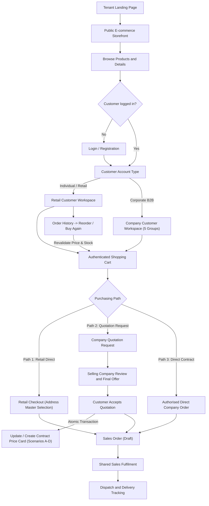

# ApexERP — E-commerce Frontend Master Plan

**Document Version:** 1.1.0  
**Status:** Architecture & Requirements Specification — Ready for Implementation  
**Date:** 2026-11-21  
**Target Repository:** `ApexERP` (`Frontend/Web`, `Backend/ERP`)  
**Related Documents:**
- [README.md](README.md) — Documentation index and reading paths
- [01-Customer-Journey-and-Workspaces.md](01-Customer-Journey-and-Workspaces.md) — Customer navigation, transitions, and route model
- [02-Ecommerce-UI-UX-Specification.md](02-Ecommerce-UI-UX-Specification.md) — Design system, tokens, and page-level wireframes
- [03-Retail-Customer-Workflow.md](03-Retail-Customer-Workflow.md) — B2C Retail shopping, cart, Retail Checkout, and Reordering
- [04-Company-Customer-Workflow.md](04-Company-Customer-Workflow.md) — B2B Company quotations, Price Card updates (Scenarios A–D), and direct orders
- [05-API-and-Backend-Integration.md](05-API-and-Backend-Integration.md) — Complete endpoint, DTO, address linking, and permission audit
- [06-Customer-Workspace-Specification.md](06-Customer-Workspace-Specification.md) — Workspace component architectures
- [07-Implementation-and-Testing-Plan.md](07-Implementation-and-Testing-Plan.md) — Standardized E1–E10 phased rollout & verification criteria

---

## 1. Executive Summary & Purpose

The **ApexERP E-commerce Frontend** delivers a modern, high-performance, enterprise-grade digital sales channel seamlessly integrated into the ApexERP Modular Monolith architecture. It bridges public digital commerce with authoritative enterprise manufacturing and distribution operations.

This document serves as the **Master Architectural Charter** for the frontend implementation. It defines:
- **System Invariants:** Foundational architectural rules that prevent technical debt, duplicate data models, and unauthorized access.
- **Identity & Scope Separation:** Strict operational distinction between **Tenant**, **Selling Company**, **Customer Company**, **Customer Contact**, and **Security User**.
- **Customer Segmentation:** Two dedicated Customer Workspaces: **Retail Customer Workspace** (B2C) and **Company Customer Workspace** (5-group B2B multi-group purchasing portal).
- **Purchasing Channels:** Three unified purchasing paths:
  1. Retail Checkout (Standard Retail Price, Customer Address Master selection, and Retail Checkout to Draft Sales Order, plus Reordering from Order History).
  2. B2B Sales Quotation Request (Customer requested prices & quantities, immutable approved proposal, and atomic conversion with Price Card creation/updating across Scenarios A–D).
  3. B2B Direct Sales Order (Authorized contract purchasing directly from assigned Sales Price Cards).
- **Customer Delivery Address Master Integration:** Delivery addresses are maintained in the Customer Address Master (`CustomerAddress` / `Address`) and linked to `SalesOrder.DeliveryAddressId`, while `SalesOrder.DeliveryAddressSnapshot` preserves historical shipping details.
- **Downstream Convergence:** Elimination of duplicate order or fulfillment aggregates by routing all confirmed customer purchasing into the existing `SalesOrder` (`Draft`) aggregate and shared warehouse fulfillment workflows.

---

## 2. Strategic System Invariants

Every component, service, guard, and state pipeline created for the E-commerce frontend must adhere strictly to the following enterprise invariants:

### Invariant 1: No Duplicate Downstream Order Aggregates `[Agreed Business Rule]`
The E-commerce application **MUST NOT** create separate database tables or independent business aggregates for online orders, online shipments, or customer invoices.
- Retail Checkout creates a standard `SalesOrder` in status `SalesOrderStatus.Draft` via `IEcommerceCartService.CheckoutAsync` / `ISalesOrderService.CreateOrderAsync`.
- Accepted Sales Quotations convert atomically into standard `SalesOrder` records in status `SalesOrderStatus.Draft` via `ISalesQuotationService.AcceptQuotationAndConvertAtomicAsync`.
- Direct B2B orders create standard `SalesOrder` records in status `SalesOrderStatus.Draft` via `IDirectCustomerOrderService.CreateDirectB2BOrderAsync`.
- Subsequent fulfillment (Picking, Packing, Dispatch, Invoicing) uses the authoritative internal ERP modules (`SalesShipment`, `SalesInvoice`, warehouse bins, and inventory movements).

### Invariant 2: Backend Authoritative Calculations & Pricing `[Agreed Business Rule]`
- The frontend client is treated as an **untrusted presentation layer**.
- The client never calculates or submits authoritative unit prices, discount rates, tax amounts, or grand totals.
- All product prices, tiered volume discounts, customer-specific contract prices (via `PriceCard`), and tax rates (via `TaxCodes`) are evaluated server-side in real-time by `IPricingResolutionService`.
- Any price or tax value passed in a client request payload is rejected or ignored.

### Invariant 3: Mandatory Authentication for Shopping Cart & Purchasing `[Agreed Business Rule]`
- Public, unauthenticated visitors may freely browse the **Tenant Landing Page**, search the **Product Catalogue**, inspect **Product Details**, and view standard public selling prices (where permitted).
- **Adding an item to the Shopping Cart strictly requires customer authentication.**
- If an unauthenticated visitor clicks "Add to Cart", the application redirects them to the Login/Registration journey, preserving the intended item SKU, quantity, and packaging selection in `returnUrl`.
- Upon successful authentication, the action is restored, the backend re-validates current price and inventory availability, and the item is persisted into the customer's authenticated cart (`EcommerceCart`).
- Unauthenticated visitors cannot view protected cart contents, submit quotation requests, or place orders.

### Invariant 4: Mandatory Price Card Maintenance on Quotation Acceptance & Selling Company Ownership `[Agreed Business Rule]`
Commercial contract pricing is governed by the authoritative relationship pattern:

$$\text{Customer} \longrightarrow \text{Customer–Selling Company Relationship} \longrightarrow \text{Assigned Sales Price Card}$$

When a Company Customer accepts a Selling Company's final Sales Quotation and the system creates the resulting Sales Order, the customer's contract Price Card assigned to that specific Customer–Selling Company relationship must also be created or updated atomically:
- **Scenario A (No existing contract Price Card for Selling Company):** Create a new customer-specific contract Price Card associated with the Customer and Selling Company. Populate it with the accepted quotation's product lines, prices, UOM, packaging, and commercial terms, and assign it to the `CustomerSellingCompany.SalesPriceCardId` (and fallback `Customer.DefaultSalesPriceCardId`).
- **Scenario B (Existing Price Card, but quoted item does not exist):** Add the new product item as a `PriceCardLine` on the relationship's assigned card with the accepted unit price, UOM, currency, and validity dates, preserving all existing lines.
- **Scenario C (Existing Price Card and matching product item):** Update the matching line on the relationship's card by expiring the existing line (`EffectiveTo = now`) and creating an active new line with the accepted quotation price and terms, avoiding duplicate lines and preserving unrelated entries.
- **Scenario D (Multiple Selling Companies / Price Cards):** Price Cards are strictly partitioned by Customer–Selling Company relationship. Accepting a quotation from Selling Company X updates ONLY Card X for Selling Company X. Selling Company Y's card (Card Y) and any other customer's card remain completely untouched and isolated.
- **Atomicity & Audit:** Quotation acceptance, Sales Order creation, and Price Card creation/updating execute within a single atomic database transaction. If any step fails, the entire transaction is rolled back.
- **Fallback Compatibility:** `Customer.DefaultSalesPriceCardId` is preserved as a tenant-level default fallback for single-company operations and backward compatibility.

### Invariant 5: Retail Customer Reordering Without Modifying Historical Records `[Agreed Business Rule]`
- Retail customers can reorder products from historical Sales Orders via **"Reorder" / "Buy Again"**.
- Reordering **NEVER** reopens or modifies the original Sales Order. A brand-new `SalesOrder` (`Draft`) is generated with a new unique reference.
- Old prices are never reused as authoritative prices; current prices, tax rates, and inventory availability are revalidated by the backend.
- Discontinued or inactive items are identified and excluded or flagged for removal.

### Invariant 6: Rigid Separation of the Five Core Identities `[Agreed Business Rule]`

```
┌─────────────────────────────────────────────────────────────────────────────┐
│ 1. Tenant (Cloud Subscriber / Multi-tenant Partition)                       │
│    Entity: Tenant in SaaSDbContext (TenantId)                               │
│    Role: Enforces strict data isolation. Owns DNS host subdomains.          │
├─────────────────────────────────────────────────────────────────────────────┤
│ 2. Selling Company (Internal Operational Subsidiary / Legal Seller)         │
│    Entity: Company in DomainDbContext (CompanyId)                           │
│    Role: Legal entity issuing quotations and fulfilling orders.             │
│    Note: A Tenant may operate MULTIPLE independent Selling Companies!       │
├─────────────────────────────────────────────────────────────────────────────┤
│ 3. Customer Company (External Commercial Corporate Buyer)                   │
│    Entity: Customer in DomainDbContext (CustomerId)                         │
│    Role: Contracting B2B commercial entity. Linked to Selling Companies via │
│    CustomerSellingCompany, holding relationship-assigned contract Price Cards│
├─────────────────────────────────────────────────────────────────────────────┤
│ 4. Customer Contact (Human Actor / Contact Identity)                        │
│    Entity: Contact in DomainDbContext (ContactId); CustomerContact link     │
│    Role: Human contact profile with notification email and phone.           │
├─────────────────────────────────────────────────────────────────────────────┤
│ 5. Security User (Login Identity & Credentials)                             │
│    Entity: User in SecurityDbContext (UserId); Username, PasswordHash       │
│    Role: Governs authentication and token claims. Completely separated      │
│    from master data contacts (no login fields on Customer/Supplier).        │
└─────────────────────────────────────────────────────────────────────────────┘
```

### Invariant 7: PrimeNG Inspection-Only Policy `[Agreed Business Rule]`
In compliance with [Frontend/Web/AGENTS.md](file:///z:/ERP/Frontend/Web/AGENTS.md) and [ApexERP-Frontend-UI-Standards.md](file:///z:/ERP/ApexERP-Frontend-UI-Standards.md):
- **No new PrimeNG component imports** may be introduced into the project.
- Use native HTML5 elements styled with Fluent-inspired design tokens (`.erp-button`, `.erp-card`, `.erp-table`, CSS custom variables).
- Reuse existing shared components: `PageHeaderComponent`, `DataTableComponent`, `EditableDataTableComponent`, `StatusBadgeComponent`, `ConfirmationDialogComponent`, `LookupDropdownComponent`, `EmptyStateComponent`, `LoadingStateComponent`, and `ErrorStateComponent`.

---

## 3. High-Level Master Customer Journey



---

## 4. Standardized Implementation Roadmap (Phases E1–E10)

The implementation sequence is strictly standardized across all documentation:

- **E1 — Existing System Audit and API Contract Verification:** Baseline verification of existing controllers, routes, DTOs, and documented gaps. No UI coding before E1 review.
- **E2 — Shared Customer Portal Foundation:** Shared customer layouts, guards (`workspaceGuard`), error states, and responsive navigation shells.
- **E3 — Public Tenant Landing Page and Storefront:** Tenant branding, categories, search, filtering, product detail views, and unauthenticated browsing.
- **E4 — Customer Authentication and Registration:** Dual registration (Individual vs Company), customer JWT parsing, role routing, and return URL cart action restoration.
- **E5 — Authenticated Shopping Cart:** Server-side pricing resolution, cart persistence, line editing, and session-to-customer merging.
- **E6 — Retail Customer Workspace & Retail Checkout (Including Reorder):** Retail dashboard, order history, address master selection, Retail Checkout, and **Reorder from Order History**.
- **E7 — Company Customer Workspace & 5-Group Navigation:** 5 navigation groups (Dashboard, Purchasing, Orders & Fulfilment, Finance, Company Administration), and Selling Company context switcher.
- **E8 — Company Sales Quotation Workflow & Price Card Maintenance:** Quotation requests, cloning, formal PDF preview, proposal immutability, atomic acceptance, and **Price Card creation/updating (Scenarios A–D)**.
- **E9 — Direct Company Contract Ordering:** Contract ordering against assigned Price Cards, MOQ enforcement, and customer PO management.
- **E10 — Integrated End-to-End Regression and Security Testing:** 24 comprehensive QA scenarios verifying multi-tenancy, permission enforcement, address preservation, and atomic rollbacks.

---

## 5. Master Frontend Component Hierarchy

```
src/app/
├── features/
│   ├── storefront/                                  # Public Storefront Feature Module
│   │   ├── storefront.routes.ts                    # Public storefront routes
│   │   ├── landing/                                # Tenant Landing Page
│   │   ├── catalog/                                # Public Product Catalogue & Filters
│   │   ├── detail/                                 # Product Detail Page
│   │   └── cart/                                   # Authenticated Shopping Cart
│   │
│   └── domain/customer-portal/                      # Customer Portal Feature Module
│       ├── customer-portal.routes.ts               # Customer workspace routes
│       ├── layout/                                 # Customer Portal Shell Layout
│       │
│       ├── retail/                                 # Retail Customer Workspace (B2C)
│       │   ├── retail-dashboard.component.ts       # Orders summary, active shipments
│       │   ├── retail-orders.component.ts          # Order history register with "Buy Again"
│       │   ├── retail-order-detail.component.ts    # Order details, lines, fulfillment tracker
│       │   ├── retail-checkout.component.ts        # Retail Checkout: Address Master selection
│       │   └── retail-profile.component.ts         # Personal details, addresses, password
│       │
│       └── company/                                # Company Customer Workspace (5 Groups)
│           ├── dashboard/                          # 1. Dashboard
│           │   └── company-dashboard.component.ts  # KPIs, recent transactions, dispatch tracker
│           ├── purchasing/                         # 2. Purchasing
│           │   ├── company-catalog.component.ts    # Selling-company catalogue & contract prices
│           │   ├── quotation-request.component.ts  # Quotation request form & cloning
│           │   ├── quotation-register.component.ts # Quotation register (Awaiting Acceptance, etc.)
│           │   ├── quotation-review.component.ts   # Final offer review, PDF embed, Accept/Decline
│           │   ├── direct-order.component.ts       # Direct order entry from contract Price Card
│           │   └── direct-order-history.component.ts
│           ├── orders/                             # 3. Orders & Fulfilment
│           │   ├── company-orders.component.ts     # Corporate Sales Orders register
│           │   ├── company-order-detail.component.ts # Order lines, totals, 8-stage tracker
│           │   └── dispatch-tracking.component.ts  # Waybill, carrier, milestones
│           ├── finance/                            # 4. Finance
│           │   └── company-invoices.component.ts   # Invoices, balance due, payment status
│           └── management/                         # 5. Company Administration
│               ├── company-profile.component.ts    # Corporate master data, tax registration
│               ├── company-users.component.ts      # Authorized contacts roster
│               ├── user-permissions.component.ts   # Authority delegation (Admin only)
│               ├── delivery-locations.component.ts # Customer delivery address master
│               └── selling-companies.component.ts  # Selling company relationships
```

## Unified Customer Workspace Invariant

**Invariant 8: Single Shared Customer Workspace** – Retail and Company customers must use one common workspace foundation (`CustomerWorkspaceLayoutComponent`). The workspace retains access to the public E‑commerce storefront and authenticated Shopping Cart after login. Navigation, order history, order detail, tracking, invoice and payment views are shared components, with role‑based visibility gating specific purchasing actions (Retail Checkout, Quotation Request, Direct B2B Order). This ensures consistent UI/UX, eliminates duplicate aggregates, and enforces permission‑based access via `roleGuard` and `permissionGuard`.

**Invariant 9: Convergent SalesOrder Lifecycle** – Regardless of the purchasing route (Retail Checkout, Quotation Acceptance, Direct B2B Order, Reorder, or Reuse Quotation), a **single `SalesOrder` aggregate** is created in `Draft` status and proceeds through the existing warehouse fulfilment pipeline (`SalesShipment`, Dispatch Note, Delivery, `SalesInvoice`, Payment). No separate Retail or B2B order aggregates are introduced.

**Invariant 10: Current Pricing & Price Card Validation** – All order creation paths validate pricing server‑side using `PricingResolutionService`. Retail uses `Product.SellingPrice`; Company customers resolve prices from the active `CustomerSellingCompany.SalesPriceCardId`, falling back only to `Customer.DefaultSalesPriceCardId` in single‑company scenarios. Historical prices are never reused.

**Invariant 11: Notification Integration** – Order‑related events trigger the existing `NotificationService` to push workspace notifications and email alerts (Quotation Request Submitted, Quotation Issued, Quotation Accepted, SalesOrder Created, Dispatch Prepared, Dispatch Completed, Invoice Issued, Payment Received). No new notification infrastructure is introduced.

---