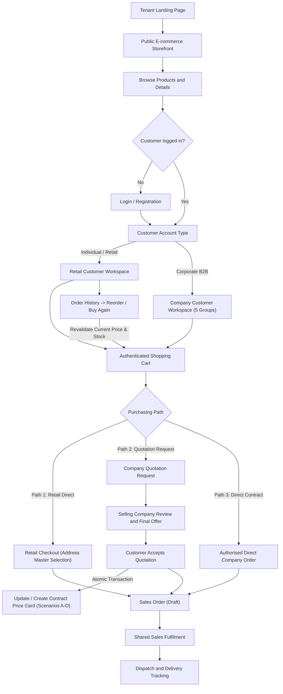
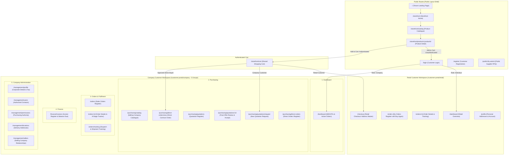

# ApexERP — Customer Journey, Workspaces & Route Architecture

**Document Version:** 1.4.0  
**Status:** Architecture & Requirements Specification — Tenant Landing Page & Dynamic Storefront Completed, Customer Registration & Workspaces Milestone Active  
**Date:** 2026-11-22  
**Target Repository:** `ApexERP` (`Frontend/Web`, `Backend/ERP`)  
**Preceding Milestones:**  
- Milestone 1 — Tenant Subdomain Public Landing Page (Completed & Verified)  
- Milestone 2 — Dynamic E-commerce Storefront & Product Catalogue (Completed & Verified)  
**Active Milestone:** Milestone 3 — Customer Registration & Retail/Organisation Workspaces (Phase E4)  
**Related Documents:**
- [README.md](README.md) — Documentation index and reading paths
- [00-Ecommerce-Frontend-Master-Plan.md](00-Ecommerce-Frontend-Master-Plan.md) — Master architectural charter and invariants
- [02-Ecommerce-UI-UX-Specification.md](02-Ecommerce-UI-UX-Specification.md) — Design system, tokens, and page wireframes
- [03-Retail-Customer-Workflow.md](03-Retail-Customer-Workflow.md) — Retail purchasing path, Retail Checkout, and Reordering
- [04-Company-Customer-Workflow.md](04-Company-Customer-Workflow.md) — B2B Company quotations, Price Card maintenance, and direct orders
- [05-API-and-Backend-Integration.md](05-API-and-Backend-Integration.md) — Complete endpoint, DTO, address linking, and permission audit
- [06-Customer-Workspace-Specification.md](06-Customer-Workspace-Specification.md) — Workspace component architectures
- [07-Implementation-and-Testing-Plan.md](07-Implementation-and-Testing-Plan.md) — Standardized E1–E10 implementation phases & QA tests

---

## 0. Milestone Progression & Current Status

| Milestone | Scope & Deliverables | Status | Version |
|---|---|:---:|---|
| **Milestone 1** | **Tenant Subdomain Public Landing Page:** Layout header with middle navigation, 7 standard corporate sections, macOS 3-dot visual card, and tenant corporate footer. | **COMPLETED** | v1.2.0 |
| **Milestone 2** | **Dynamic E-commerce Storefront & Product Catalogue:** Dynamic product listing, category filtering, search, product detail navigation (`/storefront/products/:productId`), safe idempotent product publication backfill, and shared common login with account-type routing. | **COMPLETED** | v1.3.0 |
| **Milestone 3 (Active)** | **Customer Registration & Retail/Organisation Workspaces:** Customer Registration for Individual and Organisation accounts, common authentication reuse, shared Customer Workspace shell, separate Retail and Organisation navigation, and workspace permission isolation. | **ACTIVE** | v1.3.0 |
| **Milestone 4 (Future)** | **Authenticated Shopping Cart & Retail Checkout:** Persistent cart session, item mutations, server-side pricing, Address Master selection, order submission. | PLANNED | Phase E5–E6 |
| **Milestone 5 (Future)** | **Company Customer Quotations & Direct B2B Purchasing:** 5 navigation groups, RFQ quotations, Price Card agreements, direct orders. | PLANNED | Phase E7–E9 |

---

## 1. Master Customer Journey Flow

The complete customer lifecycle starts at the tenant's public web presence, branches into public exploration, enforces authentication boundaries before commercial staging, routes to the appropriate customer workspace, and converges into the unified sales fulfillment engine.

---

## 2. Transition-by-Transition Journey Specification

Every step in the customer lifecycle has a clearly defined trigger, UI component, route, backend API endpoint, DTO contract, and permission scope:

### Transition T1: Tenant Subdomain Landing Page &rarr; Navigation Destinations & Public Storefront
- **Trigger:** Visitor navigates to the tenant subdomain root (`/` on `abc.apexerp.com`, `nova.192.168.1.65.nip.io:4200`, `retail.localhost:4200`) or clicks header navigation links (`Home`, `Products`, `About Us`, `Services`, `Suppliers`, `Contact Us`).
- **Source Component:** `HomeComponent` (Tenant Corporate View via `PublicLayoutComponent`, route: `/`).
- **Target Destinations:**
  - `Products` / "Explore Products" CTA &rarr; `ProductCatalogComponent` (route: `/storefront/catalog` or anchor `#products`).
  - `Suppliers` / "Become a Supplier" CTA &rarr; `PublicRfqSubmitComponent` (route: `/public/rfq-submit` or anchor `#suppliers`).
  - `Sign In` &rarr; `LoginComponent` (route: `/login`).
  - `Register` &rarr; `RegisterComponent` (route: `/register` with Customer tabs).
- **Backend API:**
  - `GET /Tenant/context` (via `TenantContextService`) for dynamic branding, structure, and e-commerce flags.
  - `GET /api/ecommerce/catalogue/{companyId}/products` (via `EcommerceCatalogueController`) for curated featured products and categories.
  - `GET /api/company` / Address Master for corporate physical address, phone, and inquiry channels.
- **DTOs:** `TenantContextDto`, `PublicEcommerceProductDto`.
- **Permission:** Anonymous public access (`[AllowAnonymous]`).
- **Context Preserved:** Resolved `TenantId` from hostname and default active Selling `CompanyId`.

### Transition T2: Storefront Browsing &rarr; Product Details
- **Trigger:** Visitor clicks on a specific product card in the catalogue grid.
- **Source Component:** `ProductCardComponent` / `ProductCatalogComponent`.
- **Target Component:** `ProductDetailComponent` (route: `/storefront/products/:productId`).
- **Backend API:** `GET /api/ecommerce/catalogue/{companyId}/products/{productId}`.
- **DTOs:** Returns `PublicEcommerceProductDto`.
- **Permission:** Anonymous public access (`[AllowAnonymous]`).
- **Context Preserved:** `TenantId`, `CompanyId`, `ProductId`.

### Transition T3: Unauthenticated "Add to Cart" &rarr; Login / Registration Interception
- **Trigger:** An unauthenticated visitor clicks "Add to Cart" or "Request Quotation" on a product card or product detail page.
- **Enforcement Rule:** Cart mutations strictly require authenticated customer identity.
- **Application Action:**
  1. Capture intended action payload: `{ productId, quantity, unitOfMeasureId, productPackagingId, action: 'add-to-cart' }`.
  2. Encode state into URL query parameter or temporary browser session storage (`apex_pending_cart_action`).
  3. Redirect user to `/login` with `returnUrl=/storefront/products/{productId}?resumeAction=true`.
- **Target Component:** `LoginComponent` (route: `/login`) or `CustomerRegisterComponent` (route: `/register` or `/customer-register`).
- **Permission:** Anonymous access.

### Transition T3B: Customer Registration (Individual Retail vs Organisation B2B)
- **Trigger:** Visitor clicks "Register" or "Create Customer Account" from the tenant header, storefront, product detail page, or login page.
- **Source Component:** `PublicLayoutComponent`, `StorefrontComponent`, `ProductDetailComponent`, or `LoginComponent`.
- **Target Component:** `CustomerRegisterComponent` (route: `/register` on tenant domain or `/customer-register`).
- **Account Types & Data Specifications:**
  1. **Individual / Retail Customer (`CUSTOMER_INDIVIDUAL`):**
     - **Target Entities Created:**
       - `Customer` Master (`CustomerCode: CUST-IND-*`, `CustomerName: First Last`, `DefaultSalesPriceCardId = null`).
       - `Contact` in `DomainDbContext` (`ContactId = userId`, `FirstName`, `LastName`, `Email`, `Mobile`, `JobTitle = "Individual Customer"`).
       - `CustomerContact` linking `CustomerId` and `ContactId` (`IsPrimary = true`, `IsActive = true`).
       - `User` in `SecurityDbContext` (`Id = userId`, `Username = normalizedEmail`, `Email = normalizedEmail`, `TenantId = tenantId`, `IsActive = true`).
       - `UserRole` assigning role `CUSTOMER_INDIVIDUAL`.
     - **Fields:** First Name, Last Name, Email Address (unique login username), Mobile Number, Delivery Address (Line 1, Line 2, City, Postal Code, Country), Password and Confirm Password.
     - **Submission API:** `POST /api/portal/auth/register-individual` (`RegisterIndividualCustomerRequest`).
     - **Validation:** Server-side unique email check per tenant, password confirmation match, mandatory names and address.
     - **Activation Policy:** Immediate login permitted (`user.IsActive = true`, Phase 1 email verification deferred). Zero tenant or selling company records created.
     - **Customer Classification:** Customer Master currently lacks an explicit `CustomerType` column; distinction relies on the `CUST-IND-*` code prefix and assigned `CUSTOMER_INDIVIDUAL` security role. Invariant 12 prescribes adding `CustomerType.RetailIndividual` to `Customer` master.
  2. **Organisation / Company Customer (`CUSTOMER_COMPANY_ADMIN`):**
     - **Target Entities Created:**
       - `Customer` Master (Company record with deduplication check; `CustomerCode: CUST-*`, `CustomerName = CompanyName`).
       - `Contact` in `DomainDbContext` (`ContactId = userId`, `FirstName = ContactPersonName`, `Email = BusinessEmail`, `JobTitle = JobTitle`).
       - `CustomerContact` linking `CustomerId` and `ContactId` (`IsPrimary = true`, `IsActive = true`).
       - `User` in `SecurityDbContext` (`Id = userId`, `Username = normalizedBusinessEmail`, `Email = normalizedBusinessEmail`, `TenantId = tenantId`, `IsActive = true`).
       - `UserRole` assigning role `CUSTOMER_COMPANY_ADMIN`.
     - **Fields:** Organisation Legal Name, Trading Name, Company Reg / Tax Number, Company Email & Phone, Business Address (Line 1, Line 2, City, Postal Code, Country), Contact Person Full Name, Job Title, Business Email (unique login username), Mobile Number, Password and Confirm Password.
     - **Submission API:** `POST /api/portal/auth/register` / `register-company` (`RegisterCompanyCustomerRequest`).
     - **Deduplication Engine:** Evaluates existing customer entities via `ICustomerDeduplicationService` (matching Company Name, Tax Number, or Corporate Email).
       - *New Company Path:* If no match, provisions a new `Customer` master record with the requested business address.
       - *Existing Company Path:* If matched, links the new user's contact record to the existing `Customer` via `CustomerContact` and returns `RequiresAuthorization = true`.
     - **Governance & Security Discrepancy Note:** In the current backend implementation, both paths set `user.IsActive = true` immediately and assign role `CUSTOMER_COMPANY_ADMIN`. If a registrant matches an existing corporate customer, granting immediate active administrative access without prior verification presents a significant corporate data isolation risk. The approved enterprise invariant requires that matched corporate accounts enter a **Pending Verification / Approval** status (`RequiresAuthorization = true`), blocking quotation acceptance, credit terms, and order placement until confirmed by an existing authorized company admin or tenant administrator.
     - **Login Email vs Corporate Email Separation:**
       - `User.Email` / `User.Username`: The registrant's personal business email, serving strictly as the login credential in `SecurityDbContext`.
       - `Customer.Email`: The corporate enterprise email (e.g. `billing@company.com`) stored on `Customer` master in `DomainDbContext`.
       - `Contact.Email`: The personal contact notification email stored on `Contact` in `DomainDbContext`.
- **Post-Registration Journey:**
  - Displays registration success card. If `RequiresAuthorization` is true, displays a prominent notice: *"Your registration has been linked to an existing corporate account and is awaiting administrative verification before full purchasing features are enabled."*
  - Automatically redirects to `/login` or designated Customer Workspace (`/customer-portal/retail` or `/customer-portal/company`) preserving any pending `returnUrl` or cart actions.

### Transition T4: Common Shared Authentication &rarr; Account Type Resolution & Authorized Routing
- **Trigger:** User submits credentials at the shared common `/login` entry point (or completes self-registration).
- **Architecture Invariant:** The public tenant website, storefront, and authenticated workspaces share a single common login entry point. No separate or redundant login systems are maintained for different account types.
- **Backend API:** `POST /Security/login` (or `POST /api/portal/auth/login`).
- **DTOs:** `LoginRequest` &rarr; returns `LoginResponse` / `UserSession` with `roles`, `permissions`, `tenantId`, `userId`, `email`.
- **Frontend Evaluation (`AuthService` / `LoginComponent`):**
  - **Account Type Resolution:**
    - If user holds `CUSTOMER_INDIVIDUAL`: User is resolved as an Individual/Retail buyer &rarr; routed to Retail Customer Workspace (`/customer-portal/retail/dashboard`).
    - If user holds `CUSTOMER_COMPANY_ADMIN` (or corporate portal roles): User is resolved as a Corporate B2B buyer &rarr; routed to Company Customer Workspace (`/customer-portal/company/dashboard`).
    - If user holds `Tenant Admin`: User is an authorized tenant administrator &rarr; routed to internal ERP `/app/dashboard`.
    - If user holds `Tenant User`, `Branch User`, or operational employee roles: User is an internal ERP operational staff member &rarr; routed to `/app/dashboard`.
    - If user holds `Platform Admin` or `Platform Staff`: Routed to `/platform-admin` or `/platform-staff` respectively.
  - **Enforcement & Guard Invariant:** Workspace isolation is strictly enforced via `workspaceGuard` and `roleGuard`. External customer accounts are strictly blocked from internal `/app/*` operational workspaces, while operational employees cannot access customer portal workspaces unless assigned the corresponding customer role.
  - **Context Resolution & Identity Decoupling (`CurrentCustomerContext`):**
    - The backend `CurrentCustomerContext` evaluates the authenticated caller's identity:
      1. Resolves `TenantId` from the caller's JWT claim.
      2. Resolves `UserId` from caller claims.
      3. Queries `CustomerContact` where `TenantId == callerTenantId && ContactId == callerUserId && IsActive`.
    - *Identified Architecture Gap:* The existing query assumes `ContactId == UserId`. While `CustomerRegistrationService` creates both with identical GUIDs, contacts created via internal ERP master data (`CustomerService`) have independent `ContactId` values. The context resolution service must fall back to matching `Contact.Email == User.Email` to ensure internal-created customer contacts can log in and access their customer workspace reliably.
- **Resume Action Handling:**
  - If `resumeAction` exists and `returnUrl` is preserved: Post the preserved payload to `POST /api/ecommerce/cart/items?companyId={companyId}` using `AddToCartRequest`.
  - Backend re-validates current price and stock availability server-side.
  - Navigate directly to `/storefront/cart`.

### Transition T5: Authenticated Shopping Cart &rarr; Purchasing Path Decision
- **Trigger:** Customer navigates to `/storefront/cart` to review staged items.
- **Component:** `CartViewComponent`.
- **Backend API:** `GET /api/ecommerce/cart?companyId={companyId}` (via `EcommerceCartController`).
- **DTO:** Returns `CartDto` with server-calculated subtotals, tax breakdown, and item validations.
- **Purchasing Options Displayed:**
  - **Retail Customer:** "Proceed to Retail Checkout" button (navigates to Path 1: `/customer-portal/retail/checkout`).
  - **Company Customer (Quotation):** "Submit as Quotation Request" button (navigates to Path 2: `/customer-portal/company/purchasing/quotations/request`).
  - **Approved Company Customer (Direct Contract):** "Place Direct Company Order" button (available if corporate account has an assigned `PriceCard` and user holds `PORTAL_ORDER.SUBMIT` permission; navigates to Path 3: `/customer-portal/company/purchasing/direct-orders/new`).

### Transition T6A: Path 1 — Retail Checkout &rarr; Sales Order (Draft)
- **Trigger:** Retail customer selects saved address from Customer Address Master (or creates a new address), enters delivery notes, and clicks "Confirm Order".
- **Component:** `RetailCheckoutComponent` (route: `/customer-portal/retail/checkout`).
- **Backend API:** `POST /api/ecommerce/cart/checkout?companyId={companyId}`.
- **DTO:** `CheckoutRequest` (`DeliveryAddressId`, `CustomerNotes`, `RequestedDeliveryDate`) &rarr; returns `CheckoutResultDto` with `SalesOrderId`, `OrderNumber`, and `OrderStatus: Draft`.
- **Outcome:** Cart is marked `CheckedOut`. An official ERP `SalesOrder` is created in `SalesOrderStatus.Draft` linking `DeliveryAddressId` and saving `DeliveryAddressSnapshot`. User is redirected to order confirmation view (`/customer-portal/retail/orders/:id`).

### Transition T6B: Path 2 — Company Quotation Request &rarr; Final Offer &rarr; Acceptance & Price Card Maintenance
- **Trigger 1 (Submission):** Company buyer submits quotation request with requested quantities, target pricing, and technical remarks.
  - **Component:** `QuotationRequestComponent` (route: `/customer-portal/company/purchasing/quotations/request`).
  - **Backend API:** `POST /api/portal/customer/quotations/request?companyId={companyId}&branchId={branchId}`.
  - **DTO:** `CreateCustomerQuotationRequest` &rarr; returns `SalesQuotationDto` in status `Draft` / `Submitted`.
- **Selling Company Action (ERP Backend / Staff Workspace):**
  - Sales staff reviews request in internal ERP workspace (`SalesQuotationController`).
  - Adjusts line prices, adds commercial terms, applies policy discounts, attaches formal PDF, and issues quotation (`SalesQuotationStatus.Approved` / `Issued`).
  - **Immutability Invariant:** Once approved and issued, the quotation is **strictly immutable**. Neither staff nor customer can edit line prices or quantities. Any change requires a new quotation request.
- **Trigger 2 (Customer Acceptance):** Company buyer reviews formal PDF and clicks "Accept Quotation".
  - **Component:** `QuotationReviewComponent` (route: `/customer-portal/company/purchasing/quotations/:id`).
  - **Backend API:** `POST /api/portal/customer/quotations/{id}/accept`.
  - **DTO:** `AcceptQuotationRequest` (`DeliveryAddressId`, optional PO reference, and customer remarks).
  - **Permission:** Requires `PORTAL_QUOTATION.ACCEPT`.
  - **Atomic Backend Conversion & Price Card Maintenance:** In a single atomic database transaction, the backend resolves the customer's `CustomerSellingCompany` relationship with the quotation's Selling Company, converts the quotation into a `SalesOrder` (`Draft`), and **creates or updates the relationship's assigned contract Sales Price Card** across Scenarios A, B, C, D without altering other Selling Companies' cards.

### Transition T6C: Path 3 — Approved Company Customer Direct Contract Order &rarr; Sales Order (Draft)
- **Trigger:** Authorized company buyer submits a direct contract order.
- **Component:** `DirectOrderComponent` (route: `/customer-portal/company/purchasing/direct-orders/new`).
- **Backend API:** `POST /api/portal/customer/orders/direct-b2b` (via `DirectCustomerOrderController`).
- **DTO:** `CreateDirectB2BOrderRequest` (`SellingCompanyId`, `DeliveryAddressId`, items) &rarr; returns `SalesOrderDto` in status `Draft`.
- **Permission:** Requires `PORTAL_ORDER.SUBMIT` and an active `CustomerSellingCompany` relationship with an assigned contract `SalesPriceCardId` (or valid customer fallback).
- **Validation:** Backend strictly validates relationship contract Price Card rates, MOQ (Minimum Order Quantity), UOM, currency, and tax.

### Transition T7: Retail Customer Reordering (`Buy Again`)
- **Trigger:** Retail customer selects "Reorder" / "Buy Again" on a historical Sales Order.
- **Component:** `RetailOrderDetailComponent` / `RetailOrdersComponent`.
- **Action:**
  1. Frontend retrieves previous order lines from `CustomerOrderDetailDto.Items`.
  2. Customer selects items/quantities to reorder.
  3. Frontend posts items to `POST /api/ecommerce/cart/items?companyId={companyId}`.
  4. Backend revalidates current product availability, prices, and taxes. Unavailable items are flagged.
  5. Customer reviews items in `/storefront/cart` and completes normal Retail Checkout.
  6. A brand-new `SalesOrder` (`Draft`) is generated. The original historical order remains unchanged.

### Transition T8: Core Sales Order &rarr; Fulfillment & Tracking
- **Trigger:** Internal ERP staff confirms and fulfills the `SalesOrder` through Picking, Packing, and Dispatch (`SalesShipmentController`).
- **Customer Visibility:** Both Retail and Company customers track progress via post-order tracking screens.
- **Components:** `RetailOrderDetailComponent` / `CompanyOrderDetailComponent` / `DispatchTrackingComponent`.
- **Backend APIs:**
  - `GET /api/portal/customer/orders/{id}`
  - `GET /api/portal/customer/orders/{id}/tracking`
- **Scrubbing Rule:** Backend completely scrubs internal cost margins, supplier details, warehouse picker IDs, and private internal notes.

---

## 3. Shopping Cart History vs. Sales Order History Investigation

To ensure architectural accuracy, the distinction between active carts, cart history, and order history is clarified below:

| Concept | Definition & State | Backend Persistence | Supported in Phase 1? |
|---|---|---|---|
| **Active Shopping Cart** | Staged items currently being prepared for checkout or quotation. | Persisted in `EcommerceCarts` (`Status = Active`) & `EcommerceCartLines`. | **Yes (Fully Supported)** |
| **Sales Order History** | Formally placed commercial transactions generated from checkout, accepted quotes, or direct orders. | Persisted in `SalesOrders` (`Status = Draft, Submitted, Confirmed, etc.`). | **Yes (Fully Supported)** |
| **Shopping Cart History** | Historical review or restoration of previously checked-out or abandoned shopping carts. | `EcommerceCart.Status` records `CheckedOut` and `Abandoned`, but **no controller endpoints or service methods exist to list or restore historical carts**. | **No (Deferred Feature)** |

> [!NOTE]
> **Cart History Finding:** The backend does not currently support listing or restoring historical abandoned shopping carts. Retail customer reordering is fully supported through **Sales Order History (`Buy Again`)**, where previous order lines are re-staged into the current active cart with real-time price and stock revalidation.

---

## 4. Master Navigation & Route Hierarchy

---

## 5. Route Mapping Table

| User Experience | Existing Route | Proposed Route if Missing | Existing Component / Source | Required Action |
|---|---|---|---|---|
| **Tenant Landing Page** | None (root loads platform SaaS overview) | `/` (when host is tenant subdomain) or `/storefront/landing` | `PublicLayoutComponent` (`Frontend/Web/src/app/layout/public-layout/public-layout.component.ts`) | **Create component:** `TenantLandingComponent` displaying tenant branding, hero, and explore CTA. |
| **Storefront Home** | `/storefront` | `/storefront` | `StorefrontComponent` (`Frontend/Web/src/app/features/storefront/storefront.component.ts`) | **Modify existing:** Upgrade prototype into container with header, brand bar, and navigation tabs. |
| **Product Catalogue** | None (hardcoded in storefront prototype) | `/storefront/catalog` | Prototype list in `StorefrontComponent` | **Create component:** `ProductCatalogComponent` with categories, search, filtering, and cards. |
| **Product Details** | None | `/storefront/products/:productId` | None | **Create component:** `ProductDetailComponent` with gallery, technical specs, UOM selector, and Add to Cart. |
| **Shopping Cart** | None | `/storefront/cart` | None | **Create component:** `CartViewComponent` connecting to `/api/ecommerce/cart` endpoints. |
| **Customer Login** | `/login` | `/login` | `LoginComponent` (`Frontend/Web/src/app/features/saas/public/login/login.component.ts`) | **Modify existing:** Add customer account routing logic and returnUrl resume action handling. |
| **Customer Registration** | `/register` | `/register` | `RegisterComponent` (`Frontend/Web/src/app/features/saas/public/register/register.component.ts`) | **Modify existing:** Add tabbed registration supporting Individual vs Company customer types. |
| **Customer Portal Shell** | `/customer-portal` | `/customer-portal` | `CustomerPortalComponent` (`Frontend/Web/src/app/features/domain/customer-portal/customer-portal.component.ts`) | **Modify existing:** Replace placeholder with role-based routing shell to Retail vs Company workspaces. |
| **Retail Dashboard** | None | `/customer-portal/retail/dashboard` | Prototype cards in `CustomerPortalComponent` | **Create component:** `RetailDashboardComponent` showing recent orders and account overview. |
| **Retail Orders List** | None | `/customer-portal/retail/orders` | None | **Create component:** `RetailOrdersComponent` with "Buy Again" action using shared `DataTableComponent`. |
| **Retail Order Details** | None | `/customer-portal/retail/orders/:id` | None | **Create component:** `RetailOrderDetailComponent` with shipment tracker and reorder lines selector. |
| **Retail Checkout** | None | `/customer-portal/retail/checkout` | None | **Create component:** `RetailCheckoutComponent` for Customer Address Master selection and Retail Checkout. |
| **Retail Profile** | None | `/customer-portal/retail/profile` | None | **Create component:** `RetailProfileComponent` for managing personal delivery addresses. |
| **Company Dashboard** | None | `/customer-portal/company/dashboard` | None | **Create component:** `CompanyDashboardComponent` displaying B2B purchasing KPIs. |
| **Company Catalogue** | None | `/customer-portal/company/purchasing/catalog` | None | **Create component:** `CompanyCatalogComponent` with Selling Company pricing cards. |
| **Quotation Request Form** | None | `/customer-portal/company/purchasing/quotations/request` | None | **Create component:** `QuotationRequestComponent` with requested prices, quantities, and cloning. |
| **Quotation Register** | None | `/customer-portal/company/purchasing/quotations` | None | **Create component:** `QuotationRegisterComponent` tracking quotation statuses. |
| **Quotation Review & Acceptance** | None | `/customer-portal/company/purchasing/quotations/:id` | None | **Create component:** `QuotationReviewComponent` with PDF viewer, atomic Accept (Price Card update), and Decline. |
| **Direct Contract Order Form** | None | `/customer-portal/company/purchasing/direct-orders/new` | None | **Create component:** `DirectOrderComponent` with contract Price Card lines and MOQ validation. |
| **Direct Order History** | None | `/customer-portal/company/purchasing/direct-orders` | None | **Create component:** `DirectOrderHistoryComponent` tracking submitted contract orders. |
| **Company Sales Orders** | None | `/customer-portal/company/orders` | None | **Create component:** `CompanyOrdersComponent` listing corporate Sales Orders. |
| **Company Order Details** | None | `/customer-portal/company/orders/:id` | None | **Create component:** `CompanyOrderDetailComponent` showing items, totals, and 8-stage tracker. |
| **Dispatch & Shipment Tracking** | None | `/customer-portal/company/orders/tracking` | None | **Create component:** `DispatchTrackingComponent` displaying waybills and carrier milestones. |
| **Company Invoices (Finance)** | None | `/customer-portal/company/finance/invoices` | None | **Create component:** `CompanyInvoicesComponent` showing invoice summaries and payment status. |
| **Company Profile** | None | `/customer-portal/company/management/profile` | None | **Create component:** `CompanyProfileComponent` managing corporate master data and tax ID. |
| **Authorized Company Users** | None | `/customer-portal/company/management/users` | None | **Create component:** `CompanyUsersComponent` listing authorized contacts. |
| **User Purchasing Permissions** | None | `/customer-portal/company/management/permissions` | None | **Create component:** `UserPermissionsComponent` allowing admins to view purchasing rights. |
| **Delivery Locations** | None | `/customer-portal/company/management/locations` | None | **Create component:** `DeliveryLocationsComponent` managing Customer Address Master records. |
| **Selling Company Relationships**| None | `/customer-portal/company/management/sellers` | None | **Create component:** `SellingCompaniesComponent` listing approved seller relationships. |

---

## 6. Security Boundaries & Guard Architecture

### 6.1 Guard Enforcement Rules
All routes are guarded using functional Angular guards defined in `Frontend/Web/src/app/core/guards/auth.guard.ts`:

1. **`authGuard`:** Validates active session via `AuthService.isAuthenticated()`. If unauthenticated, generates a redirect tree to `/login` with `queryParams: { returnUrl: state.url }`.
2. **`roleGuard(allowedRoles: string[])`:**
   - Validates that the authenticated user possesses at least one of the specified roles.
   - For Retail routes: `roleGuard(['CUSTOMER_INDIVIDUAL', 'Customer'])`.
   - For Company routes: `roleGuard(['CUSTOMER_COMPANY_ADMIN', 'CUSTOMER_BUYER', 'CUSTOMER_VIEWER', 'Customer'])`.
   - If unauthorized, redirects to `/access-denied` with attempted and required role parameters.
3. **`permissionGuard(requiredPermissions: string[])`:**
   - Validates specific action permissions from customer token claims (e.g., `PORTAL_QUOTATION.ACCEPT`, `PORTAL_ORDER.SUBMIT`).
   - Disables or hides unauthorized mutation actions and blocks direct navigation.
4. **`workspaceGuard` (ERP Internal Isolation):**
   - Strictly blocks customer portal users (`authService.isCustomer() == true`) from accessing internal employee workspaces under `/app/*`.
   - Prevents privilege escalation from external portal accounts into internal tenant operations.

### 6.2 Selling Company Context Validation & Contract Price Card Scoping
The Company Customer Workspace header displays the active Selling Company and provides a selector for authorized contacts. When switching:
- Client issues `POST /api/portal/profile/select-company` with `SellingCompanyId`.
- Backend resolves the active `CustomerSellingCompany` relationship for `(TenantId, CustomerId, SellingCompanyId)`.
- Backend validates that the commercial relationship is active (`IsActive == true`) within the tenant and current date window.
- The active Selling Company's assigned contract Sales Price Card (`CustomerSellingCompany.SalesPriceCardId`) is bound to the customer session for direct ordering and contract catalog pricing.
- Upon success, active catalogue, cart, quotations, and direct orders refresh automatically. Client-supplied company IDs are never trusted without backend verification.
- Other Selling Companies' price cards (e.g. Card Y for Company Y) remain completely isolated.

## Unified Customer Workspace Invariant

**Invariant 8: Single Shared Customer Workspace** – Retail and Company customers must use one common workspace foundation (`CustomerWorkspaceLayoutComponent`). The workspace retains access to the public E‑commerce storefront and authenticated Shopping Cart after login. Navigation, order history, order detail, tracking, invoice and payment views are shared components, with role‑based visibility gating specific purchasing actions (Retail Checkout, Quotation Request, Direct B2B Order). This ensures consistent UI/UX, eliminates duplicate aggregates, and enforces permission‑based access via `roleGuard` and `permissionGuard`.

**Invariant 9: Convergent SalesOrder Lifecycle** – Regardless of the purchasing route (Retail Checkout, Quotation Acceptance, Direct B2B Order, Reorder, or Reuse Quotation), a **single `SalesOrder` aggregate** is created in `Draft` status and proceeds through the existing warehouse fulfilment pipeline (`SalesShipment`, Dispatch Note, Delivery, `SalesInvoice`, Payment). No separate Retail or B2B order aggregates are introduced.

**Invariant 10: Current Pricing & Price Card Validation** – All order creation paths validate pricing server‑side using `PricingResolutionService`. Retail uses `Product.SellingPrice`; Company customers resolve prices from the active `CustomerSellingCompany.SalesPriceCardId`, falling back only to `Customer.DefaultSalesPriceCardId` in single‑company scenarios. Historical prices are never reused.

**Invariant 11: Notification Integration** – Order‑related events trigger the existing `NotificationService` to push workspace notifications and email alerts (Quotation Request Submitted, Quotation Issued, Quotation Accepted, SalesOrder Created, Dispatch Prepared, Dispatch Completed, Invoice Issued, Payment Received). No new notification infrastructure is introduced.
