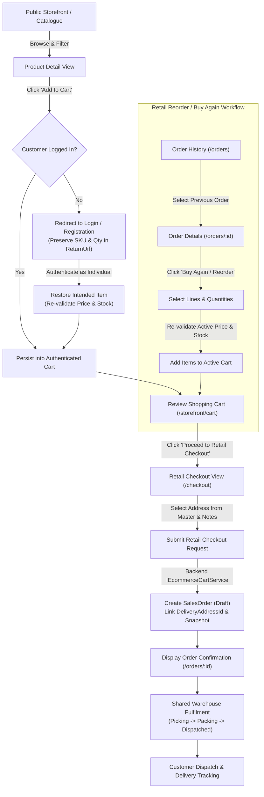

# ApexERP — Retail Customer Workflow (Path 1) & Reordering

**Document Version:** 1.2.0  
**Status:** Architecture & Requirements Specification — Ready for Implementation  
**Date:** 2026-11-22  
**Target Repository:** `ApexERP` (`Frontend/Web`, `Backend/ERP`)  
**Target Channel:** Channel A — E-commerce Sales (Retail Channel)  
**Related Documents:**
- [README.md](README.md) — Documentation index and reading paths
- [00-Ecommerce-Frontend-Master-Plan.md](00-Ecommerce-Frontend-Master-Plan.md) — Master architectural charter and invariants
- [01-Customer-Journey-and-Workspaces.md](01-Customer-Journey-and-Workspaces.md) — Customer journey and routes
- [02-Ecommerce-UI-UX-Specification.md](02-Ecommerce-UI-UX-Specification.md) — Design system and wireframes
- [04-Company-Customer-Workflow.md](04-Company-Customer-Workflow.md) — Company B2B purchasing workflows and Price Card maintenance
- [05-API-and-Backend-Integration.md](05-API-and-Backend-Integration.md) — Backend API matrix and address linking
- [06-Customer-Workspace-Specification.md](06-Customer-Workspace-Specification.md) — Retail workspace components
- [07-Implementation-and-Testing-Plan.md](07-Implementation-and-Testing-Plan.md) — Standardized E1–E10 phased rollout & QA scenarios

---

## 1. Retail Workflow Overview & Scope

The **Retail Customer Workflow (Path 1)** governs the consumer/individual purchasing and post-order experience within ApexERP. It addresses walk-in buyers, individual professionals, and retail consumers who purchase products directly at standard published retail prices without corporate Price Card contracts or formal quotation bidding.

### Core Strategic Principles:
- **Standard Retail Pricing:** Unit prices are strictly evaluated from Product Master (`Product.SellingPrice`). Retail customers do not hold negotiated contract Price Cards. `CustomerSellingCompany` relationships and assigned contract Sales Price Cards are strictly reserved for authorized corporate B2B customer accounts.
- **Mandatory Customer Authentication:** Public visitors may explore the catalogue, but adding products to a cart, viewing staged items, reordering, and checking out strictly requires customer authentication.
- **Customer Delivery Address Master Integration:** Delivery addresses are selected from the customer's saved records in Customer Address Master (`CustomerAddress` / `Address`) and linked to `SalesOrder.DeliveryAddressId`. Historical orders retain delivery integrity through `SalesOrder.DeliveryAddressSnapshot`.
- **Retail Checkout (On-Account / Pre-Arranged Terms):** Checkout generates an authoritative internal `SalesOrder` record in `SalesOrderStatus.Draft`. In accordance with Phase 1 governance, online credit card payment capture, payment gateways, and mock payment records are strictly excluded. This does **not** mean goods are free; payment terms, credit limits, and on-account arrangements follow backend ERP rules.
- **Sales Order Reordering (`Buy Again`):** Customers can re-purchase items from completed or historical Sales Orders, creating a brand-new `SalesOrder` with real-time price and stock revalidation.
- **Unified Downstream Fulfillment:** Confirmed retail orders enter the exact same warehouse picking, packing, dispatch, and shipment tracking pipeline as corporate orders.

---

## 2. End-to-End Retail Journey Diagram



---

## 3. Step-by-Step Functional & Technical Specification

### Step 1: Public Exploration & Catalogue Discovery
- **User Experience:**
  - The visitor enters the storefront at `/storefront` or `/storefront/catalog`.
  - The visitor browses published products, filters by category (e.g., Raw Hardware, Tools), searches keywords, and inspects product cards.
  - The visitor clicks a product card to open the **Product Detail Page** (`/storefront/products/:productId`), viewing high-resolution imagery, UOM choices, packaging sizes, and technical specifications.
- **API Interactions:**
  - `GET /api/ecommerce/catalogue/{companyId}/products`
  - `GET /api/ecommerce/catalogue/{companyId}/products/{productId}`
- **Security Boundary:** Anonymous public access (`[AllowAnonymous]`). Internal valuation, supplier identifiers, cost margins, and warehouse bin locations are completely scrubbed from response DTOs.

### Step 2: Unauthenticated "Add to Cart" Interception & Authentication
- **User Experience:**
  - The visitor selects a quantity (e.g., 2 units) and clicks **"Add to Shopping Cart"**.
  - Because the visitor is unauthenticated, the application intercepts the action.
  - A friendly notification informs the user: *"Please sign in or register an individual customer account to begin adding items to your cart."*
  - The user is seamlessly routed to `/login?returnUrl=/storefront/products/XYZ?resumeAction=true`.
  - If the user does not have an account, they click "Create New Customer Account" (`/register`), selecting the **Individual Retail Customer** tab.
- **Registration Pipeline (`CustomerRegistrationService.RegisterIndividualCustomerAsync`):**
  - Submits `RegisterIndividualCustomerRequest` to `POST /api/portal/auth/register-individual`.
  - Generates a unique GUID (`userId`) utilized for both the Security User and the Domain Contact.
  - **Entity Creations in Domain & Security:**
    1. `Customer` Master in `DomainDbContext`: Sets `CustomerCode` (`CUST-IND-*`), `CustomerName` (`{FirstName} {LastName}`), `IsActive = true`, `DefaultSalesPriceCardId = null`. (Note: Customer Master currently lacks an explicit `CustomerType` column; distinction relies on the code prefix and assigned role).
    2. `Contact` in `DomainDbContext`: Sets `ContactId = userId`, names, email, mobile, and `JobTitle = "Individual Customer"`.
    3. `CustomerContact` in `DomainDbContext`: Links `CustomerId` and `ContactId` with `IsPrimary = true` and `IsActive = true`.
    4. `User` in `SecurityDbContext`: Creates identity record with `Id = userId`, `Username = normalizedEmail`, `Email = normalizedEmail`, `IsActive = true`.
    5. `UserRole` in `SecurityDbContext`: Assigns role `CUSTOMER_INDIVIDUAL`.
  - **Email Lifecycle Separation:** `User.Email` acts as login identity; `Contact.Email` acts as personal delivery/notification email; `Customer.Email` acts as commercial record email. They are stored in separate database tables.
  - **Activation Policy:** Immediate login is permitted (`user.IsActive = true`, Phase 1 email verification deferred). Zero tenant or selling company records are created.
- **Authentication & Action Restoration:**
  - User submits credentials to `POST /api/portal/auth/login`.
  - Upon receiving `CustomerLoginResponse`, `AuthService` stores the session and detects the `resumeAction` query parameter.
  - The application automatically executes `POST /api/ecommerce/cart/items?companyId={companyId}` with `AddToCartRequest`.
  - The backend re-evaluates `Product.SellingPrice`, checks active inventory availability, and creates/updates the persistent `EcommerceCart`.
  - The user is navigated directly to `/storefront/cart`.

### Step 3: Shopping Cart Management (`CartViewComponent`)
- **User Experience:**
  - The customer reviews staged items in a structured table displaying product code, description, UOM, packaging, unit price, quantity input stepper, tax rate, and calculated line totals.
  - The customer can change item quantities or remove lines using the inline delete action.
  - Subtotal, applicable sales tax (VAT), and Grand Total are displayed in a sticky commercial summary card.
- **Technical & Pricing Enforcement:**
  - **Zero Client Price Input:** Cart mutation requests pass only `{ ProductId, Quantity, UnitOfMeasureId, ProductPackagingId }`. Client-side prices are never accepted.
  - **Backend Evaluation:** `EcommerceCartController` routes to `IEcommerceCartService.AddToCartAsync` or `UpdateLineQuantityAsync`. Unit price is dynamically fetched from Product Master, tax is evaluated from active `TaxCodes` (`Sales` applicability), and totals are returned in `CartDto`.
- **API Interactions:**
  - `GET /api/ecommerce/cart?companyId={companyId}`
  - `POST /api/ecommerce/cart/items?companyId={companyId}`
  - `PUT /api/ecommerce/cart/items/{lineId}?companyId={companyId}`
  - `DELETE /api/ecommerce/cart/items/{lineId}?companyId={companyId}`
  - `DELETE /api/ecommerce/cart?companyId={companyId}` (Clear Cart)

### Step 4: Checkout Workflow (`RetailCheckoutComponent`)
- **User Experience:**
  - The customer clicks **"Proceed to Retail Checkout"** and is navigated to `/customer-portal/retail/checkout`.
  - **Customer Address Master Selection:**
    - The customer selects a saved delivery address from Customer Address Master (`CustomerAddress` / `Address`) or enters a new address.
    - If a new address is entered, it is saved against the Customer's profile in `CustomerAddress` with `IsDefault` option.
  - **Delivery Instructions & Schedule:**
    - The customer selects a requested delivery date and enters optional notes (e.g., *"Leave package at residential reception"*).
  - **Order Confirmation Summary:**
    - Displays line items, calculated VAT, and delivery fee status.
- **Commercial Notice:**
  - Prominently informs the user: *"Retail Checkout: Submitting creates an official Sales Order in Draft status. Payment terms and invoice settlement follow backend on-account rules. No credit card is captured online."*

### Step 5: Retail Checkout Execution & Order Creation
- **Trigger:** Customer clicks the sticky button **"Confirm & Submit Sales Order"**.
- **Backend Coordination:**
  - Submits `CheckoutRequest` to `POST /api/ecommerce/cart/checkout?companyId={companyId}`:
    ```json
    {
      "sessionId": "session-token-or-null",
      "idempotencyKey": "unique-uuid",
      "deliveryAddressId": "3fa85f64-5717-4562-b3fc-2c963f66afa6",
      "customerNotes": "Delivery instructions",
      "requestedDeliveryDate": "2026-11-28T00:00:00Z"
    }
    ```
  - `EcommerceCartService.CheckoutAsync` validates:
    1. Cart exists and is in `Active` status.
    2. Cart contains at least one line item.
    3. Idempotency key prevents double submissions.
    4. Current inventory stock availability.
    5. Validates that `DeliveryAddressId` belongs to the customer and tenant.
  - The cart service invokes `ISalesOrderService.CreateOrderAsync`:
    - Creates a new `SalesOrder` aggregate root in `SalesOrderStatus.Draft`.
    - Generates official sequence number (e.g., `SO-2026-0941`).
    - Snapshots customer details, delivery address, currency, unit prices, and tax lines.
    - Links `SalesOrder.DeliveryAddressId` to the Customer Address Master record and populates `SalesOrder.DeliveryAddressSnapshot`.
  - Marks `EcommerceCart` as `Status = CheckedOut` and links `SalesOrderId`.
- **Outcome:**
  - Returns `CheckoutResultDto` (`Success = true`, `SalesOrderId`, `OrderNumber`).
  - Frontend clears local cart badges and navigates the customer to `/customer-portal/retail/orders/:id` with a success notification.

---

## 4. Retail Customer Reordering Workflow (`Buy Again`)

A core capability of the Retail Customer Workspace is reordering previously purchased products without manually searching the catalogue again:

```mermaid
sequenceDiagram
    autonumber
    actor Customer as Retail Customer
    participant UI as Retail Orders / Detail View
    participant PortalAPI as CustomerOrderController
    participant CartAPI as EcommerceCartController
    participant CartView as Shopping Cart View (/cart)

    Customer->>UI: Navigates to My Orders (/orders)
    UI->>PortalAPI: GET /api/portal/customer/orders
    PortalAPI-->>UI: Returns List<CustomerOrderSummaryDto>
    Customer->>UI: Selects historical order & clicks "Buy Again / Reorder"
    UI->>PortalAPI: GET /api/portal/customer/orders/{id}
    PortalAPI-->>UI: Returns CustomerOrderDetailDto (with Items list)
    UI->>Customer: Opens "Reorder Lines" modal with quantities & checkboxes
    Customer->>UI: Adjusts quantities and clicks "Add Selected to Cart"
    loop For each selected product line
        UI->>CartAPI: POST /api/ecommerce/cart/items (ProductId, Quantity)
        CartAPI-->>UI: Revalidates active price & inventory; stages line
    end
    UI->>CartView: Navigates to /storefront/cart
    Customer->>CartView: Reviews updated cart & proceeds to Retail Checkout
    CartView->>PortalAPI: Creates brand-new SalesOrder (Draft) with new reference
```

### Critical Reordering Business Rules:
1. **Historical Immutability:** Reordering **NEVER** reopens, mutates, or cancels the original historical `SalesOrder`. The original transaction, timestamps, and audit history remain permanently intact.
2. **Brand-New Sales Order Reference:** The reorder generates an entirely new `SalesOrder` in `SalesOrderStatus.Draft` with a new sequential order number.
3. **Real-Time Price & Availability Revalidation:** Historical prices are **not** reused. The backend re-evaluates current selling prices, active sales taxes, and inventory availability at the moment items are added to the cart and during checkout.
4. **Discontinued / Unavailable Product Handling:** If a product from the historical order is now discontinued, inactive, or unpublished, the backend returns a validation error (`ValidationMessage` on `CartItemDto`). The frontend highlights the unavailable item, allows the customer to remove it, and permits reordering the remaining items.
5. **Fresh Delivery Address Selection:** During reorder checkout, the customer selects a current saved delivery address from Customer Address Master rather than blindly reusing an obsolete address from the previous order.

---

## 5. Shopping Cart History vs. Order History Investigation

| Dimension | Active Shopping Cart | Shopping Cart History | Sales Order History |
|---|---|---|---|
| **Entity** | `EcommerceCart` (`Status = Active`) | `EcommerceCart` (`Status = Abandoned / CheckedOut`) | `SalesOrder` (`Status = Draft .. Delivered`) |
| **Persistence** | Stored in relational database table `EcommerceCarts` & `EcommerceCartLines`. | Historical rows persist with status `CheckedOut` or `Abandoned`. | Stored in relational database table `SalesOrders` & `SalesOrderItems`. |
| **API Endpoints** | `GET /api/ecommerce/cart`, `POST /items`, `PUT /lines/{id}`, `DELETE /lines/{id}`. | **None exist.** No controller or service methods exist to query or restore historical carts. | `GET /api/portal/customer/orders`, `GET /api/portal/customer/orders/{id}`. |
| **Reorder Capability**| Current session staging. | **Not supported in Phase 1.** Classified as a recommended future enhancement. | **Fully supported via "Buy Again" / Reorder workflow.** |

---

## 6. Retail Customer Workspace Navigation Structure

```
Retail Workspace Navigation:
├── Dashboard            -> /customer-portal/retail/dashboard
├── My Orders / History  -> /customer-portal/retail/orders
│   ├── Order Details    -> /customer-portal/retail/orders/:id
│   └── Buy Again        -> Triggers Reorder line staging into /storefront/cart
├── Browse Storefront    -> /storefront/catalog
├── Shopping Cart        -> /storefront/cart
├── Saved Addresses      -> /customer-portal/retail/profile#addresses
└── Account Settings     -> /customer-portal/retail/profile
```
