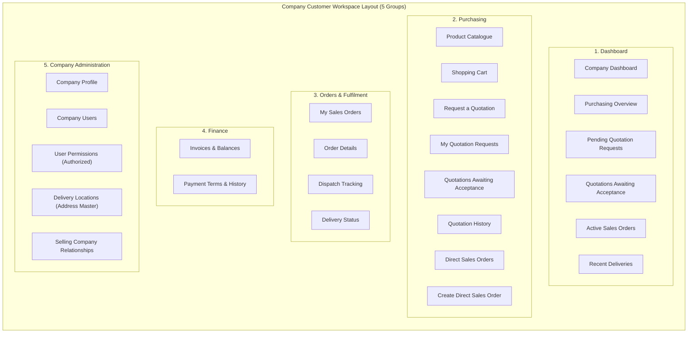
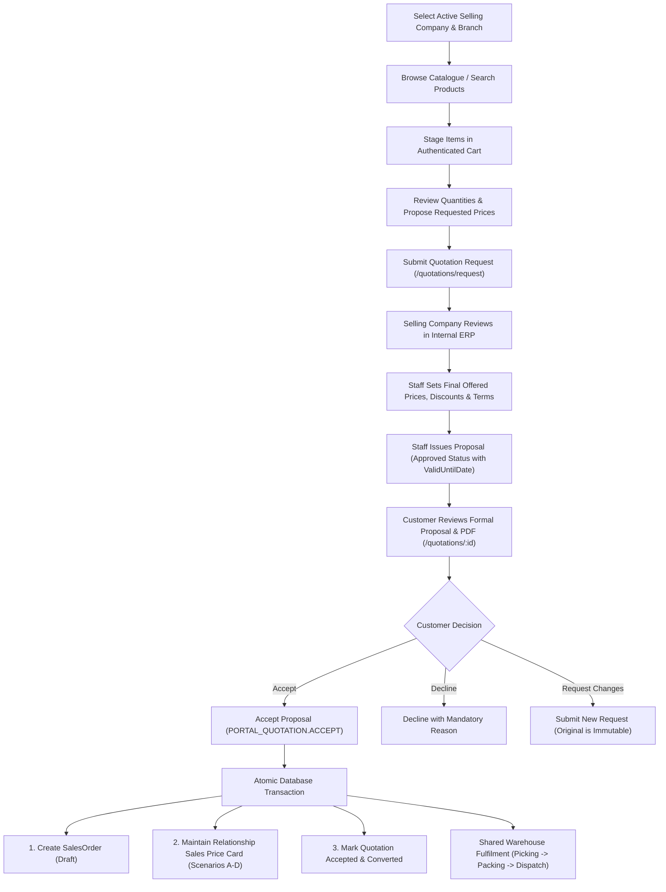
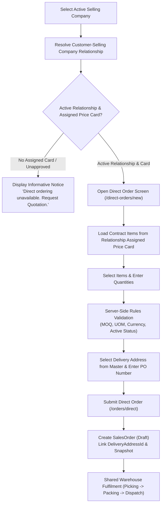

# ApexERP — Company Customer Workflow (Paths 2 & 3) & Price Card Maintenance

**Document Version:** 1.3.0  
**Status:** Architecture & Requirements Specification — Ready for Implementation  
**Date:** 2026-11-22  
**Target Repository:** `ApexERP` (`Frontend/Web`, `Backend/ERP`)  
**Target Channels:** Channel B (Direct Company Sales) & Channel C (Sales Quotations)  
**Related Documents:**
- [README.md](README.md) — Documentation index and reading paths
- [00-Ecommerce-Frontend-Master-Plan.md](00-Ecommerce-Frontend-Master-Plan.md) — Master architectural charter and invariants
- [01-Customer-Journey-and-Workspaces.md](01-Customer-Journey-and-Workspaces.md) — Customer journey and routes
- [02-Ecommerce-UI-UX-Specification.md](02-Ecommerce-UI-UX-Specification.md) — Design system and wireframes
- [03-Retail-Customer-Workflow.md](03-Retail-Customer-Workflow.md) — Retail purchasing path and reordering
- [05-API-and-Backend-Integration.md](05-API-and-Backend-Integration.md) — Complete endpoint, DTO, and permission audit
- [06-Customer-Workspace-Specification.md](06-Customer-Workspace-Specification.md) — Company workspace component breakdown
- [07-Implementation-and-Testing-Plan.md](07-Implementation-and-Testing-Plan.md) — Standardized E1–E10 implementation roadmap & QA tests
- [E1-VERIFICATION-REPORT.md](E1-VERIFICATION-REPORT.md) — Baseline verification scorecard and gap register

---

## 1. Company Customer Purchasing Overview

The **Company Customer Workflow** delivers a complete, professional B2B purchasing platform for commercial enterprises, institutional buyers, and industrial contractors. Commercial purchasing is characterized by:
1. **Multi-User Corporate Governance:** Multiple human professionals (buyers, procurement directors, finance controllers) transact on behalf of a single corporate buyer entity (`Customer`), governed by granular user permissions.
2. **Customer–Selling Company Relationships:** One corporate buyer may hold active commercial relationships with multiple legal Selling Companies under the same tenant. Each relationship maintains its own independent customer-specific contract Sales Price Card.
3. **Selling Company Context Switching:** The corporate customer switches operational context on the fly via the workspace header without re-authenticating. The workspace header displays the Customer Company, the active Selling Company, and an authorized selector.
4. **Formal Quotation Negotiation (Path 2):** Customers propose target quantities and prices; Selling Company staff prepares formal proposals; proposals are backed by formal PDF documents and mandatory expiry dates.
5. **Mandatory Price Card Maintenance on Quotation Acceptance:** When a customer accepts a final Sales Quotation, the system atomically generates the resulting `SalesOrder` (`Draft`) **AND creates or updates the relationship's assigned contract Sales Price Card** across all commercial scenarios (Scenarios A–D).
6. **Contract Direct Ordering (Path 3):** Pre-approved corporate customers bypass bidding to order directly against the Sales Price Card assigned to their active Customer–Selling Company relationship, subject to Minimum Order Quantities (MOQ), unit of measure rules, and purchasing permissions.
7. **Customer Delivery Address Master Integration:** Delivery destinations are managed in Customer Address Master (`CustomerAddress` / `Address`) and linked to `SalesOrder.DeliveryAddressId` with historical address preservation via `SalesOrder.DeliveryAddressSnapshot`.

---

## 2. Professional B2B Navigation Architecture (5 Groups)

The Company Customer Workspace provides a structured, five-group enterprise command layout:



### Selling Company Header Selector & Context Validation
- The workspace header prominently renders:
  - **Customer Company Name:** e.g., *"Acme Manufacturing Ltd"*.
  - **Active Selling Company:** e.g., *"Alpha Precision Tools Ltd"*.
  - **Selling Company Dropdown Selector:** Available to authorized contacts.
- **Backend Validation Rule:** When a user selects another Selling Company, the frontend issues `POST /api/portal/profile/select-company` (`SelectSellingCompanyRequest`). The backend verifies that the customer company holds an active, authorized commercial relationship with that Selling Company within the tenant.
- **Scoping Enforcement:** All product catalogue queries, cart staging, quotation submissions, relationship-specific price cards, and direct orders are bound to the validated `SellingCompanyId`. Client-supplied company IDs are never trusted without backend validation.

---

## 2.5 B2B Organisation Customer Registration, Deduplication & Governance Gate

Corporate purchasing requires stringent commercial onboarding to safeguard enterprise contracts, custom pricing schedules, and credit lines.

### Registration Data Entities & Separation:
- **Corporate Entity (`Customer` in `DomainDbContext`):**
  - Holds `CompanyName`, `TradingName`, `TaxNumber`, `CompanyPhone`, corporate `Address`, and commercial terms.
  - Classification: Should explicitly be tagged as `CustomerType.CorporateOrganisation`.
- **Human Contact Person (`Contact` in `DomainDbContext`):**
  - Holds personal `FirstName`, `LastName`, `JobTitle`, `Mobile`, and `Email` (personal business email).
  - Linked to `Customer` via `CustomerContact` (`IsPrimary = true`, `IsActive = true`).
- **Security Login Identity (`User` in `SecurityDbContext`):**
  - Holds `Username` (normalized business email), `Email`, `PasswordHash`, `TenantId`, `IsActive = true`.
  - Assigned security role `CUSTOMER_COMPANY_ADMIN`.

### Deduplication Engine & Matching Logic:
Registration requests to `POST /api/portal/auth/register` execute through `ICustomerDeduplicationService.FindExistingCompanyAsync`:
1. **Tax / VAT Number Match:** Matches against existing `Customer.TaxNumber` within the tenant.
2. **Company Name Match:** Matches normalized string against `Customer.CustomerName`.
3. **Corporate Email Match:** Matches company email domain against existing customer records.

### Registration Branches & Security Governance Discrepancy:
- **Branch A: Brand New Corporate Customer:**
  - A new `Customer` record is provisioned under the current tenant with code `CUST-*`.
  - The registrant is established as the primary administrator contact.
- **Branch B: Matched Existing Corporate Customer:**
  - The service links the new user contact to the existing `Customer` via `CustomerContact.Create(...)`.
  - The service sets `RequiresAuthorization = true` in the returned response DTO.
  - **Identified Security Gap in Implementation:** In the current backend codebase, `User.IsActive = true` is set immediately and the user is granted role `CUSTOMER_COMPANY_ADMIN`. If an unauthorized registrant enters a legitimate company's name or tax number, they are currently granted immediate administrative access to that existing company's confidential transactions, active Price Cards, and past invoices!
  - **Mandatory Target Security Policy:** When `RequiresAuthorization == true`, the user must be placed in a restricted **Pending Corporate Verification** state. The user can log in to view public catalogue items, but commercial ordering, Price Card viewing, and quotation acceptance are locked until an existing authorized company admin or the tenant administrator approves the user's affiliation.

### Email Architecture Invariant:
- `User.Email`: Login credential used exclusively by `SecurityDbContext`.
- `Contact.Email`: Human notification and order dispatch communication address.
- `Customer.Email`: Corporate tax and legal billing address.
These emails are stored in distinct database tables. Updating one never silently alters the others.

---

## 3. Path 2: B2B Sales Quotation Request Lifecycle



### Detailed Quotation Step Execution:

#### Step 1: Request Staging & Context Selection
- **Selling Company Selection:** The customer selects their target Selling Company via the header scope switcher.
- **Item Selection:** The customer browses the catalogue and adds products to their cart, or manually enters line items in the Quotation Request form.
- **Cloning Shortcuts (High-Efficiency Entry):**
  - **Clone from Sales Order:** Customer clicks "Clone from Past Order", selecting an existing `SalesOrderId`. Backend copies items, quantities, and packaging into a new quotation draft.
  - **Clone from Quotation:** Customer clicks "Clone from Past Quotation", selecting a previous `quotationId`. Backend duplicates items into a new request.
- **Target Pricing Proposal:**
  - For each line item, the customer enters the required quantity, preferred unit of measure, target unit price, and project remarks.
  - Customer enters a project reference (e.g., `PRJ-ACME-2026-Q4`), requested delivery date, and technical attachment notes.

#### Step 2: Submission to Internal ERP Sales Pipeline
- Customer clicks **"Submit Quotation Request"**.
- Component `QuotationRequestComponent` posts payload to `POST /api/portal/quotations/request`.
- Backend `ISalesQuotationService` generates a formal quotation record (e.g., `SQ-2026-0042`) in `SalesQuotationStatus.Draft` / `Submitted`.
- Notification triggers an internal email/alert to the Selling Company's sales team.

#### Step 3: Selling Company Commercial Review & Final Proposal
- Internal sales staff reviews the request inside the internal ERP workspace (`SalesQuotationController`).
- Staff evaluates product cost, stock levels, and margin policies.
- Staff sets the **authoritative final offered prices**, applies commercial line discounts, and defines payment/credit terms.
- **Mandatory Expiry Rule:** Staff specifies `ValidUntilDateUtc` (e.g., 14 or 30 days). Proposal cannot be accepted after this timestamp.
- Staff clicks "Approve & Issue Quotation". The quotation status transitions to `Approved`.
- System generates the official PDF document via `PdfService` and notifies the customer contact.

#### Step 4: Strict Quotation Immutability Rule `[Agreed Business Rule]`
> [!IMPORTANT]
> **Once approved and issued by the Selling Company, the quotation is STRICTLY IMMUTABLE.**
> - Neither internal staff nor the customer can edit line prices, quantities, discount rates, or delivery terms.
> - The backend enforces this rule at the domain aggregate level (`SalesQuotation.cs`). Any attempt to mutate an approved quotation throws an `InvalidOperationException`.
> - **Change Protocol:** If the customer requires price adjustments or quantity alterations, the current quotation must be declined or left to expire, and a **new quotation request** must be submitted. This guarantees a tamper-proof commercial audit trail.

#### Step 5: Customer Review & Decision
- Customer navigates to `/portal/purchasing/quotations/:id` (`QuotationReviewComponent`).
- Screen displays proposal header, validity countdown timer, embedded PDF preview (`GET /api/portal/quotations/{id}/pdf`), and line items comparison.
- **Decline:** Customer clicks "Decline Proposal". Modal prompts for mandatory remarks. Calls `POST /api/portal/quotations/{id}/reject`. Quotation status updates to `Rejected`.
- **Accept:** Customer confirms delivery address from Customer Address Master, enters internal PO reference (`CustomerRemarks` / PO), and clicks **"Accept Quotation & Convert to Order"** (requires `PORTAL_QUOTATION.ACCEPT`). Calls `POST /api/portal/quotations/{id}/accept`.

---

## 4. Mandatory Business Rule: Price Card Maintenance on Quotation Acceptance

The stakeholder has established the following binding rule:

> **When a Company Customer accepts a final Sales Quotation and the system creates the resulting Sales Order, the customer's contract Price Card for that specific Customer–Selling Company relationship must also be created or updated using the accepted quotation's agreed prices and commercial terms.**

### Execution Across All Four Scenarios:

```
┌─────────────────────────────────────────────────────────────────────────────┐
│ SCENARIO A: No Existing Customer Contract Price Card for Selling Company    │
│ 1. System checks relationship.SalesPriceCardId == null.                     │
│ 2. Creates a new PriceCard aggregate:                                       │
│    - Type: PriceCardType.Sales (2)                                          │
│    - TenantId: Authenticated TenantId                                       │
│    - Name: "Contract - {CustomerName} - {SellingCompanyName}"               │
│    - Code: Sequential code (e.g. PC-CUSTA-COMPX-01)                         │
│    - Currency: Quoted Currency                                              │
│    - EffectiveFrom: DateTime.UtcNow, EffectiveTo: null                      │
│ 3. Adds PriceCardLine for each accepted quoted product:                     │
│    - ProductId, UnitPrice: Quoted accepted UnitPrice                        │
│    - UnitOfMeasureId, MinimumQuantity: item.Quantity                        │
│ 4. Assigns card to relationship: relationship.SalesPriceCardId = newCard.Id.│
│ 5. Legacy Fallback: If Customer.DefaultSalesPriceCardId is null, sets it to │
│    newCard.Id for backwards compatibility.                                  │
├─────────────────────────────────────────────────────────────────────────────┤
│ SCENARIO B: Existing Relationship Price Card, But Quoted Line Does Not Exist│
│ 1. PriceCard resolved via relationship.SalesPriceCardId.                    │
│ 2. Quoted product not present in priceCard.Lines.                           │
│ 3. Appends new PriceCardLine:                                               │
│    - ProductId, UnitPrice: Quoted accepted price                            │
│    - UnitOfMeasureId, MinimumQuantity: Quoted quantity                      │
│    - EffectiveFrom: DateTime.UtcNow, EffectiveTo: null                      │
│ 4. Preserves all existing unrelated PriceCardLine records untouched.        │
├─────────────────────────────────────────────────────────────────────────────┤
│ SCENARIO C: Existing Relationship Price Card and Matching Product Line Exists│
│ 1. Matching active line found: l.ProductId == item.ProductId && l.IsActive. │
│ 2. Non-destructive versioning: Sets existing line.EffectiveTo = now         │
│    (retaining historical pricing for audit).                                │
│ 3. Inserts new active PriceCardLine:                                        │
│    - ProductId, UnitPrice: Quoted accepted price                            │
│    - MinimumQuantity: Quoted quantity                                       │
│    - EffectiveFrom: DateTime.UtcNow, EffectiveTo: null                      │
│ 4. Zero duplicate active lines created. Unrelated lines remain intact.      │
├─────────────────────────────────────────────────────────────────────────────┤
│ SCENARIO D: Multiple Selling Companies / Price Cards (Relationship Scoping) │
│ 1. Rule: System resolves the exact Customer–Selling Company relationship    │
│    matching quotation.CustomerId and quotation.CompanyId.                   │
│ 2. Updates ONLY that specific relationship's assigned Price Card.           │
│ 3. Other Selling Companies' Price Cards (e.g. Card Y for Company Y) remain  │
│    COMPLETELY UNTOUCHED and isolated.                                       │
│ 4. Customer.DefaultSalesPriceCardId is preserved as a tenant-level fallback. │
└─────────────────────────────────────────────────────────────────────────────┘
```

### Transaction & Audit Integrity Requirements:
- **Atomicity:** Quotation status transition, `SalesOrder` (`Draft`) creation, and `PriceCard` / `PriceCardLine` creation/updating execute within a single EF Core transaction (`IDbContextTransaction`).
- **Rollback Guarantee:** If Sales Order creation fails or Price Card updating encounters a concurrency conflict, the entire transaction is rolled back immediately. No orphan orders or half-updated price cards can exist.
- **Idempotency & Concurrency:** The acceptance endpoint enforces `quotation.Status == SalesQuotationStatus.Approved` and checks that `quotation.ConvertedSalesOrderId` is not already populated. Repeated clicks or concurrent acceptance requests throw an `InvalidOperationException`.
- **Price Card Audit:** Each `PriceCardLine` inherits `Auditable` (`CreatedAt`, `CreatedBy`, `ModifiedAt`, `ModifiedBy`), recording timestamps and the acting customer user ID.

---

## 5. Customer–Selling Company Relationship and Contract Price Card Assignment

### 5.1 Existing Supplier Relationship Pattern and Evidence `[VERIFIED]`
- **Source Code Verification:** In `Backend/ERP/Domain/Features/MasterData/Supplier/Supplier.cs` (lines 36–77):
  - `Supplier` is a tenant-level master data entity (`ITenantScopedEntity`) possessing `DefaultPurchasePriceCardId` (nullable `Guid` pointing to `PriceCard` of type `Purchase`).
  - Related child entities `SupplierAddress` and `SupplierContact` link `Supplier` to `Address` and `Contact` with composite tenant foreign keys `(TenantId, SupplierId)` and filtered unique indexes.
  - In procurement workflows (`PurchaseOrder.cs`), `PurchaseOrder` is scoped to `TenantId`, `CompanyId` (the internal buying company), and `SupplierId` (the vendor). Pricing is resolved via `PricingResolutionService.ResolvePurchasePriceAsync`, which inspects transaction override, `supplier.DefaultPurchasePriceCardId`, and legacy `SupplierProductPrice`.
  - **Architectural Distinction:** While internal ERP purchasing treats `Supplier` as a tenant-level vendor used by internal companies, sales operations in a multi-subsidiary tenant invert this relationship: an external `Customer` transacts with multiple distinct internal `Selling Companies`.

### 5.2 Existing Customer and Price Card Model Findings `[VERIFIED]`
- **Customer Master:** `Backend/ERP/Domain/Features/MasterData/Customer.cs` (lines 8–150):
  - Implements `Auditable` and `ITenantScopedEntity`.
  - Holds `DefaultSalesPriceCardId` (nullable `Guid` pointing to `PriceCard` of type `Sales`).
  - Currently stores only a **single default sales price card reference** directly on the customer record.
- **Price Card Master:** `Backend/ERP/Domain/Features/MasterData/PriceCard/PriceCard.cs`:
  - Contains `PriceCardType` (`Purchase = 1`, `Sales = 2`), `Currency`, `EffectiveFrom`, `EffectiveTo`, and child collection `Lines` (`PriceCardLine`).
  - `PriceCardLine` records `ProductId`, `UnitPrice`, `UnitOfMeasureId`, `MinimumQuantity`, `EffectiveFrom`, `EffectiveTo`.
- **Limitation Identified:** If Customer A purchases from Selling Company X (e.g. Industrial Tools) and Selling Company Y (e.g. Chemicals), storing only `Customer.DefaultSalesPriceCardId` forces both Selling Companies to share a single default price card, preventing independent contract pricing.

### 5.3 Proposed Customer–Selling Company Relationship Entity `[PROPOSED]`
To support independent contract pricing per Selling Company, a dedicated relationship entity is established following the master data conventions of `CustomerAddress` and `CustomerContact`:

```
┌─────────────────────────────────────────────────────────────────────────────┐
│ CustomerSellingCompany (Entity in Domain/Features/MasterData/Customer)      │
├─────────────────────────────────────────────────────────────────────────────┤
│ • CustomerSellingCompanyId : Guid (Primary Key)                             │
│ • TenantId                 : Guid (ITenantScopedEntity)                     │
│ • CustomerId               : Guid (Foreign Key -> Customer)                 │
│ • CompanyId                : Guid (Foreign Key -> Company / Selling Company)│
│ • SalesPriceCardId         : Guid? (Foreign Key -> PriceCard [Sales])       │
│ • IsActive                 : bool (Default: true)                           │
│ • EffectiveFrom            : DateTime (Default: DateTime.UtcNow)            │
│ • EffectiveTo              : DateTime? (Nullable)                           │
│ • CreditLimit              : decimal? (Optional Selling Company override)   │
│ • PaymentTerms             : string? (Optional Selling Company override)    │
│ • CurrencyId               : Guid? (Optional Selling Company override)      │
│ • Auditable Metadata       : CreatedAt, CreatedBy, UpdatedAt, UpdatedBy     │
└─────────────────────────────────────────────────────────────────────────────┘
```

#### EF Core Configuration (`CustomerSellingCompanyConfiguration.cs`):
- Table: `CustomerSellingCompanies`.
- Unique Index: `(TenantId, CustomerId, CompanyId)`.
- Filtered Unique Index: Active relationship lookup `(TenantId, CustomerId, CompanyId)` where `[IsActive] = 1`.
- Composite Foreign Keys:
  - `CustomerSellingCompany -> Customer`: `(TenantId, CustomerId)` on delete `Restrict`.
  - `CustomerSellingCompany -> Company`: `(TenantId, CompanyId)` on delete `Restrict`.
  - `CustomerSellingCompany -> PriceCard`: `(TenantId, SalesPriceCardId)` on delete `Restrict`.

### 5.4 Relationship-to-Price-Card Ownership `[PROPOSED]`
The commercial ownership model is strictly established as:

$$\text{Customer} \longrightarrow \text{Customer–Selling Company Relationship} \longrightarrow \text{Assigned Sales Price Card}$$

| Customer | Selling Company | Assigned Sales Price Card | Operational Impact |
| :--- | :--- | :--- | :--- |
| **Customer A** | **Selling Company X** | **Card X** (`PC-CUSTA-COMPX`) | Direct orders & quotations for Company X resolve prices from Card X |
| **Customer A** | **Selling Company Y** | **Card Y** (`PC-CUSTA-COMPY`) | Direct orders & quotations for Company Y resolve prices from Card Y |
| **Customer B** | **Selling Company X** | **Card Z** (`PC-CUSTB-COMPX`) | Customer B maintains distinct pricing with Company X |

- **Strict Isolation:** Card X and Card Y are completely independent aggregates. Updating rates on Card X has zero impact on Card Y.
- **Selling Company Boundary:** A customer cannot apply Card X pricing to orders placed with Selling Company Y.

### 5.5 Quotation Acceptance Integration `[PROPOSED]`
When a Company Customer accepts an approved Sales Quotation (`POST /api/portal/quotations/{id}/accept`):
1. Backend resolves quotation header: `quotation.CustomerId` and `quotation.CompanyId` (Selling Company).
2. Backend queries `CustomerSellingCompany` for `(TenantId, CustomerId, CompanyId)`.
   - If no relationship record exists, backend auto-provisions an active relationship for the customer and selling company.
3. Backend inspects `relationship.SalesPriceCardId`:
   - If null (**Scenario A**): Creates a new `PriceCard` aggregate scoped to Tenant and Selling Company, attaches quotation lines, saves, and assigns `relationship.SalesPriceCardId = newCard.PriceCardId`.
   - If card exists and item is new (**Scenario B**): Appends new `PriceCardLine`.
   - If card exists and item matches (**Scenario C**): Retires existing active line (`EffectiveTo = now`) and appends new active line.
   - Multi-Company isolation (**Scenario D**): Guaranteed because lookup is explicitly scoped to `(CustomerId, CompanyId)`.
4. Atomically creates `SalesOrder` (`Draft`), marks Quotation as `Converted`, and commits the transaction.

### 5.6 Direct Company Sales Integration `[PROPOSED]`
When a Company Customer creates a Direct B2B Order (`POST /api/portal/orders/direct`):
1. Request supplies `SellingCompanyId`.
2. Backend verifies customer membership and resolves `CustomerSellingCompany` for `(TenantId, CustomerId, SellingCompanyId)`.
3. Validates that relationship exists, `IsActive == true`, and current date is within `[EffectiveFrom, EffectiveTo]`.
4. Resolves the contract `PriceCard` via `relationship.SalesPriceCardId`:
   - If relationship has no assigned card, order creation is rejected with informative guidance to request a quotation.
   - Validates that `PriceCard.IsActive == true` and valid for the current date.
   - Server-side authoritative price resolution enforces contract `UnitPrice`, `MinimumQuantity`, and currency.
5. The frontend never calculates authoritative commercial pricing.

### 5.7 Compatibility with `Customer.DefaultSalesPriceCardId` `[PROPOSED]`
- **Retention Decision:** `Customer.DefaultSalesPriceCardId` is **retained** on the `Customer` entity. It is **not** deleted.
- **Role as Tenant-Level Fallback:**
  - In single-company deployments or simplified B2B workflows, `Customer.DefaultSalesPriceCardId` provides an immediate default price card without requiring explicit relationship records.
  - In `PricingResolutionService.ResolveSalesPriceAsync`, the resolution hierarchy becomes:
    1. Transaction-level override (`overridePriceCardId`).
    2. Relationship-assigned price card (`CustomerSellingCompany.SalesPriceCardId` for the specific Selling Company).
    3. Customer master fallback (`Customer.DefaultSalesPriceCardId`).
    4. Product master retail selling price (`Product.SellingPrice`).
- **Zero Breaking Changes:** Preserving `Customer.DefaultSalesPriceCardId` guarantees that all existing tests, internal ERP sales orders, and legacy services continue to function without disruption.

### 5.8 Security and Tenant-Isolation Rules `[VERIFIED & PROPOSED]`
- **Tenant Scope:** Every `CustomerSellingCompany` record implements `ITenantScopedEntity`. EF Core global query filters prevent cross-tenant exposure.
- **Customer Ownership:** Customer portal endpoints extract `CustomerId` from verified JWT claims (`sub`, `customer_id`). Customers cannot query or modify relationships belonging to other customers.
- **Selling Company Verification:** Selling Companies must be active entities belonging to the customer's authenticated tenant. Cross-tenant company references are rejected (`KeyNotFoundException`).

### 5.9 Required Implementation Changes `[PROPOSED]`

| Change Item | Layer | Description | Status |
| :--- | :--- | :--- | :--- |
| **`CustomerSellingCompany.cs`** | Domain (`MasterData/Customer`) | New entity modeling Customer–Selling Company relationship and `SalesPriceCardId`. | **PROPOSED** |
| **`CustomerSellingCompanyConfiguration.cs`** | Infrastructure (`Persistence`) | EF Core entity configuration with tenant composite keys and unique index. | **PROPOSED** |
| **`ICustomerSellingCompanyService.cs`** | Domain / Application | Service interface for relationship management and price card resolution. | **PROPOSED** |
| **`PricingResolutionService.cs`** | Domain (`MasterData/PriceCard`) | Extend `ResolveSalesPriceAsync` to accept `Guid? sellingCompanyId = null` and check relationship card. | **PROPOSED** |
| **`SalesQuotationService.cs`** | Domain (`Sales`) | Update `AcceptQuotationAndConvertAtomicAsync` to resolve/update relationship-specific price card. | **PROPOSED** |
| **`DirectCustomerOrderService.cs`** | Application (`Sales/DirectOrder`) | Update `CreateDirectB2BOrderAsync` to validate relationship-specific card before fallback. | **PROPOSED** |
| **`CustomerSellingCompanyController.cs`** | API (`Features/Portal`) | Portal endpoints for viewing customer's active selling company relationships. | **PROPOSED** |

---

## 6. Path 3: Approved Company Customer Direct Contract Order

Approved corporate customers with pre-negotiated contracts can order directly from their assigned Sales Price Card without quotation overhead:



### Direct Order Specification:
- **Relationship Resolution:** Customer must have an active `CustomerSellingCompany` relationship with the selected Selling Company, containing an active `SalesPriceCardId` (or valid fallback).
- **Contract Line Validation:** Quantities must satisfy `Quantity >= line.MinOrderQuantity`.
- **Customer Address Master Selection:** Customer selects delivery destination from `CustomerAddress` / `Address`. The backend validates address ownership and populates `SalesOrder.DeliveryAddressId` and `SalesOrder.DeliveryAddressSnapshot`.

---

## 7. Role & Permission-Aware Navigation System

```mermaid
flowchart TD
    subgraph CorporateUserRoles ["Company Contact Person Roles"]
        R_Admin["CUSTOMER_COMPANY_ADMIN<br>(Primary Contact / Director)"]
        R_Buyer["CUSTOMER_BUYER<br>(Purchasing Agent / Procurement)"]
        R_Viewer["CUSTOMER_VIEWER<br>(Finance Auditor / Read-Only)"]
    end

    subgraph PermissionChecks ["Token Claims Permission Evaluation"]
        P_Prof["PORTAL_PROFILE.VIEW"]
        P_Sales["PORTAL_SALES.VIEW"]
        P_QReq["PORTAL_QUOTATION.REQUEST"]
        P_QAcc["PORTAL_QUOTATION.ACCEPT"]
        P_OrdSub["PORTAL_ORDER.SUBMIT"]
        P_OrdView["PORTAL_ORDER.VIEW"]
        P_InvView["PORTAL_INVOICE.VIEW"]
        P_Users["PORTAL_USERS.MANAGE"]
    end

    subgraph NavVisibility ["Navigation Item Rendering (5 Groups)"]
        N_Dash["1. Dashboard: Visible to All"]
        N_Purch["2. Purchasing: Catalog visible; Actions gated"]
        N_QReq["Request Quotation: Requires PORTAL_QUOTATION.REQUEST"]
        N_QAcc["Accept Quotation Action: Requires PORTAL_QUOTATION.ACCEPT"]
        N_DOrd["Direct Orders: Requires PORTAL_ORDER.SUBMIT"]
        N_Orders["3. Orders & Fulfilment: Requires PORTAL_ORDER.VIEW"]
        N_Fin["4. Finance (Invoices): Requires PORTAL_INVOICE.VIEW"]
        N_Mgmt["5. Company Administration: Users requires PORTAL_USERS.MANAGE"]
    end

    R_Admin --> P_Prof & P_Sales & P_QReq & P_QAcc & P_OrdSub & P_OrdView & P_InvView & P_Users
    R_Buyer --> P_Prof & P_Sales & P_QReq & P_OrdSub & P_OrdView
    R_Viewer --> P_Prof & P_Sales & P_OrdView & P_InvView

    P_QReq --> N_QReq
    P_QAcc --> N_QAcc
    P_OrdSub --> N_DOrd
    P_OrdView --> N_Orders
    P_InvView --> N_Fin
    P_Users --> N_Mgmt
```



---

## 8. Quality Assurance & Integration Test Scenarios

The following comprehensive automated and integration test suite must be satisfied:

| Test ID | Test Scenario Description | Preconditions | Expected Outcome |
| :---: | :--- | :--- | :--- |
| **TC-REL-01** | Multi-Selling-Company Price Card Independence | Customer A holds active relationships with Selling Company X and Selling Company Y. Card X and Card Y have different prices for Product P. | Quoting or ordering from Company X resolves Card X price; quoting or ordering from Company Y resolves Card Y price. |
| **TC-REL-02** | Quotation Acceptance Updates Only Targeted Relationship Card | Customer A accepts quotation from Selling Company X. | Card X is updated (line versioned/added); Card Y for Selling Company Y remains completely unchanged. |
| **TC-REL-03** | Quotation Acceptance with No Assigned Card (Scenario A) | Customer A accepts quotation from Company X with no assigned card on relationship. | New `PriceCard` aggregate created, populated with quoted lines, and assigned to `CustomerSellingCompany.SalesPriceCardId`. |
| **TC-REL-04** | Quotation Acceptance with New Product (Scenario B) | Customer A accepts quotation for unlisted product. Relationship has Card X. | New `PriceCardLine` appended to Card X. All existing unrelated lines on Card X preserved. |
| **TC-REL-05** | Quotation Acceptance with Matching Product (Scenario C) | Customer A accepts quotation for existing product. | Active line on Card X expired (`EffectiveTo = now`), new active line appended with accepted price. Zero duplicate active lines. |
| **TC-REL-06** | Direct B2B Order Pricing Resolution | Customer A places direct order with Selling Company X. | Prices resolved strictly from Card X. Quantities below MOQ rejected. |
| **TC-REL-07** | Inactive or Missing Relationship Direct Order Rejection | Customer A attempts direct order with Selling Company Z (no relationship or inactive). | Request rejected with informative error directing user to request a quotation. |
| **TC-REL-08** | Cross-Tenant Relationship Access Rejection | Customer in Tenant 1 attempts to query or bind relationship in Tenant 2. | Global tenant query filters reject operation with 404 / 403. |
| **TC-REL-09** | Atomic Transaction Rollback on Failure | Quotation acceptance succeeds in Sales Order generation but Price Card line insertion throws exception. | Entire transaction rolls back; quotation remains `Approved`, no order or price card changes committed. |
| **TC-REL-10** | Idempotent Quotation Acceptance | Customer double-clicks or retries acceptance for an already converted quotation. | Backend rejects second request with `InvalidOperationException`; no duplicate orders or duplicate card lines. |
| **TC-REL-11** | Concurrent Acceptance Concurrency Protection | Concurrent acceptance requests issued simultaneously. | Handled safely via EF Core concurrency tokens / status check; exactly one order and one card update created. |
| **TC-REL-12** | Legacy Fallback Verification | Customer with `DefaultSalesPriceCardId` but no relationship record places order in single-company mode. | System successfully resolves price from `Customer.DefaultSalesPriceCardId` via fallback hierarchy. |

## Unified Purchasing Routes – Convergent SalesOrder Creation

**Verified (Backend) Purchasing Paths** – The following routes are implemented and available in the current codebase:

1. **Retail Checkout (Path A)** – `POST /api/ecommerce/cart/checkout` creates a `SalesOrder` in `Draft` status using `Product.SellingPrice`. `[VERIFIED]`
2. **Company Quotation Request (Path B)** – `POST /api/portal/customer/quotations/request` creates a quotation draft; after seller approval, `POST /api/portal/quotations/{id}/accept` atomically creates a `SalesOrder` and updates the relationship `PriceCard`. `[VERIFIED]`
3. **Company Direct B2B Order (Path C)** – `POST /api/portal/customer/orders/direct-b2b` creates a `SalesOrder` after resolving the active `CustomerSellingCompany.SalesPriceCardId`. `[VERIFIED]`
4. **Reorder from Sales Order History (Path D)** – `GET /api/portal/customer/orders/{id}` + `POST /api/ecommerce/cart/items` re‑stages items; `POST /api/ecommerce/cart/checkout` creates a new `SalesOrder`. `[VERIFIED]`
5. **Reuse Approved Quotation (Path E)** – Clone from an existing approved quotation via `POST /api/portal/customer/quotations/request/clone-quotation/{quotationId}`; follows Path B flow for a new quotation. `[PROPOSED]`

All routes resolve to a **single `SalesOrder` aggregate** and then follow the shared downstream fulfillment pipeline (Warehouse → Dispatch → Delivery → Invoice → Payment). No duplicate order aggregates are created.

---