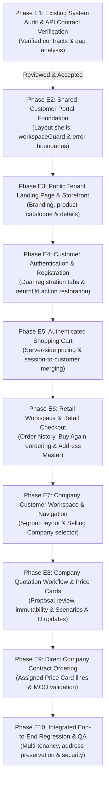

# ApexERP — E-commerce Frontend Implementation Roadmap & Extended QA Testing Plan

**Document Version:** 1.1.0  
**Status:** Architecture & Requirements Specification — Ready for Implementation  
**Date:** 2026-11-21  
**Target Repository:** `ApexERP` (`Frontend/Web`, `Backend/ERP`)  
**Starting Phase:** Phase E1 — Existing System Audit and API Contract Verification  
**Related Documents:**
- [README.md](README.md) — Documentation index and reading paths
- [00-Ecommerce-Frontend-Master-Plan.md](00-Ecommerce-Frontend-Master-Plan.md) — Master architectural charter and invariants
- [01-Customer-Journey-and-Workspaces.md](01-Customer-Journey-and-Workspaces.md) — Customer journey and routes
- [02-Ecommerce-UI-UX-Specification.md](02-Ecommerce-UI-UX-Specification.md) — Design system and wireframes
- [03-Retail-Customer-Workflow.md](03-Retail-Customer-Workflow.md) — Retail purchasing path and reordering
- [04-Company-Customer-Workflow.md](04-Company-Customer-Workflow.md) — Company B2B purchasing workflows and Price Card maintenance
- [05-API-and-Backend-Integration.md](05-API-and-Backend-Integration.md) — Backend API integration matrix and address linking
- [06-Customer-Workspace-Specification.md](06-Customer-Workspace-Specification.md) — Workspace component details

---

## 1. Implementation Philosophy & Phased Execution Roadmap

The implementation of the ApexERP E-commerce frontend is structured into **ten discrete, sequential phases (Phases E1 through E10)**.

> [!IMPORTANT]
> **Implementation must begin at Phase E1 – Existing System Audit and API Contract Verification.**  
> No UI implementation, component scaffolding, or route modification may proceed before Phase E1 is formally reviewed and signed off by stakeholders.

---

## 2. Phase-by-Phase Implementation Specifications

### Phase E1: Existing System Audit and API Contract Verification (Starting Point)
- **Objective:** Establish the verified baseline across frontend components and backend API endpoints before altering application source code.
- **Tasks:**
  1. Inspect existing routes in `Frontend/Web/src/app/app.routes.ts` and `storefront.routes.ts`.
  2. Verify existing controllers in `Backend/ERP/API/Features/Ecommerce` and `API/Features/Portal`.
  3. Validate active DTO models in `ERP.Application.Features.Ecommerce` and `API.Features.Portal.DTOs`.
  4. Verify Customer Address Master (`CustomerAddress`, `Address`) and `SalesOrder` delivery properties.
  5. Formulate verified endpoint-to-screen mapping matrix and sign off on documented backend gaps (Scenario A Price Card creation, Customer Address Portal CRUD).
- **Deliverable:** Verified API-to-screen audit report and sign-off.
- **Acceptance Gate:** Zero frontend code written until Phase E1 documentation is approved.

### Phase E2: Shared Customer Portal Foundation
- **Objective:** Establish shared layout shells, navigation infrastructure, and security guards for external customer portals.
- **Dependencies:** Phase E1 sign-off.
- **Components to Implement/Upgrade:**
  - `CustomerPortalLayoutComponent` (`/customer-portal/*` layout shell)
  - `TenantScopeSwitcherComponent` (active Selling Company selector)
  - Update `workspaceGuard` to guarantee external customer tokens cannot enter internal `/app/*`.
  - Reusable async feedback containers (`EmptyStateComponent`, `LoadingStateComponent`, `ErrorStateComponent`).
- **Acceptance Criteria:** Customer portal layout renders with responsive command bar and side navigation; internal ERP routes reject customer accounts with `403 Forbidden`.

### Phase E3: Public Tenant Landing Page and Storefront
- **Objective:** Deliver the public-facing digital storefront and product discovery experience.
- **Dependencies:** Phase E2.
- **Components to Implement/Upgrade:**
  - `TenantLandingComponent` (route: `/storefront` or tenant subdomain root `/`)
  - `ProductCatalogComponent` (route: `/storefront/catalog`)
  - `ProductCardComponent` (reusable standalone card)
  - `CategoryFilterComponent` (hierarchical category tree)
  - `ProductDetailComponent` (route: `/storefront/products/:productId`)
- **Key Capabilities:**
  - Dynamic tenant branding and hero section derived from `TenantContextService`.
  - Public catalogue querying `GET /api/ecommerce/catalogue/{companyId}/products`.
  - Real-time search, category filtering, stock availability indicators.
  - Public product detail with UOM selection, packaging choices, and spec sheets.
- **Acceptance Criteria:** Public visitors can browse all published products, filter categories, and inspect details without being prompted to log in.

### Phase E4: Customer Authentication and Registration
- **Objective:** Connect customer authentication, handle account-type routing, and implement the unauthenticated "Add to Cart" interception protocol.
- **Dependencies:** Phase E3.
- **Components to Implement/Upgrade:**
  - `LoginComponent` (upgrade existing `/login`)
  - `CustomerRegisterComponent` (upgrade existing `/register` with Individual vs Company tabs)
  - `AuthService` (update with customer session parsing, roles, and permissions)
- **Key Capabilities:**
  - Registration Tab 1: Submits `RegisterIndividualCustomerRequest` to `POST /api/portal/auth/register-individual`.
  - Registration Tab 2: Submits `RegisterCompanyCustomerRequest` to `POST /api/portal/auth/register-company`.
  - Login submits `CustomerLoginRequest` to `POST /api/portal/auth/login`.
  - Captures `returnUrl` and detects `resumeAction` flag to automatically execute pending `AddToCartRequest`.
  - Directs Individual accounts to Retail Workspace and Corporate accounts to Company Workspace.
- **Acceptance Criteria:** Unauthenticated click on "Add to Cart" redirects to login, logs in, adds item to cart, and redirects to `/storefront/cart`.

### Phase E5: Authenticated Shopping Cart
- **Objective:** Implement the authenticated shopping cart connecting to the persistent backend cart engine.
- **Dependencies:** Phase E4.
- **Components to Implement:**
  - `CartViewComponent` (`/storefront/cart`)
- **Key Capabilities:**
  - Queries `GET /api/ecommerce/cart?companyId={companyId}` with header `X-Cart-Session-Id`.
  - Line quantity updates (`PUT .../lines/{lineId}`) and line deletions (`DELETE .../lines/{lineId}`).
  - Server-side recalculation of subtotal, sales tax (VAT), and grand total.
  - Dynamic purchasing action buttons: "Proceed to Retail Checkout", "Submit Quotation Request", or "Place Direct Order".
- **Acceptance Criteria:** Cart updates occur in real-time without client-calculated prices; cart items persist across browser page reloads.

### Phase E6: Retail Customer Workspace and Retail Checkout (Including Reorder)
- **Objective:** Deliver the personal self-service portal, address master selection, Retail Checkout, and historical reordering.
- **Dependencies:** Phase E5.
- **Components to Implement:**
  - `RetailDashboardComponent` (`/customer-portal/retail/dashboard`)
  - `RetailOrdersComponent` (`/customer-portal/retail/orders` with "Buy Again" action)
  - `RetailOrderDetailComponent` (`/customer-portal/retail/orders/:id`)
  - `RetailCheckoutComponent` (`/customer-portal/retail/checkout`)
  - `RetailProfileComponent` (`/customer-portal/retail/profile`)
- **Key Capabilities:**
  - **Customer Address Master Selection:** Customer selects saved address from `CustomerAddress` or adds a new address linking `SalesOrder.DeliveryAddressId`.
  - **Retail Checkout Execution:** Submits `CheckoutRequest` creating a `SalesOrder` (`Draft`) on account.
  - **Retail Reordering (`Buy Again`):** Reads previous lines from `CustomerOrderDetailDto.Items`, allows selection, revalidates active prices and stock, stages into active cart, and proceeds through checkout to create a brand-new `SalesOrder`.
- **Acceptance Criteria:** Retail user can place orders via Retail Checkout and reorder items from past orders without modifying historical records.

### Phase E7: Company Customer Workspace and 5-Group Navigation
- **Objective:** Construct the professional B2B command shell, 5-group navigation layout, and Selling Company selector.
- **Dependencies:** Phase E5.
- **Components to Implement:**
  - `CompanyDashboardComponent` (`/customer-portal/company/dashboard`)
  - 5 Navigation Groups: Dashboard, Purchasing, Orders & Fulfilment, Finance, Company Administration.
  - Header with Customer Company, Active Selling Company, and authorized Selling Company switcher.
  - `SellingCompaniesComponent` (`/customer-portal/company/management/sellers`).
- **Key Capabilities:**
  - Queries available Selling Companies via `GET /api/portal/selling-companies` and activates context via `POST /api/portal/selling-companies/select`.
  - Executive KPI cards: Pending Quotation Requests, Offers to Accept, Active Orders.
- **Acceptance Criteria:** Company user navigates across the 5 layout groups; switching Selling Company refreshes active workspace context dynamically.

### Phase E8: Company Sales Quotation Workflow & Price Card Maintenance
- **Objective:** Implement the commercial proposal lifecycle with mandatory contract Price Card creation/updating upon acceptance.
- **Dependencies:** Phases E5, E7.
- **Components to Implement:**
  - `QuotationRequestComponent` (`/customer-portal/company/purchasing/quotations/request`)
  - `QuotationRegisterComponent` (`/customer-portal/company/purchasing/quotations`)
  - `QuotationReviewComponent` (`/customer-portal/company/purchasing/quotations/:id`)
- **Key Capabilities:**
  - Prepare quotation requests with proposed quantities and target unit prices.
  - Clone items from past `SalesOrder` or prior `SalesQuotation`.
  - PDF proposal preview with countdown timer for `ValidUntilDateUtc`.
  - Quotation Immutability enforcement (approved quotes cannot be edited).
  - Quotation Acceptance (`POST .../accept`) atomically creating `SalesOrder` (`Draft`) and **creating/updating contract Price Card lines across Scenarios A, B, C, D**.
- **Acceptance Criteria:** Accepting a quotation atomically creates a Sales Order and updates/creates the customer's contract Price Card; original quotation is immutable.

### Phase E9: Direct Company Contract Ordering
- **Objective:** High-speed contract purchasing directly from assigned Sales Price Cards.
- **Dependencies:** Phases E7, E8.
- **Components to Implement:**
  - `DirectOrderComponent` (`/customer-portal/company/purchasing/direct-orders/new`)
  - `DirectOrderHistoryComponent` (`/customer-portal/company/purchasing/direct-orders`)
- **Key Capabilities:**
  - Gated by customer eligibility (`DefaultSalesPriceCardId != null` and `PORTAL_ORDER.SUBMIT`).
  - Displays contract items, approved prices, and Minimum Order Quantities (MOQ).
  - Customer Address Master destination selection.
  - Submits `CreateDirectB2BOrderRequest` creating `SalesOrder` (`Draft`).
- **Acceptance Criteria:** Eligible company buyers can order directly from contract Price Cards with MOQ and UOM enforcement.

### Phase E10: Integrated End-to-End Regression and Security Testing
- **Objective:** Comprehensive integration testing across multi-tenant boundaries, security roles, address integrity, and browser viewports.
- **Dependencies:** All previous phases (E1–E9).
- **Scope:** Complete verification of all 24 security and functional test scenarios defined in Section 3.
- **Acceptance Gate:** 100% pass rate across security, multi-tenancy, address preservation, and transaction integrity test suites.

---

## 3. Comprehensive QA Testing & Security Verification Suite (24 Scenarios)

### Group 1: Quotation Acceptance & Price Card Maintenance Tests

#### Test Scenario 1: Quotation Acceptance — Scenario A (No Existing Price Card)
- **Preconditions:** Customer has an active relationship with Selling Company X, but `relationship.SalesPriceCardId == null`. A formal quotation is issued by Company X.
- **Action:** Customer accepts quotation via `POST /api/portal/customer/quotations/{id}/accept`.
- **Verification:** Backend creates a new `PriceCard` (`PriceCardType.Sales`) scoped to tenant and Selling Company X; creates matching `PriceCardLine` records for each quoted item; assigns card to `CustomerSellingCompany.SalesPriceCardId` (and sets `Customer.DefaultSalesPriceCardId` as fallback); creates `SalesOrder` (`Draft`); marks quote `Accepted`. All execute atomically.

#### Test Scenario 2: Quotation Acceptance — Scenario B (Existing Price Card, New Product Line)
- **Preconditions:** Customer has an assigned Price Card on the relationship with Selling Company X containing Products P1 and P2. Quotation is issued for Product P3.
- **Action:** Customer accepts quotation.
- **Verification:** New `PriceCardLine` for Product P3 is appended to the existing card; existing lines for P1 and P2 remain untouched; `SalesOrder` is created with exact accepted quotation prices.

#### Test Scenario 3: Quotation Acceptance — Scenario C (Existing Price Card, Matching Product Line)
- **Preconditions:** Customer has an assigned Price Card with Product P1 at $100. Accepted quotation offers Product P1 at $85.
- **Action:** Customer accepts quotation.
- **Verification:** Previous active line for Product P1 has its `EffectiveTo` updated to `now`. New active line for Product P1 is inserted with price $85 and `EffectiveFrom = now`. Zero duplicate active lines exist. Unrelated lines are preserved.

#### Test Scenario 4: Quotation Acceptance — Scenario D (Multi-Selling Company Price Card Isolation)
- **Preconditions:** Customer A transacts with Selling Company X (assigned Card X) and Selling Company Y (assigned Card Y). Card X has Product P1 at $50; Card Y has Product P1 at $65.
- **Action:** Customer A accepts a new quotation from Selling Company X offering Product P1 at $45.
- **Verification:** System resolves the `CustomerSellingCompany` relationship for (Customer A, Company X) and updates Card X (line versioned to $45). Card Y for Selling Company Y remains COMPLETELY UNTOUCHED at $65. Selling Company Y's card is strictly isolated.

#### Test Scenario 4B: Direct B2B Ordering with Multi-Company Price Cards
- **Preconditions:** Customer A selects Selling Company X, then Selling Company Y.
- **Action:** Query catalog and stage direct orders for Product P1 under each company context.
- **Verification:** Under Company X, price resolves as $45 (Card X). Under Company Y, price resolves as $65 (Card Y). Attempting direct order with Selling Company Z (no relationship or inactive) is rejected with 400 Bad Request.

#### Test Scenario 5: Quotation Acceptance Transaction Atomicity & Rollback
- **Preconditions:** Simulate a database concurrency exception or unique constraint failure during Price Card line creation.
- **Action:** Customer attempts quotation acceptance.
- **Verification:** Complete transaction rolls back. No `SalesOrder` is created; quotation status remains `Approved`; Price Card remains unchanged. No orphan records exist.

#### Test Scenario 6: Concurrent Quotation Acceptance & Idempotency
- **Preconditions:** Quotation is issued. Two acceptance requests are fired simultaneously with the same `IdempotencyKey`.
- **Action:** Process both requests concurrently.
- **Verification:** Exactly one `SalesOrder` is created. Exactly one Price Card update occurs. Second request returns the existing result without duplicating records or throwing unhandled exceptions.

#### Test Scenario 7: Quotation Immutability Enforcement
- **Preconditions:** Quotation is in status `Approved` / `Sent`.
- **Action:** Attempt to send a PUT or POST request to modify line prices, quantities, or terms.
- **Verification:** System rejects mutation with `InvalidOperationException: Approved quotations cannot be modified`.

#### Test Scenario 7B: Legacy Fallback Verification
- **Preconditions:** Customer with `DefaultSalesPriceCardId` populated has no explicit `CustomerSellingCompany` record in a single-company tenant deployment.
- **Action:** System resolves price via `IPricingResolutionService.ResolveSalesPriceAsync`.
- **Verification:** System falls back to `Customer.DefaultSalesPriceCardId` seamlessly, maintaining 100% backward compatibility.

---

### Group 2: Retail Customer & Reordering Tests

#### Test Scenario 8: Reorder Completed Historical Sales Order
- **Preconditions:** Retail customer has a completed historical order `SO-2026-0100`.
- **Action:** Customer clicks "Buy Again / Reorder", reviews lines, and clicks "Add Selected to Cart".
- **Verification:** Items are staged in active cart. Current prices and stock are re-evaluated. Checkout generates a completely new `SalesOrder` (e.g. `SO-2026-0500`). Historical order `SO-2026-0100` remains completely unmodified.

#### Test Scenario 9: Reorder with Discontinued / Inactive Products
- **Preconditions:** Historical order contains Product A (active) and Product B (subsequently discontinued/unpublished).
- **Action:** Customer initiates reorder.
- **Verification:** UI flags Product B as unavailable with an informative message. Customer is prompted to remove Product B and proceed with Product A. Cart checkout succeeds for available items only.

#### Test Scenario 10: Reorder Price & Tax Revalidation
- **Preconditions:** Historical order purchased Product A at $50. Current selling price is $60, with updated 8% VAT.
- **Action:** Customer initiates reorder and reviews cart.
- **Verification:** Cart reflects current $60 price and 8% VAT. Historical $50 price is not carried over as authoritative.

#### Test Scenario 11: Reorder Selected Lines Only
- **Preconditions:** Historical order has 5 distinct lines.
- **Action:** In reorder modal, customer deselects 3 items and adjusts quantity on remaining 2 items.
- **Verification:** Exactly the 2 selected items with modified quantities are added to the active cart.

---

### Group 3: Shopping Cart History & Persistence Tests

#### Test Scenario 12: Active Cart Persistence & Reload
- **Preconditions:** Authenticated customer adds items to cart.
- **Action:** Customer refreshes browser, navigates away, and returns to `/storefront/cart`.
- **Verification:** All cart lines, quantities, and selected packaging units persist from `EcommerceCarts` database records.

#### Test Scenario 13: Cart History Graceful Handling (Missing Capability)
- **Preconditions:** Customer looks for previously abandoned cart history.
- **Action:** Application verifies supported features.
- **Verification:** UI does not render fake cart history endpoints; informs customer that historical reordering is supported via Order History.

#### Test Scenario 14: Cart Customer Merge Security
- **Preconditions:** Guest adds items under `SessionId`. Customer then registers/logs in.
- **Action:** Backend executes `AssociateCustomer`.
- **Verification:** Cart is bound to customer's `CustomerId` and `ContactId`. Another guest session cannot access or view those cart lines.

---

### Group 4: Customer Delivery Address Master Integration Tests

#### Test Scenario 15: Select Saved Address from Address Master
- **Preconditions:** Customer has 2 addresses saved in `CustomerAddress` / `Address`.
- **Action:** Customer proceeds to Retail Checkout or Direct Order; selects Address 2.
- **Verification:** `SalesOrder.DeliveryAddressId` is set to Address 2. `SalesOrder.DeliveryAddressSnapshot` captures full address text.

#### Test Scenario 16: Create New Delivery Address During Checkout
- **Preconditions:** Customer enters a new shipping address during Retail Checkout with "Save as Default" checked.
- **Action:** Customer submits order.
- **Verification:** New `Address` and `CustomerAddress` records are created in master data with `IsDefault = true`. Order links to the newly created address ID.

#### Test Scenario 17: Historical Sales Order Delivery Detail Preservation
- **Preconditions:** Order `SO-2026-0200` was placed with Address A ("14 Oak St"). Customer subsequently edits Address A in master data to "99 Pine St".
- **Action:** Customer inspects order details for `SO-2026-0200`.
- **Verification:** Historical order details display original destination "14 Oak St" derived from `DeliveryAddressSnapshot`. Historical destination is not silently overwritten.

#### Test Scenario 18: Reject Unauthorized / Cross-Customer Address ID
- **Preconditions:** Customer A attempts to submit an order with `DeliveryAddressId` belonging to Customer B.
- **Action:** Submit checkout payload.
- **Verification:** Backend rejects request with `400 BadRequest` or `403 Forbidden: Address does not belong to authorized customer`.

#### Test Scenario 19: Reject Cross-Tenant Address ID
- **Preconditions:** Malicious user supplies an `AddressId` belonging to another tenant.
- **Action:** Submit checkout payload.
- **Verification:** Backend tenant isolation filter rejects address with `404 Not Found`.

---

### Group 5: Security, Permissions & Multi-Tenancy Tests

#### Test Scenario 20: Public Storefront Anonymous Browsing
- **Test:** Open `/storefront/catalog` as unauthenticated guest.
- **Verification:** Products render. Internal employee notes, costs, and warehouse bins are completely omitted.

#### Test Scenario 21: Unauthenticated "Add to Cart" Interception
- **Test:** Click "Add to Cart" as a guest.
- **Verification:** Item is not staged in persistent cart; user is redirected to `/login` with `returnUrl`; action restores post-login.

#### Test Scenario 22: Retail vs Company Account Routing
- **Test:** Log in as `CUSTOMER_INDIVIDUAL` vs `CUSTOMER_COMPANY_ADMIN`.
- **Verification:** Retail lands on `/customer-portal/retail/dashboard`. Company lands on `/customer-portal/company/dashboard`. Cross-workspace navigation is blocked by `roleGuard`.

#### Test Scenario 23: Company User Permission Enforcement
- **Test:** Log in as `CUSTOMER_VIEWER` (lacks `PORTAL_QUOTATION.ACCEPT` and `PORTAL_ORDER.SUBMIT`).
- **Verification:** "Accept Quotation" and "Create Direct Order" buttons are disabled/hidden. Direct API calls return `403 Forbidden`.

#### Test Scenario 24: Selling Company Scope Switching
- **Test:** Corporate customer switches Selling Company via header selector.
- **Verification:** Backend verifies relationship via `POST /api/portal/selling-companies/select`. Active catalogue, cart, and orders refresh dynamically to the selected selling entity.
