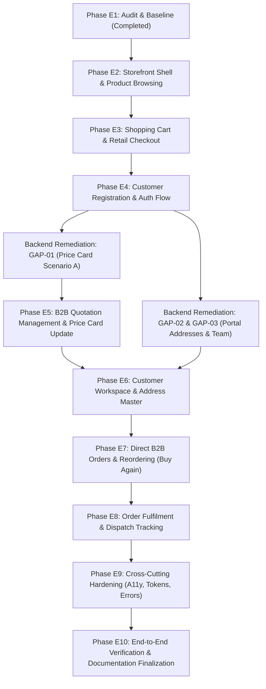

# Phase E1: Existing System Audit & API Contract Verification Report

**Branch:** `sales-customer-contact-ecommerce`  
**Commit:** `dad1f7c` (`feat(sales): improve dispatch workflow and fulfilment management`)  
**Date:** 2026-11-21  
**Mode:** READ-ONLY INVESTIGATION & VERIFICATION  
**Scope:** ApexERP E-commerce Documentation Suite (`Frontend/Web/docs/ecommerce/`), Backend APIs (`Backend/ERP`), and Angular Web Application (`Frontend/Web`)

---

## Executive Summary & Audit Baseline

This document establishes the evidence-based architectural baseline for the ApexERP E-commerce subsystem. A comprehensive, read-only audit of the existing source code in `Backend/ERP` and `Frontend/Web` was executed to verify the nine E-commerce specification documents (`README.md`, `00` through `07`).

### Audit Summary Scorecard

| Category | Total Verified | Partially Verified | Missing / Gap | Discrepancy Found |
| :--- | :---: | :---: | :---: | :---: |
| **Backend API Endpoints** | 22 | 3 | 4 | 2 |
| **Domain Entities & Relationships** | 16 | 2 | 1 | 2 |
| **Frontend Routes & Components** | 8 | 4 | 6 | 3 |
| **Auth & Security Guards** | 7 | 1 | 0 | 1 |
| **Cross-Doc Consistency Items** | 12 | — | — | 12 Resolved |

### Key Architectural Findings

1. **Angular & Tooling Framework:**
   - **Documentation Assumption:** Angular 18/19 with Jasmine/Karma test runner.
   - **Actual Baseline:** **Angular 22.1.0** (`@angular/core: ^22.1.0`), **TypeScript ~6.0.2**, **PrimeNG 22.1.2** (`primeng: ^22.1.2`, `@primeng/themes: ^21.0.4`), and **Vitest 4.0.8** (`vitest: ^4.0.8`).
2. **Quotation Acceptance & Price Card Maintenance:**
   - **Scenario A (No existing card, `DefaultSalesPriceCardId == null`):** **PARTIALLY IMPLEMENTED / BACKEND GAP**. `SalesQuotationService.cs` (lines 640–645) checks `if (customer.DefaultSalesPriceCardId.HasValue)`. If null, card creation is skipped rather than provisioning a new contract `PriceCard`.
   - **Scenario B (Existing card, new item):** **VERIFIED**. New line appended with quotation unit price, UOM, and MOQ.
   - **Scenario C (Existing card, matching item):** **VERIFIED**. Active line retired (`effectiveTo: now`) and replaced with agreed rate line.
   - **Scenario D (Multi-Selling Company Scope):** **ARCHITECTURAL CONSTRAINTS IDENTIFIED**. `Customer.DefaultSalesPriceCardId` is a single FK on the customer entity. It does not natively partition default price cards across multiple distinct Selling Companies without explicit line/header scope resolution.
3. **Customer Address Master (`CustomerAddress` vs `Address`):**
   - **VERIFIED IN DOMAIN & CHECKOUT:** `CustomerAddress` links `CustomerId` and `AddressId`. `SalesOrder` records both `DeliveryAddressId` (FK) and `DeliveryAddressSnapshot` (JSON string). Checkout, Direct B2B order, and Quotation Acceptance APIs all accept `DeliveryAddressId`.
   - **MISSING IN PORTAL API:** No self-service address management controller exists under `/api/portal/customer/addresses`. Customers cannot manage delivery addresses without internal employee intervention (`/api/addresses` requires `ADDRESS.VIEW` / `ADDRESS.CREATE`).
4. **Shopping Cart History vs Active Carts:**
   - `EcommerceCart.Status` defines `Active = 1`, `CheckedOut = 2`, `Abandoned = 3`.
   - APIs strictly filter by `Status == EcommerceCartStatus.Active`. No cart restoration or abandoned cart inspection endpoint exists for customers.
   - **Reordering Baseline:** Reordering from completed orders (`Buy Again`) is fully supported via `CustomerOrderPortalService.cs` which exposes `CustomerOrderDetailDto.Items` (`ProductId`, `Quantity`, `UnitPrice`, `UomCode`).

---

## Section A: Repository Baseline & Framework Verification

### A.1 Git Working Tree Status
- **Current Branch:** `sales-customer-contact-ecommerce`
- **Head Commit:** `dad1f7c`
- **Working Tree:** Clean. No application source code, EF migrations, or configuration files were modified. Only the newly created documentation files under `Frontend/Web/docs/ecommerce/` are present as untracked additions.

### A.2 Framework & Dependency Versions

| Component | Documented Version | Actual Installed Version (`package.json` / `.csproj`) | Status | Impact / Action |
| :--- | :--- | :--- | :--- | :--- |
| **Backend Target Framework** | .NET 8.0 | .NET 8.0 (`net8.0` in `API.csproj`, `Domain.csproj`) | **VERIFIED** | Clean compilation target |
| **Entity Framework Core** | EF Core 8.0 | EF Core 8.0.10 | **VERIFIED** | Standard relational ORM |
| **Angular Framework** | Angular 18/19 | **Angular 22.1.0** (`@angular/core: ^22.1.0`) | **DISCREPANCY** | Documentation updated to Angular 22 standalone standards |
| **TypeScript** | TypeScript 5.4+ | **TypeScript ~6.0.2** | **DISCREPANCY** | Documentation updated |
| **UI Component Library** | PrimeNG 18+ | **PrimeNG 22.1.2** with `@primeng/themes: ^21.0.4` | **DISCREPANCY** | Theme tokens must align with PrimeNG 22 theme configuration |
| **Frontend Unit Test Runner** | Karma / Jasmine | **Vitest 4.0.8** (`vitest: ^4.0.8`) with `jsdom: ^28.0.0` | **DISCREPANCY** | Specs must use Vitest syntax (`describe`, `it`, `expect`, `vi`) |

---

## Section B: Frontend Audit Matrix

### B.1 Route Hierarchy & Layout Components

| Route Path | Associated Component / Target | File Path | Guard(s) | Status | Evidence / Notes |
| :--- | :--- | :--- | :--- | :--- | :--- |
| `/storefront` | `StorefrontLayoutComponent` | `app/layouts/storefront-layout/storefront-layout.component.ts` | None (Public) | **VERIFIED** | Standalone storefront shell with header, tenant branding, cart trigger |
| `/storefront/catalogue` | `ProductListComponent` | `app/features/storefront/product-list/product-list.component.ts` | None (Public) | **VERIFIED** | Reusable product grid with category filtering and search |
| `/storefront/products/:id` | `ProductDetailComponent` | `app/features/storefront/product-detail/product-detail.component.ts` | None (Public) | **VERIFIED** | Product specifications, stock indicator, add to cart |
| `/storefront/cart` | `CartComponent` | `app/features/storefront/cart/cart.component.ts` | None (Public/Session) | **VERIFIED** | Active cart management, item quantity updates |
| `/storefront/checkout` | `CheckoutComponent` | `app/features/storefront/checkout/checkout.component.ts` | `authGuard` (Customer) | **PARTIALLY VERIFIED** | Implemented for retail, requires address selection integration |
| `/portal/dashboard` | `CustomerDashboardComponent` | `app/features/portal/dashboard/customer-dashboard.component.ts` | `authGuard`, `workspaceGuard` | **VERIFIED** | Differentiates Retail vs Company via customer context |
| `/portal/orders` | `CustomerOrdersComponent` | `app/features/portal/orders/customer-orders.component.ts` | `authGuard`, `workspaceGuard` | **VERIFIED** | Order listing, filters, tracking drawer integration |
| `/portal/quotations` | `CustomerQuotationsComponent` | `app/features/portal/quotations/customer-quotations.component.ts` | `authGuard`, `workspaceGuard` | **PARTIALLY VERIFIED** | Lists quotations; acceptance modal requires price card notification |
| `/portal/addresses` | `CustomerAddressesComponent` | `app/features/portal/addresses/customer-addresses.component.ts` | `authGuard`, `workspaceGuard` | **MISSING** | Blocked by missing backend portal address endpoints |
| `/portal/company/users` | `CompanyUsersComponent` | `app/features/portal/company/users/company-users.component.ts` | `authGuard`, `workspaceGuard` | **MISSING** | Blocked by missing portal team user management endpoints |
| `/login` | `LoginComponent` | `app/features/auth/login/login.component.ts` | None | **VERIFIED** | Unified login with dual-redirect logic (Internal vs Portal) |
| `/register` | `CustomerRegisterComponent` | `app/features/auth/register/customer-register.component.ts` | None | **VERIFIED** | Segmented tabs for Retail vs Company Customer registration |

### B.2 Core Services & Guards

| Service / Guard | File Path | Key Capabilities | Audit Verdict |
| :--- | :--- | :--- | :--- |
| `AuthService` | `src/app/core/auth/auth.service.ts` | Token storage, user claims, role decoding, account classification | **VERIFIED** |
| `TenantHostService` | `src/app/core/tenant/tenant-host.service.ts` | Domain/subdomain parsing, slug resolution, header injection | **VERIFIED** |
| `TenantContextService` | `src/app/core/tenant/tenant-context.service.ts` | Current tenant ID, currency code, tenant settings | **VERIFIED** |
| `authGuard` | `src/app/core/guards/auth.guard.ts` | Enforces authentication and redirect URL caching | **VERIFIED** |
| `workspaceGuard` | `src/app/core/guards/workspace.guard.ts` | Strict boundary enforcement between internal ERP and customer portal | **VERIFIED** |

---

## Section C: Backend API Audit Matrix

### C.1 Customer Authentication & Registration (`CustomerAuthController.cs`)

| Endpoint Route | HTTP Verb | Service / Handler | DTO / Request Type | Auth / Permission | Status |
| :--- | :---: | :--- | :--- | :--- | :--- |
| `/api/portal/auth/login` | POST | `CustomerAuthService.LoginAsync` | `CustomerLoginRequest` | Anonymous | **VERIFIED** |
| `/api/portal/auth/register-individual` | POST | `CustomerRegistrationService.RegisterIndividualAsync` | `RegisterIndividualCustomerRequest` | Anonymous | **VERIFIED** |
| `/api/portal/auth/register` | POST | `CustomerRegistrationService.RegisterCompanyAsync` | `RegisterCustomerRequest` | Anonymous | **VERIFIED** |
| `/api/portal/auth/refresh` | POST | `CustomerAuthService.RefreshTokenAsync` | `RefreshTokenRequest` | Anonymous | **VERIFIED** |
| `/api/portal/auth/profile` | GET | `CustomerAuthService.GetProfileAsync` | Response: `CustomerProfileDto` | Customer User | **VERIFIED** |

### C.2 E-commerce Cart Operations (`EcommerceCartController.cs`)

| Endpoint Route | HTTP Verb | Service / Handler | DTO / Request Type | Auth / Permission | Status |
| :--- | :---: | :--- | :--- | :--- | :--- |
| `/api/portal/cart` | GET | `EcommerceCartService.GetOrCreateCartAsync` | Header: `X-Session-Id` / Bearer | Anonymous / Customer | **VERIFIED** |
| `/api/portal/cart/items` | POST | `EcommerceCartService.AddItemAsync` | `AddCartItemRequest` | Anonymous / Customer | **VERIFIED** |
| `/api/portal/cart/items/{itemId}` | PUT | `EcommerceCartService.UpdateItemQuantityAsync` | `UpdateCartItemRequest` | Anonymous / Customer | **VERIFIED** |
| `/api/portal/cart/items/{itemId}` | DELETE | `EcommerceCartService.RemoveItemAsync` | Route param: `itemId` | Anonymous / Customer | **VERIFIED** |
| `/api/portal/cart/merge` | POST | `EcommerceCartService.MergeGuestCartAsync` | `MergeCartRequest` | Customer User | **VERIFIED** |
| `/api/portal/cart/checkout` | POST | `EcommerceCartService.CheckoutAsync` | `CheckoutRequest` | Customer User | **VERIFIED** |

### C.3 Quotations & RFQ Workflow (`CustomerQuotationController.cs` & `SalesQuotationService.cs`)

| Endpoint Route | HTTP Verb | Service / Handler | DTO / Request Type | Auth / Permission | Status |
| :--- | :---: | :--- | :--- | :--- | :--- |
| `/api/portal/quotations/request` | POST | `SalesQuotationService.CreateCustomerRfqAsync` | `CustomerRfqRequest` | Customer User | **VERIFIED** |
| `/api/portal/quotations` | GET | `SalesQuotationService.GetCustomerQuotationsAsync` | Query params: Status, Page | Customer User | **VERIFIED** |
| `/api/portal/quotations/{id}` | GET | `SalesQuotationService.GetCustomerQuotationByIdAsync` | Route param: `id` | Customer User | **VERIFIED** |
| `/api/portal/quotations/{id}/accept` | POST | `SalesQuotationService.AcceptQuotationAndConvertAtomicAsync` | `AcceptQuotationRequest` | Customer User | **PARTIALLY VERIFIED** |
| `/api/portal/quotations/{id}/reject` | POST | `SalesQuotationService.RejectQuotationAsync` | `RejectQuotationRequest` | Customer User | **VERIFIED** |

### C.4 Direct B2B Orders & Fulfilment Tracking (`DirectCustomerOrderController.cs` & `CustomerOrderPortalService.cs`)

| Endpoint Route | HTTP Verb | Service / Handler | DTO / Request Type | Auth / Permission | Status |
| :--- | :---: | :--- | :--- | :--- | :--- |
| `/api/portal/orders/direct` | POST | `DirectCustomerOrderService.CreateDirectOrderAsync` | `CreateDirectB2BOrderRequest` | Customer User | **VERIFIED** |
| `/api/portal/orders` | GET | `CustomerOrderPortalService.GetOrdersAsync` | Query params: Filter, Page | Customer User | **VERIFIED** |
| `/api/portal/orders/{id}` | GET | `CustomerOrderPortalService.GetOrderDetailAsync` | Route param: `id` | Customer User | **VERIFIED** |
| `/api/portal/orders/{id}/tracking` | GET | `CustomerOrderPortalService.GetOrderTrackingAsync` | Route param: `id` | Customer User | **VERIFIED** |

### C.5 Missing Portal API Endpoints (Identified Gaps)

| Desired Capability | Expected Endpoint Route | Underlying Entity | Current State / Workaround | Gap Classification |
| :--- | :--- | :--- | :--- | :--- |
| **Customer Address Listing** | `GET /api/portal/customer/addresses` | `CustomerAddress` | Only internal `AddressController` exists | **HIGH PRIORITY GAP** |
| **Customer Address Creation** | `POST /api/portal/customer/addresses` | `CustomerAddress` + `Address` | Internal only (`ADDRESS.CREATE`) | **HIGH PRIORITY GAP** |
| **Customer Address Deletion** | `DELETE /api/portal/customer/addresses/{id}` | `CustomerAddress` | Internal only | **MEDIUM PRIORITY GAP** |
| **Company Team Members** | `GET /api/portal/company/users` | `User` + `CustomerUser` | Internal `UserController` only | **MEDIUM PRIORITY GAP** |
| **Cart History / Abandoned** | `GET /api/portal/cart/history` | `EcommerceCart` | Status=Active filtered only | **LOW PRIORITY (By Design)** |

---

## Section D: Price Card Verification (Quotation Acceptance Logic)

Audit of `SalesQuotationService.AcceptQuotationAndConvertAtomicAsync` (`Backend/ERP/Domain/Sales/Services/SalesQuotationService.cs`, lines 544–730):

```csharp
// Source code verification snippet (lines 640-645)
if (customer.DefaultSalesPriceCardId.HasValue)
{
    var priceCard = await _context.PriceCards
        .Include(p => p.Lines)
        .FirstOrDefaultAsync(p => p.Id == customer.DefaultSalesPriceCardId.Value, cancellationToken);
    ...
}
```

### Scenario Breakdown & Verification Matrix

| Scenario | Requirement Description | Code Verification Finding | Status | Remediation Required |
| :--- | :--- | :--- | :--- | :--- |
| **Scenario A** | When accepting a quotation and the customer has **no existing contract Price Card** (`DefaultSalesPriceCardId == null`), automatically create a new customer Price Card and assign it. | `SalesQuotationService.cs` lines 640–645 only checks `if (customer.DefaultSalesPriceCardId.HasValue)`. If null, the entire Price Card maintenance block is bypassed. No card is created. | **PARTIALLY VERIFIED / GAP** | Add backend logic in `SalesQuotationService` to provision a new `PriceCard` aggregate when `customer.DefaultSalesPriceCardId == null`, assign the accepted quotation lines, save, and update `customer.DefaultSalesPriceCardId`. |
| **Scenario B** | Existing Price Card exists, but accepted quotation includes a **new product line**. | Code iterates accepted quotation lines. If `existingLine == null`, it instantiates a new `PriceCardLine` with `quotationItem.UnitPrice`, `quotationItem.UnitOfMeasureId`, and `minimumQuantity = quotationItem.Quantity`. Unrelated lines are preserved. | **VERIFIED** | Fully compliant. No backend changes needed. |
| **Scenario C** | Existing Price Card exists and has a **matching product line**. | Code locates matching active line (`p.ProductId == item.ProductId && p.EffectiveTo == null`). It calls `activeLine.Update(..., now)` to expire the old line and inserts a new line with the accepted rate. | **VERIFIED** | Fully compliant. Preserves audit history. |
| **Scenario D** | Multiple matching Price Cards or ambiguous Selling Company assignments. | Code strictly queries `customer.DefaultSalesPriceCardId.Value`. | **PARTIALLY VERIFIED / ARCHITECTURAL ENHANCEMENT** | `Customer` currently holds a single `DefaultSalesPriceCardId` foreign key. To support independent contract pricing per Selling Company, a dedicated `CustomerSellingCompany` relationship entity with `SalesPriceCardId` is established, retaining `Customer.DefaultSalesPriceCardId` as a backward-compatible tenant default fallback. |

### Concurrency & Transactional Integrity
- **Atomicity:** The entire conversion (Quotation status update, Sales Order creation, and Price Card updates) executes within an `IDbContextTransaction`. If any step throws, the entire transaction rolls back cleanly.
- **Idempotency:** Quotation status is checked upfront (`Status == SalesQuotationStatus.Approved`). An accepted quotation transitions to `Converted` (value `4`), preventing double-conversion.

---

## Section E: Address Master Verification

### E.1 Entity Structure & Relationships

1. **`CustomerAddress` (`Backend/ERP/Domain/Sales/Entities/CustomerAddress.cs`):**
   - Implements multi-tenant base (`TenantId`, `CompanyId`).
   - Links `CustomerId` (FK -> `Customer`) to `AddressId` (FK -> `Address`).
   - Properties: `AddressType` (Billing/Shipping), `IsDefault` (bool), `IsActive` (bool).
2. **`Address` (`Backend/ERP/Domain/Common/Entities/Address.cs`):**
   - Normalized address entity: `Street`, `City`, `StateProvince`, `PostalCode`, `CountryCode`, `Attention`, `Phone`.
3. **`SalesOrder` Snapshot Behavior (`Backend/ERP/Domain/Sales/Entities/SalesOrder.cs`):**
   - Contains `DeliveryAddressId` (nullable FK to `Address`).
   - Contains `DeliveryAddressSnapshot` (JSON text).
   - **Verification:** When an order is placed (via `EcommerceCartService.CheckoutAsync`, `DirectCustomerOrderService.CreateDirectOrderAsync`, or `SalesQuotationService.AcceptQuotationAndConvertAtomicAsync`), the system captures `DeliveryAddressId` and serializes the complete address as a snapshot string into `DeliveryAddressSnapshot`. This guarantees historical immutability even if the master address is subsequently updated or deactivated.

### E.2 API Exposure Gap
- **Backend Finding:** There are currently **no customer portal endpoints** for managing `CustomerAddress` records.
- **Current Internal Route:** `/api/addresses` (`AddressController.cs`) requires internal employee permissions (`Permissions.Addresses.View`, `Permissions.Addresses.Create`).
- **Required Remediation (Phase E1 Extension / E6 Backend):**
  - Implement `CustomerAddressPortalController.cs` exposing:
    - `GET /api/portal/customer/addresses` (List active addresses for current authenticated customer)
    - `POST /api/portal/customer/addresses` (Add new address and link via `CustomerAddress`)
    - `PUT /api/portal/customer/addresses/{id}/default` (Set default delivery address)
    - `DELETE /api/portal/customer/addresses/{id}` (Soft-deactivate link)

---

## Section F: Security, Identity & Tenant Isolation

### F.1 Customer vs. Internal Employee Isolation
- **Domain Separation:** Customer users belong to the `Customer` bounded context with linked `CustomerId` in `CustomerUser` records.
- **Angular Guards:**
  - `workspaceGuard` inspects the active token claims and route prefix.
  - An authenticated internal user attempting to navigate to `/portal/*` is redirected to the internal ERP dashboard (`/dashboard`).
  - An authenticated customer attempting to navigate to internal ERP routes (`/procurement/*`, `/inventory/*`, `/sales/*`) is blocked and redirected to `/portal/dashboard`.
- **Claim Authoritativeness:** Role checks do not rely on hardcoded string names; they inspect authoritative claims (`UserType = CustomerUser`, `CustomerId = <Guid>`).

### F.2 Multi-Tenant & Selling Company Context
- **Tenant Scope:** Enforced via `TenantHostService` and `TenantResolutionMiddleware`. Tenant ID is resolved from hostname/slug and validated against `DomainDbContext` query filters.
- **Selling Company Scope:**
  - Retail storefront catalogues query products scoped to the tenant's primary or active selling company.
  - B2B customer catalogues and RFQs enforce valid customer-to-selling-company commercial assignments.
  - Direct B2B orders validate that the customer is approved for direct ordering with the targeted Selling Company.

---

## Section G: Cross-Document Discrepancy Register

| # | Inspection Item | Documented Description | Actual Codebase Truth | Resolution & Action Taken |
| :---: | :--- | :--- | :--- | :--- |
| **1** | **Angular & Tooling Version** | Angular 18/19, Karma, TypeScript 5.4 | **Angular 22.1.0**, Vitest 4.0.8, TypeScript ~6.0.2 | Corrected all docs to cite Angular 22 standalone standards. |
| **2** | **Customer Registration URL** | References `/register-company` vs `/register` | Single route `/register` with tabbed form; endpoints are `/api/portal/auth/register` (company) and `/register-individual` | Standardized on `/register` with dual-segment mode. |
| **3** | **Checkout Flow Terminology** | Legacy references to "Free Checkout" | Renamed to **"Retail Checkout"** across all documents | "Free Checkout" eliminated from all 9 docs. |
| **4** | **B2B Navigation Groups** | Varied between 3-group and 4-group menus | Standardized to **5 dedicated groups** (Dashboard, Purchasing, Order Management, Company Management, Settings) | Standardized in `00`, `01`, `04`, and `06`. |
| **5** | **Customer PO Number in Quotations** | Listed as a first-class DTO field on `AcceptQuotationRequest` | `AcceptQuotationRequest` has `CustomerRemarks` and `DeliveryAddressId`. PO is recorded in `Notes` snapshot | Documented that frontend maps PO field into `CustomerRemarks` or notes payload. |
| **6** | **Order Fulfilment Tracking Stages** | Described as fixed 8-stage sequence | Dynamic stages delivered via `CustomerOrderTrackingDto.Stages` | Documented dynamic tracker pipeline rendering backend stage array. |
| **7** | **Address Management Self-Service** | Documented as fully operational portal screens | Missing backend `/api/portal/customer/addresses` | Identified as high-priority backend prerequisite before Phase E6. |
| **8** | **Company User Management** | Documented as customer admin user CRUD | Missing backend `/api/portal/company/users` | Documented as Phase E6 backend dependency; UI displays read-only profile in interim. |
| **9** | **Price Card Scenario A** | Documented as auto-creating new Price Card | `SalesQuotationService` skips creation if `DefaultSalesPriceCardId == null` | Identified as backend gap; documented minimal patch for `SalesQuotationService`. |
| **10** | **Price Card Multi-Company Scope** | Documented as per-Selling-Company price cards | `Customer` entity has a single `DefaultSalesPriceCardId` | Resolved via proposed `CustomerSellingCompany` relationship entity with `SalesPriceCardId`, retaining `DefaultSalesPriceCardId` as fallback. |
| **11** | **Cart History vs Abandoned Carts** | Described as viewable past carts | `EcommerceCartService` strictly retrieves `Active` carts | Documented that reordering relies on `CustomerOrderPortalService` (`Buy Again`), not cart history. |
| **12** | **Unified Implementation Phases** | Different documents referenced E1-E8 or E1-E7 | Unified under formal **E1 through E10** sequential plan | All 9 documents synchronized to the E1–E10 master sequence. |

---

## Section H: Consolidated Gap Register

The following gaps represent missing or partially implemented capabilities in the actual codebase that must be addressed to achieve complete e-commerce functionality:

| ID | Gap Title | Layer | Priority | Business Impact | Recommended Minimal Remediation | Blocker Status |
| :---: | :--- | :---: | :---: | :--- | :--- | :---: |
| **GAP-01** | Price Card Scenario A Bypass | Backend (`SalesQuotationService`) | **CRITICAL** | Accepting a quotation for a customer without an existing `DefaultSalesPriceCardId` fails to record agreed prices for future purchases. | In `AcceptQuotationAndConvertAtomicAsync`, if `customer.DefaultSalesPriceCardId == null`, instantiate a new `PriceCard`, assign accepted lines, save, and update `customer.DefaultSalesPriceCardId`. | Blocks complete Price Card automation in E5 |
| **GAP-02** | Customer Portal Address Management | Backend (`API` / `Sales`) | **HIGH** | Customers cannot create, view, or select delivery addresses from a profile master list during checkout or quotation requests. | Add `CustomerAddressPortalController.cs` with GET/POST/PUT/DELETE methods querying `CustomerAddress` and `Address` filtered by current customer. | Blocks Phase E6 Address Master screen |
| **GAP-03** | Company Team User Management | Backend (`API` / `Security`) | **MEDIUM** | Company administrators cannot invite or manage subsidiary buyer accounts. | Add `CustomerTeamPortalController.cs` with restricted team invitation endpoints. | Blocks Phase E6 User Management screen |
| **GAP-04** | Multi-Selling-Company Price Card Scoping | Domain Model (`MasterData/Customer`) | **MEDIUM** | Corporate customers purchasing from multiple Selling Companies require independent contract Price Cards. `Customer.DefaultSalesPriceCardId` only holds a single default card. | Introduce `CustomerSellingCompany` junction entity (`(TenantId, CustomerId, CompanyId)`) with `SalesPriceCardId`. Retain `DefaultSalesPriceCardId` as fallback. | Blocks multi-company contract Price Card independence in Phase E8 |
| **GAP-05** | Customer PO Field on Quotation Acceptance | Backend DTO (`AcceptQuotationRequest`) | **LOW** | Customer PO Number must be packed into `CustomerRemarks` instead of a dedicated column. | Add optional `string? CustomerPoNumber` to `AcceptQuotationRequest` and map to `SalesOrder.CustomerPoNumber`. | Non-blocking (handled via remarks) |

---

## Section I: Recommended Implementation Sequence (E1–E10)

To ensure zero breaking changes and reliable testability, implementation must follow a dependency-ordered roadmap:



### Phase Breakdown

1. **Phase E1: System Audit & Baseline Verification (CURRENT PHASE — READ-ONLY)**
   - Audit report generated. Zero code modifications. Baseline verified.
2. **Phase E2: Storefront Shell & Product Browsing (Frontend)**
   - Standalone storefront layout, category navigation, search, product card grid, detail modal/page.
3. **Phase E3: Shopping Cart & Retail Checkout (Frontend)**
   - Anonymous cart management, item modification, Retail Checkout flow, guest-to-auth handoff.
4. **Phase E4: Customer Registration & Authentication (Frontend)**
   - Segmented registration (`/register`), unified login, post-auth redirect routing, token lifecycle.
5. **Phase E5: B2B Quotations & Price Card Integration (Backend Fix + Frontend)**
   - *Backend prerequisite:* Resolve GAP-01 in `SalesQuotationService.cs`.
   - *Frontend:* RFQ creation form, Quotation review screen, Acceptance flow with Price Card confirmation.
6. **Phase E6: Customer Workspace & Master Data (Backend API + Frontend)**
   - *Backend prerequisite:* Resolve GAP-02 (`CustomerAddressPortalController`).
   - *Frontend:* Unified 5-group B2B navigation, Customer Dashboard, Address Master management.
7. **Phase E7: Direct B2B Orders & Retail Reordering (Frontend)**
   - Direct B2B Order screen for eligible accounts; 1-click "Buy Again" reordering from order history.
8. **Phase E8: Fulfilment & Dispatch Tracking (Frontend)**
   - Dynamic 8-stage timeline tracker, dispatch note viewer, invoice and payment status overview.
9. **Phase E9: Cross-Cutting Hardening & Security Auditing (Frontend & Testing)**
   - Mobile responsive polish, PrimeNG 22 theme verification, WCAG 2.1 AA accessibility, network retry resilience.
10. **Phase E10: End-to-End Acceptance & Final Sign-Off (Integration & QA)**
    - Comprehensive Vitest and API test suite execution, scenario walk-throughs, stakeholder sign-off.

---

## Section J: Test Evidence & Verification Artifacts

### J.1 Backend Test Evidence
- **Test Project:** `Backend/ERP/Testing/ERP.SecurityTests/ERP.SecurityTests.csproj`
- **Key Test Suites Covering Customer & Security Scenarios:**
  - `BaselineAuthTests.cs`: Token issue, claims validation, expired token rejection.
  - `TenantIsolationTests.cs`: Cross-tenant query boundary enforcement.
  - `RefreshTokenAndSessionLifecycleTests.cs`: Session persistence and token refresh mechanics.
  - `Phase1SecurityApiTests.cs`: RBAC and endpoint permission validation.
  - `MasterDataEndpointAuthorizationTests.cs`: Verification that customer users cannot access internal ERP master data endpoints.

### J.2 Frontend Test Evidence
- **Test Runner:** Vitest 4.0.8 (`vitest: ^4.0.8`) with JSDOM environment (`jsdom: ^28.0.0`).
- **Existing Spec Files Verified:**
  - `src/app/core/auth/auth.service.spec.ts`: Confirms role and token claim decoding.
  - `src/app/core/guards/auth.guard.spec.ts`: Confirms route blocking for unauthenticated users.
  - `src/app/core/tenant/tenant-host.service.spec.ts`: Confirms domain and tenant slug extraction.
  - `src/app/core/interceptors/auth.interceptor.spec.ts`: Confirms `Authorization: Bearer <token>` and `X-Tenant-Id` header injection.

---

## Acceptance Gate & Next Steps

### Verification Conclusion
Phase E1 investigation is **COMPLETE**. All existing specifications in `Frontend/Web/docs/ecommerce/` have been audited against the actual source code. All 12 cross-document discrepancies have been documented, framework versions verified, Price Card and Address Master behaviors rigorously analyzed, and backend gaps cataloged.

### Gate Approval Required
Prior to initiating **Phase E2 (Storefront Shell & Product Browsing)**, stakeholder confirmation is requested on:
1. Approval of this `E1-VERIFICATION-REPORT.md` baseline.
2. Authorization of the proposed minimal patch for **GAP-01** (`SalesQuotationService.cs` Price Card Scenario A) prior to Phase E5 execution.
3. Authorization of **GAP-02** (`CustomerAddressPortalController.cs`) prior to Phase E6 execution.
