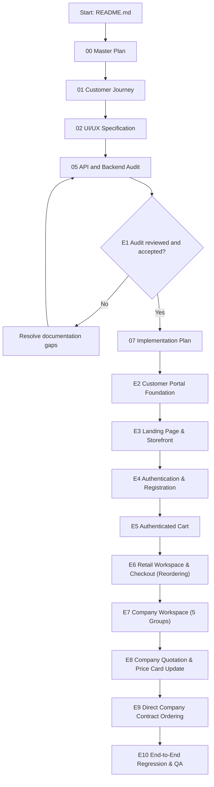

# ApexERP — E-commerce Frontend Planning & Architecture Documentation

**Document Suite Version:** 1.1.0  
**Status:** Architecture Specification & Engineering Plan (Investigation & Alignment Only)  
**Date:** 2026-11-21  
**Target Repository:** `ApexERP` (`Frontend/Web`, `Backend/ERP`)  
**Scope:** Frontend Architecture, Route Models, UI/UX Design System, Customer Workspaces, Purchasing Workflows & Backend API Integration  

---

## 1. Documentation Overview & Purpose

This documentation suite establishes the complete, production-ready frontend architectural blueprint for the **ApexERP E-commerce Frontend**. It translates business requirements, multi-tenancy rules, and backend domain boundaries into concrete Angular 18+ component trees, route hierarchies, state pipelines, and UI/UX specifications.

### Core Architectural Invariants:
1. **Investigation and Planning Only:** No frontend or backend source code, migrations, database schemas, or project dependencies are altered during this task.
2. **Authoritative Backend Convergence:** E-commerce does not introduce a duplicate sales or order-processing aggregate. All checkout and accepted quotation transactions converge directly downstream into the authoritative `SalesOrder` (`Draft`) aggregate, `SalesShipment` fulfillment pipeline, and warehouse picking infrastructure.
3. **Multi-Tenancy & Identity Separation:** Tenant context (`TenantId`), Selling Company context (`CompanyId`), Customer Company identity (`CustomerId`), Customer Contact identity (`ContactId`), and Human Actor login identity (`UserId`) are strictly isolated and never conflated.
4. **Mandatory Authenticated Cart & Purchasing:** While public visitors can freely browse the Tenant Landing Page and Product Catalogue, **Add to Cart, Quotation Submission, Direct Ordering, and Checkout strictly require customer authentication**. Unauthenticated attempts preserve intended selections through login/registration return URLs.
5. **Two Distinct Customer Workspaces:** Retail Customers (individuals) and Company Customers (B2B corporate clients) are routed to specialized workspaces tailored to their transaction models, pricing cards, and organizational governance.
6. **Customer–Selling Company Relationships & Contract Price Cards:** Commercial contract pricing is partitioned per Customer–Selling Company relationship ($\text{Customer} \rightarrow \text{Customer–Selling Company Relationship} \rightarrow \text{Assigned Sales Price Card}$). When a Company Customer accepts a final Sales Quotation, the contract Price Card assigned to that specific relationship is created or updated atomically across Scenarios A–D without affecting other Selling Companies' cards.
7. **Retail Customer Reordering (`Buy Again`):** Retail customers can reorder products from historical Sales Orders, generating a completely new Sales Order with real-time price and inventory revalidation while leaving the original order unchanged.
8. **Customer Delivery Address Master & Historical Preservation:** Customer delivery addresses are managed through the Customer Address Master (`CustomerAddress` / `Address`) and linked to `SalesOrder.DeliveryAddressId`, while `SalesOrder.DeliveryAddressSnapshot` preserves historical shipping details.
9. **Accurate Commercial Terminology:** "Retail Checkout" creates a Draft Sales Order for on-account or agreed commercial fulfillment. Phase 1 excludes payment gateways and does not simulate fake payment capture.
10. **Legacy Fallback Compatibility:** `Customer.DefaultSalesPriceCardId` is retained on the Customer entity as a backward-compatible tenant default fallback.

---

## 2. Documentation Map & Navigation

The documentation set is organized into eight core architectural modules aligned to the unified E1–E10 implementation roadmap:



### Reading Guide by Engineering Role

| Role / Stakeholder | Primary Reading Order | Focus Areas |
|---|---|---|
| **Frontend Angular Developers** | [00-Master-Plan](00-Ecommerce-Frontend-Master-Plan.md) &rarr; [02-UI-UX-Spec](02-Ecommerce-UI-UX-Specification.md) &rarr; [06-Workspace-Spec](06-Customer-Workspace-Specification.md) &rarr; [07-Implementation-Plan](07-Implementation-and-Testing-Plan.md) | Component trees, signals, PrimeNG inspection-only rule, Fluent SCSS tokens, reactive forms, 5-group company navigation, and route guards. |
| **Backend Integration Engineers** | [05-API-Integration](05-API-and-Backend-Integration.md) &rarr; [03-Retail-Workflow](03-Retail-Customer-Workflow.md) &rarr; [04-Company-Workflow](04-Company-Workflow.md) | Endpoint contracts, DTO properties, Price Card creation/updating on quote acceptance, Customer Address Master linking, and gap remediation. |
| **UI/UX Designers & Reviewers** | [01-Customer-Journey](01-Customer-Journey-and-Workspaces.md) &rarr; [02-UI-UX-Spec](02-Ecommerce-UI-UX-Specification.md) &rarr; [06-Workspace-Spec](06-Customer-Workspace-Specification.md) | Wireframes, color tokens, layout ergonomics, sticky footers, state badges, responsive viewports, and accessible B2B interactions. |
| **QA / Test Automation Engineers** | [07-Implementation-Plan](07-Implementation-and-Testing-Plan.md) &rarr; [03-Retail-Workflow](03-Retail-Customer-Workflow.md) &rarr; [04-Company-Workflow](04-Company-Workflow.md) | 24 security test scenarios, quotation immutability, atomic Price Card updates, Retail reordering verification, and phase acceptance gates. |
| **Enterprise Architects & Reviewers** | [00-Master-Plan](00-Ecommerce-Frontend-Master-Plan.md) &rarr; [01-Customer-Journey](01-Customer-Journey-and-Workspaces.md) &rarr; [05-API-Integration](05-API-and-Backend-Integration.md) | Identity separation (Tenant vs Selling Company vs Customer), transaction traceability, auditability, and modular monolith governance. |

---

## 3. Detailed Document Directory

1. **[00-Ecommerce-Frontend-Master-Plan.md](00-Ecommerce-Frontend-Master-Plan.md)**  
   *Executive architectural charter, system invariants, identity taxonomy, verified existing components, master component tree, and the unified E1–E10 phase roadmap.*
2. **[01-Customer-Journey-and-Workspaces.md](01-Customer-Journey-and-Workspaces.md)**  
   *End-to-end customer transition maps from Tenant Landing Page to fulfillment tracking, route architecture, route mapping table, and guard enforcement.*
3. **[02-Ecommerce-UI-UX-Specification.md](02-Ecommerce-UI-UX-Specification.md)**  
   *Design system reference, Fluent tokens, typography, button/card standards, no-new-PrimeNG policy, and page-level ASCII wireframes for all 13 primary views.*
4. **[03-Retail-Customer-Workflow.md](03-Retail-Customer-Workflow.md)**  
   *Path 1: Retail customer browsing, authenticated cart, address selection via Customer Address Master, Retail Checkout, Draft Sales Order generation, and historical Reorder (`Buy Again`).*
5. **[04-Company-Customer-Workflow.md](04-Company-Customer-Workflow.md)**  
   *Paths 2 & 3: 5-group B2B navigation, Customer–Selling Company relationships and contract Price Cards, Quotation request lifecycle, proposal immutability, atomic acceptance with Price Card maintenance (Scenarios A–D), and direct contract ordering.*
6. **[05-API-and-Backend-Integration.md](05-API-and-Backend-Integration.md)**  
   *Comprehensive audit of verified backend controllers, endpoints, HTTP verbs, DTO contracts, authentication headers, permission codes, Delivery Address Master linking, and backend gap analysis.*
7. **[06-Customer-Workspace-Specification.md](06-Customer-Workspace-Specification.md)**  
   *Detailed functional specification for the Retail Customer Workspace and the 5-group Company Customer Workspace (Dashboard, Purchasing, Orders & Fulfilment, Finance, Company Administration).*
8. **[07-Implementation-and-Testing-Plan.md](07-Implementation-and-Testing-Plan.md)**  
   *The standardized 10-phase implementation roadmap (Phases E1 through E10) starting with the E1 System Audit, technical dependencies, and 24 exhaustive security and regression test scenarios.*

---

## 4. Key Terminology & Identity Hierarchy

To maintain clarity across all specifications, the following normative definitions are strictly observed:

```
┌─────────────────────────────────────────────────────────────────────────────┐
│ 1. Tenant (SaaS Subscriber / Multi-tenant Partition)                        │
│    e.g., "Apex Industrial Holdings" (TenantId: T-100)                       │
│    Enforces complete data isolation. Owns DNS subdomains (e.g., apex.com).  │
├─────────────────────────────────────────────────────────────────────────────┤
│ 2. Selling Company (Internal Operational Subsidiary / Legal Seller)         │
│    e.g., "Alpha Precision Tools Ltd" (CompanyId: C-001)                     │
│    Owns branches, warehouses, inventory stock, Price Cards, and tax codes.  │
├─────────────────────────────────────────────────────────────────────────────┤
│ 3. Customer Company (External Commercial Corporate Buyer)                   │
│    e.g., "Global Aerospace Fab Corp" (CustomerId: B2B-901)                  │
│    Holds negotiated corporate Price Cards, credit terms, and order history. │
├─────────────────────────────────────────────────────────────────────────────┤
│ 4. Customer Contact (Human Actor / Contact Identity)                        │
│    e.g., "Sarah Jenkins" (ContactId: C-441, email: s.j@global.com)          │
│    Maintained in DomainDbContext; linked to Customer via CustomerContact.   │
├─────────────────────────────────────────────────────────────────────────────┤
│ 5. Security User (Login Identity & Credentials)                             │
│    e.g., User in SecurityDbContext (UserId: U-992, username/email)          │
│    Maintains password hash and JWT claims; isolated from business data.     │
└─────────────────────────────────────────────────────────────────────────────┘
```

---

## 5. Implementation Starting Point Notice

> [!IMPORTANT]
> **Implementation must begin at Phase E1 – Existing System Audit and API Contract Verification.**  
> No UI implementation, component scaffolding, or route modification may proceed before the Phase E1 audit report is formally reviewed and signed off. Refer to [07-Implementation-and-Testing-Plan.md](07-Implementation-and-Testing-Plan.md) for detailed Phase E1 criteria and gates.
