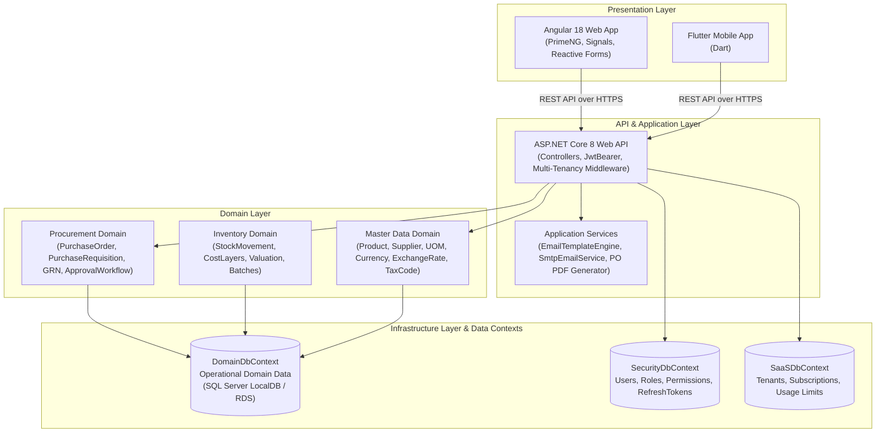
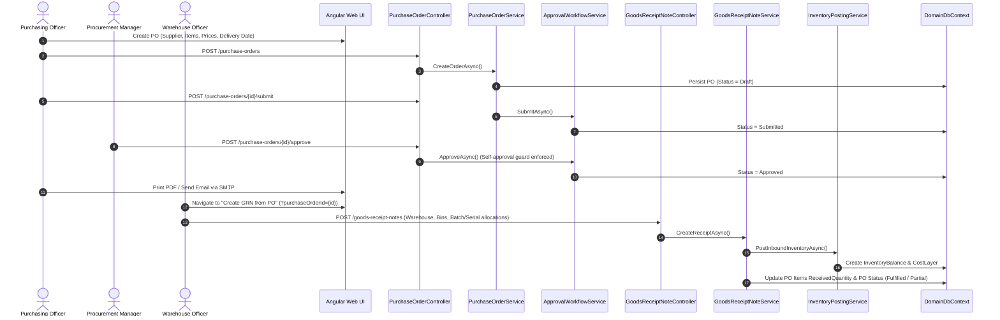
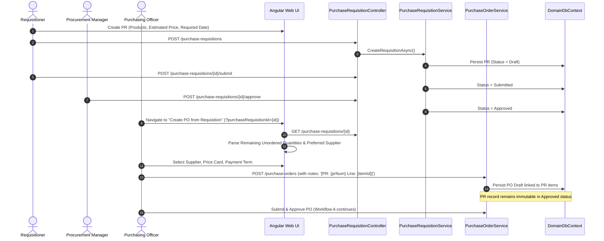
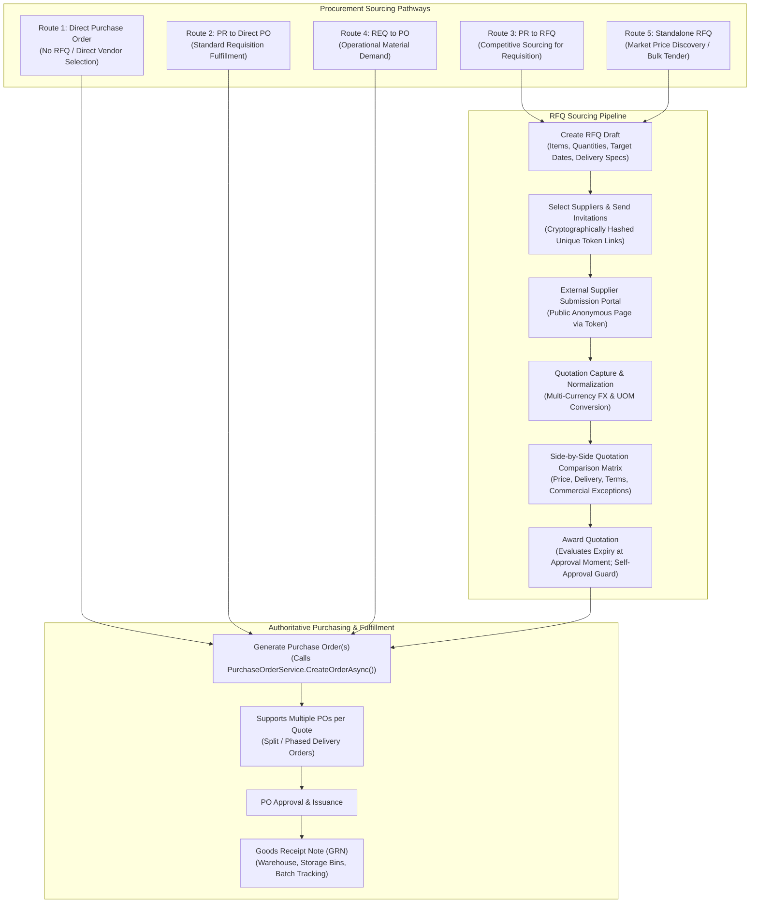
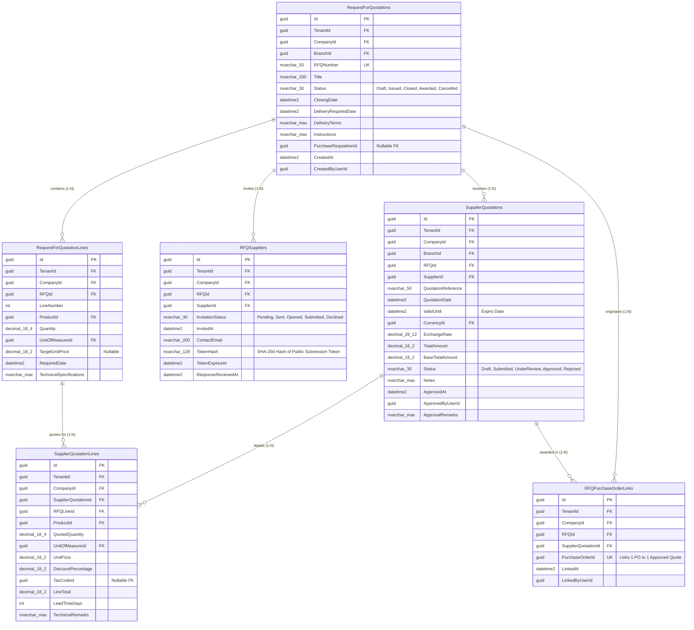
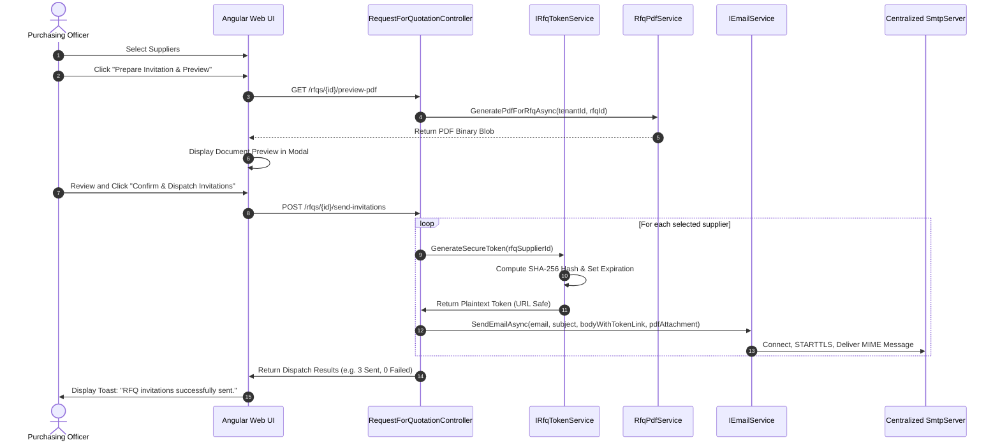
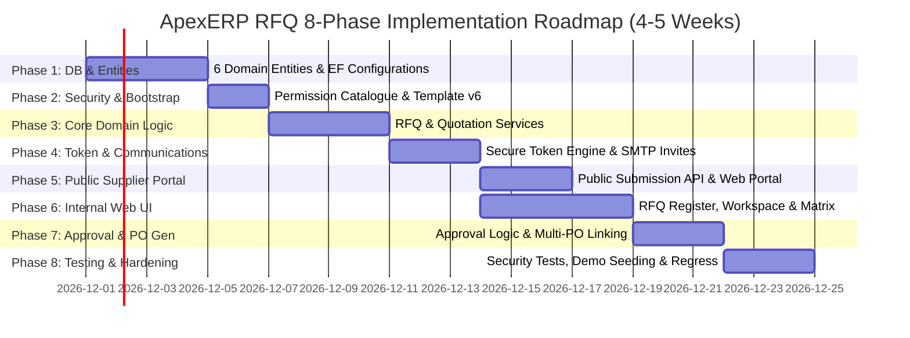

# ApexERP — Request for Quotation (RFQ) Architecture Evaluation and Implementation Plan

**Document Reference:** `DOC-ARCH-RFQ-2026-001`  
**Target Solution:** ApexERP Procurement Module  
**Status:** Architecture Investigation & Implementation Plan (Final Pre-Implementation Revision)  
**Author:** Antigravity AI (on behalf of ApexERP Architecture & Engineering Team)  
**Date:** November 17, 2026  
**Document File:** `z:\ERP\RFQ-Implementation-Plan.md`  

---

## 1. Executive Summary

ApexERP is a multi-tenant, domain-driven modular monolith enterprise application built on **.NET 8 / ASP.NET Core / Entity Framework Core** (backend), **Angular 18 / PrimeNG / TypeScript** (web frontend), and **Flutter** (mobile client). 

This document evaluates the architectural feasibility, structural prerequisites, reusable components, technical risks, confirmed business decisions, and detailed technical design for introducing an optional upstream **Request for Quotation (RFQ)** module into the existing ApexERP Procurement capability.

### Core Strategic Mandates
1. **Preserve Baseline Procurement Stability:** Existing procurement routes—**Route 1 (Direct PO → GRN)**, **Route 2 (PR → PO → GRN)**, and **Route 4 (REQ → PO → GRN)**—must remain 100% operational without regression.
2. **RFQ as an Optional Upstream Workflow:** RFQ constitutes **Route 3 (PR → RFQ → PO → GRN)** or a **Standalone RFQ (Standalone RFQ → PO → GRN)**. It does not replace or mandate itself upon direct purchasing.
3. **Zero Entity Mutation on Existing Models:** No columns (such as `RFQId` or `SupplierQuotationId`) will be injected into the authoritative `PurchaseOrders` or `PurchaseRequisitions` entities/tables. Relationship traceability will be owned entirely by an RFQ-owned linking aggregate (`RFQPurchaseOrderLinks`).
4. **Zero Duplication of Commercial and Fulfillment Logic:** PO creation from approved quotations must invoke the authoritative `PurchaseOrderService.CreateOrderAsync()` orchestration pipeline, reusing pricing resolution, currency snapshots, tax calculations, payment terms, and validation rules.
5. **Multiple PO Generation Support:** A single approved supplier quotation can generate multiple Purchase Orders (e.g. for split deliveries or phased procurement) without restriction. An RFQ can also have multiple approved quotations (e.g. for multi-supplier split awards).
6. **Quotation Validity Rule:** Quotation validity is evaluated strictly at the moment of approval ($\text{CurrentDate} \le \text{ValidUntil}$). Once approved before its expiry date, the approval remains permanently valid even after expiry, permitting subsequent PO generation indefinitely.
7. **External Supplier Access via Cryptographically Secure Links:** Invited suppliers submit bids through dedicated, public submission pages accessed via single-purpose, cryptographically hashed tokens (`[AllowAnonymous]`). Suppliers do **NOT** receive internal portal user accounts in `SecurityDbContext`, preventing user credential bloat and eliminating unnecessary attack surface.
8. **Tenant Admin Full Permission Grant:** To facilitate comprehensive administrative oversight and frictionless testing, `TenantAdmin` receives every RFQ permission.
9. **Idempotent Versioned Security Bootstrap:** RFQ permissions will be registered in `PermissionCatalogue.cs`, assigned in `StandardRoleTemplates.cs` (version bumped from 5 to 6), and applied to existing tenants additively via `SecurityBootstrapService.UpgradeExistingTenantsAsync()` on application startup without modifying custom role configurations.

---

## 2. Existing Architecture Overview

ApexERP follows strict **Clean Architecture** and **Domain-Driven Design (DDD)** principles within a Modular Monolith:



### Context and Security Boundaries
- **Database Segregation:**
  - `DomainDbContext`: Contains master data, sales, procurement, inventory, and operational transactions.
  - `SecurityDbContext`: Houses identity, credentials, roles, permissions, and tenant-scoped role assignments.
  - `SaaSDbContext`: Houses platform tenants, plans, and subscription limit parameters.
  - `AIDbContext`: Houses AI audit and prompt logging.
- **Architectural Invariant:** Zero cross-database foreign keys exist between contexts. All cross-context references are maintained using stable GUID identifiers validated at the application boundary.

---

## 3. Evaluation of Existing Procurement Workflows

ApexERP currently operates three verified procurement pathways:

### 3.1 Workflow A: Direct PO → GRN (Baseline Operational Route)



- **Verification Status:** Verified by automated tests (`ProcurementWorkflowIntegrationTests.cs`, `GoodsReceiptNoteTests.cs`) and documented user testing.

---

### 3.2 Workflow B: PR → PO → GRN (Internal Demand-Driven Route)



- **Verification Status:** Verified by automated tests (`ProcurementWorkflowIntegrationTests.PurchaseRequisition_CreateSubmitRejectLifecycle_AndBranchScopeEnforcement`).

---

### 3.3 Workflow 4: REQ → PO → GRN (Material Requisition Route)

Inspection of the codebase confirms that ApexERP does not maintain a separate `MaterialRequisitions` database table. Instead:
- Requisition demands originating from maintenance, operations, or shop-floor requests (`REQ-...`) utilize the unified `PurchaseRequisition` domain model or pass `sourceDocumentReference: 'REQ-...'` directly into purchase order headers.
- Requisitions generated under the `REQ` naming convention follow identical commercial, pricing, and fulfillment rules via `PurchaseOrderService.CreateOrderAsync()`.
- **Verification Status:** Verified by codebase inspection (`PurchaseOrderService.cs`, `stock-transaction-form.component.html`).

---

## 4. Reusable Services and Infrastructure Catalogue

The proposed RFQ module will directly reuse existing, verified infrastructure without re-implementing foundational capabilities:

| Existing Service / Component | Location | Capability Reused by RFQ |
| :--- | :--- | :--- |
| `ApprovalWorkflowService` | `Domain/Features/Procurement/Approval/` | Two-tier approval lifecycle, self-approval prevention guard (`actor != creator`). |
| `PricingResolutionService` | `Domain/Features/Procurement/Pricing/` | Resolving active supplier price cards, currency baselines, and fallback pricing. |
| `ExchangeRateService` | `Domain/Features/MasterData/Currencies/` | Daily spot-rate resolution for multi-currency quotation normalization. |
| `UnitOfMeasureService` | `Domain/Features/MasterData/UnitsOfMeasure/` | Converting quoted vendor packaging (e.g. cartons) to base inventory UOM (e.g. units). |
| `MailKitSmtpEmailService` | `ERP.Infrastructure/Services/Email/` | Centralized STARTTLS/SSL SMTP dispatch with connection pooling and retry logic. |
| `EmailTemplateEngine` | `ERP.Infrastructure/Services/Email/` | Razor/HTML template parsing, model injection, and CSS inlining. |
| `PurchaseOrderPdfService` | `ERP.Infrastructure/Services/Pdf/` | Pure BCL cross-platform PDF layout rendering (headers, tables, totals, branding). |
| `PurchaseOrderService.CreateOrderAsync` | `Domain/Features/Procurement/PurchaseOrder/` | Complete orchestration of PO creation, validation, tax calculations, and line snapshots. |
| `SecurityBootstrapService` | `Security/Boostrap/` | Additive, versioned deployment of permissions and role templates across tenants. |

---

## 5. Proposed RFQ Business Workflow

RFQ operates as an upstream procurement stage that feeds into the existing Purchase Order pipeline:



---

## 6. RFQ Creation Architecture

### 6.1 Creation Modes
1. **PR-Derived RFQ:** Created from one or more approved Purchase Requisitions. Lines are automatically populated with product codes, requested quantities, required dates, and technical specifications.
2. **Standalone RFQ:** Created directly by a Purchasing Officer for market price benchmarking, periodic contract tenders, or capital expenditure projects.

### 6.2 Header & Line Model
- **Header:** Defines RFQ number, title, procurement category, submission closing date/time, delivery terms, and evaluation criteria.
- **Lines:** Define product references, requested quantities, base UOMs, target benchmark prices (internal only), and delivery location specifications.
- **Invited Suppliers:** A sub-collection of vendors chosen from the Supplier Master.

---

## 7. Confirmed Database Structure & Entity-Relationship Architecture

The RFQ module requires **six domain tables** in `DomainDbContext`. Zero columns will be added to `PurchaseOrders` or `PurchaseRequisitions`.



### 7.1 Detailed Table & Constraint Specifications

#### 1. `RequestForQuotations` (RFQ Header)
- **Primary Key:** `Id` (Guid, clustered).
- **Tenant Scope:** Implements `ITenantScopedEntity`, `ICompanyScopedEntity`, and `IBranchScopedEntity`.
- **Unique Constraint:** `UK_RequestForQuotations_Tenant_Company_RFQNumber` on `(TenantId, CompanyId, RFQNumber)`.
- **Indexes:** `IX_RFQ_Status_ClosingDate` on `(TenantId, Status, ClosingDate)`.
- **Soft Delete:** Implements `ISoftDeletable` (`IsDeleted`, `DeletedAt`, `DeletedByUserId`).

#### 2. `RequestForQuotationLines` (Requested Items)
- **Primary Key:** `Id` (Guid, clustered).
- **Foreign Keys:** `FK_RFQLines_RFQ` referencing `RequestForQuotations(Id)` (Cascade delete with RFQ draft).
- **Precision:** `Quantity` defined as `decimal(18,4)`; `TargetUnitPrice` as `decimal(18,2)`.
- **Unique Constraint:** `UK_RFQLines_RFQ_LineNumber` on `(RFQId, LineNumber)`.

#### 3. `RFQSuppliers` (Invited Suppliers & Token Security)
- **Primary Key:** `Id` (Guid, clustered).
- **Foreign Keys:** `FK_RFQSuppliers_RFQ` referencing `RequestForQuotations(Id)`; `SupplierId` referencing `Suppliers(Id)`.
- **Unique Constraint:** `UK_RFQSuppliers_RFQ_Supplier` on `(RFQId, SupplierId)`.
- **Token Security:** `TokenHash` stores SHA-256 hash (`nvarchar(128)`) with non-clustered index `IX_RFQSuppliers_TokenHash` filtered where `TokenExpiresAt > SYSUTCDATETIME()`.
- **Audit Columns:** `InvitedAt`, `ResponseReceivedAt`, `ContactEmail`.

#### 4. `SupplierQuotations` (Quotation Headers)
- **Primary Key:** `Id` (Guid, clustered).
- **Foreign Keys:** `RFQId` referencing `RequestForQuotations(Id)`; `SupplierId` referencing `Suppliers(Id)`; `CurrencyId` referencing `Currencies(Id)`.
- **Financial Precision:** `ExchangeRate` stored as `decimal(28,12)`; `TotalAmount` and `BaseTotalAmount` stored as `decimal(18,2)`.
- **Quotation Validity:** `ValidUntil` (`datetime2`) checked at approval time.
- **Indexes:** `IX_SupplierQuotations_RFQ_Status` on `(TenantId, RFQId, Status)`.

#### 5. `SupplierQuotationLines` (Quoted Items & Pricing)
- **Primary Key:** `Id` (Guid, clustered).
- **Foreign Keys:** `SupplierQuotationId` referencing `SupplierQuotations(Id)`; `RFQLineId` referencing `RequestForQuotationLines(Id)`.
- **Financial Precision:** `QuotedQuantity` as `decimal(18,4)`; `UnitPrice`, `DiscountPercentage`, `LineTotal` as `decimal(18,2)`.

#### 6. `RFQPurchaseOrderLinks` (Multi-PO Traceability Link)
- **Primary Key:** `Id` (Guid, clustered).
- **Foreign Keys:** `RFQId` referencing `RequestForQuotations(Id)`; `SupplierQuotationId` referencing `SupplierQuotations(Id)`; `PurchaseOrderId` referencing `PurchaseOrders(Id)`.
- **Cardinality Rules & Unique Constraints:**
  - **Multiple POs per Quotation:** An approved quotation can generate multiple Purchase Orders without restriction. Therefore, there is **NO** unique constraint on `SupplierQuotationId`.
  - **Single Source per Generated PO:** A generated Purchase Order is originated by exactly one quotation. Therefore, the unique constraint is:
    $$\text{UK\_RFQPurchaseOrderLinks\_PO} \text{ on } (\text{TenantId}, \text{CompanyId}, \text{PurchaseOrderId})$$
  - **Index:** `IX_RFQPurchaseOrderLinks_Quote` on `(TenantId, SupplierQuotationId)`.

---

## 8. Supplier Quotation, Validity & PO Generation Rules

### 8.1 Multi-Currency Normalization Baseline
Suppliers frequently submit bids in foreign currencies (e.g., USD, EUR, JPY) while the operating company maintains accounts in a local base currency (e.g., LKR, GBP).
- **Quotation Currency Preservation:** The original `CurrencyId`, `UnitPrice`, and `TotalAmount` quoted by the vendor are permanently preserved.
- **Comparison Currency Calculation:** 
  $$\text{BaseTotalAmount} = \text{TotalAmount} \times \text{ExchangeRate}$$
- When recording a quotation, `IExchangeRateService.ResolveAsync(tenantId, quoteCurrencyId, companyBaseCurrencyId, quoteDate)` resolves the active exchange rate.
- In the comparison view, all supplier totals are displayed side-by-side in their original currency **and** translated into the company base currency for an objective financial comparison.

### 8.2 Unit of Measure (UOM) Discrepancy Reconciliation
If an RFQ requests `1000 KGM` and a vendor quotes `100 10-KG-BAG`:
- The vendor's quoted UOM (`UnitOfMeasureId`) is recorded as submitted.
- `IUnitOfMeasureService.ConvertProductQuantityAsync()` evaluates the equivalent quantity in the RFQ line's base UOM.
- The UI highlights UOM differences with a conversion indicator, preventing erroneous quantity comparisons.

### 8.3 Confirmed Quotation Validity & Approval Rule
1. **Validity Evaluated at Approval Moment:** The system evaluates whether a quotation is expired **strictly at the moment of approval**:
   $$\text{CurrentDate} \le \text{SupplierQuotations.ValidUntil}$$
2. **Permanent Approval Validity:** Once approved by the Procurement Manager prior to its expiry date, the approval remains **permanently valid**. Subsequent PO generation is permitted indefinitely, regardless of whether the original `ValidUntil` date has elapsed.
3. **Multiple Approved Quotations per RFQ:** An RFQ may have multiple approved quotations (e.g. Supplier A awarded Line 1, Supplier B awarded Line 2, or multi-vendor split allocations).
4. **Multiple PO Generation from Single Approved Quotation:** An approved quotation can generate multiple Purchase Orders over time (e.g., phased delivery batches or staged releases) up to the business limit.

---

## 9. Supplier Invitation, Cryptographically Secure Links & External Access

### 9.1 Multi-Recipient Email Dispatch Pattern
- **Target Recipient Selection:** In the RFQ workspace, the user selects two or more active suppliers from the supplier master.
- **Pre-Flight Preview Modal:** A **"Send RFQ Invitations"** action opens a pre-flight modal displaying:
  - List of selected suppliers and their verified primary email addresses.
  - RFQ Number, Closing Date, and Email Subject line.
  - Attachment filename (e.g., `RFQ-2026-0042.pdf`).
  - Interactive PDF Document Preview.



### 9.2 Public Supplier Submission Page Architecture (Token-Based)
External vendors must be able to submit formal bids without requiring an employee login:
1. **Zero Internal User Accounts:** Suppliers do **NOT** receive user records in `SecurityDbContext`. No user IDs, passwords, or tenant role assignments are created for external vendors.
2. **Cryptographic Token Pattern:**
   - When the invitation is sent, a 256-bit cryptographically secure random token is generated.
   - The SHA-256 hash of the token is persisted in `RFQSuppliers.TokenHash`.
   - The token expiration date is set to `RFQ.ClosingDate` (plus an optional configurable grace period).
   - The plaintext token is embedded in the invitation link sent to the supplier:
     `https://{tenant-portal-domain}/public/rfq-submit?token={token}`
3. **Public Submission Endpoint (`[AllowAnonymous]`):**
   - A dedicated public controller endpoint (`PublicRfqQuotationController`) validates the token hash against `RFQSuppliers`.
   - If valid and not expired, it returns the RFQ details, requested line items, quantities, UOMs, and instructions.
   - The external supplier enters quoted unit prices, lead times, tax codes, discounts, delivery remarks, and their quote validity date (`ValidUntil`).
   - On submission, the endpoint validates required fields, creates a `SupplierQuotations` record in `Submitted` status, and marks `RFQSuppliers.ResponseReceivedAt = DateTime.UtcNow`.
   - The token is invalidated for subsequent submissions (or restricted to view-only mode).

### 9.3 Test Supplier Email Configuration
- In accordance with production security practices, demo and test supplier emails are configurable via application configuration (`appsettings.json` or environment variables).
- **Strict Prohibition:** Zero personal email addresses are hardcoded in schemas, EF Core configurations, migrations, or database seed files.

---

## 10. Frontend Architecture & Enterprise Fluent UI Standard

### 10.1 UI/UX Guidelines
- **Framework:** Angular 18 (Standalone Components, Signals, Reactive Forms).
- **Design Tokens:** Strict adherence to existing CSS variables (`--color-surface`, `--color-primary`, `--font-family`, `--spacing-md`).
- **No Competing Libraries:** Strictly reuse PrimeNG components already configured. No custom CSS frameworks or runtime theme switchers.
- **Modal Policy:** Adhere to Section 8 of root `AGENTS.md`—minimize disruptive modals; favor full dedicated workspace pages with tabs, reserving modals solely for explicit confirmation, token pre-flight review, and document preview.

### 10.2 Proposed Consolidated Screen Architecture
Rather than fragmenting the user journey across disparate screens, the RFQ module is consolidated into **three primary screens**:

```
Procurement > Request for Quotations
├── 1. RFQ Register (Register & Grid View)
│   └── Path: /app/procurement/rfq
│   └── Features: Status chips, search, date range filter, "New RFQ" button
│
├── 2. RFQ Workspace Page (Master-Detail Tabbed Hub)
│   └── Path: /app/procurement/rfq/new OR /app/procurement/rfq/:id
│   ├── Tab 1: Overview & Commercial Specs (Header metadata, delivery terms, PR source)
│   ├── Tab 2: Line Items & Requirements (Editable grid, target prices, base UOM)
│   ├── Tab 3: Invited Suppliers & Dispatch (Vendor roster, token status, email trigger)
│   ├── Tab 4: Received Quotations (Captured quotes, multi-currency display, manual entry)
│   ├── Tab 5: Quotation Comparison Matrix (Side-by-side evaluation, award action)
│   └── Tab 6: Audit History & PO Links (Tracking generated Purchase Orders)
│
└── 3. External Supplier Quotation Submission Portal (Public Route)
    └── Path: /public/rfq-submit?token={secureToken}
    └── Features: Mobile-responsive, standalone theme, product table, price/lead-time inputs
```

---

## 11. Quotation Approval & PO Generation Interaction

### 11.1 Procurement Manager Approval Modal
When a Procurement Manager reviews the comparison matrix and awards an RFQ:
- Clicking **"Award Quotation"** opens the standard confirmation dialog showing:
  - RFQ Number & Title
  - Winning Supplier Name
  - Supplier Quotation Number & Date
  - Quoted Total & Currency
  - Calculated Base Currency Equivalent
  - Expiry status check: Confirms $\text{CurrentDate} \le \text{ValidUntil}$.
  - Optional Award Remarks
- **Mandatory Self-Approval Enforcement:** If the logged-in Procurement Manager originally created the RFQ, `ApprovalWorkflowService` blocks self-approval with a `409 Conflict` error.

### 11.2 PO Generation Execution Flow
Upon quotation approval:
1. The user clicks **"Generate Purchase Order"**.
2. The frontend invokes `POST /rfqs/{id}/quotations/{quoteId}/generate-po`.
3. The backend:
   - Validates that the quotation status is `Approved`.
   - Reads the approved quotation header and lines.
   - Maps quotation items to `CreatePurchaseOrderRequest` DTO.
   - Invokes authoritative `PurchaseOrderService.CreateOrderAsync()` to guarantee exact pricing, currency snapshots, tax calculations, and tenant number sequence (`PO-2026-XXXX`).
   - Persists a new record in `RFQPurchaseOrderLinks` bridging the approved quote to the newly created PO.
   - Leaves the approved quote available for additional PO generations if needed (e.g. for partial deliveries).
4. The frontend displays the generated PO number with a direct navigation link.

---

## 12. Security, Role, and Permission Architecture

### 12.1 Canonical Permissions Catalogue
Following the authoritative resource-prefix naming pattern established in `PermissionCatalogue.cs` (lines 320-375):

| Canonical Permission Code | Operation | Category | Description |
| :--- | :--- | :--- | :--- |
| `RFQ.VIEW` | View | Procurement | View RFQ registers, headers, and line items |
| `RFQ.CREATE` | Create | Procurement | Create new standalone or PR-derived RFQ drafts |
| `RFQ.EDIT` | Edit | Procurement | Edit draft RFQ headers and line items |
| `RFQ.SUPPLIER.MANAGE` | Manage | Procurement | Add/remove suppliers from the invitation roster |
| `RFQ.SEND` | Execute | Procurement | Dispatch official RFQ invitation emails |
| `RFQ.QUOTATION.RECORD` | Create | Procurement | Enter and upload supplier quotation proposals manually |
| `RFQ.QUOTATION.VIEW` | View | Procurement | View submitted supplier quotation details |
| `RFQ.COMPARE` | View | Procurement | Access and evaluate the side-by-side quotation matrix |
| `RFQ.APPROVE` | Approve | Procurement | Formally approve/award a supplier quotation |
| `RFQ.REJECT` | Reject | Procurement | Formally reject a quotation or cancel the RFQ |
| `RFQ.PO.GENERATE` | Create | Procurement | Generate a Purchase Order from an approved quote |

### 12.2 Role-Permission Matrix (Confirmed Decisions)

To facilitate complete administrative oversight and testing, **Tenant Admin receives every RFQ permission**:

| Permission | Procurement Officer | Procurement Manager | Tenant Admin |
| :--- | :---: | :---: | :---: |
| `RFQ.VIEW` | **Yes** | **Yes** | **Yes** |
| `RFQ.CREATE` | **Yes** | **Yes** | **Yes** |
| `RFQ.EDIT` | **Yes** | **Yes** | **Yes** |
| `RFQ.SUPPLIER.MANAGE` | **Yes** | **Yes** | **Yes** |
| `RFQ.SEND` | **Yes** | **Yes** | **Yes** |
| `RFQ.QUOTATION.RECORD` | **Yes** | **Yes** | **Yes** |
| `RFQ.QUOTATION.VIEW` | **Yes** | **Yes** | **Yes** |
| `RFQ.COMPARE` | **Yes** | **Yes** | **Yes** |
| `RFQ.APPROVE` | **NO** | **YES** | **Yes** |
| `RFQ.REJECT` | **NO** | **YES** | **Yes** |
| `RFQ.PO.GENERATE` | **NO** | **YES** | **Yes** |

### 12.3 Idempotent Bootstrap & Additive Upgrade Mechanism
To deploy RFQ permissions across new and existing tenants safely:
1. **Permission Catalogue Registration:** Add the 11 new `RFQ.*` permissions in `Backend/ERP/Security/Boostrap/Permissions/PermissionCatalogue.cs` under the `"Procurement"` category.
2. **Standard Role Template Update:** Update `StandardRoleTemplates.cs`:
   - Map all 11 permissions to `PROCUREMENT_MANAGER`.
   - Map operational permissions (`RFQ.VIEW` through `RFQ.COMPARE`) to `PROCUREMENT_OFFICER`.
   - `TENANT_ADMIN` role dynamically inherits all tenant catalogue permissions (`PermissionCatalogue.TenantCodes`), thereby automatically receiving all 11 RFQ permissions.
3. **Bump Template Version:** Increment `StandardRoleTemplates.CurrentVersion` from `5` to `6`.
4. **Additive Tenant Synchronization:**
   - On application startup, `SecurityBootstrapService.UpgradeExistingTenantsAsync()` calls `EnsureTenantStandardRolesAsync(tenantId)` for every active tenant in `SaaSDbContext`.
   - The method detects that the tenant's standard roles have `TemplateVersion < 6`.
   - It performs an additive `INSERT` into `RolePermissions` for the newly introduced permissions.
   - It **never deletes** existing permissions, preserving any custom tenant configurations.
   - Existing Tenant Admins and Procurement Officers/Managers immediately gain their assigned RFQ capabilities upon next login.
   - Newly provisioned tenants receive the complete RFQ permission set automatically during onboarding.

---

## 13. Test User and Supplier Account Seeding Architecture

### 13.1 Automated Demo User Provisioning
ApexERP provisions demonstration users per tenant using `TenantUserSetupService.cs`. The standard demo accounts align with the RFQ security model:

| User Code Pattern | Role Assigned | Effective RFQ Capabilities |
| :--- | :--- | :--- |
| `{cleanCode}ADM` | `TenantAdmin` | **Full RFQ access** (Creation, Editing, Dispatch, Comparison, Approval, PO Generation). |
| `{cleanCode}PURMGR` | `ProcurementManager` | **Full RFQ Workflow** (Review, Comparison, Quotation Approval/Rejection, PO Generation). |
| `{cleanCode}PURSTF` | `ProcurementOfficer` | **Operational RFQ** (Creation, Line Item Entry, Supplier Dispatch, Manual Quote Entry). |

### 13.2 Demo Supplier Master Data Seeding
- Demo suppliers are seeded per tenant via `TenantMasterDataSetupService.cs` using template data files (such as `retail.json`).
- In test environments, demo supplier contact emails are populated from configurable application settings (e.g. `Testing:DemoSupplierEmails:Supplier1`), ensuring **strictly zero hardcoded personal email addresses** exist in schemas or production seed files.

---

## 14. Testing Strategy and Quality Assurance

### 14.1 Automated Regression Verification (Baseline Safety)
Before introducing RFQ, the existing test suites must continue to pass with zero regressions:
- `ProcurementWorkflowIntegrationTests.cs` (PR & PO lifecycles, approval guards)
- `GoodsReceiptNoteTests.cs` (Fulfillment, zero over-receipt, batch/serial allocations)
- `PurchaseOrderScopeTests.cs` (Multi-tenant, company, and branch isolation)
- `PurchaseOrderPdfTests.cs` (PDF generation byte verification)
- `SmtpLiveDeliveryTests.cs` (MailKit live delivery and attachment integrity)

### 14.2 Dedicated RFQ Automated Test Suite
When RFQ is implemented, dedicated test suites will be authored in `Testing/ERP.SecurityTests/`:
1. `RfqLifecycleIntegrationTests.cs`:
   - Standalone RFQ creation, line item entry, and status transitions (`Draft` → `Issued` → `UnderReview` → `Awarded`).
   - PR-to-RFQ creation, verifying line item pre-population and that the PR remains unmodified in `Approved` status.
2. `RfqTokenAndPublicSubmissionTests.cs`:
   - Cryptographic token generation, SHA-256 hash persistence, and token expiration validation.
   - Public anonymous quotation submission endpoint (`POST /public/rfq-submit`), verifying rate limiting, token invalidation, and data persistence.
3. `RfqQuotationAndComparisonTests.cs`:
   - Recording multiple quotations with differing currencies and UOMs.
   - Verifying exchange-rate resolution and base currency normalization calculations.
   - Verifying UOM conversion accuracy between requested and quoted quantities.
4. `RfqApprovalAndPoGenerationTests.cs`:
   - Verifying that only `Procurement Manager` or `Tenant Admin` can award quotations.
   - Enforcing quotation expiry check at approval time ($\text{CurrentDate} \le \text{ValidUntil}$).
   - Verifying that an approved quotation can generate multiple POs over time.
   - Verifying that generated POs correctly link to source quotations via `RFQPurchaseOrderLinks`.
5. `RfqSecurityAndScopeTests.cs`:
   - Cross-tenant and cross-company boundary enforcement on all RFQ endpoints.
   - Verification that `Procurement Officer` is forbidden from awarding quotations (`403 Forbidden`).
   - Verification that `Tenant Admin` can execute all RFQ actions.

---

## 15. Comprehensive Risk Assessment and Mitigation

| Risk | Level | Impact Analysis | Mitigation Strategy |
| :--- | :---: | :--- | :--- |
| **1. Regression on Direct PO & PR Workflows** | **Critical** | Modifying shared entities or common controllers could break working demo workflows. | Keep `PurchaseOrders` and `PurchaseRequisitions` entities completely unchanged. Use `RFQPurchaseOrderLinks` for all relationship mapping. |
| **2. Cross-Tenant Data Leakage** | **Critical** | Quotation pricing or RFQ details leaking across tenant boundaries. | Enforce `ITenantScopedEntity`, `ICompanyScopedEntity`, and branch scope on all RFQ and quotation entities and EF queries. |
| **3. Currency Conversion Inaccuracy** | **High** | Comparing quotations using fluctuating or missing exchange rates could lead to awarding the wrong supplier. | Force exchange-rate snapshotting on the quotation date using `IExchangeRateService`. Store both quoted amount and normalized base currency amount. |
| **4. UOM Conversion Discrepancy** | **High** | Vendor quoting in bags/boxes while RFQ requested kilograms, leading to 10x over/under purchasing. | Enforce product-specific conversion through `IUnitOfMeasureService.ConvertProductQuantityAsync`. Flag UOM mismatches visually. |
| **5. Public Token Abuse or Brute Force** | **High** | Malicious actor attempting to guess submission tokens to access sensitive RFQ data. | Use 256-bit cryptographically secure random tokens, store only SHA-256 hashes, enforce rate limiting on public endpoints, and expire tokens after closing date. |
| **6. Self-Approval Security Bypass** | **Medium** | A purchasing officer awards an RFQ to a favoured vendor without supervisory oversight. | Enforce self-approval check in `ApprovalWorkflowService` (blocks approval if `actorUserId == createdByUserId`). |
| **7. Duplicate PO Generation** | **Medium** | Repeated rapid clicks on "Generate PO" could create duplicate purchase orders. | Enforce transactional locking and button disabled states during submission. |
| **8. Permission Upgrade Overwrite** | **Low** | Tenant role sync overwriting custom tenant permissions. | Follow existing `SecurityBootstrapService` additive versioning pattern (`TemplateVersion = 6`). |

---

## 16. Refined 8-Phase Implementation Roadmap & Effort Estimation

### Realistic Effort Analysis
A one-week timeline for a complete, production-grade RFQ module in ApexERP is unrealistic and carries severe regression risk. Delivering an enterprise-grade RFQ capability requires a structured **8-phase implementation spanning 4 to 5 weeks (22 to 26 working days)**:



### Detailed Phase Breakdown

#### Phase 1: Database Entities, EF Core Configurations & Migrations (4 Days)
- Author domain entities: `RequestForQuotation`, `RequestForQuotationLine`, `RFQSupplier`, `SupplierQuotation`, `SupplierQuotationLine`, `RFQPurchaseOrderLink`.
- Implement EF Core configurations in `Domain/Infrastructure/Persistence/Confiquarations/` (indexes, constraints, precision).
- Author and verify idempotent EF Core migration for `DomainDbContext`.

#### Phase 2: Security Bootstrap & Permission Engine (2 Days)
- Register 11 canonical `RFQ.*` permissions in `PermissionCatalogue.cs`.
- Map permissions to `TENANT_ADMIN` (all), `PROCUREMENT_MANAGER` (all), and `PROCUREMENT_OFFICER` in `StandardRoleTemplates.cs`.
- Increment `StandardRoleTemplates.CurrentVersion` from 5 to 6.
- Verify additive upgrade in `SecurityBootstrapService.UpgradeExistingTenantsAsync()`.

#### Phase 3: Core Domain Services & Business Logic (4 Days)
- Implement `RequestForQuotationService` (lifecycle transitions, validation, PR-to-RFQ mapping).
- Implement `SupplierQuotationService` (manual quote capture, line totals).
- Integrate `IExchangeRateService` for FX normalization and `IUnitOfMeasureService` for packaging conversion.
- Implement quotation expiry check at approval time ($\text{CurrentDate} \le \text{ValidUntil}$).

#### Phase 4: Token Generation, Email Dispatch & Cryptographic Verification (3 Days)
- Implement `IRfqTokenService` generating 256-bit cryptographically secure tokens and SHA-256 hash verification.
- Author pure BCL `RfqPdfService` for PDF document generation.
- Author `RfqInvitationEmail.html` and SMTP dispatch via `IEmailService`.

#### Phase 5: Supplier Public Submission API & Web Portal (3 Days)
- Implement `PublicRfqQuotationController` with `[AllowAnonymous]` and token validation.
- Implement standalone Angular public route `/public/rfq-submit` (mobile-friendly, product review, bid submission).
- Implement token invalidation and submission receipt confirmation.

#### Phase 6: Internal Procurement Web UI (5 Days)
- Implement RFQ Register (`rfq-register.component.ts`) with filters and status chips.
- Implement RFQ Workspace (`rfq-page.component.ts`) with tabs: Overview, Lines, Invited Suppliers, Quotations, Comparison Matrix, and Audit Links.
- Implement side-by-side Quotation Comparison Matrix with currency normalization toggle.

#### Phase 7: Approval Workflow & Multi-PO Generation Integration (3 Days)
- Implement quotation award workflow in `ApprovalWorkflowService` (with self-approval guard).
- Implement PO generation endpoint calling `PurchaseOrderService.CreateOrderAsync()`.
- Persist `RFQPurchaseOrderLinks` supporting multiple POs generated per approved quote.

#### Phase 8: End-to-End Integration Testing, Demo Seeding & Regression Verification (3 Days)
- Author automated tests in `ERP.SecurityTests` (lifecycle, token security, multi-currency comparison, PO generation).
- Configure demo user capabilities (`{cleanCode}ADM`, `{cleanCode}PURMGR`, `{cleanCode}PURSTF`) in `TenantUserSetupService`.
- Execute full regression verification across Direct PO, PR, and GRN workflows.

- **Total Realistic Effort:** **27 Working Days (~5 Calendar Weeks)**.

---

## 17. Stakeholder Alignment Decisions (Resolved & Closed)

All architectural questions raised during previous reviews are now formally resolved and incorporated into this plan:

1. **External Supplier Access:** Resolved via **cryptographically secure single-purpose token links** (`[AllowAnonymous]`). External vendors will not receive internal user accounts in `SecurityDbContext`.
2. **Quotation Validity & Approval:** Resolved. Expiry is validated **strictly at the moment of approval**. Once approved prior to expiry, the approval remains permanently valid even after expiry, permitting subsequent PO generation indefinitely.
3. **Multiple PO Support:** Resolved. An approved quotation can generate multiple Purchase Orders (e.g. for split deliveries), and an RFQ can have multiple approved quotations (e.g. for split line awards). `RFQPurchaseOrderLinks` enforces uniqueness on `(TenantId, CompanyId, PurchaseOrderId)` without restricting `SupplierQuotationId`.
4. **Tenant Admin Permissions:** Resolved. `TenantAdmin` receives **all 11 RFQ permissions** to facilitate administrative control and end-to-end testing.
5. **Test Data & Supplier Emails:** Resolved. Demo accounts utilize `TenantUserSetupService` (`{cleanCode}ADM`, `{cleanCode}PURMGR`, `{cleanCode}PURSTF`), and supplier emails are populated via configurable test parameters without hardcoding personal email addresses.

---

## 18. Final Recommendation & Safety Declaration

### 18.1 Architectural Recommendation

$$\mathbf{READY\ FOR\ IMPLEMENTATION\ UPON\ STAKEHOLDER\ APPROVAL}$$

#### Justification:
The design is structurally complete, adheres strictly to ApexERP's Clean Architecture and Domain-Driven Design principles, preserves all baseline procurement workflows, introduces zero database schema mutations on existing entities, and secures external supplier access without account bloat.

Implementation should proceed according to the **8-Phase Roadmap (~4 to 5 weeks)** once formally authorized.

---

### 18.2 Compliance & Safety Declaration

In strict compliance with task instructions:
- **Application Source Code:** Zero lines of existing frontend or backend source code were modified.
- **Database Schema & Migrations:** Zero migrations were created or executed; zero database schemas were touched.
- **Bootstrap & Security:** Zero changes to bootstrap logic, role templates, or permission assignments.
- **Git Operations:** Zero commits, pushes, merges, resets, or branch changes were performed.
- **Files Maintained:** Exactly two documentation artifacts represent the complete investigation:
  1. `z:\ERP\RFQ-Inspection-Report.md` (Inspection findings and baseline verification)
  2. `z:\ERP\RFQ-Implementation-Plan.md` (Architecture, design, and 8-phase implementation roadmap)

---

## 19. Stage 1 Implementation Record & Current Status

### 19.1 Scope Boundaries Enforced
- **Strict Independence:** RFQ Stage 1 operates as an independent procurement capability. No integration with `PurchaseOrders` or `PurchaseRequisitions` was introduced in this stage.
- **Zero Existing Schema Mutation:** No fields were added to `PurchaseOrders` or `PurchaseRequisitions`.
- **No PO Linking in Stage 1:** `RFQPurchaseOrderLinks` and `RFQ.PO.GENERATE` are deferred to Stage 2.
- **No Git Mutations:** No commits, pushes, merges, resets, or branch switches were executed.

### 19.2 Implemented Components

#### 1. Database & Domain Entities
- `RequestForQuotation` (Header with Draft, Issued, Closed, Cancelled status lifecycle).
- `RequestForQuotationLine` (Line items with Product, Quantity, UOM, Target Date, Target Price).
- `RFQSupplier` (Invited vendors with secure token hash and invitation tracking).
- `SupplierQuotation` (Quotations with Draft, Submitted, UnderReview, Approved, Rejected status).
- `SupplierQuotationLine` (Quoted items with UnitPrice, DiscountPercentage, TaxRate, SubTotal, TaxAmount, TotalAmount, LeadTimeDays).
- Entity Framework Core configurations with exact precision (`decimal(18,4)` for prices/quantities, `decimal(18,2)` for financial totals).

#### 2. Domain & Application Services
- `RFQService`: RFQ CRUD, status state-machine transitions, supplier management, invitation dispatch with SHA-256 token generation, comparison matrix builder, quotation approval/rejection with 4-eyes validation.
- `SupplierQuotationService`: Manual quotation capture and public submission via cryptographic token lookup.
- `IRfqEmailNotificationService` & `RfqEmailNotificationService`: Inverted dependency application service for supplier email dispatch using `IEmailService`.

#### 3. API Controllers
- `RequestForQuotationController`: Internal API routes at `/api/companies/{companyId}/branches/{branchId}/rfqs` (secured with permission checks).
- `PublicRfqQuotationController`: Public API routes at `/api/public/rfqs/invitation` and `/api/public/rfqs/submit` (`[AllowAnonymous]`).

#### 4. Frontend Web (Angular 18 & PrimeNG)
- `rfq.models.ts`: Full DTO and request interfaces.
- `rfq.service.ts`: Client API service for internal and public RFQ operations.
- `rfq.component.ts`: RFQ Register / List page with status summary chips, search, filtering, and row actions.
- `rfq-page.component.ts`: Comprehensive RFQ Workspace with 5 tabs: Details & Terms, Line Items, Invited Suppliers, Received Quotations & Manual Entry, Bid Comparison Matrix.
- `public-rfq-submit.component.ts`: Standalone responsive public supplier quotation submission portal.
- Routes & Navigation: Registered in `workspace.routes.ts`, `app.routes.ts`, and `tenant-layout.component.ts`.

#### 5. Verification & Tests
- Automated security and workflow unit tests in `ERP.SecurityTests/RfqWorkflowTests.cs` (5 tests passing: draft lifecycle, line validation, invitation tokens, manual quotation calculation, comparison matrix, and 4-eyes approval enforcement).
- Frontend TypeScript type-checking verified with zero compilation errors (`tsc --noEmit`).

---
*End of RFQ Architecture Evaluation and Implementation Plan.*
