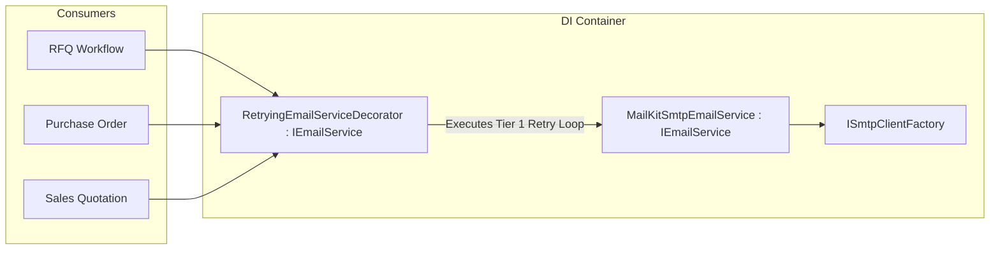

# ApexERP — Shared Email Service & Configurable Retry Architecture

**Document Version:** 1.2.0  
**Status:** Technical Architecture & Design Specification (Under Review)  
**Target Projects:** `ERP.Application.Common.Email`, `ERP.Infrastructure.Email`, `ERP.API`  
**Related Documents:**
- [Sales-Quotation-Workflow.md](file:///z:/ERP/Sales-Quotation-Workflow.md)
- [ApexERP-Frontend-UI-Standards.md](file:///z:/ERP/ApexERP-Frontend-UI-Standards.md)
- [Backend Instructions](file:///z:/ERP/Backend/ERP/AGENTS.md)
- [Root Instructions](file:///z:/ERP/AGENTS.md)

---

## 1. Executive Summary

ApexERP utilizes an enterprise email infrastructure designed to handle transactional notifications across operational modules, including Procurement Request for Quotation (RFQ) supplier invitations, RFQ award confirmations, Purchase Order supplier dispatches, and future Sales Quotation customer proposals.

A comprehensive inspection of the existing backend confirms:
1. A centralised email delivery abstraction (`IEmailService`) and a concrete MailKit implementation (`MailKitSmtpEmailService`) exist.
2. **Zero automated transport retry currently exists** in the active codebase. Any transient socket drop, temporary timeout, or SMTP 4xx rate-limit immediately results in a failed delivery returned to the caller.
3. Procurement RFQ and Purchase Order consume the same `IEmailService` implementation and configuration, but utilize divergent body generation approaches and notification call patterns.

This specification documents:
- The **verified current architecture** across RFQ and Purchase Order.
- The **two-tier retry hierarchy**:
  - **Tier 1 (Automatic Retry):** Up to 5 automatic retries after the initial attempt (up to 6 SMTP attempts per dispatch cycle) for classified transient faults.
  - **Tier 2 (Manual Retry Cycle):** User-authorized **Retry Email** action from the frontend when all 6 attempts fail, initiating a fresh, distinct dispatch cycle of up to 6 SMTP attempts while preserving historical dispatch records.
- The **structured failure-classification requirements** replacing fragile string parsing.
- The **SMTP uncertain-outcome scenario and duplicate delivery realities**.
- The **modular adoption plan** across existing and future modules.

---

## 2. Verified Current Email Architecture

### 2.1 Component Inventory & Layer Boundaries

```
Backend/ERP/
├── ERP.Application/Common/Email/
│   ├── IEmailService.cs                     # Centralised delivery abstraction
│   ├── IEmailTemplateEngine.cs             # Template rendering abstraction
│   ├── EmailMessage.cs                     # Message model (recipients, subject, bodies, attachments, headers)
│   ├── EmailRecipient.cs                   # Recipient model (DisplayName, Address)
│   ├── EmailAttachment.cs                  # File attachment model (FileName, ContentType, Content bytes)
│   └── EmailResult.cs                      # Result model (IsSuccess, MessageId, ErrorMessage, TimestampUtc)
│
├── ERP.Infrastructure/Email/
│   ├── MailKitSmtpEmailService.cs          # Active concrete IEmailService implementation
│   ├── ISmtpClientFactory.cs               # Factory abstraction wrapping MailKit client creation
│   ├── Configuration/SmtpOptions.cs        # Strongly typed SMTP settings (Host, Port, SSL, Credentials)
│   └── Templates/EmailTemplateEngine.cs    # Disk-based template engine (placeholders & CSS inliner)
│
└── API/Confiquration/ServiceRegistration.cs # Dependency Injection composition root
```

### 2.2 Dependency Injection Composition Root

In [ServiceRegistration.cs](file:///z:/ERP/Backend/ERP/API/Confiquration/ServiceRegistration.cs#L71-L79), email services are registered as follows:

```csharp
// Centralised Email & Document Generation Infrastructure
services.AddOptions<ERP.Infrastructure.Email.Configuration.SmtpOptions>()
    .Bind(configuration.GetSection(ERP.Infrastructure.Email.Configuration.SmtpOptions.SectionName));

services.AddSingleton<ERP.Infrastructure.Email.ISmtpClientFactory, ERP.Infrastructure.Email.DefaultSmtpClientFactory>();
services.AddScoped<ERP.Application.Common.Email.IEmailTemplateEngine, ERP.Infrastructure.Email.Templates.EmailTemplateEngine>();
services.AddScoped<ERP.Application.Common.Email.IEmailService, ERP.Infrastructure.Email.MailKitSmtpEmailService>();
services.AddScoped<ERP.Application.Features.Procurement.PurchaseOrderFeature.IPurchaseOrderPdfService, ERP.Infrastructure.Pdf.PurchaseOrderPdfService>();
```

### 2.3 Single-Attempt Execution Flow in `MailKitSmtpEmailService`

In [MailKitSmtpEmailService.cs](file:///z:/ERP/Backend/ERP/ERP.Infrastructure/Email/MailKitSmtpEmailService.cs#L38-L118):
- Validates `message.Validate()` and `config.Validate()`.
- Constructs a MimeKit `MimeMessage` from `EmailMessage` and `SmtpOptions`.
- Uses `_smtpClientFactory.CreateClient()` to obtain an `ISmtpTransportClient`.
- Executes a single connection and send sequence:
  1. `await client.ConnectAsync(config.Host, config.Port, secureSocketOptions, cancellationToken);`
  2. `await client.AuthenticateAsync(config.Username, config.Password, cancellationToken);`
  3. `var response = await client.SendAsync(mimeMessage, cancellationToken);`
  4. `await client.DisconnectAsync(true, cancellationToken);`
- **Exception Encapsulation:** Catches all exceptions (`OperationCanceledException`, `AuthenticationException`, `SmtpCommandException`, `SocketException`, `Exception`), logs them, and returns an `EmailResult.Failure(errorMessage)`.
- **Finding:** **No automated retry loop, timer, Polly policy, or wrapper exists in the active codebase.**

---

## 3. Comparison: RFQ vs. Purchase Order Email Call Flows

| Aspect | Procurement RFQ | Procurement Purchase Order | Verified Finding |
|---|---|---|---|
| **Underlying SMTP Implementation** | `MailKitSmtpEmailService` | `MailKitSmtpEmailService` | **Verified Current Implementation:** Identical SMTP transport pipeline and options. |
| **Email Service Instance** | Resolves `IEmailService` | Resolves `IEmailService` | **Verified Current Implementation:** Resolves the same DI-registered interface. |
| **SMTP Configuration** | `SmtpOptions` (`"SmtpSettings"`) | `SmtpOptions` (`"SmtpSettings"`) | **Verified Current Implementation:** Same host, port, credentials, and timeout. |
| **Calling Function / Abstraction** | Consumes `IRfqEmailNotificationService` (`RfqEmailNotificationService`) | Orchestrated directly inside `PurchaseOrderController.EmailPurchaseOrder` | **Divergence:** RFQ uses a dedicated application service; PO coordinates inside an API controller. |
| **Email Body Generation** | Hardcoded C# `StringBuilder` HTML generation inside `RfqEmailNotificationService` | Consumes `IEmailTemplateEngine.RenderAsync("PurchaseOrder/PurchaseOrderEmail", ...)` from disk templates | **Divergence:** PO uses the reusable template engine; RFQ bypasses it with manual HTML building. |
| **Attachment Handling** | No attachments (sends secure token portal links) | Attaches generated binary ISO 32000-1 PDF via `IPurchaseOrderPdfService` | **Divergence:** PO attaches generated PDF; RFQ does not attach files. |
| **Automated Retry Implementation** | **None** | **None** | **Verified Current Implementation:** Neither workflow has automated transport retry. |
| **Manual Business-Level Retry** | Has `POST .../retry-award-notification` with `_recentlySentAwards` deduplication | **None** (Failed send returns HTTP 400 `BadRequestResponse`) | **Divergence:** RFQ has a manual retry endpoint; PO has no retry endpoint. |

---

## 4. The Two-Tier Email Retry Hierarchy

To prevent both premature failure on transient faults and uncontrolled runaway retry loops, ApexERP establishes a clear two-tier retry model:

```
                               ┌─────────────────────────────┐
                               │ User clicks "Send Email"    │
                               └──────────────┬──────────────┘
                                              │
                      ========================▼========================
                      TIER 1: AUTOMATIC RETRY CYCLE (Up to 6 attempts)
                      =================================================
                      Attempt 1 (Initial SMTP Attempt)
                           │
                           ├──► [Success] ──► Mark Cycle Succeeded ──► Document Status = Sent
                           │
                           └──► [Transient Failure]
                                     │
                                     ├── Retry 1 (Attempt 2) [wait 2000ms] ──► Success? ──► Succeeded
                                     ├── Retry 2 (Attempt 3) [wait 2000ms] ──► Success? ──► Succeeded
                                     ├── Retry 3 (Attempt 4) [wait 2000ms] ──► Success? ──► Succeeded
                                     ├── Retry 4 (Attempt 5) [wait 2000ms] ──► Success? ──► Succeeded
                                     └── Retry 5 (Attempt 6) [wait 2000ms] ──► Success? ──► Succeeded
                                           │
                                           └── [All 6 attempts failed]
                                                 │
                      ===========================▼===========================
                      TIER 2: DISPATCH CYCLE TERMINATION & MANUAL USER ACTION
                      =======================================================
                                                 │
                                                 ▼
                                     Cycle 1 Marked "Failed"
                                     Audit Record Appended
                                     Quotation Status remains "Confirmed"
                                     Frontend Displays Error Banner & Enables:
                                     [ Retry Email ] (Manual Action)
                                                 │
                                                 ▼
                               ┌─────────────────────────────────┐
                               │ User clicks "Retry Email"       │
                               │ (New User-Authorized Decision)  │
                               └─────────────────┬───────────────┘
                                                 │
                      ===========================▼===========================
                      NEW DISPATCH CYCLE (Cycle 2: Up to 6 fresh attempts)
                      =======================================================
                      Attempt 1 (Fresh Initial Attempt for Cycle 2)
                           │
                           ├──► [Success] ──► Cycle 2 Succeeded ──► Document Status = Sent
                           └──► [Transient Failure] ──► Retries 1-5 (Attempts 2-6)
                                     │
                                     └── [All 6 failed again] ──► Cycle 2 Failed ──► [ Retry Email ]
```

### 4.1 Tier 1: Automatic Retry Within a Single Dispatch Cycle
- **Trigger:** Initiated automatically by `RetryingEmailServiceDecorator` upon a transient network or server fault.
- **Scope:** Bound to a single dispatch cycle.
- **Attempt Count:** **1 initial attempt + up to 5 automatic retries = maximum 6 attempts** per cycle.
- **Delay:** Governed by `EmailRetrySettings` (constant 2,000 ms by default, or exponential backoff capped at 30,000 ms).
- **Termination:** If all 6 attempts fail, the automatic loop halts immediately. It does **not** proceed to attempt 7. The dispatch cycle is marked `Failed`.

### 4.2 Tier 2: Manual Retry Starting a Fresh Dispatch Cycle
- **Trigger:** Initiated strictly by a deliberate user action: clicking the **Retry Email** button on the frontend after a dispatch cycle has failed.
- **Cycle Independence:**
  - A manual retry is **not** an extension (attempt 7) of the previous cycle.
  - It creates a **completely new dispatch cycle** (e.g. Cycle #2) with its own `DispatchCycleId` and correlation tracking.
  - Cycle #2 executes with a clean slate: **1 new initial attempt + up to 5 automatic retries** (up to 6 SMTP attempts).
- **History Preservation:**
  - Previous dispatch attempts and failure reasons from Cycle #1 are **never erased or overwritten**.
  - All dispatch cycles are recorded in the document's audit history and linked to the same parent logical `EmailOperationId`.
- **Pre-Condition Validation:**
  - Prior to initiating a new dispatch cycle, the backend independently verifies that the business document (e.g. Sales Quotation) is still in an eligible sending status (`Confirmed` or `Sent`), that the customer address remains valid, and that the acting user has `SALES_QUOTATION.SEND` permission.
- **Runaway Loop Prevention:**
  - Automated infinite loops are structurally impossible because starting a new cycle requires explicit human authorization.
  - Backend concurrency locks prevent duplicate clicks from spawning overlapping dispatch cycles.

---

## 5. Standard Configuration & Semantic Rules

### 5.1 Agreed Configuration Schema

The retry settings are bound from `appsettings.json` under `EmailRetrySettings`:

```json
{
  "EmailRetrySettings": {
    "MaxRetryAttempts": 5,
    "RetryDelayMilliseconds": 2000,
    "UseExponentialBackoff": false,
    "MaxRetryDelayMilliseconds": 30000
  }
}
```

#### Precise Configuration Semantics:
1. **`MaxRetryAttempts: 5`**: The number of **additional automatic retries after the initial attempt** within one dispatch cycle.
   $$\text{Maximum Attempts Per Cycle} = 1 \text{ (Initial)} + \text{MaxRetryAttempts (5)} = 6 \text{ attempts}$$
   *(If configured to `0`, exactly 1 attempt is made with zero automatic retries).*
2. **`RetryDelayMilliseconds: 2000`**: The baseline delay in milliseconds between failed attempts. When `UseExponentialBackoff` is `false`, the delay between retries remains **constant at exactly 2,000 ms** (2 seconds).
3. **`UseExponentialBackoff: false`**: Boolean controlling delay progression:
   - When `false`: Constant delay ($\text{Delay}(a) = 2000\text{ ms}$).
   - When `true`: Exponential delay ($\text{Delay}(a) = \min(\text{MaxRetryDelayMilliseconds}, 2000 \times 2^{a - 1})$).
4. **`MaxRetryDelayMilliseconds: 30000`**: Maximum delay ceiling (30,000 ms / 30 seconds) enforced when exponential backoff is active.
5. **Startup Validation:** Options validation ensures `MaxRetryAttempts` $\in [0, 10]$, `RetryDelayMilliseconds` $\ge 200$, and `MaxRetryDelayMilliseconds` $\ge \text{RetryDelayMilliseconds}$.

---

## 6. Structured Failure Classification (Non-Fragile Design)

### 6.1 The Fragile String Parsing Limitation
The existing `EmailResult` contract in [EmailResult.cs](file:///z:/ERP/Backend/ERP/ERP.Application/Common/Email/EmailResult.cs) exposes only `bool IsSuccess` and `string? ErrorMessage`. In `MailKitSmtpEmailService.cs`, exceptions are caught and flattened into plain text strings.

> **Architectural Risk:** Inspecting error message substrings (such as `msg.Contains("SMTP error")`) inside a retry decorator is fragile, localization-sensitive, and prone to breaking upon MailKit library updates.

### 6.2 Proposed Structured Contract: `EmailFailureCategory`

To ensure robust retry decisions without string parsing, the `EmailResult` model must be enhanced to include an explicit failure classification enum:

```csharp
namespace ERP.Application.Common.Email;

public enum EmailFailureCategory
{
    None = 0,                   // Succeeded
    TransientNetwork = 1,       // SocketException, TimeoutException, connection drop -> ELIGIBLE FOR RETRY
    TransientServer = 2,        // SMTP 4xx temporary response (rate limit, busy) -> ELIGIBLE FOR RETRY
    PermanentAuthentication = 3,// SMTP 535 invalid credentials -> NO RETRY
    PermanentSecurity = 4,      // TLS handshake failure, untrusted cert -> NO RETRY
    PermanentMailbox = 5,       // SMTP 5xx (550 mailbox not found, 551 user not local) -> NO RETRY
    PermanentValidation = 6,    // Malformed address format, empty recipient -> NO RETRY
    Canceled = 7,               // OperationCanceledException -> ABORT IMMEDIATELY (NO RETRY)
    Ambiguous = 8               // Socket drop after DATA before 250 OK -> UNCERTAIN OUTCOME
}
```

### 6.3 Retry Eligibility Decision Matrix

| Failure Category | Exception Source / Condition | Automatic Retry (Tier 1)? | Manual Retry (Tier 2)? | Notes |
|---|---|---|---|---|
| **TransientNetwork** | `SocketException`, `TimeoutException` | **YES** (Up to 5 retries) | **YES** | Caused by transient network or port connectivity issues. |
| **TransientServer** | `SmtpCommandException` (4xx status code) | **YES** (Up to 5 retries) | **YES** | Temporary server throttling or mailbox lock. |
| **PermanentAuthentication** | `MailKit.Security.AuthenticationException` (535) | **NO** (Fail immediately) | **NO** (Requires credential fix) | Retrying will lock SMTP accounts. |
| **PermanentSecurity** | `System.Security.Authentication.AuthenticationException` | **NO** (Fail immediately) | **NO** (Requires cert fix) | TLS handshake failure cannot resolve automatically. |
| **PermanentMailbox** | `SmtpCommandException` (5xx status code) | **NO** (Fail immediately) | **NO** (Requires address fix)| Recipient does not exist or domain rejected. |
| **PermanentValidation** | `FormatException`, `ArgumentException` | **NO** (Fail immediately) | **NO** (Requires data fix) | Malformed email syntax. |
| **Canceled** | `OperationCanceledException` | **NO** (Abort immediately)| **YES** (If user re-initiates) | User/client disconnected; stop immediately. |
| **Ambiguous** | Protocol drop after `DATA` sent before `250 OK` | **NO** (Flagged for Review) | **Conditional** (Requires Review)| Server may have committed message; retry risks duplicate. |

*(Note: In Phase 1 documentation, this classification represents the target contract design. If `EmailResult` is not immediately evolved, retry logic must execute directly within `MailKitSmtpEmailService` where native typed exceptions remain accessible).*

---

## 7. Shared Decorator Architecture

To adhere to Clean Architecture, retry orchestration is implemented as a shared decorator wrapping `MailKitSmtpEmailService`:



### 7.1 Non-Recursive Dependency Injection Registration

In `ServiceRegistration.cs`, the decorator is registered without circular dependencies:

```csharp
// 1. Bind and validate settings
services.AddOptions<EmailRetrySettings>()
    .Bind(configuration.GetSection(EmailRetrySettings.SectionName))
    .ValidateOnStart();

// 2. Register concrete transport implementation directly
services.AddScoped<MailKitSmtpEmailService>();

// 3. Register IEmailService resolved as decorator wrapping the concrete transport
services.AddScoped<IEmailService>(sp =>
{
    var transport = sp.GetRequiredService<MailKitSmtpEmailService>();
    var retrySettings = sp.GetRequiredService<IOptions<EmailRetrySettings>>();
    var logger = sp.GetRequiredService<ILogger<RetryingEmailServiceDecorator>>();
    return new RetryingEmailServiceDecorator(transport, retrySettings, logger);
});
```

---

## 8. Auditability & Dispatch History Tracking

To support operational traceability, multi-cycle retry inspection, and compliance, email operations must record structured dispatch history.

### 8.1 Proposed Dispatch Audit Schema

Subject to domain persistence verification, each dispatch cycle records:

```csharp
public class EmailDispatchHistoryRecord
{
    public Guid Id { get; set; }                           // Unique dispatch history ID
    public Guid EmailOperationId { get; set; }             // Stable logical ID across all cycles for this document
    public Guid DispatchCycleId { get; set; }              // Unique ID for this specific cycle
    public int DispatchCycleNumber { get; set; }           // 1, 2, 3...
    public string DocumentType { get; set; } = string.Empty; // "SalesQuotation", "PurchaseOrder", "RFQ"
    public Guid DocumentId { get; set; }                   // Entity ID of the business document
    public string DocumentNumber { get; set; } = string.Empty; // e.g. "SQ-2026-0001"
    public string RecipientAddress { get; set; } = string.Empty;
    public string? RecipientName { get; set; }
    public DateTime InitiatedAtUtc { get; set; }
    public int AttemptsExecuted { get; set; }              // 1 to 6
    public string FinalOutcome { get; set; } = string.Empty; // "Sent", "Failed", "Ambiguous", "Canceled"
    public EmailFailureCategory FailureCategory { get; set; }
    public string? ErrorMessage { get; set; }
    public DateTime? SucceededAtUtc { get; set; }
    public Guid? InitiatingUserId { get; set; }
    public string? InitiatingUserName { get; set; }
}
```

### 8.2 Dispatch Cycle Traceability
- **Logical Grouping:** When a user sends an email (Cycle 1) and later clicks "Retry Email" (Cycle 2), both cycles share the same `EmailOperationId`.
- **Non-Destructive History:** Cycle 1's failure record is preserved permanently in the database and audit trail. Cycle 2 appends a new record.
- **Document Metadata Snapshot:** The business entity (e.g. `SalesQuotation`) maintains summary fields: `EmailDeliveryStatus` (`Sent` / `Failed`), `LastEmailedAtUtc`, `LastEmailedToAddress`, `DispatchCycleCount`, and `LastEmailFailureReason`.

---

## 9. The SMTP Uncertain-Outcome Scenario & Duplicate Delivery

### 9.1 The Protocol Edge Case
SMTP is an application-level store-and-forward protocol over TCP. An inherent edge case exists:
1. Client connects, authenticates, and transmits message headers and body data (`DATA`).
2. Remote SMTP server accepts the message and enqueues it for delivery.
3. **The network connection drops before the remote server's `250 OK` acknowledgment packet reaches the client.**

Under this condition:
- The client receives a `SocketException` or `TimeoutException`.
- The client cannot distinguish whether the server committed the email or dropped it.
- **Automatically retrying in this state can deliver duplicate emails to the customer.**

### 9.2 Mitigation vs. Guarantee
> **Engineering Standard:** Exactly-once email delivery is theoretically impossible over standard SMTP. Systems must distinguish **risk mitigation** from false guarantees.

| Mechanism | Reality / Guarantee Level |
|---|---|
| **`X-ApexERP-CorrelationId` Header** | **Traceability Aid Only:** Stamps a unique GUID onto the message. Aids mail log auditing, but standard SMTP relays and spam filters do **not** deduplicate messages based on custom headers. |
| **Stable Operation ID** | **Mitigation:** The correlation ID must remain **stable across all retries of the same dispatch attempt**, ensuring all retransmitted copies share the same audit trail. |
| **Frontend Button Debouncing** | **UX Mitigation:** Prevents users from clicking "Send Email" twice during high-latency requests. Does **not** prevent backend transport duplicates. |
| **Conservative Retry Limits** | **Mitigation:** Limiting retries to 5 attempts prevents continuous retry storms on unstable connections. |
| **Backend Concurrency Locks** | **Concurrency Protection:** A distributed or in-memory lock on `(TenantId, DocumentType, DocumentId)` prevents concurrent duplicate dispatch executions. |

---

## 10. Cancellation & Concurrency

1. **Cancellation Safety:**
   - When `cancellationToken.IsCancellationRequested` is true, the retry loop terminates immediately.
   - Cancellation is classified as `EmailFailureCategory.Canceled` and **never triggers another automatic retry**.
   - `CancellationToken` is passed to all `Task.Delay` and transport calls.
2. **Concurrency & Idempotency:**
   - Multiple rapid clicks on "Send Email" or "Retry Email" are blocked at the frontend via reactive button disabling (`actionInProgress()`).
   - The backend validates that a dispatch operation is not already running for the target document before starting a cycle.

---

## 11. Modular Adoption Roadmap

Because the retry mechanism is placed at the `IEmailService` decorator level, **all modules automatically inherit retry resilience with zero code changes**:

```
IEmailService Decorator (Shared Retry Engine)
 ├── Procurement RFQ (RfqEmailNotificationService)        --> Automatic Tier 1 Retry
 ├── Procurement Purchase Order (PurchaseOrderController)   --> Automatic Tier 1 Retry
 ├── Sales Quotation (SalesQuotationService)                --> Automatic Tier 1 Retry + Tier 2 Manual Retry
 └── Future Modules (Billing, Invoices, Shipments)          --> Automatic Tier 1 Retry + Tier 2 Manual Retry
```

---

## 12. Synchronous Request-Time Retry vs. Asynchronous Outbox

| Dimension | Option A: Synchronous Request-Time Decorator (Phase 1 Target) | Option B: Asynchronous Persistent Outbox (Future Phase) |
|---|---|---|
| **Architecture Complexity** | **Low:** Single decorator class, zero database changes, zero background daemons. | **High:** Requires Outbox SQL tables, background worker (`IHostedService`), polling/locking logic, and Dead Letter Queue. |
| **HTTP Response Time** | Slower on network failures (blocks request up to 10s during retries). | Fast (HTTP request commits outbox record in milliseconds and returns). |
| **Failure Recovery** | Fails completely if server process restarts during retry loop. | Resilient: Survives process crashes and server restarts; resumes delivery from database. |
| **UI Feedback** | Immediate: User gets definitive success/failure feedback in the UI response. | Asynchronous: Requires polling or WebSocket notifications to notify UI of delivery outcome. |
| **Recommendation** | **Adopt for Phase 1:** Directly solves transient socket drops with minimal surface area. | **Deferred to Future:** Suitable for high-volume automated billing or batch invoice distribution. |

---

## 13. Summary of Decisions & Next Steps

| # | Item | Status | Action Required |
|---|---|---|---|
| **1** | **`EmailRetrySettings` Validation** | Agreed Requirement | Validate at application startup via `ValidateOnStart()`. |
| **2** | **Retry Count per Cycle** | Agreed Requirement | 1 initial attempt + 5 automatic retries = 6 total attempts per cycle. |
| **3** | **Manual Retry Multi-Cycle Model** | Agreed Requirement | User clicking "Retry Email" initiates a fresh cycle of up to 6 attempts while preserving history. |
| **4** | **`EmailResult` Contract Refactoring** | Proposed Design | Introduce `EmailFailureCategory` enum to `EmailResult` in Phase 1 implementation. |
| **5** | **Outbox Architecture** | Open Decision / Future | Confirm whether Phase 1 synchronous decorator is accepted, deferring Outbox to Phase 2. |
