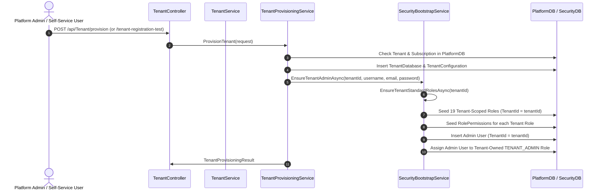

# Report E — Flow A Tenant Provisioning and Seeding

**Workspace:** `Z:\ERP`  
**Audit Mode:** READ-ONLY  
**Date:** 2026-11-11  
**Auditor:** Antigravity (DeepMind Automated Pair Programmer)

---

## 1. Executive Summary

Flow B **defines** the canonical standard roles and permissions. Flow A **consumes** those definitions during tenant registration, provisioning, and administrator initialization.
This report evaluates whether Flow A faithfully consumes Flow B without divergence, duplication, or cross-tenant privilege leakage.

---

## 2. Provisioning & Seeding Workflow Trace



---

## 3. Detailed Verification Items

### 3.1 Standard Role Seeding
- **Specification:** When a tenant is provisioned, the tenant must receive its own tenant-scoped copies of all 19 standard role templates defined in `StandardRoleTemplates.cs`.
- **Implementation:** In [`SecurityBootstrapService.cs`](file:///z:/ERP/Backend/ERP/Security/Services/SecurityBootstrapService.cs#L204-L337), `EnsureTenantStandardRolesAsync(Guid tenantId)` iterates through `StandardRoleTemplates.All`.
- **Verification Evidence:**
  - Instantiates each role with `TenantId = tenantId`, `TemplateKey = template.Key`, `TemplateVersion = template.Version`, and `IsSystemRole = false`.
  - Maps permissions by code directly against the authoritative `PermissionCatalogue`.
- **Audit Result:** **PASS**

### 3.2 Tenant Admin Privilege Isolation
- **Specification:** The newly created tenant administrator must be assigned to the tenant-owned `TENANT_ADMIN` role and must NOT receive platform-level permissions.
- **Implementation:** [`StandardRoleTemplates.cs`](file:///z:/ERP/Backend/ERP/Security/Boostrap/Roles/StandardRoleTemplates.cs) constructs `TenantAdmin` permissions by filtering `PermissionCatalogue.All`:
  ```csharp
  x.Category == PermissionCategory.Tenant &&
  !string.Equals(x.Code, "PRICE_CARD.OVERRIDE", StringComparison.OrdinalIgnoreCase)
  ```
- **Verification Evidence:**
  - Tested in [`F1PermissionCatalogueAndStandardRolesTests.cs`](file:///z:/ERP/Backend/ERP/Testing/ERP.SecurityTests/F1PermissionCatalogueAndStandardRolesTests.cs#L196): `StandardRoleTemplates_TenantAdminExcludesPlatformAndPriceOverride` asserts zero platform permissions are present.
- **Audit Result:** **PASS**

### 3.3 Repeatability and Idempotency
- **Specification:** Rerunning tenant provisioning or bootstrap services must be safe, idempotent, and must not create duplicate roles, users, or permissions.
- **Implementation:** `EnsureTenantStandardRolesAsync` checks both `rolesByTemplateKey` and `rolesByName`. If a role exists, it verifies `TemplateVersion` and updates additively without deleting tenant customizations.
- **Verification Evidence:**
  - Tested in `TenantProvisioningTests.cs` line 316: `EnsureTenantAdminAsync_Idempotent_DoesNotDuplicateUserOrRole`.
- **Audit Result:** **PASS**

### 3.4 Compensation on Failure
- **Specification:** If Security provisioning fails during Flow A (e.g., password hashing or database conflict), the newly created `PlatformDB` records must be compensated/rolled back so the tenant is not left corrupted.
- **Implementation:** [`TenantProvisioningService.cs`](file:///z:/ERP/Backend/ERP/SaaS/Application/Services/TenantProvisioningService.cs#L160-L180) wraps `EnsureTenantAdminAsync` in a `try-catch` block and deletes `TenantDatabase`, `TenantConfiguration`, and newly provisioned `TenantDomain` on failure.
- **Verification Evidence:**
  - Tested in `TenantProvisioningTests.cs` line 351: `ProvisionTenant_WhenSecurityBootstrapFails_RollsBackPlatformDbRecords`.
- **Audit Result:** **PASS**

---

## 4. Flow A Audit Findings

| ID | Module / Service | Description | Risk | Audit Result | Recommendation |
| :--- | :--- | :--- | :--- | :--- | :--- |
| **GAP-FLA-01** | `SecurityBootstrapService.cs` | Legacy global role `Tenant Admin` (`TenantId = null`) is still seeded in `EnsureTenantAdminRoleAsync` alongside the tenant-owned copy. | Low | **GAP FOUND** | Deprecate global `Tenant Admin` record to prevent accidental assignment of legacy global role to new users. |
| **GAP-FLA-02** | `TenantController.cs` | `TenantRegistrationTest` does not invoke `TenantProvisioningService` (only creates PlatformDB records, does not seed SecurityDB users or roles). | Medium | **GAP FOUND** | Self-service registration creates the tenant shell, but provisioning must be triggered separately or chained to initialize the admin identity. |
