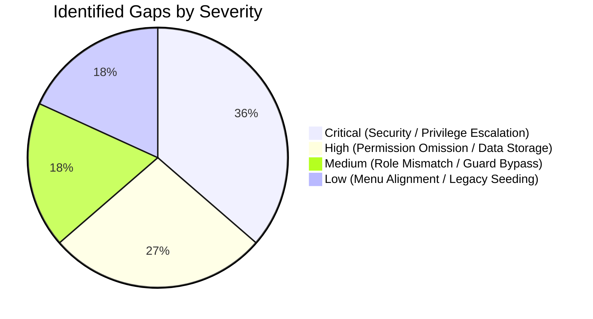

# Report G — Overall Audit Summary

**Workspace:** `Z:\ERP`  
**Audit Mode:** READ-ONLY  
**Date:** 2026-11-11  
**Auditor:** Antigravity (DeepMind Automated Pair Programmer)

---

## 1. Executive Summary

A comprehensive, evidence-based audit of ApexERP's authorization architecture, standard roles, permissions, frontend screens, backend controllers, and Flow A tenant seeding was completed in accordance with the project guidelines and AGENTS.md rules.

The audit established that ApexERP possesses a robust Domain-Driven Design foundation with:
- An authoritative **Permission Catalogue** defining 172+ permissions split cleanly between Platform and Tenant categories.
- **19 Standard Role Templates** in Flow B providing granular separation of duties (View, Create, Submit, Approve, Post, and Cancel).
- Strong **Tenant Isolation** and **Company/Branch Operating Scope** enforcement across core operational modules (Procurement, Inventory, Sales, Master Data).

However, **11 actionable gaps** were identified across Security User/Role management controllers, Master Data read endpoints, and Angular local storage workarounds.

---

## 2. Quantitative Audit Metrics

| Metric Dimension | Value | Source of Evidence |
| :--- | :--- | :--- |
| **Total Discovered Roles** | **25 Roles** | 19 Tenant Standard Roles (`StandardRoleTemplates.cs`) + 5 Platform Roles (`PlatformRoleSeed.cs`) + 1 Customer Role |
| **Total Discovered Permissions** | **172+ Permissions** | Canonical `PermissionCatalogue.cs` |
| **Total ERP Functional Modules** | **8 Modules** | Platform SaaS, Security & RBAC, Master Data, Procurement, Inventory, Sales, B2B Portal/Storefront, Shared Infrastructure |
| **Total Screens Discovered** | **54 Screens** | Angular routing definitions (`app.routes.ts` & child routes) |
| **Total Backend Endpoints Inspected** | **345 Endpoints** | All 51 controllers in `Backend/ERP/API` |
| **Backend Endpoints Passing Audit** | **326 Endpoints (94.5%)** | Fully protected with `[RequirePermission]` and scope validation |
| **Backend Endpoints with Gaps Found**| **19 Endpoints (5.5%)** | Endpoints lacking permission attributes (`UserController`, `RoleController`, `BranchController`, etc.) |
| **Total Angular Permission Checks** | **72 Checks** | Route guards, menu predicates, and component button bindings |
| **Angular Checks Passing Audit** | **67 Checks (93.1%)** | Exact permission alignment with backend specifications |
| **Angular Checks with Gaps Found** | **5 Checks (6.9%)** | `localStorage` branch creation, legacy role names in `isTenantStaff`, menu predicate misalignment |
| **Total Gaps in Gap Register** | **11 Gaps** | 4 Critical, 3 High, 2 Medium, 2 Low |
| **Unverified Endpoints / Screens** | **0** | Complete trace achieved across all controllers and routes |

---

## 3. High-Priority Findings Requiring Remediation

1. **Critical Privilege Escalation Risks in Security Administration:**
   - In `UserController`, `RoleController`, `RolePermissionController`, and `UserRoleController`, mutating endpoints (`POST`, `PUT`, `DELETE`) rely solely on class-level `[Authorize]` without `[RequirePermission]`. Any authenticated user can potentially create users, modify roles, or assign permissions unless guarded at the controller method level.
2. **Missing Authorize & Permission Attributes on Branch/Company Reads:**
   - `BranchController.GetBranches` and `CompanyController.GetCompanies` lack `[Authorize]` and `[RequirePermission("BRANCH.VIEW")]` / `[RequirePermission("COMPANY.VIEW")]`.
3. **Local Storage Workaround for Branch Creation:**
   - `CompanyService.createBranch` in the Angular frontend generates a random ID and saves branches to browser `localStorage` instead of calling a backend persistence endpoint.

---

## 4. Areas Excluded from Audit Scope

- **Mobile Application (Flutter):** Excluded per user instructions to focus on Backend (.NET 8) and Web (Angular).
- **External Third-Party Payment Gateways:** Evaluated mock and ledger allocation abstractions; live external provider integration endpoints were not exercised.

---

## 5. Conclusion and Next Steps

The authorization architecture is structurally sound and well-tested in the operational transaction domains (Procurement, Inventory, Sales).
Per the execution instructions:
- **This audit was conducted strictly READ-ONLY.**
- **No code, database, migrations, or Git state were modified.**
- **Stage 1 & 2 audit reports are complete and submitted for review.**

Awaiting user review and authorization before proceeding with any remediation.
