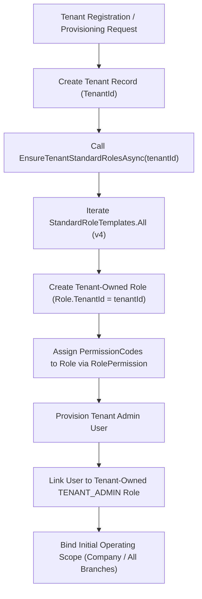

# ApexERP — Tenant Provisioning & Role Seeding Audit

**Date:** 2026-11-11  
**Audit Scope:** Analysis of Standard Role Templates, Provisioning Logic, Permission Seeding, and Tenant Isolation  

---

## 1. Executive Summary

ApexERP employs a hybrid role-based security model:
1. **Central Authoritative Template Catalogue (`StandardRoleTemplates.cs`):** Defines standard role templates (versioned, current version 4) and their least-privilege permission lists.
2. **Tenant-Scoped Role Copies:** During tenant provisioning or role upgrade (`EnsureTenantStandardRolesAsync`), a tenant-owned copy of each template (`Role.TenantId = tenantId`) is created.
3. **Legacy Global Seeder (`TenantAdminRolePermissionSeed.cs`):** Seeds a global system role `Tenant Admin` (`Role.TenantId = null`).

This audit evaluates the consistency across standard role definitions, tenant provisioning, and existing vs. newly provisioned tenants.

---

## 2. Standard Role Definitions Inventory

| Role Key | Role Name | Intended Responsibilities | Catalogue Version | Total Permissions | Key Assigned Permissions | Deliberately Excluded Permissions |
| :--- | :--- | :--- | :---: | :---: | :--- | :--- |
| **`TENANT_ADMIN`** | Tenant Admin | Full tenant business, user, and security administration. | 4 | All Tenant Codes (~95 perms) | `COMPANY.*`, `BRANCH.*`, `PRODUCT.*`, `CUSTOMER.*`, `SUPPLIER.*`, `PURCHASE_ORDER.*`, `GRN.*`, `SALES_ORDER.*`, `USER.*`, `ROLE.*`, `WAREHOUSE.*` | Platform permissions (`TENANT.*`, `SUBSCRIPTION.*`, `AUDIT.*`); `PRICE_CARD.OVERRIDE` |
| **`TENANT_AUDITOR`** | Tenant Read-only Auditor | Complete read-only audit across tenant operational records. | 4 | ~25 view perms | Every `.VIEW` permission in the tenant catalogue | All mutating permissions (`CREATE`, `EDIT`, `DELETE`, `SUBMIT`, `APPROVE`, `POST`, `CANCEL`) |
| **`MASTER_DATA_MANAGER`** | Master Data Manager | Maintains products, categories, partners, pricing, and facilities. | 4 | 58 perms | All CRUD + Soft Delete on Products, Categories, Brands, UOM, Currency, Payment Terms, Tax Codes, Warehouses, Locations, Price Cards, Customers, Suppliers, Addresses, Contacts, Companies, Branches | Transactional operations (`PURCHASE_ORDER.*`, `SALES_ORDER.*`, `GRN.*`); User management (`USER.*`, `ROLE.*`) |
| **`MASTER_DATA_VIEWER`** | Master Data Viewer | Read-only inspection of master data entities. | 4 | 19 perms | `COMPANY.VIEW`, `BRANCH.VIEW`, `PRODUCT.VIEW`, `CATEGORY.VIEW`, `UOM.VIEW`, `CURRENCY.VIEW`, `BRAND.VIEW`, `PAYMENT_TERM.VIEW`, `TAX_CODE.VIEW`, `WAREHOUSE.VIEW`, `LOCATION.VIEW`, `BATCH.VIEW`, `ADDRESS.VIEW`, `CONTACT.VIEW`, `COUNTRY.VIEW`, `SUPPLIER.VIEW`, `CUSTOMER.VIEW`, `SUPPLIER_PRICE.VIEW`, `PRICE_CARD.VIEW` | All create, edit, delete, activate/deactivate permissions |
| **`PRODUCT_CATEGORY_OFFICER`** | Product & Category Officer | Maintains catalog items, categories, brands, and batch metadata. | 4 | 19 perms | `PRODUCT.*`, `CATEGORY.*`, `BRAND.*`, `BATCH.*`, `UOM.VIEW`, `COUNTRY.VIEW` | Pricing, facilities, suppliers, customers |
| **`UOM_PACKAGING_OFFICER`** | UOM & Packaging Officer | Maintains units of measure and packaging conversion factors. | 4 | 8 perms | `UOM.*` (`VIEW`, `CREATE`, `EDIT`, `DELETE`, `CONVERT`), `PRODUCT.VIEW`, `BATCH.VIEW`, `WAREHOUSE.VIEW` | Non-UOM entities |
| **`SUPPLIER_CUSTOMER_OFFICER`** | Supplier & Customer Officer | Maintains business partners, addresses, and contacts. | 4 | 21 perms | `SUPPLIER.*`, `CUSTOMER.*`, `ADDRESS.*`, `CONTACT.*`, `COUNTRY.VIEW` | Products, pricing, financial reference data |
| **`PRICING_OFFICER`** | Pricing Officer | Maintains price cards, supplier price agreements, and overrides. | 4 | 18 perms | `PRICE_CARD.*` (including `OVERRIDE`), `SUPPLIER_PRICE.*`, `CUSTOMER.PRICE_CARD.ASSIGN`, `SUPPLIER.PRICE_CARD.ASSIGN`, View on reference data | General master data creation |
| **`FINANCE_CONFIGURATION_OFFICER`** | Finance Configuration Officer | Maintains currencies, exchange rates, tax codes, and payment terms. | 4 | 15 perms | `CURRENCY.*`, `TAX_CODE.*`, `PAYMENT_TERM.*`, `COMPANY.VIEW`, `PRICE_CARD.VIEW`, `SUPPLIER_PRICE.VIEW` | Operational inventory and procurement |
| **`WAREHOUSE_CONFIGURATION_OFFICER`**| Warehouse Configuration Officer | Maintains storage facilities, zones, racks, and bin locations. | 4 | 17 perms | `WAREHOUSE.*`, `LOCATION.*`, View on Products, UOM, Batch, Inventory | Non-warehouse master data |
| **`PROCUREMENT_MANAGER`** | Procurement Manager | Full procurement lifecycle management including approvals. | 4 | 28 perms | All Requisition, PO, and GRN permissions (`VIEW`, `CREATE`, `EDIT`, `DELETE`, `SUBMIT`, `APPROVE`, `CANCEL`, `CONFIRM`), procurement settings | Sales, User management |
| **`PROCUREMENT_OFFICER`** | Procurement Officer | Day-to-day purchasing and goods receiving. Cannot approve. | 4 | 20 perms | Requisition and PO (`VIEW`, `CREATE`, `EDIT`, `DELETE`, `SUBMIT`, `CANCEL`); GRN (`VIEW`, `CREATE`, `EDIT`, `DELETE`, `CONFIRM`, `CANCEL`) | **`PURCHASE_REQUISITION.APPROVE`**, **`PURCHASE_ORDER.APPROVE`** |
| **`PROCUREMENT_VIEWER`** | Procurement Viewer | Read-only inspection of procurement records. | 4 | 8 perms | `PURCHASE_REQUISITION.VIEW`, `PURCHASE_ORDER.VIEW`, `GRN.VIEW`, `PROCUREMENT.SETTINGS.VIEW`, `SUPPLIER.VIEW`, `SUPPLIER_PRICE.VIEW`, `PRODUCT.VIEW`, `INVENTORY.VIEW` | Mutating actions |
| **`INVENTORY_MANAGER`** | Inventory Manager | Manages stock receipts, issues, putaway, and count approvals. | 4 | 22 perms | `INVENTORY.VIEW`, `STOCK_RECEIPT.POST`, `STOCK_ISSUE.POST`, `PUTAWAY.POST`, `STOCK_COUNT.*` (including `APPROVE`, `POST`), `BATCH.*` | Requisitions, PO approval |
| **`INVENTORY_OFFICER`** | Inventory Officer | Executes physical inventory movements; prepares stock counts. | 4 | 13 perms | `INVENTORY.VIEW`, `STOCK_RECEIPT.POST`, `STOCK_ISSUE.POST`, `PUTAWAY.POST`, `STOCK_COUNT` (`VIEW`, `CREATE`, `EDIT`, `SUBMIT`, `CANCEL`) | **`STOCK_COUNT.APPROVE`**, **`STOCK_COUNT.POST`** |
| **`SALES_MANAGER`** | Sales Manager | Full sales lifecycle including order confirmation and invoices. | 4 | 22 perms | All Sales Order, Shipment, and Invoice permissions | Procurement, master data administration |
| **`SALES_OFFICER`** | Sales Officer | Prepares sales orders and dispatches shipments. | 4 | 16 perms | Sales Orders (`VIEW`, `CREATE`, `EDIT`, `DELETE`, `SUBMIT`, `CANCEL`), Shipments (`VIEW`, `CREATE`, `EDIT`, `DISPATCH`, `DELIVER`, `CANCEL`), Invoices (`VIEW`, `CREATE`, `EDIT`) | **`SALES_ORDER.CONFIRM`**, **`SALES_INVOICE.CONFIRM`** |

---

## 3. Tenant Lifecycle & Provisioning Traceability

### 3.1 New Tenant Provisioning
When a new tenant is provisioned:
1. `EnsureTenantStandardRolesAsync(tenantId)` is invoked.
2. A tenant-specific instance of each of the 17 standard roles is generated.
3. Every permission code declared in the template is resolved against `PermissionCatalogue` and mapped via `RolePermission`.
4. The tenant's primary admin account is created and bound to the tenant's copy of `TENANT_ADMIN`.
5. This ensures all standard capabilities—including `USER.VIEW`, `USER.CREATE`, `USER.EDIT`, `USER.DELETE`, and `USER.ASSIGN_ROLE`—are immediately available to the tenant admin.

### 3.2 Existing Tenant Upgrade Path
`SecurityBootstrapService.UpgradeExistingTenantsAsync()` provides an idempotent migration:
1. Iterates through all existing tenants in `SaaSDbContext`.
2. Calls `EnsureTenantStandardRolesAsync(tenantId)` for each tenant:
   - If a role template copy is missing, it is created.
   - If a role copy exists with an older `TemplateVersion` (< 4), new permissions declared in the template are additively appended without removing custom tenant assignments.
3. Migrates any user assigned to the legacy global `Tenant Admin` (`TenantId = null`) to the tenant's dedicated `TENANT_ADMIN` role, copying company/branch operating scopes.

---

## 4. Key Provisioning Findings & Gaps

### Finding GAP-PROV-01: Legacy Seeder Omission of User Management
- **File:** `Backend/ERP/Security/Boostrap/Roles/TenantAdminRolePermissionSeed.cs`
- **Issue:** The hardcoded list of permissions in `TenantAdminRolePermissionSeed.cs` (lines 20-192) omits:
  - `USER.VIEW`, `USER.CREATE`, `USER.EDIT`, `USER.DELETE`, `USER.ASSIGN_ROLE`
  - `ROLE.VIEW`, `ROLE.CREATE`, `ROLE.EDIT`, `ROLE.DELETE`
- **Impact:** If an existing installation or developer environment runs `EnsureDomainPermissionsAsync()` without running `UpgradeExistingTenantsAsync()`, the global fallback Tenant Admin role lacks user and role management permissions.
- **Remediation:** Synchronize `TenantAdminRolePermissionSeed.cs` with `StandardRoleTemplates.TenantAdminKey` so that legacy fallback roles also include user and role governance capabilities.
