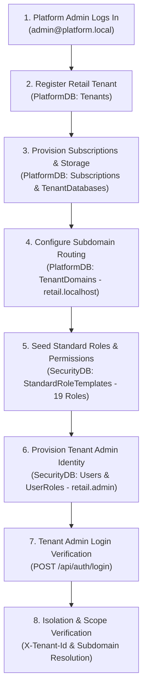

# ApexERP — Retail Tenant Initialization (Flow A: Platform Responsibility)

## 1. Overview & Purpose

This document defines **Flow A: Platform / Retail Tenant Initialization** for the **Development Environment** (`PlatformDB`, `SecurityDB`, `DomainDB`).

Flow A is strictly the responsibility of the **Platform Administrator** and encompasses:
1. Retail Tenant Registration
2. Tenant Provisioning (Storage, Subscriptions & Configuration)
3. Subdomain & Hostname Mapping (`retail.localhost`)
4. Standard Security Roles and Permissions Initialization
5. Tenant Administrator Account Creation
6. Tenant Admin Authentication & Token Verification
7. Tenant Context Resolution and Isolation Verification

> **Boundary Note:** Flow A handles purely multi-tenant platform container initialization and tenant admin identity. It **does NOT** perform ERP master-data seeding, warehouse setup, product creation, or operational transaction processing (which belong exclusively to **Flow B**).

---

## 2. Intended Execution Sequence



---

## 3. Detailed Step-by-Step Procedure

### Step 1: Platform Administrator Authentication
- **Endpoint:** `POST /api/auth/login`
- **Request Payload:**
  ```json
  {
    "email": "admin@platform.local",
    "password": "123"
  }
  ```
- **Expected Response:** `HTTP 200 OK` with JWT Bearer Token containing:
  - `sub`: Platform Admin User ID (`99999999-9999-9999-9999-999999999999`)
  - `role`: `Platform Admin`
  - `tenant_id`: `null` (Cross-tenant platform administrator authority)

---

### Step 2: Retail Tenant Registration
- **Target Table:** `PlatformDB.dbo.Tenants`
- **Registration Specifications:**
  - `Id`: `10000000-0000-0000-0000-000000000001` (Fixed Canonical Retail Tenant ID)
  - `Name`: `Lanka Retail Mart`
  - `Code`: `RETAIL`
  - `IsActive`: `1` (True)
  - `CreatedAt`: UTC Timestamp
- **Development Status:** **Already Registered** in `PlatformDB`.
- **Verification Query (Read-Only):**
  ```sql
  SELECT Id, Name, Code, IsActive, CreatedAt 
  FROM PlatformDB.dbo.Tenants 
  WHERE Id = '10000000-0000-0000-0000-000000000001';
  ```

---

### Step 3: Tenant Provisioning & Subscription Setup
- **Target Service:** `ITenantProvisioningService.ProvisionTenant` (`TenantProvisioningService.cs`)
- **Target Tables:**
  - `PlatformDB.dbo.Subscriptions`
  - `PlatformDB.dbo.TenantConfigurations`
  - `PlatformDB.dbo.TenantDatabases`
- **Provisioning Specifications:**
  1. **Subscription:**
     - `TenantId`: `10000000-0000-0000-0000-000000000001`
     - `SubscriptionPlanId`: `11111111-1111-1111-1111-111111111111` (Standard / Free Plan)
     - `SubscriptionName`: `Lanka Retail Mart Demo Subscription`
     - `SubscriptionType`: `FREE`
     - `StorageMode`: `Shared` (`0`)
     - `Status`: `Active` (`2`)
     - `IsActive`: `1` (True)
  2. **Tenant Configuration:**
     - `TenantId`: `10000000-0000-0000-0000-000000000001`
     - `SpecialUomConversionEnabled`: `1` (True — required for retail packaging conversions)
  3. **Tenant Database Routing:**
     - `TenantId`: `10000000-0000-0000-0000-000000000001`
     - `DatabaseName`: `DomainDB`
     - `DatabaseServer`: `SQLSERVER`
     - `IsActive`: `1` (True)
- **Development Status:** **Already Provisioned** in `PlatformDB`.
- **Verification Query (Read-Only):**
  ```sql
  SELECT s.SubscriptionName, s.Status, c.SpecialUomConversionEnabled, d.DatabaseName 
  FROM PlatformDB.dbo.Tenants t
  JOIN PlatformDB.dbo.Subscriptions s ON t.Id = s.TenantId
  JOIN PlatformDB.dbo.TenantConfigurations c ON t.Id = c.TenantId
  JOIN PlatformDB.dbo.TenantDatabases d ON t.Id = d.TenantId
  WHERE t.Id = '10000000-0000-0000-0000-000000000001';
  ```

---

### Step 4: Subdomain Creation and DNS Routing
- **Target Table:** `PlatformDB.dbo.TenantDomains`
- **Domain Mapping Specifications:**
  - `TenantId`: `10000000-0000-0000-0000-000000000001`
  - `Subdomain`: `retail`
  - `Hostname`: `retail.localhost`
  - `DomainType`: `Subdomain` (`1`)
  - `IsPrimary`: `1` (True)
  - `IsActive`: `1` (True)
  - `IsVerified`: `1` (True)
- **Host Routing Resolution:**
  - The middleware (`TenantResolutionMiddleware.cs`) inspects incoming host headers. Requests to `http://retail.localhost:4200` automatically resolve `TenantId = 10000000-0000-0000-0000-000000000001`.
  - In direct API calls (`http://localhost:5182`), passing `X-Tenant-Id: 10000000-0000-0000-0000-000000000001` or `retail.localhost` provides equivalent tenant context.
- **Development Status:** **Already Configured** in `PlatformDB`.
- **Verification Query (Read-Only):**
  ```sql
  SELECT Id, TenantId, Subdomain, Hostname, IsPrimary, IsActive, IsVerified 
  FROM PlatformDB.dbo.TenantDomains 
  WHERE TenantId = '10000000-0000-0000-0000-000000000001';
  ```

---

### Step 5: Standard Security Roles & Permissions Setup
- **Target Tables:** `SecurityDB.dbo.Roles`, `SecurityDB.dbo.RolePermissions`
- **Catalogue Reference:** `StandardRoleTemplates.cs` (`Backend/ERP/Security/Boostrap/Roles/StandardRoleTemplates.cs`)
- **Tenant Scope Provisioning:**
  - Standard tenant role provisioning creates tenant-scoped copies (`Role.TenantId = 10000000-0000-0000-0000-000000000001`, `IsSystemRole = 0`).
  - Active Roles Required for Retail Operations:
    1. `TENANT_ADMIN` — Tenant Admin (Full tenant business administration)
    2. `PROCUREMENT_OFFICER` — Procurement Officer (PO & PR creation, submission)
    3. `PROCUREMENT_MANAGER` — Procurement Manager (Independent PO & PR approval)
    4. `INVENTORY_MANAGER` — Inventory Manager (Receipts, Putaway, Issues, Transfers, Counts)
    5. `INVENTORY_OFFICER` — Inventory Officer (Execution tasks)
    6. `SALES_MANAGER` — Sales Manager (Sales Orders, Shipments, Dispatch)
    7. `SALES_OFFICER` — Sales Officer (Order entry)
    8. `TENANT_AUDITOR` — Tenant Read-only Auditor (Read-only verification)
    9. `MASTER_DATA_MANAGER` — Master Data Manager (Catalogs, Products, Parties)
    10. `PRODUCT_CATEGORY_OFFICER` — Products & Categories
    11. `SUPPLIER_CUSTOMER_OFFICER` — Suppliers & Customers
    12. `PRICING_OFFICER` — Price Cards & Discounts
    13. `UOM_PACKAGING_OFFICER` — Units of Measure & Packagings
    14. `WAREHOUSE_CONFIGURATION_OFFICER` — Warehouses, Locations & Zones
    15. `FINANCE_CONFIGURATION_OFFICER` — Currencies, Tax Codes & Terms
    16. `PROCUREMENT_VIEWER` — Procurement Read-only
    17. `INVENTORY_VIEWER` — Inventory Read-only
    18. `SALES_VIEWER` — Sales Read-only
    19. `MASTER_DATA_VIEWER` — Master Data Read-only
- **Development Status:** **19 Tenant-Scoped Roles Already Seeded** in `SecurityDB`.
- **Verification Query (Read-Only):**
  ```sql
  SELECT COUNT(*) AS RoleCount, 
         COUNT(DISTINCT TemplateKey) AS UniqueTemplates
  FROM SecurityDB.dbo.Roles 
  WHERE TenantId = '10000000-0000-0000-0000-000000000001';
  -- Returns: 19 Roles
  ```

---

### Step 6: Tenant Administrator Creation & Access
- **Target Tables:** `SecurityDB.dbo.Users`, `SecurityDB.dbo.UserRoles`
- **Tenant Admin Identity:**
  - `Id`: `E04A3DBD-07FB-4DD8-AB7B-BF113ABA5982`
  - `TenantId`: `10000000-0000-0000-0000-000000000001`
  - `Username`: `retail.admin`
  - `Email`: `retail.admin@retail.local`
  - `Password`: `123` (PBKDF2-HMAC-SHA256 hashed)
  - `IsActive`: `1` (True)
  - `Assigned Role`: `Tenant Admin` (`TemplateKey = TENANT_ADMIN`)
- **Development Status:** **Already Created & Assigned** in `SecurityDB`.
- **Verification Query (Read-Only):**
  ```sql
  SELECT u.Id, u.Username, u.Email, u.IsActive, r.Name AS RoleName, r.TemplateKey
  FROM SecurityDB.dbo.Users u
  JOIN SecurityDB.dbo.UserRoles ur ON u.Id = ur.UserId
  JOIN SecurityDB.dbo.Roles r ON ur.RoleId = r.Id
  WHERE u.TenantId = '10000000-0000-0000-0000-000000000001'
    AND u.Username = 'retail.admin';
  ```

---

### Step 7: Tenant Admin Login & Isolation Verification
- **Login Request:**
  - Method: `POST`
  - URL: `http://localhost:5182/api/auth/login`
  - Headers:
    ```http
    Content-Type: application/json
    X-Tenant-Id: 10000000-0000-0000-0000-000000000001
    ```
  - Body:
    ```json
    {
      "email": "retail.admin@retail.local",
      "password": "123"
    }
    ```
- **Validation Checklist:**
  1. `HTTP 200 OK` returned.
  2. Response payload contains `accessToken`, `refreshToken`, and user profile.
  3. Access token JWT payload decoded claims:
     - `tenant_id`: `10000000-0000-0000-0000-000000000001`
     - `email`: `retail.admin@retail.local`
     - `role`: `Tenant Admin`
  4. Cross-tenant isolation check: Requesting operational data from another tenant returns `HTTP 403 Forbidden` or empty results.

---

## 4. Flow A Sign-Off Status

| Initialization Task | Target Entity | Development Verification Result | Readiness |
| :--- | :--- | :--- | :---: |
| Tenant Registration | `PlatformDB.Tenants` | `10000000-0000-0000-0000-000000000001` (`RETAIL`) verified | **READY** |
| Tenant Subscription | `PlatformDB.Subscriptions` | Active Free Demo Subscription verified | **READY** |
| Tenant Configuration | `PlatformDB.TenantConfigurations` | `SpecialUomConversionEnabled = true` verified | **READY** |
| Subdomain Routing | `PlatformDB.TenantDomains` | `retail.localhost` verified | **READY** |
| Standard Roles | `SecurityDB.Roles` | 19 Tenant-Scoped Roles verified | **READY** |
| Tenant Admin User | `SecurityDB.Users` | `retail.admin@retail.local` (`123`) verified | **READY** |
| Tenant Admin Role Assignment | `SecurityDB.UserRoles` | Assigned to `Tenant Admin` verified | **READY** |

**Flow A is 100% complete and verified in the Development environment.** Platform initialization is ready for handoff to **Flow B (Retail Tenant ERP Preparation & Demonstration)**.
