# ApexERP Retail Industry 1 — Comprehensive Manual UI Test Guide (Gate 6)

## 1. Prerequisites and Browser Preparation

1. **Web Client URL:** `http://localhost:4200`
2. **Backend API URL:** `http://localhost:5182`
3. **Tenant & Scope Context:** Log in using the Retail tenant context:
   - **Tenant ID:** `10000000-0000-0000-0000-000000000001` (`RETAIL` / `Lanka Retail Mart`)
   - **Company:** `Lanka Retail Mart` (`30C46526-3161-455C-B362-227E8BD0A34A`)
   - **Branch:** `Main Store` (`5CFABB17-CBE0-43C5-99AB-72769D8DECF1`)
4. **Standard Test Credentials:**
   - Default Password for all test users: **`123`**

### User Accounts and Operational Responsibilities

| User Role | Username | Login Email Alias | Password | Operational Gate 6 Responsibility |
| :--- | :--- | :--- | :---: | :--- |
| **Tenant Administrator** | `retail.admin` | `retail.admin@retail.local` | `123` | Master data setup, user security administration, emergency oversight |
| **Procurement Officer** | `retail.po` | `retail.po@retail.local` | `123` | Purchase Requisition & Purchase Order creation, submission |
| **Procurement Manager** | `retail.approver` | `retail.approver@retail.local` | `123` | Independent Purchase Requisition & Purchase Order approval / rejection (SoD) |
| **Receiving Clerk** | `retail.grn` | `retail.grn@retail.local` | `123` | Goods Receipt Note (GRN) creation, batch splits, confirmation |
| **Inventory Storekeeper** | `retail.store` | `retail.store@retail.local` | `123` | Putaway, stock receipts, stock issues, transfers, stock counts, reversals |
| **Sales Representative** | `retail.sales` | `retail.sales@retail.local` | `123` | Sales orders, customer confirmation, shipment dispatch, sales invoicing |
| **Audit Viewer** | `retail.viewer` | `retail.viewer@retail.local` | `123` | Read-only audit verification and RBAC enforcement |

---

## 2. Updated 14-Step Workflow Sequence

```mermaid
flowchart TD
    S01["Step 1: Purchase Requisition (PR)<br><i>retail.po (Create/Submit) -> retail.approver (Approve)</i>"] --> S02["Step 2: Purchase Order (PO)<br><i>retail.po (From PR) -> retail.approver (Approve)</i>"]
    S02 --> S03["Step 3: Product Receipt / GRN<br><i>retail.grn (Draft from Approved PO)</i>"]
    S03 --> S04["Step 4: Batch & Serial Allocation<br><i>retail.grn (5 Batches, 240 units, Confirm)</i>"]
    S04 --> S05["Step 5: Warehouse Putaway<br><i>retail.store (Dock LOC-REC-01 -> Rack LOC-STK-01)</i>"]
    S05 --> S06["Step 6: Stock Receipt<br><i>retail.store (Direct Inward +30 units)</i>"]
    S06 --> S07["Step 7: Stock Issue<br><i>retail.store (Internal Use -30 units, Net Zero)</i>"]
    S07 --> S08["Step 8: Inventory Item Transfer<br><i>retail.store (WH1 to WH2, 40 units)</i>"]
    S08 --> S09["Step 9: Stock Count<br><i>retail.store (Count, Variance Approval & Post)</i>"]
    S09 --> S10["Step 10: Sales Orders<br><i>retail.sales (SO1 & SO2 Entry, Confirmation)</i>"]
    S10 --> S11["Step 11: Dispatch Notes<br><i>retail.sales (Shipments SH1 & SH2, Batch Relief)</i>"]
    S11 --> S12["Step 12: Sales Invoices<br><i>retail.sales (INV1 & INV2 from Shipments, Confirm)</i>"]
    S12 --> S13["Step 13: Inventory Reversals<br><i>retail.store (Transfer Return WH2 to WH1)</i>"]
    S13 --> S14["Step 14: Reports & Audit<br><i>retail.viewer / retail.admin (Zero Stock Reconciliation)</i>"]
```

---

## 3. Step-by-Step Manual Execution Scenarios

### Step 1: Purchase Requisition (PR) Workflow

#### Scenario Metadata
- **Actor:** `retail.po` (Requester) | Next Approver: `retail.approver` (Procurement Manager)
- **Role:** `Procurement Officer` | `Procurement Manager`
- **Tenant Scope:** `retail` (`10000000-0000-0000-0000-000000000001`)
- **Company Scope:** `Lanka Retail Mart` (`30C46526-3161-455C-B362-227E8BD0A34A`)
- **Branch Scope:** `Main Store` (`5CFABB17-CBE0-43C5-99AB-72769D8DECF1`)
- **Permissions Required:**
  - Requester: `PURCHASE_REQUISITION.VIEW`, `PURCHASE_REQUISITION.CREATE`, `PURCHASE_REQUISITION.EDIT`, `PURCHASE_REQUISITION.SUBMIT`
  - Approver: `PURCHASE_REQUISITION.VIEW`, `PURCHASE_REQUISITION.APPROVE`
- **Allowed Actions:** View, Create Draft, Edit Lines, Submit, Approve, Reject
- **Restricted Actions:** `retail.po` cannot approve PR (HTTP 403 Forbidden)

#### 1A: Create & Submit Purchase Requisition
1. **Login As:** `retail.po@retail.local` / Password: `123`
2. **Navigate to:** `Procurement -> Purchase Requisitions` (`/app/procurement/purchase-requisitions`)
3. **Click:** `+ New Purchase Requisition`
4. **Header Fields:**
   - **Company:** `Lanka Retail Mart`
   - **Branch:** `Main Store`
   - **Requisition Date:** Today's date
   - **Required Date:** 7 days from today
   - **Department:** `Retail Store Operations`
   - **Priority:** `Medium`
   - **Justification:** "Quarterly replenishment for retail staple food and cooking essentials."
5. **Requisition Line Items (Add 3 Distinct SKUs — Meets 'At Least 2 Items' Requirement):**
   - **Line 1:** Product: `RET-001` (Samba Rice 5kg) | Qty: `100` | UOM: `BAG` | Est. Unit Price: `1,500.00 LKR` | Subtotal: `150,000.00 LKR`
   - **Line 2:** Product: `RET-002` (Cooking Oil 1L) | Qty: `80` | UOM: `BTL` | Est. Unit Price: `850.00 LKR` | Subtotal: `68,000.00 LKR`
   - **Line 3:** Product: `RET-003` (White Sugar 1kg) | Qty: `60` | UOM: `PKT` | Est. Unit Price: `320.00 LKR` | Subtotal: `19,200.00 LKR`
   - **Requisition Estimated Total:** `237,200.00 LKR` (240 units total).
6. **Actions:**
   - Click `Save Draft` -> Verify toast message "Draft saved successfully". PR status displays `Draft`.
   - Click `Submit` -> PR status updates to `Submitted`.
   - **SoD Verification:** Notice the `Approve` button is **disabled or hidden** for `retail.po` (requester cannot self-approve).
7. **Role Handoff:** Logout and hand over to `retail.approver@retail.local`.

#### 1B: Rejection & Cancellation Validation (Negative / Alternate Paths)
- **Optional Test 1 (Rejection):** Approver opens a test submitted PR and clicks `Reject` with remarks *"Exceeds monthly allocated store budget"*. Status updates to `Rejected`. Line items become locked.
- **Optional Test 2 (Cancellation):** Requester opens a draft PR and clicks `Cancel`. Status updates to `Cancelled`.

#### 1C: Independent PR Approval
1. **Login As:** `retail.approver@retail.local` / Password: `123`
2. **Navigate to:** `Procurement -> Purchase Requisitions`
3. **Open:** The submitted Purchase Requisition from Step 1A (`PR-RET-2026-001`).
4. **Inspect:** Verify all 3 line items (100 BAG, 80 BTL, 60 PKT) and estimated total `237,200.00 LKR` are present.
5. **Actions:**
   - Click `Approve` -> Enter approval remarks: "Approved for Purchase Order conversion under FY26 retail replenishment budget."
   - PR status updates to `Approved`.
   - Audit trail records: `ApprovedBy: retail.approver`, approval timestamp, and remarks.
6. **Role Handoff:** Logout and hand over to `retail.po@retail.local` for PO creation.

---

### Step 2: Purchase Order (PO) Workflow

#### Scenario Metadata
- **Actor:** `retail.po` (Creator) | Next Approver: `retail.approver` (Procurement Manager)
- **Role:** `Procurement Officer` | `Procurement Manager`
- **Tenant Scope:** `retail` (`10000000-0000-0000-0000-000000000001`)
- **Company Scope:** `Lanka Retail Mart` (`30C46526-3161-455C-B362-227E8BD0A34A`)
- **Branch Scope:** `Main Store` (`5CFABB17-CBE0-43C5-99AB-72769D8DECF1`)
- **Permissions Required:**
  - Creator: `PURCHASE_ORDER.VIEW`, `PURCHASE_ORDER.CREATE`, `PURCHASE_ORDER.EDIT`, `PURCHASE_ORDER.SUBMIT`
  - Approver: `PURCHASE_ORDER.VIEW`, `PURCHASE_ORDER.APPROVE`
- **Allowed Actions:** View, Create Draft from PR, Submit, Approve
- **Restricted Actions:** `retail.po` cannot approve PO (HTTP 403 Forbidden)

#### 2A: Create PO from Approved PR
1. **Login As:** `retail.po@retail.local` / Password: `123`
2. **Navigate to:** `Procurement -> Purchase Orders` (`/app/procurement/purchase-orders`)
3. **Click:** `+ New Purchase Order`
4. **Link Source Requisition:**
   - Select approved PR `PR-RET-2026-001` in the `Source Requisition` dropdown.
   - Badge appears: `Source Requisition: PR-RET-2026-001 (Approved)`.
   - Verify line items automatically pre-populate from PR.
5. **Header Fields:**
   - **Supplier:** Select `Lanka Retail Distributors (Pvt) Ltd` (`SUP-RET-001`)
   - **Warehouse:** Select `Central Retail Warehouse` (`RETAIL-WH1`)
   - **Order Number:** `PO-RET-2026-001`
   - **Order Date:** Today's date
   - **Expected Delivery Date:** 7 days from today
   - **Payment Terms:** `Net 30 Days`
   - **Currency:** `LKR`
6. **Line Items Grid Verification:**
   - **Line 1 (From PR 1):** `RET-001` (Samba Rice 5kg) | Qty: `100` | Max Allowed: `100` | Unit Price: `1,500.00` | Tax: `TAX-EXEMPT` (0%) | Subtotal: `150,000.00`
   - **Line 2 (From PR 2):** `RET-002` (Cooking Oil 1L) | Qty: `80` | Max Allowed: `80` | Unit Price: `850.00` | Tax: `VAT-18` (18%) | Subtotal: `68,000.00` | Tax: `12,240.00`
   - **Line 3 (From PR 3):** `RET-003` (White Sugar 1kg) | Qty: `60` | Max Allowed: `60` | Unit Price: `320.00` | Tax: `TAX-EXEMPT` (0%) | Subtotal: `19,200.00`
7. **Over-Order Protection Verification:**
   - Temporarily increase Ordered Qty on Line 1 (`RET-001`) to `105`.
   - Verify validation error: *"Ordered quantity cannot exceed remaining requisition quantity (100)"*.
   - Revert Qty to `100`.
8. **Totals Verification:**
   - SubTotal: `237,200.00 LKR`
   - Tax Amount: `12,240.00 LKR`
   - Total Amount: `249,440.00 LKR`
9. **Submit:**
   - Click `Save Draft` -> Verify toast message. Status: `Draft`.
   - Click `Submit` -> Status updates to `Submitted`. Lines lock.
   - Self-approval attempt is blocked (HTTP 403 Forbidden).
10. **Role Handoff:** Logout and hand over to `retail.approver@retail.local`.

#### 2B: Independent PO Approval
1. **Login As:** `retail.approver@retail.local` / Password: `123`
2. **Navigate to:** `Procurement -> Purchase Orders`
3. **Open:** The submitted Purchase Order (`PO-RET-2026-001`).
4. **Inspect:** Verify totals match `249,440.00 LKR`.
5. **Actions:**
   - Click `Approve` -> Enter approval remarks: "Approved FY26 Retail Stock".
   - Status updates to `Approved`.
   - PR status updates to reflect `Ordered`.
6. **Role Handoff:** Logout and hand over to `retail.grn@retail.local` (Receiving Clerk).

---

### Step 3: Product Receipt / GRN Draft Creation

#### Scenario Metadata
- **Actor:** `retail.grn` (Receiving Clerk / Procurement Officer)
- **Role:** `Procurement Officer`
- **Tenant Scope:** `retail` (`10000000-0000-0000-0000-000000000001`)
- **Company Scope:** `Lanka Retail Mart` (`30C46526-3161-455C-B362-227E8BD0A34A`)
- **Branch Scope:** `Main Store` (`5CFABB17-CBE0-43C5-99AB-72769D8DECF1`)
- **Permissions Required:** `GRN.VIEW`, `GRN.CREATE`, `WAREHOUSE.VIEW`
- **Allowed Actions:** View Approved POs, Create Draft GRN from PO, Set Receiving Location
- **Restricted Actions:** Confirm GRN without complete batch tracking data
- **Next Responsible User:** Same user (`retail.grn`) continues to Step 4 for batch allocation.

#### UI Actions
1. **Login As:** `retail.grn@retail.local` / Password: `123`
2. **Navigate to:** `Inventory -> Goods Receipt Notes` (`/app/procurement/goods-receipts`)
3. **Click:** `+ New GRN from PO`
4. **Select PO:** Pick approved PO `PO-RET-2026-001`.
5. **Receiving Destination:** Select `Receiving Dock 01` (`LOC-REC-01`).
6. **Verify Header:** GRN reference generated `GRN-RET-001`, Status: `Draft`. Line items (100 BAG, 80 BTL, 60 PKT) pre-populated from PO.

---

### Step 4: Batch and Serial Allocation & GRN Confirmation

#### Scenario Metadata
- **Actor:** `retail.grn` (Receiving Clerk)
- **Role:** `Procurement Officer`
- **Tenant Scope:** `retail` (`10000000-0000-0000-0000-000000000001`)
- **Company Scope:** `Lanka Retail Mart` (`30C46526-3161-455C-B362-227E8BD0A34A`)
- **Branch Scope:** `Main Store` (`5CFABB17-CBE0-43C5-99AB-72769D8DECF1`)
- **Permissions Required:** `GRN.EDIT`, `GRN.CONFIRM`, `BATCH.CREATE`, `BATCH.VIEW`
- **Allowed Actions:** Allocate Batches, Validate Dates, Confirm Receipt
- **Restricted Actions:** Post putaway movements to racks (Requires `retail.store`)

#### UI Actions: Enter 5 Batch Splits for Exactly 240 Units
1. **On Line 1 (`RET-001` Samba Rice 5kg Pack — 100 units):**
   - Click `+ Add Batch Split`
   - Batch 1: `RICE-2026-001` | Split Qty: `60` | Mfg: `2026-01-15` | Exp: `2027-06-30`
   - Click `+ Add Batch Split`
   - Batch 2: `RICE-2026-002` | Split Qty: `40` | Mfg: `2026-02-01` | Exp: `2027-08-31`
   *(Line 1 Allocation Total: 100 units — 100% matched)*
2. **On Line 2 (`RET-002` Cooking Oil 1L — 80 units):**
   - Click `+ Add Batch Split`
   - Batch 1: `OIL-2026-001` | Split Qty: `50` | Mfg: `2026-03-01` | Exp: `2027-09-30`
   - Click `+ Add Batch Split`
   - Batch 2: `OIL-2026-002` | Split Qty: `30` | Mfg: `2026-03-15` | Exp: `2027-10-31`
   *(Line 2 Allocation Total: 80 units — 100% matched)*
3. **On Line 3 (`RET-003` White Sugar 1kg — 60 units):**
   - Batch 1: `SUGAR-2026-001` | Split Qty: `60` | Mfg: `2026-01-10` | Exp: `2027-07-31`
   *(Line 3 Allocation Total: 60 units — 100% matched)*
4. **Confirm Receipt:**
   - Click `Confirm Receipt`.
   - Toast message appears: "Goods Receipt Note confirmed successfully".
   - Status updates to `Confirmed`.
5. **Stock & Ledger Verification:**
   - Navigate to `Inventory -> Overview` / `Current Stock`.
   - Verify KPI Card **Total Inventory Value:** `237,200.00 LKR`
   - Verify KPI Card **Total On-Hand Quantity:** `240.0000` units
   - All 240 units reside in `LOC-REC-01` (Receiving Dock). Main storage rack `LOC-STK-01` currently has `0.0000` units.
6. **Role Handoff:** Logout and hand over to `retail.store@retail.local` (Inventory Storekeeper).

---

### Step 5: Warehouse Putaway to Main Racks

#### Scenario Metadata
- **Actor:** `retail.store` (Warehouse Storekeeper / Inventory Manager)
- **Role:** `Inventory Manager`
- **Tenant Scope:** `retail` (`10000000-0000-0000-0000-000000000001`)
- **Company Scope:** `Lanka Retail Mart` (`30C46526-3161-455C-B362-227E8BD0A34A`)
- **Branch Scope:** `Main Store` (`5CFABB17-CBE0-43C5-99AB-72769D8DECF1`)
- **Permissions Required:** `PUTAWAY.POST`, `INVENTORY.VIEW`, `WAREHOUSE.VIEW`, `LOCATION.VIEW`, `BATCH.VIEW`
- **Allowed Actions:** View Dock Stock, Create Putaway Draft from GRN, Confirm Putaway
- **Next Responsible User:** Same user (`retail.store`) continues to Step 6.

#### UI Actions
1. **Login As:** `retail.store@retail.local` / Password: `123`
2. **Navigate to:** `Inventory -> Putaway` (`/app/inventory/store-putaway`)
3. **Click:** `+ New Putaway`
4. **Select Source:** Pick `Goods Receipt Note` -> Select confirmed GRN `GRN-RET-001`.
5. **Destination Location:** Set all 5 lines to `Main Rack A-01` (`LOC-STK-01`).
6. **Confirm Movements:**
   - `RET-001` | Batch `RICE-2026-001` (60)
   - `RET-001` | Batch `RICE-2026-002` (40)
   - `RET-002` | Batch `OIL-2026-001` (50)
   - `RET-002` | Batch `OIL-2026-002` (30)
   - `RET-003` | Batch `SUGAR-2026-001` (60)
7. **Execute:**
   - Click `Confirm Putaway`. Status updates to `Completed`.
8. **Verification:**
   - Dock `LOC-REC-01` drops cleanly to **`0.0000`** units.
   - Main Rack `LOC-STK-01` shows all **`240.0000`** units safely stored.
   - Total inventory valuation remains unchanged at `237,200.00 LKR`.

---

### Step 6: Direct Stock Receipt (+30 Units)

#### Scenario Metadata
- **Actor:** `retail.store` (Inventory Manager)
- **Role:** `Inventory Manager`
- **Tenant Scope:** `retail` (`10000000-0000-0000-0000-000000000001`)
- **Company Scope:** `Lanka Retail Mart` (`30C46526-3161-455C-B362-227E8BD0A34A`)
- **Branch Scope:** `Main Store` (`5CFABB17-CBE0-43C5-99AB-72769D8DECF1`)
- **Permissions Required:** `STOCK_RECEIPT.POST`, `INVENTORY.VIEW`, `BATCH.VIEW`
- **Next Responsible User:** Same user (`retail.store`) continues to Step 7.

#### UI Actions
1. **Navigate to:** `Inventory -> Stock Receipts` (`/app/inventory/stock-receipts`) -> Click `+ New Stock Receipt`.
2. **Warehouse & Location:** `RETAIL-WH1` | Location: `LOC-STK-01` | Reason: `Sample/Promotion Intake`.
3. **Add Receipt Lines:**
   - `RET-001` | Batch: `RICE-2026-001` | Qty: `10` | Cost: `1,500.00`
   - `RET-002` | Batch: `OIL-2026-001` | Qty: `10` | Cost: `850.00`
   - `RET-003` | Batch: `SUGAR-2026-001` | Qty: `10` | Cost: `320.00`
4. **Post:** Click `Post Receipt`. Toast: "Stock receipt posted successfully". Document: `SR-RET-001`.
5. **Verification:** Total inventory increases to `270.0000` units (+30 units); valuation increases to `263,900.00 LKR` (+26,700.00 LKR).

---

### Step 7: Direct Stock Issue (-30 Units, Net Zero Offset)

#### Scenario Metadata
- **Actor:** `retail.store` (Inventory Manager)
- **Role:** `Inventory Manager`
- **Tenant Scope:** `retail` (`10000000-0000-0000-0000-000000000001`)
- **Company Scope:** `Lanka Retail Mart` (`30C46526-3161-455C-B362-227E8BD0A34A`)
- **Branch Scope:** `Main Store` (`5CFABB17-CBE0-43C5-99AB-72769D8DECF1`)
- **Permissions Required:** `STOCK_ISSUE.POST`, `INVENTORY.VIEW`, `BATCH.VIEW`
- **Next Responsible User:** Same user (`retail.store`) continues to Step 8.

#### UI Actions
1. **Navigate to:** `Inventory -> Stock Issues` (`/app/inventory/issue-stock`) -> Click `+ New Stock Issue`.
2. **Warehouse & Location:** `RETAIL-WH1` | Location: `LOC-STK-01` | Purpose: `Quality Assurance / Tasting Sample`.
3. **Add Issue Lines:**
   - `RET-001` | Batch: `RICE-2026-001` | Qty: `10`
   - `RET-002` | Batch: `OIL-2026-001` | Qty: `10`
   - `RET-003` | Batch: `SUGAR-2026-001` | Qty: `10`
4. **Post:** Click `Post Issue`. Toast: "Stock issue posted successfully". Document: `SI-RET-001`.
5. **Verification (Net Zero):** Storage rack `LOC-STK-01` returns exactly to **`240.0000`** units and **`237,200.00 LKR`**. The receipt (+30) and issue (-30) cleanly net to zero!

---

### Step 8: Inventory Item Transfer (WH1 to WH2)

#### Scenario Metadata
- **Actor:** `retail.store` (Inventory Manager)
- **Role:** `Inventory Manager`
- **Tenant Scope:** `retail` (`10000000-0000-0000-0000-000000000001`)
- **Company Scope:** `Lanka Retail Mart` (`30C46526-3161-455C-B362-227E8BD0A34A`)
- **Branch Scope:** `Main Store` (`5CFABB17-CBE0-43C5-99AB-72769D8DECF1`)
- **Permissions Required:** `STOCK_TRANSFER.POST`, `INVENTORY.VIEW`, `WAREHOUSE.VIEW`, `LOCATION.VIEW`
- **Next Responsible User:** Same user (`retail.store`) continues to Step 9.

#### UI Actions
1. **Navigate to:** `Inventory -> Item Transfers` (`/app/inventory/transfers`) -> Click `+ New Transfer`.
2. **Origin:** `Central Retail Warehouse` (`RETAIL-WH1`) | Location: `LOC-STK-01`
3. **Destination:** `Annex Retail Warehouse` (`RETAIL-WH2`) | Location: `LOC-WH2-01`
4. **Transfer Lines (40 Units Total):**
   - `RET-001` | Batch: `RICE-2026-001` | Qty: `20`
   - `RET-002` | Batch: `OIL-2026-001` | Qty: `10`
   - `RET-003` | Batch: `SUGAR-2026-001` | Qty: `10`
5. **Post:** Click `Save Draft` -> Then `Post Transfer`. Document: `TR-RET-001`.
6. **Verification:**
   - WH1 stock drops to `200.0000` units (`195,500.00 LKR`).
   - WH2 stock increases to `40.0000` units (`41,700.00 LKR`).
   - Total company valuation unchanged at `237,200.00 LKR`.

---

### Step 9: Stock Count & Discrepancy Adjustment

#### Scenario Metadata
- **Actor:** `retail.store` (Inventory Manager)
- **Role:** `Inventory Manager`
- **Tenant Scope:** `retail` (`10000000-0000-0000-0000-000000000001`)
- **Company Scope:** `Lanka Retail Mart` (`30C46526-3161-455C-B362-227E8BD0A34A`)
- **Branch Scope:** `Main Store` (`5CFABB17-CBE0-43C5-99AB-72769D8DECF1`)
- **Permissions Required:** `STOCK_COUNT.VIEW`, `STOCK_COUNT.CREATE`, `STOCK_COUNT.SUBMIT`, `STOCK_COUNT.APPROVE`, `STOCK_COUNT.POST`
- **Allowed Actions:** Create Count, Enter Physical Counts, Submit, Approve, Post
- **Next Responsible User:** `retail.sales@retail.local` (Sales Manager) for Sales Orders.

#### UI Actions
1. **Navigate to:** `Inventory -> Stock Counts` (`/app/inventory/count-adjust`) -> Click `+ New Stock Count`.
2. **Scope:** Warehouse: `RETAIL-WH1` | Location: `LOC-STK-01`.
3. **Enter Physical Counts:**
   - `RET-001` (`RICE-2026-001`): System Qty `40` | Counted `40` -> Variance: `0`
   - `RET-002` (`OIL-2026-001`): System Qty `40` | Counted `38` -> Variance: `-2` (Shortage)
   - `RET-003` (`SUGAR-2026-001`): System Qty `50` | Counted `55` -> Variance: `+5` (Overage)
4. **Workflow:** Click `Submit` -> Then `Approve` -> Then `Post Count`. Document: `SC-RET-001`.
5. **Verification:** Shortage and overage adjustments post atomically with separate idempotency keys.
6. **Role Handoff:** Logout and hand over to `retail.sales@retail.local`.

---

### Step 10: Sales Orders (SO1 & SO2)

#### Scenario Metadata
- **Actor:** `retail.sales` (Sales Manager)
- **Role:** `Sales Manager`
- **Tenant Scope:** `retail` (`10000000-0000-0000-0000-000000000001`)
- **Company Scope:** `Lanka Retail Mart` (`30C46526-3161-455C-B362-227E8BD0A34A`)
- **Branch Scope:** `Main Store` (`5CFABB17-CBE0-43C5-99AB-72769D8DECF1`)
- **Permissions Required:** `SALES_ORDER.VIEW`, `SALES_ORDER.CREATE`, `SALES_ORDER.EDIT`, `SALES_ORDER.SUBMIT`, `SALES_ORDER.CONFIRM`, `CUSTOMER.VIEW`
- **Allowed Actions:** View, Create SO1 & SO2, Submit, Confirm Orders
- **Next Responsible User:** Same user (`retail.sales`) continues to Step 11 for shipments.

#### 10A: Sales Order 1 (Primary Batches — 170 Units Total)
1. **Login As:** `retail.sales@retail.local` / Password: `123`
2. **Navigate to:** `Sales -> Sales Orders` (`/app/sales/orders`) -> Click `+ New Sales Order`.
3. **Header:** Customer: `Cargills Retail Supermarkets PLC` (`CUST-RET-001`) | Warehouse: `RETAIL-WH1`.
4. **Lines (Primary Batches Target):**
   - Line 1: `RET-001` | Qty: `60` | Unit Price: `1,800.00 LKR` | Total: `108,000.00 LKR`
   - Line 2: `RET-002` | Qty: `50` | Unit Price: `1,050.00 LKR` | Total: `61,950.00 LKR` (with VAT)
   - Line 3: `RET-003` | Qty: `60` | Unit Price: `400.00 LKR` | Total: `24,000.00 LKR`
5. **Submit & Confirm:** Click `Submit` -> Then `Confirm Order`. Document: `SO-RET-1-XXXX`.

#### 10B: Sales Order 2 (Secondary Batches — 70 Units Total)
1. **Navigate to:** `Sales -> Sales Orders` -> Click `+ New Sales Order`.
2. **Header:** Customer: `Keells Supermarkets Holdings` (`CUST-RET-002`) | Warehouse: `RETAIL-WH1`.
3. **Lines (Secondary Batches Target):**
   - Line 1: `RET-001` | Qty: `40` | Unit Price: `1,800.00 LKR` | Total: `72,000.00 LKR`
   - Line 2: `RET-002` | Qty: `30` | Unit Price: `1,050.00 LKR` | Total: `37,170.00 LKR` (with VAT)
4. **Submit & Confirm:** Click `Submit` -> Then `Confirm Order`. Document: `SO-RET-2-XXXX`.

---

### Step 11: Dispatch Notes / Sales Shipments (SH1 & SH2)

#### Scenario Metadata
- **Actor:** `retail.sales` (Sales Manager)
- **Role:** `Sales Manager`
- **Tenant Scope:** `retail` (`10000000-0000-0000-0000-000000000001`)
- **Company Scope:** `Lanka Retail Mart` (`30C46526-3161-455C-B362-227E8BD0A34A`)
- **Branch Scope:** `Main Store` (`5CFABB17-CBE0-43C5-99AB-72769D8DECF1`)
- **Permissions Required:** `SALES_SHIPMENT.VIEW`, `SALES_SHIPMENT.CREATE`, `SALES_SHIPMENT.DISPATCH`, `INVENTORY.VIEW`, `BATCH.VIEW`
- **Next Responsible User:** Same user (`retail.sales`) continues to Step 12 for invoicing.

#### 11A: Dispatch Shipment 1 (Primary Batches — 170 Units)
1. **Navigate to:** `Sales -> Shipments` (`/app/sales/dispatches`) -> Click `+ Create Shipment from Order`.
2. **Select Order:** Pick `SO-RET-1-XXXX`.
3. **Allocate Batches:**
   - `RET-001`: Batch `RICE-2026-001` (Qty: `60`)
   - `RET-002`: Batch `OIL-2026-001` (Qty: `50`)
   - `RET-003`: Batch `SUGAR-2026-001` (Qty: `60`)
4. **Dispatch:** Click `Dispatch`. Document: `SH-RET-1-XXXX`. Primary batches depleted to `0.0000`.

#### 11B: Dispatch Shipment 2 (Secondary Batches — 70 Units)
1. **Navigate to:** `Sales -> Shipments` -> Click `+ Create Shipment from Order`.
2. **Select Order:** Pick `SO-RET-2-XXXX`.
3. **Allocate Batches:**
   - `RET-001`: Batch `RICE-2026-002` (Qty: `40`)
   - `RET-002`: Batch `OIL-2026-002` (Qty: `30`)
4. **Dispatch:** Click `Dispatch`. Document: `SH-RET-2-XXXX`. Secondary batches depleted to `0.0000`.
5. **Inventory Check:** All batches are now fully dispatched.

---

### Step 12: Sales Invoices (INV1 & INV2)

#### Scenario Metadata
- **Actor:** `retail.sales` (Sales Manager)
- **Role:** `Sales Manager`
- **Tenant Scope:** `retail` (`10000000-0000-0000-0000-000000000001`)
- **Company Scope:** `Lanka Retail Mart` (`30C46526-3161-455C-B362-227E8BD0A34A`)
- **Branch Scope:** `Main Store` (`5CFABB17-CBE0-43C5-99AB-72769D8DECF1`)
- **Permissions Required:** `SALES_INVOICE.VIEW`, `SALES_INVOICE.CREATE`, `SALES_INVOICE.EDIT`, `SALES_INVOICE.CONFIRM`
- **Allowed Actions:** View, Create Draft from Shipment, Update, Confirm Invoice
- **Next Responsible User:** `retail.store@retail.local` (Inventory Manager) for Reversals (Step 13).

#### UI Actions
1. **Navigate to:** `Sales -> Invoices` (`/app/sales/invoices`) -> Click `+ New Invoice from Shipment`.
2. **Invoice 1:** Pick `SH-RET-1-XXXX`. Verify SubTotal: `184,500.00 LKR`, Tax: `9,450.00 LKR`, Total: `193,950.00 LKR`. Click `Confirm Invoice`. Reference: `INV-RET-1-XXXX`.
3. **Invoice 2:** Pick `SH-RET-2-XXXX`. Verify SubTotal: `97,000.00 LKR`, Tax: `5,670.00 LKR`, Total: `102,670.00 LKR`. Click `Confirm Invoice`. Reference: `INV-RET-2-XXXX`.
4. **Role Handoff:** Logout and hand over to `retail.store@retail.local`.

---

### Step 13: Inventory Reversals (Transfer Return WH2 to WH1)

#### Scenario Metadata
- **Actor:** `retail.store` (Warehouse Storekeeper / Inventory Manager)
- **Role:** `Inventory Manager`
- **Tenant Scope:** `retail` (`10000000-0000-0000-0000-000000000001`)
- **Company Scope:** `Lanka Retail Mart` (`30C46526-3161-455C-B362-227E8BD0A34A`)
- **Branch Scope:** `Main Store` (`5CFABB17-CBE0-43C5-99AB-72769D8DECF1`)
- **Permissions Required:** `STOCK_TRANSFER.POST`, `INVENTORY.VIEW`, `WAREHOUSE.VIEW`, `LOCATION.VIEW`
- **Allowed Actions:** View, Create Return Transfer Draft, Post Reversal
- **Next Responsible User:** `retail.viewer@retail.local` (Auditor) / `retail.admin@retail.local` (Tenant Admin).

#### UI Actions
1. **Login As:** `retail.store@retail.local` / Password: `123`
2. **Navigate to:** `Inventory -> Item Transfers` (`/app/inventory/transfers`) -> Click `+ New Transfer`.
3. **Origin:** `Annex Retail Warehouse` (`RETAIL-WH2`) | Location: `LOC-WH2-01`
4. **Destination:** `Central Retail Warehouse` (`RETAIL-WH1`) | Location: `LOC-STK-01`
5. **Transfer Lines (40 Units Total):**
   - `RET-001` | Batch: `RICE-2026-001` | Qty: `20`
   - `RET-002` | Batch: `OIL-2026-001` | Qty: `10`
   - `RET-003` | Batch: `SUGAR-2026-001` | Qty: `10`
6. **Post:** Click `Save Draft` -> Then `Post Transfer`. Document: `TR-RET-002`.
7. **Verification:** WH2 (`LOC-WH2-01`) drops cleanly to **`0.0000`** units (`0.00 LKR`). All stock is restored to WH1 ready for final zero-stock reconciliation!
8. **Role Handoff:** Logout and hand over to `retail.viewer@retail.local` and `retail.admin@retail.local`.

---

### Step 14: Reports, Audit Verification & Zero-Stock Reconciliation

#### Scenario Metadata
- **Actor:** `retail.viewer` (Auditor) | Oversight: `retail.admin` (Tenant Admin)
- **Role:** `Tenant Read-only Auditor` | `Tenant Admin`
- **Tenant Scope:** `retail` (`10000000-0000-0000-0000-000000000001`)
- **Company Scope:** `Lanka Retail Mart` (`30C46526-3161-455C-B362-227E8BD0A34A`)
- **Branch Scope:** `Main Store` (`5CFABB17-CBE0-43C5-99AB-72769D8DECF1`)
- **Permissions Required:** All 41 `*.VIEW` permissions (Auditor) / All 89 permissions (Tenant Admin)
- **Allowed Actions:** View all lists, stock balances, valuation layers, transaction ledgers
- **Restricted Actions:** Any creation, modification, deletion or posting (Denied with HTTP 403 Forbidden)

#### UI Actions & Final Stock Reconciliations
1. **Login As:** `retail.viewer@retail.local` / Password: `123`
2. **Navigate to:** `Inventory -> Overview` & `Inventory -> Current Stock`:
   - Verify KPI Card **Total On-Hand Quantity:** Cleanly **`0.0000`** units across all locations!
   - Verify KPI Card **Total Inventory Value:** Cleanly **`0.00 LKR`**!
   - Verify Receiving Dock `LOC-REC-01`: **`0.0000`** units.
   - Verify Main Storage Rack `LOC-STK-01`: **`0.0000`** units.
   - Verify Annex Storage `LOC-WH2-01`: **`0.0000`** units.
3. **Navigate to:** `Inventory -> Recent Transactions` / Transaction Ledger:
   - Full end-to-end movement sequence verified:
     `GoodsReceipt` -> `StoragePutaway` -> `StockReceipt` -> `StockIssue` -> `InternalTransfer` -> `StockAdjustment` -> `ShipmentDispatch` -> `InternalTransfer` (Return)
   - FIFO valuation layers preserved and relieved accurately.
4. **RBAC Guard Verification:**
   - Attempt to click `+ New Purchase Requisition` -> Button is hidden or disabled.
   - Attempt to click `+ New Purchase Order` -> Button is hidden or disabled.
   - Direct API calls to POST/PUT/DELETE return HTTP 403 Forbidden.
5. **Tenant Admin Full Verification:**
   - Login as `retail.admin@retail.local` / Password: `123`.
   - Verify access across Tenant Administration, User Management, Role Management, and all 19 Master Data screens.

---

## 4. End-State Stock Balance Reconciliation Table

| Product Code | Product Description | Batch Number | Warehouse Code | Location Code | Inbound GRN | Direct Receipt | Direct Issue | Transfer Out | Transfer Return | Dispatched SO1 | Dispatched SO2 | Count Adj | Expected Final Qty | Verification Status |
| :--- | :--- | :--- | :--- | :--- | :---: | :---: | :---: | :---: | :---: | :---: | :---: | :---: | :---: | :---: |
| `RET-001` | Samba Rice 5kg | `RICE-2026-001` | `RETAIL-WH1` | `LOC-STK-01` | +60.0000 | +10.0000 | -10.0000 | -20.0000 | +20.0000 | -60.0000 | 0.0000 | 0.0000 | **0.0000** | Reconciled Net Zero |
| `RET-001` | Samba Rice 5kg | `RICE-2026-002` | `RETAIL-WH1` | `LOC-STK-01` | +40.0000 | 0.0000 | 0.0000 | 0.0000 | 0.0000 | 0.0000 | -40.0000 | 0.0000 | **0.0000** | Reconciled Net Zero |
| `RET-002` | Cooking Oil 1L | `OIL-2026-001` | `RETAIL-WH1` | `LOC-STK-01` | +50.0000 | +10.0000 | -10.0000 | -10.0000 | +10.0000 | -50.0000 | 0.0000 | 0.0000 | **0.0000** | Reconciled Net Zero |
| `RET-002` | Cooking Oil 1L | `OIL-2026-002` | `RETAIL-WH1` | `LOC-STK-01` | +30.0000 | 0.0000 | 0.0000 | 0.0000 | 0.0000 | 0.0000 | -30.0000 | 0.0000 | **0.0000** | Reconciled Net Zero |
| `RET-003` | White Sugar 1kg | `SUGAR-2026-001` | `RETAIL-WH1` | `LOC-STK-01` | +60.0000 | +10.0000 | -10.0000 | -10.0000 | +10.0000 | -60.0000 | 0.0000 | 0.0000 | **0.0000** | Reconciled Net Zero |
| *(All)* | *(Quarantine Dock)* | *(All Batches)* | `RETAIL-WH1` | `LOC-REC-01` | +240.0000 | 0.0000 | 0.0000 | 0.0000 | 0.0000 | 0.0000 | 0.0000 | 0.0000 | **0.0000** | Dock Cleared by Putaway |
| *(All)* | *(Annex Storage)* | *(All Batches)* | `RETAIL-WH2` | `LOC-WH2-01` | 0.0000 | 0.0000 | 0.0000 | +40.0000 | -40.0000 | 0.0000 | 0.0000 | 0.0000 | **0.0000** | Cleared by Return Reversal |
