# ApexERP — Retail Industry Portable Test Pack

## 1. Overview

This test pack defines the authoritative, repeatable and portable test suite for **ApexERP Industry 1 — Retail (Gate 6)**.
It ensures that automated integration tests, manual browser execution, and role-based security audits share the **identical identities, master data codes, quantities, batch numbers, transaction scenarios, and expected outcomes**, while maintaining clean execution separation.

Future industry testing (Industries 2–11) reuses this exact structure and methodology.

## 2. Updated Workflow Sequence (Gate 6 Full Lifecycle)

The Gate 6 retail verification follows an end-to-end 14-step operational sequence:

```mermaid
flowchart TD
    S01["1. Purchase Requisition (PR)<br><i>Draft, Submit, Rejection Test, Approval</i>"] --> S02["2. Purchase Order (PO)<br><i>From Approved PR, Submit, SoD Approval</i>"]
    S02 --> S03["3. Product Receipt / GRN<br><i>Draft from Approved PO, Dock Landing</i>"]
    S03 --> S04["4. Batch & Serial Allocation<br><i>5 Batches, 240 Units, Product Master Driven, Confirm</i>"]
    S04 --> S05["5. Warehouse Putaway<br><i>Dock to Storage Bins, Clear Staging</i>"]
    S05 --> S06["6. Stock Receipt<br><i>Direct Inward Intake (+30 units)</i>"]
    S06 --> S07["7. Stock Issue<br><i>Operational / Sample Issue (-30 units, Net Zero)</i>"]
    S07 --> S08["8. Inventory Item Transfer<br><i>WH1 (Central) to WH2 (Annex) (40 units)</i>"]
    S08 --> S09["9. Stock Count<br><i>Physical Verification, Variance Approval & Post</i>"]
    S09 --> S10["10. Sales Order<br><i>Customer SO1 & SO2 Entry, Confirmation</i>"]
    S10 --> S11["11. Dispatch Note<br><i>Sales Shipments SH1 & SH2, Batch Picking, Dispatch</i>"]
    S11 --> S12["12. Sales Invoice<br><i>Billing from Shipments, Tax & Totals, Confirm</i>"]
    S12 --> S13["13. Inventory Reversals<br><i>Transfer Return WH2 to WH1, Full Reconciled Balances</i>"]
    S13 --> S14["14. Reports & Audit<br><i>Stock Overview, Valuation, Ledger, RBAC & Tenant Admin Audit</i>"]
```

## 3. Directory Structure

- [`README.md`](file:///z:/ERP/Testing/Retail-Test-Pack/README.md) — This file. Master index, navigation, and updated 14-step workflow sequence.
- [`Test-Environment.md`](file:///z:/ERP/Testing/Retail-Test-Pack/Test-Environment.md) — Database configurations, connection strings, safety guards, and isolation topology.
- [`Users-and-Roles.md`](file:///z:/ERP/Testing/Retail-Test-Pack/Users-and-Roles.md) — Canonical test accounts, login email aliases, password policies, scope assignments, and scenario user-role matrix.
- [`Permissions-Matrix.md`](file:///z:/ERP/Testing/Retail-Test-Pack/Permissions-Matrix.md) — Verified matrix mapping each workflow step to actual roles, permission codes, routes, and API enforcement.
- [`Master-Data.md`](file:///z:/ERP/Testing/Retail-Test-Pack/Master-Data.md) — Shared master data definitions (Company, Branch, Currency, Taxes, Suppliers, Customers).
- [`Products-and-UOM.md`](file:///z:/ERP/Testing/Retail-Test-Pack/Products-and-UOM.md) — Retail item definitions (`RET-001`, `RET-002`, `RET-003`), UOM conversion ratios, and tracking modes.
- [`Warehouse-and-Locations.md`](file:///z:/ERP/Testing/Retail-Test-Pack/Warehouse-and-Locations.md) — Warehouse A (`RETAIL-WH1`), Warehouse B (`RETAIL-WH2`), zones, staging docks, and storage bins.
- [`Batch-Register.md`](file:///z:/ERP/Testing/Retail-Test-Pack/Batch-Register.md) — Authoritative batch numbers, manufacturing dates, expiration dates, and 5-batch split allocations.
- [`Procurement-Test-Cases.md`](file:///z:/ERP/Testing/Retail-Test-Pack/Procurement-Test-Cases.md) — Purchase Requisition (PR) lifecycle, Rejection/Cancellation, and Purchase Order (PO) creation from PR.
- [`Approval-Test-Cases.md`](file:///z:/ERP/Testing/Retail-Test-Pack/Approval-Test-Cases.md) — Independent PR & PO approval workflows, rejection checks, and segregation of duties (SoD) verification.
- [`GRN-and-Putaway-Test-Cases.md`](file:///z:/ERP/Testing/Retail-Test-Pack/GRN-and-Putaway-Test-Cases.md) — Goods Receipt batch allocation (5 batches, 240 units), receipt confirmation, and warehouse putaway.
- [`Inventory-Test-Cases.md`](file:///z:/ERP/Testing/Retail-Test-Pack/Inventory-Test-Cases.md) — Stock Receipt, Stock Issue, Inter-warehouse Transfer, Stock Count, and Inventory Reversals.
- [`Sales-Test-Cases.md`](file:///z:/ERP/Testing/Retail-Test-Pack/Sales-Test-Cases.md) — Sales Orders, Shipments / Dispatch Notes, and Sales Invoicing.
- [`Expected-Stock-Balances.md`](file:///z:/ERP/Testing/Retail-Test-Pack/Expected-Stock-Balances.md) — Mathematical baseline and reconciled inventory quantities across warehouses and batches.
- [`Transaction-Register.md`](file:///z:/ERP/Testing/Retail-Test-Pack/Transaction-Register.md) — Master audit log of all automated and manual transaction references (`PR`, `PO`, `GRN`, `PUT`, `SR`, `SI`, `TR`, `SO`, `SH`, `INV`, `SC`).
- [`Automated-Test-Results.md`](file:///z:/ERP/Testing/Retail-Test-Pack/Automated-Test-Results.md) — Automated test execution logs, pass/fail metrics, and execution history.
- [`Manual-Test-Guide.md`](file:///z:/ERP/Testing/Retail-Test-Pack/Manual-Test-Guide.md) — Comprehensive step-by-step user manual with exact UI screens, inputs, clicks, role handoffs, and validations.
- [`Defect-Register.md`](file:///z:/ERP/Testing/Retail-Test-Pack/Defect-Register.md) — Formal defect tracking register (`RET-DEF-xxx`) with root cause analysis and severity.
- [`Regression-Test-History.md`](file:///z:/ERP/Testing/Retail-Test-Pack/Regression-Test-History.md) — Audit log of fixes, re-tests, and verification runs.
- [`Gate-6-Verification-Report.md`](file:///z:/ERP/Testing/Retail-Test-Pack/Gate-6-Verification-Report.md) — Official Gate 6 execution evidence, test logs, and sign-off report.
