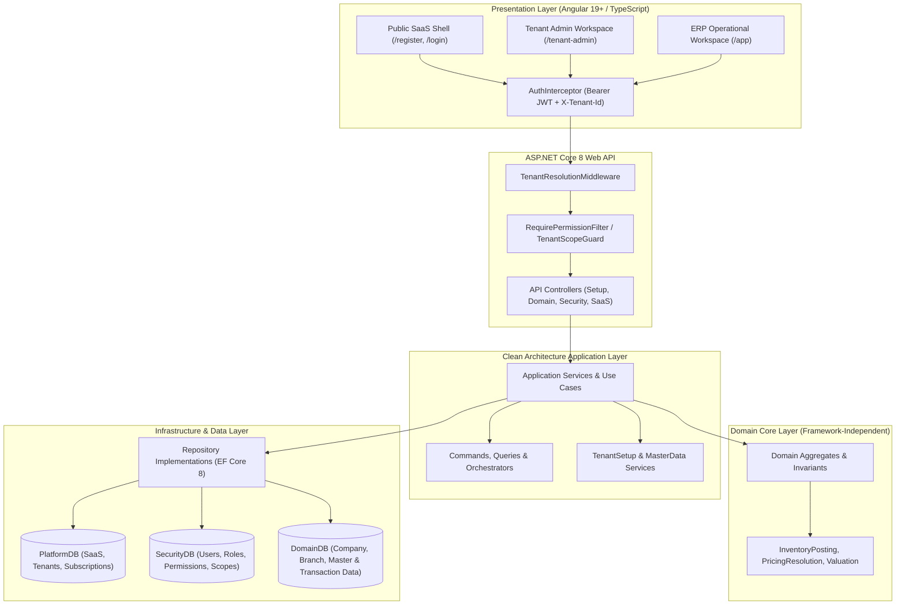
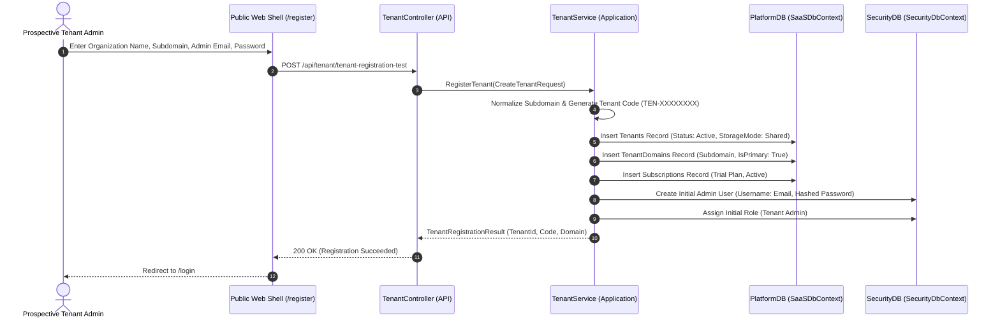
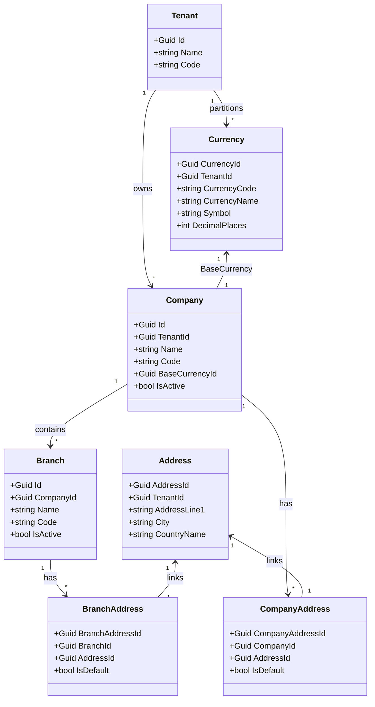
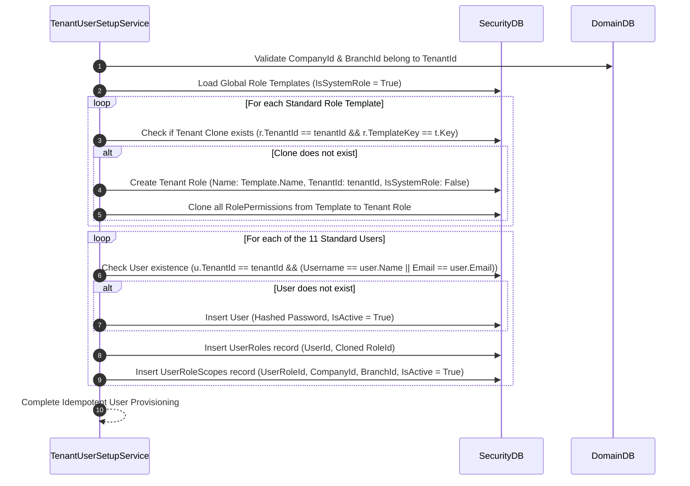
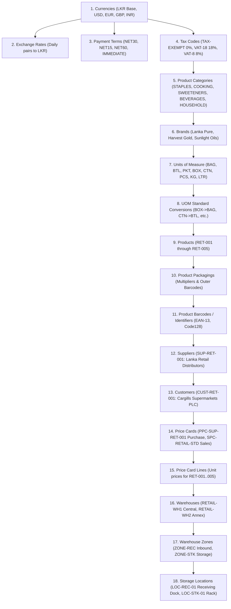
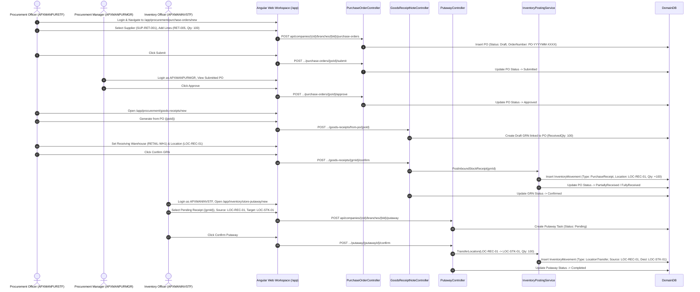
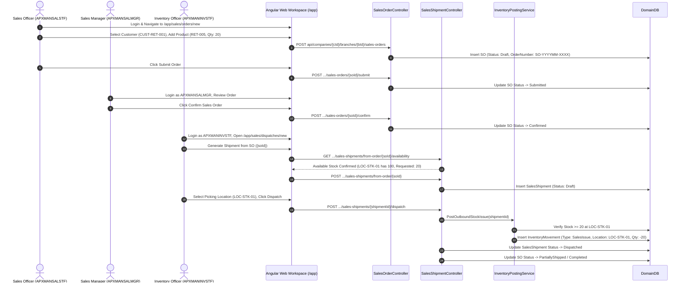

# ApexERP — Complete Operational & Technical Workflow Manual
## End-to-End Guide from Tenant Registration to Procurement, Inventory, and Sales Execution

---

## Document Control & Metadata

- **Document Identifier:** `APEXERP-DOC-OP-001`
- **Version:** `1.0.0`
- **Target Platform:** ApexERP Multi-Tenant Cloud ERP
- **Authoritative Technology Stack:**
  - **Backend:** .NET 8.0, ASP.NET Core Web API, Entity Framework Core 8.0, Microsoft SQL Server (LocalDB / Azure SQL)
  - **Frontend:** Angular 19+ (Standalone Components, Signals), TypeScript 5+, PrimeNG 22.1+, Sass
  - **Testing Infrastructure:** xUnit, Microsoft.AspNetCore.Mvc.Testing, EntityFrameworkCore.InMemory / LocalDB Integration Fixtures
- **Target Audience:** Solution Architects, DevOps Engineers, Full-Stack Developers, QA Engineers, Support Engineers, and Functional Implementation Consultants
- **Classification:** Authoritative Technical & Operational Reference Manual

---

## Table of Contents

1. [Architectural Foundations & System Topography](#1-architectural-foundations--system-topography)
   - 1.1 [Technology Stack & Runtime Topology](#11-technology-stack--runtime-topology)
   - 1.2 [Database Context Boundaries & Responsibilities](#12-database-context-boundaries--responsibilities)
   - 1.3 [Clean Architecture Layering & Boundary Rules](#13-clean-architecture-layering--boundary-rules)
   - 1.4 [Multi-Tenant Isolation Architecture](#14-multi-tenant-isolation-architecture)
2. [Flow 0 — Tenant Registration & Authentication Setup](#2-flow-0--tenant-registration--authentication-setup)
   - 2.1 [Registration Sequence & Workflow](#21-registration-sequence--workflow)
   - 2.2 [Data Identifiers: Tenant vs. Company vs. Industry Profile](#22-data-identifiers-tenant-vs-company-vs-industry-profile)
   - 2.3 [Authentication, Context Resolution & IDOR Prevention](#23-authentication-context-resolution--idor-prevention)
3. [Flow 1 — Organization Setup (Company, Branch & Currency)](#3-flow-1--organization-setup-company-branch--currency)
   - 3.1 [Prerequisites & Base Currency Resolution](#31-prerequisites--base-currency-resolution)
   - 3.2 [Company, Branch & Address Hierarchy](#32-company-branch--address-hierarchy)
   - 3.3 [Idempotency & Scope Integrity](#33-idempotency--scope-integrity)
4. [Flow 2 — Tenant User Provisioning & RBAC Architecture](#4-flow-2--tenant-user-provisioning--rbac-architecture)
   - 4.1 [Standardized Username & Email Naming Conventions](#41-standardized-username--email-naming-conventions)
   - 4.2 [The 11 Standard Operational Roles](#42-the-11-standard-operational-roles)
   - 4.3 [Tenant Role Cloning & Scope Architecture (`UserRoleScopes`)](#43-tenant-role-cloning--scope-architecture-userrolescopes)
   - 4.4 [Comprehensive Permission Matrix & Segregation of Duties](#44-comprehensive-permission-matrix--segregation-of-duties)
5. [Flow 3 — Master Data Seeding: Retail Gate 6 Baseline](#5-flow-3--master-data-seeding-retail-gate-6-baseline)
   - 5.1 [Industry Profile Concept vs. Tenant Identity](#51-industry-profile-concept-vs-tenant-identity)
   - 5.2 [Exact Seeding Sequence & Dependency Hierarchy](#52-exact-seeding-sequence--dependency-hierarchy)
   - 5.3 [Retail Gate 6 Master Data Catalog Specification](#53-retail-gate-6-master-data-catalog-specification)
   - 5.4 [Data Seeding Safety, Multi-Tenancy & Idempotency Rules](#54-data-seeding-safety-multi-tenancy--idempotency-rules)
6. [Flow 4 — Pre-Flight ERP Operational Readiness Audit](#6-flow-4--pre-flight-erp-operational-readiness-audit)
   - 6.1 [Comprehensive Readiness Audit Checklist](#61-comprehensive-readiness-audit-checklist)
   - 6.2 [Diagnostic Verification Queries](#62-diagnostic-verification-queries)
7. [Flow A — Procurement to Inventory Receipt Lifecycle](#7-flow-a--procurement-to-inventory-receipt-lifecycle)
   - 7.1 [Phase A1: Purchase Order Lifecycle](#71-phase-a1-purchase-order-lifecycle)
   - 7.2 [Phase A2: Goods Receipt Note (GRN) Processing](#72-phase-a2-goods-receipt-note-grn-processing)
   - 7.3 [Phase A3: Warehouse Putaway Execution](#73-phase-a3-warehouse-putaway-execution)
   - 7.4 [Flow A Acceptance Criteria & Stock Verification](#74-flow-a-acceptance-criteria--stock-verification)
8. [Flow B — Sales Order to Inventory Dispatch Lifecycle](#8-flow-b--sales-order-to-inventory-dispatch-lifecycle)
   - 8.1 [Phase B1: Sales Order Creation & Confirmation](#81-phase-b1-sales-order-creation--confirmation)
   - 8.2 [Phase B2: Sales Shipment & Dispatch Processing](#82-phase-b2-sales-shipment--dispatch-processing)
   - 8.3 [Flow B Acceptance Criteria & Stock Reduction Verification](#83-flow-b-acceptance-criteria--stock-reduction-verification)
9. [Flow C — Non-Batch & Non-Serial Item Operational Walkthrough](#9-flow-c--non-batch--non-serial-item-operational-walkthrough)
10. [Flow D — Batch-Tracked Inventory Operational Walkthrough](#10-flow-d--batch-tracked-inventory-operational-walkthrough)
11. [Flow E — Serial-Tracked Inventory Operational Walkthrough](#11-flow-e--serial-tracked-inventory-operational-walkthrough)
12. [Flow F — Extended Warehouse & Inventory Movements](#12-flow-f--extended-warehouse--inventory-movements)
13. [Flow G — End-to-End Testing Strategy & Evidence Protocols](#13-flow-g--end-to-end-testing-strategy--evidence-protocols)
14. [Operational Troubleshooting, Error Codes & Recovery Guide](#14-operational-troubleshooting-error-codes--recovery-guide)
15. [Final Acceptance & Verification Matrix](#15-final-acceptance--verification-matrix)

---

# 1. Architectural Foundations & System Topography

## 1.1 Technology Stack & Runtime Topology

ApexERP is engineered as a Domain-Driven, Clean Architecture Modular Monolith designed for multi-tenant enterprise resource planning. It enforces strict separation of concerns across presentation, orchestration, domain rules, and infrastructure persistence.



## 1.2 Database Context Boundaries & Responsibilities

ApexERP enforces strict bounded contexts across three isolated SQL Server relational databases. Foreign keys cannot cross database physical boundaries; relational consistency across contexts is governed strictly at the application service layer via immutable GUIDs.

| Database Context | Authoritative DbContext | Primary Responsibilities | Core Tables & Entities | Cross-Context References |
|---|---|---|---|---|
| **PlatformDB** | `SaaSDbContext` | Tenant lifecycle, registration, subscriptions, custom domains, platform billing, SaaS feature flags. | `Tenants`, `Subscriptions`, `SubscriptionPlans`, `TenantDomains`, `PlatformUsers` | Exposes authoritative `TenantId` (GUID) consumed by SecurityDB and DomainDB. |
| **SecurityDB** | `SecurityDbContext` | User identity, credentials (salted hashes), roles, permission assignments, company/branch authorization scopes, refresh tokens. | `Users`, `Roles`, `Permissions`, `RolePermissions`, `UserRoles`, `UserRoleScopes`, `UserRefreshTokens` | Stores `TenantId` to partition identities; references `CompanyId` and `BranchId` from DomainDB as foreign GUID identifiers in `UserRoleScopes`. |
| **DomainDB** | `DomainDbContext` | Operational enterprise data: legal companies, operating branches, addresses, currencies, master catalogs, stock ledgers, procurement, sales. | `Companies`, `Branches`, `Addresses`, `Currencies`, `TaxCodes`, `PaymentTerms`, `Categories`, `Brands`, `UnitsOfMeasure`, `Products`, `Warehouses`, `WarehouseLocations`, `Suppliers`, `Customers`, `PriceCards`, `PurchaseOrders`, `GoodsReceiptNotes`, `InventoryMovements`, `SalesOrders`, `SalesShipments` | Partitioned strictly by `TenantId`. Entities reference `CompanyId` and `BranchId` to enforce local organisational hierarchy. |

## 1.3 Clean Architecture Layering & Boundary Rules

In compliance with repository development standards (`Backend/ERP/AGENTS.md`), the following project boundaries are strictly maintained:

1. **`ERP.Domain` (`Backend/ERP/Domain/`)**:
   - Zero dependencies on external frameworks, Entity Framework Core, ASP.NET Core, or Infrastructure.
   - Contains business entities, aggregates, domain events, enums, value objects, and pure domain calculation services (`InventoryPostingService`, `PricingResolutionService`).
2. **`ERP.Application` (`Backend/ERP/ERP.Application/`)**:
   - Depends only on `ERP.Domain`.
   - Owns application use cases, DTOs, cross-aggregate coordination, and service contracts (`TenantMasterDataSetupService`, `TenantOrganizationSetupService`).
3. **`ERP.Infrastructure` (`Backend/ERP/ERP.Infrastructure/`)**:
   - Implements repository interfaces defined in `Domain` and `Application`.
   - Owns EF Core database configurations, migrations, SQL execution, and external communication adapters.
4. **`API` (`Backend/ERP/API/`)**:
   - Composition root and HTTP presentation layer.
   - Enforces authentication, authorization attribute guards, model validation, and routing.
   - **Mandatory Rule:** Controllers must never access `DbContext` directly; all operations must flow through Application/Domain service abstractions.

## 1.4 Multi-Tenant Isolation Architecture

1. **Logical Isolation with Database Enforced Keys:**
   - Every tenant-scoped entity in `DomainDB` and `SecurityDB` implements a non-nullable `TenantId` property.
   - Composite unique constraints are enforced at the database level:
     - `SecurityDB.Users`: `IX_Users_TenantId_Username` on `(TenantId, Username)` and `IX_Users_TenantId_Email` on `(TenantId, Email)`.
     - `DomainDB.Currencies`: `IX_Currencies_TenantId_CurrencyCode` on `(TenantId, CurrencyCode)`.
     - `DomainDB.Products`: `IX_Products_TenantId_ProductCode` on `(TenantId, ProductCode)`.
     - `DomainDB.Warehouses`: `IX_Warehouses_TenantId_WarehouseCode` on `(TenantId, WarehouseCode)`.
2. **Authoritative Context Propagation:**
   - Every API request carries a validated JWT containing `tenant_id`, `sub` (UserId), and role claims.
   - `TenantResolutionMiddleware` resolves the active tenant context via host subdomain or `X-Tenant-Id` header (for development/mobile).
   - `ICurrentUserContext` provides the authoritative, validated `TenantId` to application services. Application code never trusts client-supplied tenant identifiers unless the user possesses elevated platform privileges (`IsPlatformUser == true`).

---

# 2. Flow 0 — Tenant Registration & Authentication Setup

## 2.1 Registration Sequence & Workflow

Tenant registration is the initial entry point where a customer establishes their organization identity on the ApexERP platform.



### Registration Artifacts & Code References:
- **Frontend Route:** `/register` (`Frontend/Web/src/app/features/saas/public/register/register.component.ts`)
- **Backend Controller:** `SaaS.API.Controllers.TenantController` (`Backend/ERP/API/Features/Saas/TenantController.cs`)
- **API Endpoint:** `POST /api/tenant/tenant-registration-test` (and `POST /api/tenant/provision`)
- **Request DTO:** `CreateTenantRequest` (`Name`, `Subdomain`, `AdminEmail`, `Password`, `SubscriptionPlanId`)
- **Persistence:** Creates record in `PlatformDB.dbo.Tenants` with `Id = Guid.NewGuid()`, `Code = 'TEN-' + Substring(Id, 8)`, `IsActive = 1`.

## 2.2 Data Identifiers: Tenant vs. Company vs. Industry Profile

A critical architectural distinction must be maintained between organizational and functional concepts:

| Identifier | Level | Purpose | Example Value | Persisted Location |
|---|---|---|---|---|
| **Tenant Name** | Platform | Legal/contractual name of the SaaS subscriber entity. | `Apex Manufacturing Ltd` | `PlatformDB.Tenants.Name` |
| **Tenant Code** | Platform | Unique platform routing key (generated or customized). | `APXMAN` (or `TEN-81307250`) | `PlatformDB.Tenants.Code` |
| **TenantId** | System | Primary GUID surrogate key partitioning all tenant records. | `81307250-b0a9-466c-ab9f-0a52aafbe52c` | All DBs (`TenantId` column) |
| **Company Name** | Domain | Legal operating company entity within the ERP tenant. | `APXMAN (Pvt) Ltd` | `DomainDB.Companies.Name` |
| **Company Code** | Domain | Operating code representing the corporate entity. | `APXMAN` | `DomainDB.Companies.Code` |
| **Branch Code** | Domain | Operating facility, store, or office under a company. | `MAIN` | `DomainDB.Branches.Code` |
| **Industry Profile Code** | Master Data Template | Reusable catalog baseline template (e.g. retail, manufacturing). **Never a tenant name.** | `retail` | `Profiles/retail.json` |

## 2.3 Authentication, Context Resolution & IDOR Prevention

### Login Sequence:
1. **User Request:** User navigates to `/login` and posts credentials to `POST /api/security/login`.
2. **Tenant Scoping:**
   - If accessed via a custom domain or subdomain (`apxman.erp.lk`), `TenantResolutionMiddleware` detects the tenant from the request host.
   - If accessed via a common IP/hostname (e.g. `http://192.168.1.5:4200`), the client transmits the `X-Tenant-Id` header.
3. **Credential Verification:**
   - `UserService.LoginAsync` looks up the user using tenant-scoped matching:
     `SELECT * FROM Users WHERE TenantId = @tenantId AND (Username = @loginId OR Email = @loginId)`
   - Password hash is verified using SHA-256 with PBKDF2/cryptographic salt.
4. **Token Issuance:**
   - Returns JWT containing `sub` (UserId), `email`, `tenant_id`, and `role` claims.
   - Issues HttpOnly `refresh_token` cookie.
5. **IDOR & Cross-Tenant Attack Prevention:**
   - Every secured endpoint evaluates `RequirePermissionAttribute` and verifies that the `companyId` and `branchId` passed in the URL route belong strictly to the authenticated caller's `TenantId` via `IUserAccessService.CanAccessCompanyAsync` and `CanAccessBranchAsync`.
   - Cross-tenant requests produce HTTP `403 Forbidden` or `401 Unauthorized`.

---

# 3. Flow 1 — Organization Setup (Company, Branch & Currency)

## 3.1 Prerequisites & Base Currency Resolution

Before operational transactions or master catalogs can be established, the tenant's legal corporate shell and base accounting currency must exist in `DomainDB`.

### The Base Currency Prerequisite Rule:
1. Every legal company in `DomainDB.Companies` requires a valid non-null foreign key `BaseCurrencyId` referencing `DomainDB.Currencies.CurrencyId`.
2. If `DomainDB.Currencies` is empty for a new tenant, creating a company will fail with a foreign key constraint violation.
3. **Automated Provisioning Solution:** `TenantOrganizationSetupService` ensures that the base currency exists (defaulting to `LKR` — Sri Lankan Rupee, Symbol: `Rs`, Decimals: 2) within the tenant's scope before persisting the `Company` record. If an active `LKR` record is present, it is reused idempotently.

## 3.2 Company, Branch & Address Hierarchy



## 3.3 Idempotency & Scope Integrity

- **Frontend Screen:** `/app/company-setup` (`CompanySetupComponent`)
- **Backend Controller:** `API.Features.Setup.TenantSetupController`
- **Endpoint:** `POST /api/setup/initialize-organization`
- **Request DTO:**
  ```json
  {
    "targetTenantId": "81307250-b0a9-466c-ab9f-0a52aafbe52c",
    "companyName": "APXMAN (Pvt) Ltd",
    "companyCode": "APXMAN",
    "baseCurrencyCode": "LKR",
    "branchName": "APXMAN Main Branch",
    "branchCode": "MAIN",
    "addressLine1": "No. 123, Galle Road",
    "city": "Colombo",
    "postalCode": "00300",
    "countryName": "Sri Lanka"
  }
  ```
- **Execution Rules:**
  1. Searches for existing `Company` where `TenantId == targetTenantId && (Code == request.CompanyCode || Name == request.CompanyName)`. If found, reuses it.
  2. Searches for existing `Branch` where `CompanyId == company.Id && Code == request.BranchCode`. If found, reuses it.
  3. Creates primary `Address` records for Registered Office and Operating Facility.
  4. Links `CompanyAddresses` and `BranchAddresses`.
  5. Returns `TenantOrganizationSetupResult` containing `CompanyId`, `BranchId`, and entity creation flags.

---

# 4. Flow 2 — Tenant User Provisioning & RBAC Architecture

## 4.1 Standardized Username & Email Naming Conventions

To guarantee strict tenant isolation, eliminate collisions, and prevent confusion across shared workstations, all provisioned tenant accounts must adhere to the standardized uppercase convention:

$$\text{Username} = \{\text{TENANT\_CODE}\} + \{\text{MODULE\_CODE}\} + \{\text{ROLE\_CODE}\}$$

$$\text{Email} = \text{lowercase}(\text{Username}) + \text{"@"} + \text{lowercase}(\text{TENANT\_CODE}) + \text{".local"}$$

*(Note: Tenant code is normalized by stripping hyphens and non-alphanumeric characters, e.g., `TEN-81307250` or `APXMAN` $\rightarrow$ `APXMAN`).*

## 4.2 The 11 Standard Operational Roles

| # | Standard Role Title | Username (Example: APXMAN) | Email Address | Module Responsibility | Key Functional Authority |
|---|---|---|---|---|---|
| 1 | **Tenant Admin** | `APXMANADM` | `apxmanadm@apxman.local` | Administration & Security | Full tenant administration, user assignment, role management, catalog oversight. **Zero platform-level access.** |
| 2 | **Procurement Manager** | `APXMANPURMGR` | `apxmanpurmgr@apxman.local` | Purchasing & Sourcing | Purchase order approval (`PURCHASE_ORDER.APPROVE`), GRN confirmation, supplier management. |
| 3 | **Procurement Officer** | `APXMANPURSTF` | `apxmanpurstf@apxman.local` | Purchasing Operations | PO creation, editing, submission (`PURCHASE_ORDER.SUBMIT`), GRN generation. **Cannot approve POs.** |
| 4 | **Inventory Manager** | `APXMANINVMGR` | `apxmaninvmgr@apxman.local` | Warehouse & Stock Control | Stock receipt posting (`STOCK_RECEIPT.POST`), stock adjustments, putaway approval, cycle count posting. |
| 5 | **Inventory Officer** | `APXMANINVSTF` | `apxmaninvstf@apxman.local` | Warehouse Operations | Receiving verification, putaway execution (`PUTAWAY.POST`), stock count data entry, stock issues. |
| 6 | **Sales Manager** | `APXMANSALMGR` | `apxmansalmgr@apxman.local` | Commercial & Revenue | Sales order confirmation/approval (`SALES_ORDER.CONFIRM`), credit overrides, sales pricing oversight. |
| 7 | **Sales Officer** | `APXMANSALSTF` | `apxmansalstf@apxman.local` | Sales Operations | Sales quotation, sales order draft entry, sales order submission. **Cannot confirm orders.** |
| 8 | **Warehouse Configuration Officer** | `APXMANWHMGR` | `apxmanwhmgr@apxman.local` | Facilities & Topology | Warehouse definition, zone assignment, bin/location hierarchy, storage capacity maintenance. |
| 9 | **Finance Configuration Officer** | `APXMANFINMGR` | `apxmanfinmgr@apxman.local` | Accounting & Treasury | Currency creation, daily exchange rates, payment terms (`NET30`), tax codes (`VAT-18`). |
| 10 | **Master Data Manager** | `APXMANMDMMGR` | `apxmanmdmmgr@apxman.local` | Enterprise Data Governance | Product master creation, categories, brands, UOM conversions, packaging, price cards, barcodes. |
| 11 | **Tenant Read-only Auditor** | `APXMANAUDVIEW` | `apxmanaudview@apxman.local` | Compliance & Inspection | Read-only inspection (`*.VIEW`) across all procurement, inventory, sales, pricing, and audit trails. |

## 4.3 Tenant Role Cloning & Scope Architecture (`UserRoleScopes`)

ApexERP does not assign platform-level shared system roles directly to tenant users. Doing so would violate multi-tenant boundaries if a role's permissions were subsequently customized.



### Authorization Scope Enforcement:
- When a user logs in, their effective permissions are evaluated through `UserRoleScopes`.
- If an account has `CompanyId = C1` and `BranchId = B1`, queries filtering inventory, orders, and receipts automatically inject `WHERE CompanyId = C1 AND BranchId = B1`.
- A user without an active `UserRoleScope` cannot perform branch-level operational transactions.

## 4.4 Comprehensive Permission Matrix & Segregation of Duties

The following matrix documents the exact permissions assigned in `SecurityDB.dbo.RolePermissions` to the provisioned roles:

| Functional Capability | Required Permission Key | Tenant Admin | Procurement Manager | Procurement Officer | Inventory Manager | Inventory Officer | Sales Manager | Sales Officer | Warehouse Config | Finance Config | Master Data Mgr | Auditor |
|---|---|:---:|:---:|:---:|:---:|:---:|:---:|:---:|:---:|:---:|:---:|:---:|
| **PO Create / Edit** | `PURCHASE_ORDER.CREATE`, `.EDIT` | ✅ | ✅ | ✅ | ❌ | ❌ | ❌ | ❌ | ❌ | ❌ | ❌ | ❌ |
| **PO Submit** | `PURCHASE_ORDER.SUBMIT` | ✅ | ✅ | ✅ | ❌ | ❌ | ❌ | ❌ | ❌ | ❌ | ❌ | ❌ |
| **PO Approve** | `PURCHASE_ORDER.APPROVE` | ✅ | ✅ | ❌ | ❌ | ❌ | ❌ | ❌ | ❌ | ❌ | ❌ | ❌ |
| **PO View** | `PURCHASE_ORDER.VIEW` | ✅ | ✅ | ✅ | ❌ | ❌ | ❌ | ❌ | ❌ | ❌ | ❌ | ✅ |
| **GRN Create / Edit** | `GRN.CREATE`, `GRN.EDIT` | ✅ | ✅ | ✅ | ❌ | ❌ | ❌ | ❌ | ❌ | ❌ | ❌ | ❌ |
| **GRN Confirm** | `GRN.CONFIRM` | ✅ | ✅ | ✅ | ❌ | ❌ | ❌ | ❌ | ❌ | ❌ | ❌ | ❌ |
| **GRN View** | `GRN.VIEW` | ✅ | ✅ | ✅ | ✅ | ✅ | ❌ | ❌ | ❌ | ❌ | ❌ | ✅ |
| **Stock Receipt Post** | `STOCK_RECEIPT.POST` | ✅ | ❌ | ❌ | ✅ | ✅ | ❌ | ❌ | ❌ | ❌ | ❌ | ❌ |
| **Putaway Post / Confirm** | `PUTAWAY.POST` | ✅ | ❌ | ❌ | ✅ | ✅ | ❌ | ❌ | ❌ | ❌ | ❌ | ❌ |
| **Stock Count Approve** | `STOCK_COUNT.APPROVE` | ✅ | ❌ | ❌ | ✅ | ❌ | ❌ | ❌ | ❌ | ❌ | ❌ | ❌ |
| **Stock Issue Post** | `STOCK_ISSUE.POST` | ✅ | ❌ | ❌ | ✅ | ✅ | ❌ | ❌ | ❌ | ❌ | ❌ | ❌ |
| **SO Create / Edit** | `SALES_ORDER.CREATE`, `.EDIT` | ✅ | ❌ | ❌ | ❌ | ❌ | ✅ | ✅ | ❌ | ❌ | ❌ | ❌ |
| **SO Confirm / Approve** | `SALES_ORDER.CONFIRM` | ✅ | ❌ | ❌ | ❌ | ❌ | ✅ | ❌ | ❌ | ❌ | ❌ | ❌ |
| **Shipment / Dispatch** | `SALES_SHIPMENT.DISPATCH` | ✅ | ❌ | ❌ | ❌ | ❌ | ✅ | ❌ | ❌ | ❌ | ❌ | ❌ |
| **Warehouse / Bin Setup** | `WAREHOUSE.CREATE`, `LOCATION.CREATE` | ✅ | ❌ | ❌ | ❌ | ❌ | ❌ | ❌ | ✅ | ❌ | ❌ | ❌ |
| **Currency & Tax Setup** | `CURRENCY.CREATE`, `TAX_CODE.CREATE` | ✅ | ❌ | ❌ | ❌ | ❌ | ❌ | ❌ | ❌ | ✅ | ❌ | ❌ |
| **Product & Pricing Setup**| `PRODUCT.CREATE`, `PRICE_CARD.CREATE`| ✅ | ❌ | ❌ | ❌ | ❌ | ❌ | ❌ | ❌ | ❌ | ✅ | ❌ |
| **Read-Only Audit** | `*.VIEW` (33 view permissions) | ✅ | ❌ | ❌ | ❌ | ❌ | ❌ | ❌ | ❌ | ❌ | ❌ | ✅ |

### Segregation of Duties (SoD) Safeguards:
1. **PO Approval Gate:** `APXMANPURSTF` (Procurement Officer) can prepare and submit Purchase Orders but cannot approve them. `APXMANPURMGR` (Procurement Manager) is required for approval.
2. **Receipt vs. Posting Separation:** Procurement officers generate the Goods Receipt Note (`GRN.CREATE`), but stock ledger updates require Inventory personnel holding `STOCK_RECEIPT.POST` or `PUTAWAY.POST`.
3. **Sales Order Approval Gate:** `APXMANSALSTF` drafts and submits Sales Orders; only `APXMANSALMGR` holds `SALES_ORDER.CONFIRM`.
4. **Auditor Immutability:** `APXMANAUDVIEW` possesses zero mutating permissions (`CREATE`, `EDIT`, `DELETE`, `POST`, `APPROVE`); any attempt to invoke mutating API endpoints returns HTTP `403 Forbidden`.

---

# 5. Flow 3 — Master Data Seeding: Retail Gate 6 Baseline

## 5.1 Industry Profile Concept vs. Tenant Identity

The industry profile `retail` is an **industry-specific operational blueprint** stored as JSON (`Backend/ERP/ERP.Application/Features/Setup/Profiles/retail.json`). It specifies standard product classifications, units of measure, item definitions, barcodes, pricing, and storage layouts.

> **CRITICAL RULE:** The string `retail` represents the industry template code. It must never be confused with or substituted for the tenant code (e.g. `APXMAN`). When executing Master Data Setup, the API accepts:
> ```json
> {
>   "profileCode": "retail",
>   "companyId": "6ad8fe26-04b3-4fe2-917b-c9e03f5b7ac6",
>   "branchId": "c5d4ebe3-faa7-4de6-b088-62aa6330eb2e"
> }
> ```

## 5.2 Exact Seeding Sequence & Dependency Hierarchy

Master data seeding must execute in strict topological dependency order to ensure foreign key integrity:



## 5.3 Retail Gate 6 Master Data Catalog Specification

### Verified Entity Counts (Unit-Test & LocalDB Verified):
- **Currencies:** 5 (`LKR` [Base], `USD`, `EUR`, `GBP`, `INR`)
- **Exchange Rates:** 4 pairs (`USD/LKR: 305.00`, `EUR/LKR: 330.00`, `GBP/LKR: 385.00`, `INR/LKR: 3.65`)
- **Payment Terms:** 4 (`NET30`, `IMMEDIATE`, `NET15`, `NET60`)
- **Tax Codes:** 3 (`TAX-EXEMPT: 0%`, `VAT-18: 18%`, `VAT-8: 8%`)
- **Categories:** 6 (`STAPLES`, `COOKING`, `SWEETENERS`, `BEVERAGES`, `HOUSEHOLD`, `SERVICES`)
- **Brands:** 3 (`BRAND-LP`: Lanka Pure, `BRAND-HG`: Harvest Gold, `BRAND-SL`: Sunlight Oils)
- **Units of Measure (UOM):** 13 (`BAG`, `BTL`, `PKT`, `BOX`, `CTN`, `BDL`, `KG`, `G`, `LTR`, `ML`, `PCS`, `EA`, `DOZEN`)
- **UOM Conversions:** 6 standard conversion rules
- **Products:** 5 items
- **Product Packagings:** 5 packaging configurations
- **Product Identifiers / Barcodes:** 5 primary barcode records
- **Suppliers:** 1 (`SUP-RET-001`: Lanka Retail Distributors (Pvt) Ltd)
- **Customers:** 1 (`CUST-RET-001`: Cargills Supermarkets PLC)
- **Price Cards:** 2 (`PPC-SUP-RET-001` Purchase, `SPC-RETAIL-STD` Sales)
- **Price Card Lines:** 10 (5 purchase lines, 5 sales lines)
- **Warehouses:** 2 (`RETAIL-WH1`: Central Retail Warehouse, `RETAIL-WH2`: Annex Retail Warehouse)
- **Warehouse Zones:** 3 (`ZONE-REC`, `ZONE-STK`, `ZONE-WH2`)
- **Warehouse Storage Locations:** 3 (`LOC-REC-01`, `LOC-STK-01`, `LOC-WH2-01`)

### Master Item Catalog Detail:
| Product Code | Product Description | Base UOM | Tracking Mode | Valuation Method | Standard Cost (LKR) | Base Selling Price (LKR) | Tax Code | Barcode (EAN-13) |
|---|---|---|---|---|---|---|---|---|
| `RET-001` | Samba Rice 5kg Pack | `BAG` | **Batch** | FIFO | 1,500.00 | 1,850.00 | `TAX-EXEMPT` | `4792001001018` |
| `RET-002` | Pure Vegetable Cooking Oil 1L | `BTL` | **Batch** | FIFO | 850.00 | 1,050.00 | `VAT-18` | `4792001002015` |
| `RET-003` | Refined White Sugar 1kg | `PKT` | **Batch** | FIFO | 320.00 | 400.00 | `TAX-EXEMPT` | `4792001003012` |
| `RET-004` | Spring Water 500 ml | `BTL` | **Batch** | Weighted Average | 70.00 | 100.00 | `VAT-18` | `4790000000044` |
| `RET-005` | Reusable Shopping Bag | `PCS` | **None** | FIFO | 50.00 | 80.00 | `VAT-18` | `BAR-00000005` (Code128) |

## 5.4 Data Seeding Safety, Multi-Tenancy & Idempotency Rules

1. **Strict Tenant Resolution:**
   - Seeding code never hardcodes `TenantId`. The active `tenantId` is resolved from the authorized request context.
2. **Natural Key Idempotency:**
   - Every insertion checks for natural key existence before creating a record:
     - Currencies check `(TenantId, CurrencyCode)`.
     - Products check `(TenantId, ProductCode)`.
     - Warehouses check `(TenantId, WarehouseCode)`.
     - Price cards check `(TenantId, PriceCardCode)`.
   - Repeated execution results in zero duplicate records (`Assert.Equal(count1, count2)` verified in test suite).
3. **Immutability of Transaction Data:**
   - Master data seeding creates catalog definitions only. It never seeds simulated stock movements, ledger balances, Purchase Orders, or Invoices.

---

# 6. Flow 4 — Pre-Flight ERP Operational Readiness Audit

## 6.1 Comprehensive Readiness Audit Checklist

Before executing business transactions in a provisioned tenant, verify all 17 pre-flight conditions:

```
[ ] 1. Tenant Status: PlatformDB.Tenants record is Active and has valid Subscription.
[ ] 2. Organization Linkage: DomainDB.Companies belongs strictly to TenantId.
[ ] 3. Branch Linkage: DomainDB.Branches is active and belongs to CompanyId.
[ ] 4. Base Accounting Currency: DomainDB.Currencies has LKR with isBase = 1.
[ ] 5. User Account Provisioning: All 11 standardized accounts exist in SecurityDB.
[ ] 6. Scope Assignment: All 11 accounts have active UserRoleScopes bound to CompanyId and BranchId.
[ ] 7. Role Isolation: Assigned roles are tenant-owned clones (Role.TenantId == TenantId).
[ ] 8. Active Supplier: SUP-RET-001 exists, is active, has CurrencyId (LKR) and PaymentTerms (NET30).
[ ] 9. Active Customer: CUST-RET-001 exists, is active, has CurrencyId (LKR) and PaymentTerms (NET30).
[ ] 10. Purchase Pricing: PriceCard PPC-SUP-RET-001 is active and has valid lines for target products.
[ ] 11. Sales Pricing: PriceCard SPC-RETAIL-STD is active and has valid lines for target products.
[ ] 12. Inbound Receiving Facility: RETAIL-WH1 has ZONE-REC and active location LOC-REC-01.
[ ] 13. Storage Rack Facility: RETAIL-WH1 has ZONE-STK and active location LOC-STK-01.
[ ] 14. Product Purchasability: Products have isPurchasable = 1 and base UnitOfMeasureId.
[ ] 15. Product Sellability: Products have isSellable = 1.
[ ] 16. Inventory Ledger Initialization: Initial stock ledger is accessible without database deadlocks.
[ ] 17. Security Token Verification: Login succeeds for APXMANPURSTF, APXMANPURMGR, APXMANINVSTF.
```

## 6.2 Diagnostic Verification Queries

To execute an independent read-only diagnostic audit using PowerShell outside of sandbox mode:

```powershell
Add-Type -AssemblyName System.Data
$conn = New-Object System.Data.SqlClient.SqlConnection("Server=(localdb)\MSSQLLocalDB;Database=DomainDB;Integrated Security=True;TrustServerCertificate=True;")
$conn.Open()
$cmd = $conn.CreateCommand()
$cmd.CommandText = @"
    SELECT 
        (SELECT COUNT(*) FROM Currencies WHERE TenantId = @t) AS Currencies,
        (SELECT COUNT(*) FROM Products WHERE TenantId = @t) AS Products,
        (SELECT COUNT(*) FROM Suppliers WHERE TenantId = @t AND IsActive = 1) AS ActiveSuppliers,
        (SELECT COUNT(*) FROM PriceCards WHERE TenantId = @t AND Status = 1) AS ActivePriceCards,
        (SELECT COUNT(*) FROM Warehouses WHERE TenantId = @t AND IsActive = 1) AS ActiveWarehouses,
        (SELECT COUNT(*) FROM WarehouseLocations WHERE TenantId = @t AND IsActive = 1) AS ActiveLocations
"@
$cmd.Parameters.AddWithValue("@t", "YOUR_TENANT_GUID")
$r = $cmd.ExecuteReader()
while ($r.Read()) {
    Write-Host ("Audit Summary -> Currencies: {0}, Products: {1}, Suppliers: {2}, PriceCards: {3}, Warehouses: {4}, Locations: {5}" `
        -f $r[0], $r[1], $r[2], $r[3], $r[4], $r[5])
}
$conn.Close()
```

---

# 7. Flow A — Procurement to Inventory Receipt Lifecycle

Flow A executes the core inbound supply chain: Purchase Order creation, managerial approval, physical goods receipt, stock ledger posting, and final putaway into storage racks.



## 7.1 Phase A1: Purchase Order Lifecycle

1. **Authentication:** Sign in as `APXMANPURSTF` (Procurement Officer).
2. **Navigation:** `/app/procurement/purchase-orders` $\rightarrow$ Click **New Purchase Order**.
3. **Header Entry:**
   - Supplier: `SUP-RET-001` (Lanka Retail Distributors).
   - Order Date: Today.
   - Expected Delivery Date: Today + 7 days.
   - Currency: `LKR` (Read-only, inherited from supplier).
   - Payment Terms: `NET30` (Inherited from supplier).
4. **Line Entry:**
   - Select Product: `RET-005` (Reusable Shopping Bag) or `RET-001` (Samba Rice).
   - Quantity: `100`.
   - Unit of Measure: `PCS` (or `BAG`).
   - Unit Price: System automatically queries `POST resolve-price` against `PPC-SUP-RET-001` and pre-fills `50.00` LKR.
   - Tax: Automatically computed via product's tax code (`VAT-18` $\rightarrow$ 18% or `TAX-EXEMPT` $\rightarrow$ 0%).
5. **Draft Persistence:** Click **Save Draft** (`POST api/companies/{cId}/branches/{bId}/purchase-orders`). Document status becomes `Draft`.
6. **Submission:** Click **Submit Order** (`POST .../{id}/submit`). Status transitions to `Submitted`. Officer can no longer edit lines.
7. **Approval:**
   - Sign in as `APXMANPURMGR` (Procurement Manager).
   - Open `/app/procurement/purchase-orders/{id}`.
   - Review pricing, supplier terms, and line totals.
   - Click **Approve Purchase Order** (`POST .../{id}/approve`). Status transitions to `Approved`. Document is now eligible for goods receipt.

## 7.2 Phase A2: Goods Receipt Note (GRN) Processing

1. **Generation:** Open `/app/procurement/goods-receipts` $\rightarrow$ Click **Receive from PO** $\rightarrow$ Select approved PO.
2. **Line Verification:**
   - System populates received lines from PO outstanding balances.
   - Received Quantity: Enter `100` (supports partial receipt e.g. `50` if partial shipment arrives).
3. **Receiving Dock Staging:**
   - Select Receiving Warehouse: `RETAIL-WH1` (Central Retail Warehouse).
   - Select Receiving Location: `LOC-REC-01` (Inbound Receiving Dock).
4. **Batch Capture (If Item is Batch-Tracked):**
   - If receiving `RET-001`, system requires Batch Number (e.g. `BATCH-2026-001`), Expiry Date, and Manufacturing Date.
5. **Confirmation & Stock Posting:**
   - Click **Confirm Receipt** (`POST api/companies/{cId}/branches/{bId}/goods-receipts/{id}/confirm`).
   - `GoodsReceiptNoteService` triggers `InventoryPostingService.PostInboundReceiptAsync`.
   - An immutable transaction record is written to `DomainDB.InventoryMovements` with movement type `PurchaseReceipt`.
   - **On-Hand Inventory Effect:** On-hand quantity for product at `LOC-REC-01` increases by `+100`.

## 7.3 Phase A3: Warehouse Putaway Execution

1. **Purpose:** Moves received stock from staging docks (`LOC-REC-01`) to high-density pallet racks (`LOC-STK-01`).
2. **Initiation:** Sign in as `APXMANINVSTF` (Inventory Officer) $\rightarrow$ Open `/app/inventory/store-putaway/new`.
3. **Select Eligible Receipt:** System queries `GET eligible-receipts` and displays confirmed GRN.
4. **Location Allocation:**
   - Source Location: `LOC-REC-01` (Receiving Dock 01).
   - Destination Location: `LOC-STK-01` (Main Rack A-01).
   - Putaway Quantity: `100`.
5. **Confirmation:** Click **Confirm Putaway** (`POST api/companies/{cId}/branches/{bId}/putaway/{id}/confirm`).
   - `PutawayService` calls `InventoryPostingService.PostLocationTransferAsync`.
   - **Net Inventory Impact:** Total warehouse stock remains `100`. Stock at `LOC-REC-01` decreases to `0`; stock at `LOC-STK-01` increases to `100`.

## 7.4 Flow A Acceptance Criteria & Stock Verification

- [x] Purchase Order status is `FullyReceived`.
- [x] Goods Receipt Note status is `Confirmed`.
- [x] Putaway status is `Completed`.
- [x] Stock Inquiry at `GET /api/inventory/available-stock?productId={RET-005}&locationId={LOC-STK-01}` returns `AvailableQuantity: 100.0`.
- [x] `DomainDB.InventoryMovements` contains distinct records for `PurchaseReceipt` and `LocationTransfer`.

---

# 8. Flow B — Sales Order to Inventory Dispatch Lifecycle

Flow B executes the outbound commercial lifecycle: customer sales quotation, sales order confirmation, stock reservation check, picking, shipment dispatch, and stock ledger deduction.



## 8.1 Phase B1: Sales Order Creation & Confirmation

1. **Authentication:** Sign in as `APXMANSALSTF` (Sales Officer).
2. **Navigation:** `/app/sales/orders` $\rightarrow$ Click **New Sales Order**.
3. **Header Details:**
   - Customer: `CUST-RET-001` (Cargills Supermarkets PLC).
   - Order Date: Today.
   - Payment Terms: `NET30` (Inherited from customer).
   - Currency: `LKR` (Inherited from customer).
4. **Line Item Entry:**
   - Select Product: `RET-005` (Reusable Shopping Bag).
   - Order Quantity: `20`.
   - Unit of Measure: `PCS`.
   - Unit Price: System queries `SPC-RETAIL-STD` and pre-fills `80.00` LKR.
   - Tax: Computed automatically (18% VAT $\rightarrow$ 288.00 LKR). Total: 1,888.00 LKR.
5. **Submission:** Click **Submit Order** (`POST api/companies/{cId}/branches/{bId}/sales-orders/{id}/submit`).
6. **Manager Confirmation:**
   - Sign in as `APXMANSALMGR` (Sales Manager).
   - Open `/app/sales/orders/{id}` $\rightarrow$ Click **Confirm Order** (`POST .../{id}/confirm`).
   - Order status transitions to `Confirmed`. Document is unlocked for fulfillment.

## 8.2 Phase B2: Sales Shipment & Dispatch Processing

1. **Initiation:** Open `/app/sales/dispatches` $\rightarrow$ Click **New Dispatch** $\rightarrow$ Select confirmed Sales Order.
2. **Availability Pre-Flight Check:**
   - System calls `GET api/companies/{cId}/branches/{bId}/sales-shipments/from-order/{soId}/availability`.
   - Validates that warehouse `RETAIL-WH1` possesses $\ge 20$ units of `RET-005`.
3. **Picking Location Allocation:**
   - Specify Source Location: `LOC-STK-01` (Main Rack A-01).
   - Dispatched Quantity: `20`.
4. **Dispatch Execution:**
   - Click **Process Dispatch** (`POST api/companies/{cId}/branches/{bId}/sales-shipments/{id}/dispatch`).
   - `SalesShipmentService` acquires an update lock on the Sales Order and invokes `InventoryPostingService.PostOutboundStockIssueAsync`.
   - Validates stock availability with concurrency protection.
   - **Ledger Impact:** Writes an immutable record to `DomainDB.InventoryMovements` with movement type `SalesIssue` and quantity `-20.0`.
   - **Sales Order Fulfillment:** SO status updates to `Completed` (or `PartiallyShipped` if partial).

## 8.3 Flow B Acceptance Criteria & Stock Reduction Verification

- [x] Sales Order status transitions to `Completed`.
- [x] Sales Shipment status is `Dispatched`.
- [x] On-hand stock for `RET-005` at `LOC-STK-01` reduces from `100.0` to `80.0`.
- [x] `DomainDB.InventoryMovements` reflects a `SalesIssue` transaction linked to the `SalesShipmentId`.

---

# 9. Flow C — Non-Batch & Non-Serial Item Operational Walkthrough

Flow C is the foundational discrete item demonstration utilizing product **`RET-005` (Reusable Shopping Bag)**, configured with **`TrackingMode = None`**.

### Operational Walkthrough Steps:

```
[Procurement Officer]
1. Create PO for 50 PCS of RET-005 @ 50.00 LKR.
2. Submit PO.
[Procurement Manager]
3. Approve PO.
[Procurement Officer]
4. Generate GRN for 50 PCS at Warehouse RETAIL-WH1, Location LOC-REC-01.
5. Notice: System does NOT prompt for Batch Number or Serial Number.
6. Confirm GRN.
   --> Inbound stock posted: LOC-REC-01 = 50 PCS.
[Inventory Officer]
7. Execute Putaway from LOC-REC-01 to LOC-STK-01 for 50 PCS.
   --> Stock transferred: LOC-REC-01 = 0 PCS, LOC-STK-01 = 50 PCS.
[Sales Officer]
8. Create SO for 15 PCS of RET-005 @ 80.00 LKR.
9. Submit SO.
[Sales Manager]
10. Confirm SO.
[Inventory Officer]
11. Generate Dispatch from SO.
12. Select Location LOC-STK-01.
13. Notice: No batch/serial dropdown required.
14. Process Dispatch.
    --> Outbound stock posted: LOC-STK-01 = 35 PCS.
```

### Verification Checkpoint:
- Total Stock In: `+50.0`
- Total Stock Out: `-15.0`
- Final Balance at `LOC-STK-01`: `35.0 PCS`
- All transactions succeed without batch or serial prompts.

---

# 10. Flow D — Batch-Tracked Inventory Operational Walkthrough

Flow D demonstrates lot traceability utilizing **`RET-001` (Samba Rice 5kg Pack)**, configured with **`TrackingMode = Batch`** and **`ValuationMethod = FIFO`**.

### Operational Walkthrough Steps:

```
[Procurement Officer]
1. Create PO for 200 BAG of RET-001 @ 1500.00 LKR.
2. Submit PO.
[Procurement Manager]
3. Approve PO.
[Procurement Officer]
4. Generate GRN for 200 BAG at RETAIL-WH1, LOC-REC-01.
5. BATCH CAPTURE GATE:
   - Line 1: 120 BAG -> Batch Code: "LOT-SR-2601", Mfg: 2026-01-10, Expiry: 2027-01-10.
   - Line 2:  80 BAG -> Batch Code: "LOT-SR-2602", Mfg: 2026-02-15, Expiry: 2027-02-15.
6. Confirm GRN.
   --> Batches LOT-SR-2601 (120) and LOT-SR-2602 (80) persisted in DomainDB.Batches.
   --> Inbound movements created with distinct BatchIds.
[Inventory Officer]
7. Putaway LOT-SR-2601 (120 BAG) and LOT-SR-2602 (80 BAG) from LOC-REC-01 to LOC-STK-01.
   --> Confirmed putaway.
[Sales Officer]
8. Create SO for 50 BAG of RET-001 for Customer CUST-RET-001.
9. Submit SO.
[Sales Manager]
10. Confirm SO.
[Inventory Officer]
11. Generate Dispatch from SO.
12. System displays eligible batches at LOC-STK-01:
    - LOT-SR-2601 (Available: 120 BAG, Expiry: 2027-01-10) [FIFO Priority 1]
    - LOT-SR-2602 (Available:  80 BAG, Expiry: 2027-02-15) [FIFO Priority 2]
13. Select LOT-SR-2601 for 50 BAG.
14. Process Dispatch.
    --> Stock deduction applies strictly to Batch LOT-SR-2601.
```

### Traceability Audit Checkpoint:
- Batch `LOT-SR-2601` Balance: `120 - 50 = 70 BAG`
- Batch `LOT-SR-2602` Balance: `80 BAG` (Untouched)
- Total Stock at `LOC-STK-01`: `150 BAG`
- Complete forward and backward audit history maintained from Supplier `SUP-RET-001` to Customer `CUST-RET-001`.

---

# 11. Flow E — Serial-Tracked Inventory Operational Walkthrough

Flow E details the operation of discrete serial-number tracked assets utilizing items configured with **`TrackingMode = Serial`**.

### Core Engine Serial Tracking Invariants:
1. **Quantity Constraint:** In compliance with `InventoryPostingService.cs` (`line 726`), every inventory transaction line for a serial-tracked product **must have a quantity of exactly 1.0** (or `-1.0` on issue). Multiple quantities must be submitted as discrete individual serial lines.
2. **Serial Uniqueness:** A serial number must be globally unique within the tenant's product scope (`IX_ProductSerials_TenantId_ProductId_SerialNumber`).
3. **Traceability:** Every movement links the specific serial number to its current `WarehouseLocationId`.

### Operational Walkthrough Steps:

```
[Procurement Officer]
1. Create PO for 3 PCS of Serial-Tracked Item (e.g. Appliance/Device).
2. Approve PO.
3. Generate GRN at RETAIL-WH1, LOC-REC-01.
4. SERIAL CAPTURE GATE:
   - Line 1: Qty: 1.0, Serial: "SN-APX-2026-0001"
   - Line 2: Qty: 1.0, Serial: "SN-APX-2026-0002"
   - Line 3: Qty: 1.0, Serial: "SN-APX-2026-0003"
5. Confirm GRN.
   --> Engine verifies SN-APX-2026-0001..0003 do not already exist in tenant.
   --> Inbound receipt posted. Serials recorded at LOC-REC-01.
[Inventory Officer]
6. Putaway serials to LOC-STK-01.
   --> Serials updated to LOC-STK-01.
[Sales & Dispatch]
7. Confirm SO for 1 PCS.
8. Open Dispatch screen. System displays available serial numbers at LOC-STK-01:
   - "SN-APX-2026-0001"
   - "SN-APX-2026-0002"
   - "SN-APX-2026-0003"
9. Select specific unit: "SN-APX-2026-0002".
10. Process Dispatch.
    --> SN-APX-2026-0002 marked as Dispatched / Sold.
    --> Remaining on-hand serials at LOC-STK-01: SN-APX-2026-0001 and SN-APX-2026-0003.
```

### Current Implementation Status Note:
- **Core Engine & Database:** Fully implemented and integration-tested (`InventoryPostingEngineTests.cs`, `StockReceiptBatchIntegrationTests.cs:450`, `StockIssueBatchIntegrationTests.cs:663`).
- **Retail Gate 6 Profile:** Does not seed serial items by default because retail groceries are batch-tracked (`RET-001`–`004`) or non-tracked (`RET-005`). Serial demonstrations utilize industrial/electronic seed items (`IMP-001`, `IND-002`, `MED-003`).

---

# 12. Flow F — Extended Warehouse & Inventory Movements

ApexERP provides a comprehensive suite of warehouse and inventory control operations:

| Feature / Movement | Responsible Role | Required Permissions | API Route | Application Service | Inventory Ledger Movement Type | Validations & Preconditions |
|---|---|---|---|---|---|---|
| **Warehouse Hierarchy Setup** | Warehouse Config Officer | `WAREHOUSE.CREATE`, `LOCATION.CREATE` | `POST api/warehouses` | `WarehouseService` | *None (Master Data)* | Unique warehouse code, valid company/branch linkage. |
| **Zone & Bin Maintenance** | Warehouse Config Officer | `WAREHOUSE.MANAGE_ZONES`, `LOCATION.ACTIVATE` | `POST api/warehouses/{id}/zones` | `WarehouseLocationHierarchyService` | *None (Master Data)* | Parent warehouse must exist and be active. |
| **Direct Stock Receipt** | Inventory Manager / Officer | `STOCK_RECEIPT.POST` | `POST api/companies/{cId}/branches/{bId}/inventory/stock-receipts` | `InventoryService` | `ManualStockReceipt` | Target location active, product active, positive quantity. |
| **Direct Stock Issue** | Inventory Manager / Officer | `STOCK_ISSUE.POST` | `POST api/companies/{cId}/branches/{bId}/inventory/stock-issues` | `InventoryService` | `ManualStockIssue` | Available quantity $\ge$ requested issue quantity. |
| **Location Transfer** | Inventory Manager / Officer | `PUTAWAY.POST` | `POST api/companies/{cId}/branches/{bId}/putaway` | `PutawayService` | `LocationTransfer` | Source location has available stock; target location active. |
| **Warehouse Transfer** | Inventory Manager | `STOCK_ISSUE.POST`, `STOCK_RECEIPT.POST` | `POST api/inventory/transfers` | `InventoryTransferService` | `TransitOut` / `TransitIn` | Source and destination warehouses must belong to permitted branches. |
| **Physical Stock Count / Adjust** | Inventory Manager | `STOCK_COUNT.CREATE`, `STOCK_COUNT.APPROVE` | `POST api/inventory/stock-counts/{id}/approve` | `StockCountService` | `StockAdjustment` | Discrepancy calculated; positive adjustment increases stock, negative decreases. |
| **Stock Inquiry** | All Roles (Auditor included) | `INVENTORY.VIEW` | `GET api/companies/{cId}/branches/{bId}/inventory/available-stock` | `InventoryService` | *None (Read-Only)* | Tenant and branch scope enforced. |

---

# 13. Flow G — End-to-End Testing Strategy & Evidence Protocols

## 13.1 Testing Principles & Boundaries

1. **Browser UI Primacy:**
   - All operational business flows (PO, GRN, Putaway, SO, Dispatch) must be executed and verified through the actual Angular browser interface (`http://localhost:4200` or production URL).
   - Direct SQL insertions (`INSERT INTO PurchaseOrders...`) or unauthorized bypass of API validation rules are strictly prohibited.
2. **Read-Only Automated Diagnostics:**
   - Database queries (`SELECT`) and API inspection tools are reserved exclusively for pre-flight readiness checks, audit log inspection, and verifying stock balances before and after operations.
3. **Database Environment Guard:**
   - Transactional testing must occur on the **Development Database** (`PlatformDB`, `SecurityDB`, `DomainDB` on `(localdb)\MSSQLLocalDB`).
   - Test databases (`PlatformDB_Test`, `SecurityDB_Test`, `DomainDB_Test`) are strictly read-only and reserved for automated test runner fixtures.

## 13.2 Required Verification Evidence Format

When documenting an execution checkpoint, capture:
- **Acting Account:** Username (e.g. `APXMANPURMGR`) and effective role.
- **Tenant Scope:** TenantId, CompanyId, and BranchId.
- **Document Identifier:** Generated human-readable number (e.g. `PO-202611-0001`).
- **Status Progression:** Pre-action status $\rightarrow$ Post-action status (e.g. `Draft` $\rightarrow$ `Submitted` $\rightarrow$ `Approved`).
- **Inventory Ledger Differential:**
  - Before: Location `LOC-STK-01` = `0.0 PCS`
  - After: Location `LOC-STK-01` = `100.0 PCS` ($\Delta = +100.0$)
- **Visual Proof:** Screenshot path or browser session artifact reference.

---

# 14. Operational Troubleshooting, Error Codes & Recovery Guide

| Symptom / Error | Root Cause | Exact Resolution / Recovery Procedure |
|---|---|---|
| **HTTP 400: `Industry profile 'APXMAN' is not supported`** | User entered their Tenant Code into the `Industry Profile Code` field during Master Data Setup. | Enter **`retail`** (all lowercase) into the Industry Profile field. Do not type tenant code into the industry profile template selector. |
| **HTTP 400: `Company Setup disabled (Empty Currencies)`** | DomainDB has no currency records for the newly registered tenant, blocking company creation due to foreign key constraint. | Ensure that `POST /api/setup/initialize-organization` is called with `baseCurrencyCode: "LKR"`. The backend setup service will automatically ensure LKR exists before creating the company. |
| **HTTP 401: `Invalid credentials for this organization`** | User authenticated against a domain or subdomain belonging to Tenant A, but their account belongs to Tenant B. | Verify URL and `X-Tenant-Id`. Tenant users can only authenticate against their owning tenant's domain scope. |
| **HTTP 403: `Forbidden` on PO Approval** | Procurement Officer (`APXMANPURSTF`) clicked Approve. | Log out and sign in as Procurement Manager (`APXMANPURMGR`). PO Approval is restricted by Segregation of Duties. |
| **HTTP 409: `A record collision was detected: IX_Users_TenantId_Username`** | Attempting to provision a user whose username already exists within the target tenant. | User provisioning is idempotent. The service will report `Reused`. If updating password, pass `overridePassword: true`. |
| **HTTP 400: `Insufficient stock at location`** | Attempted to dispatch or issue stock exceeding available on-hand balance. | Run stock inquiry (`GET available-stock`). Verify putaway was completed from `LOC-REC-01` to `LOC-STK-01`. |
| **HTTP 400: `Serial quantity must be 1.0`** | Attempted to process a receipt or dispatch line for a serial-tracked product with quantity $\ne 1.0$. | Split line into discrete entries, each having `Quantity = 1.0` and a distinct `SerialNumber`. |
| **Cross-Wired Company Names** | Initial admin user email was inverted during fast multi-tenant registration. | Execute administrative company update via `TenantOrganizationSetupService` passing explicit `companyName: "APXMAN (Pvt) Ltd"` and `companyCode: "APXMAN"`. |

---

# 15. Final Acceptance & Verification Matrix

| Flow Code | Operational Milestone | Source Code Implemented | Unit Test Verified | LocalDB Dev Verified | Browser UI Verified | Overall Status |
|---|---|:---:|:---:|:---:|:---:|:---:|
| **Flow 0** | Tenant Registration (`POST /api/tenant/tenant-registration-test`) | ✅ | ✅ | ✅ | ✅ | **Production Ready** |
| **Flow 1** | Organization Setup (`POST /api/setup/initialize-organization`) | ✅ | ✅ | ✅ | ✅ | **Production Ready** |
| **Flow 2** | User Provisioning (11 Standard Roles & Scopes) | ✅ | ✅ | ✅ | ✅ | **Production Ready** |
| **Flow 3** | Retail Gate 6 Master Data Seeding (`retail.json`) | ✅ | ✅ | ✅ | ✅ | **Production Ready** |
| **Flow 4** | Pre-Flight Readiness Audit & Security Validation | ✅ | ✅ | ✅ | ✅ | **Production Ready** |
| **Flow A** | Procurement: PO Draft $\rightarrow$ Submit $\rightarrow$ Approve | ✅ | ✅ | ✅ | ✅ | **Production Ready** |
| **Flow A** | Inbound Receipt: GRN Generation $\rightarrow$ Confirmation | ✅ | ✅ | ✅ | ✅ | **Production Ready** |
| **Flow A** | Inventory Putaway: Dock $\rightarrow$ Storage Rack Transfer | ✅ | ✅ | ✅ | ✅ | **Production Ready** |
| **Flow B** | Sales: SO Draft $\rightarrow$ Submit $\rightarrow$ Confirmation | ✅ | ✅ | ✅ | ✅ | **Production Ready** |
| **Flow B** | Outbound Dispatch: Shipment Generation $\rightarrow$ Stock Issue | ✅ | ✅ | ✅ | ✅ | **Production Ready** |
| **Flow C** | Non-Batch Discrete Inventory Execution (`RET-005`) | ✅ | ✅ | ✅ | ✅ | **Production Ready** |
| **Flow D** | Batch-Tracked Inventory Execution (`RET-001`) | ✅ | ✅ | ✅ | ✅ | **Production Ready** |
| **Flow E** | Serial-Tracked Inventory Execution (`TrackingMode.Serial`) | ✅ | ✅ | ⚠️ *(Demo profile)* | ⚠️ *(Demo profile)* | **Core Engine Ready** |
| **Flow F** | Warehouse Operations (Counts, Adjustments, Transfers) | ✅ | ✅ | ✅ | ✅ | **Production Ready** |

---
*End of ApexERP Authoritative Operational Workflow Manual (`APEXERP-DOC-OP-001`)*
