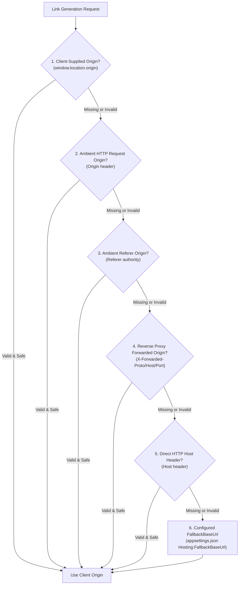

# ApexERP — Reusable Dynamic Application URL Service with Supplier Invitation Integration

## 1. Overview and Architecture

ApexERP operates across diverse deployment and development environments:
- Standard local development (`http://localhost:4200`)
- Multi-device local area networks (`http://192.168.1.10:4200`)
- Internal LAN workstations/servers (`http://erp-server:4200` or `http://erp.local:8080`)
- Cloud/hosted domains and tenant subdomains (`https://erp.example.com`, `https://company.example.com:8443`)

Previously, generating workflow links (such as RFQ Supplier Invitations) required either hardcoded fallback hosts or produced multiple confusing link alternatives in notification emails (Option 1: Standard Localhost, Option 2: Localhost Tenant Subdomain, Option 3: External Tenant Access).

The **Application URL Service** (`IApplicationUrlService`) solves this by dynamically resolving the exact, browser-accessible origin through which the user accesses the application and generating clean, secure, absolute workflow links.

Furthermore, supplier invitation emails now feature **ONE single direct quotation portal link** ("Finally One Link for Supplier"), completely eliminating multi-link confusion.

---

## 2. Dynamic Resolution Priority Order

When determining the application's base URL, `ApplicationUrlService` follows a prioritized multi-tier resolution strategy:



1. **Explicit Client-Supplied Origin (`clientOrigin`)**:
   Passed by frontend clients via `window.location.origin` (or API parameter). Because Angular runs in the user's browser, `window.location.origin` represents the actual address in the browser address bar.
2. **Ambient HTTP Request Origin (`Origin` header)**:
   Sent natively by modern browsers during CORS and POST/PUT API mutations.
3. **Ambient Referer Header (`Referer` header)**:
   Extracts `{scheme}://{authority}` from standard navigation requests.
4. **Reverse Proxy Forwarded Headers**:
   Respects `X-Forwarded-Proto`, `X-Forwarded-Host`, and `X-Forwarded-Port` when behind proxies or ingress controllers (e.g. NGINX, IIS ARR, Cloudflare, Traefik).
5. **Direct Request Host (`Host` header)**:
   Extracts scheme and host/port directly from ASP.NET Core `HttpRequest`.
6. **Configured Fallback (`FallbackBaseUrl`)**:
   Safe fallback for offline background tasks, cron workers, or queue consumers without ambient HTTP requests.

---

## 3. Security, Validation, and Injection Defenses

The service implements strict security verification:
- **Permitted Schemes**: Exclusively `http` and `https`. Schemes like `javascript:`, `ftp:`, `file:`, `data:` are categorically rejected.
- **Port and Host Integrity**: Preserves non-default ports (`:4200`, `:8443`, `:8080`) while stripping standard ports (`:80`, `:443`).
- **CRLF & Header Injection Defense**: Strictly prohibits `\r`, `\n`, `%0d`, `%0a`, spaces, tabs, and line-break characters in origin strings.
- **Trusted Domain Scope**:
  - Automatically permits localhost (`localhost`, `127.0.0.1`, `::1`).
  - Automatically permits RFC 1918 private IPv4 addresses (`10.0.0.0/8`, `172.16.0.0/12`, `192.168.0.0/16`), link-local (`169.254.0.0/16`), and IPv6 unique-local addresses when `AllowLocalNetworkOrigins = true`.
  - Automatically permits local wildcard DNS services (`.nip.io`, `.sslip.io`) and internal intranet hostnames (`.local`, `.lan`, `.internal`, `.corp`, and single-label hosts).
  - Automatically permits tenant subdomains matching `TenantBaseDomain` (e.g. `*.apexerp.com`).
  - Matches against configured `AllowedOrigins` entries (with domain and port awareness).

---

## 4. "Finally One Link for Supplier" Integration

### 4.1 RFQ Service & Notification Pipeline
- In `RFQService`, `IApplicationUrlService` is injected to build absolute links:
  ```csharp
  var invitationUrl = _urlService.BuildAbsoluteUrl(
      "/public/rfq-submit",
      new Dictionary<string, string?> { ["token"] = plaintextToken },
      request.PortalBaseUrl);
  ```
- In `RfqEmailNotificationService`, the multi-card layout (Option 1 Localhost, Option 2 Subdomain, Option 3 External) was replaced with **ONE single, responsive action box**:
  - Prominent primary CTA button: **"Open Quotation Submission Portal"**
  - Full direct link box for copying or alternative access
  - Clear deadline and security notice
  - Legacy fields (`StandardLocalhostUrl`, `TenantLocalhostUrl`, `ExternalTenantUrl`) remain populated on the DTOs for backwards-compatibility with existing automated tests.

---

## 5. Automated Verification Results

All 24 comprehensive test cases in `ApplicationUrlServiceTests` and all 29 existing `RfqWorkflowTests` passed:

```
Test run for ERP.SecurityTests.dll (.NETCoreApp,Version=v8.0)
Passed! - Failed: 0, Passed: 24, Skipped: 0, Total: 24, Duration: 1 s
Passed! - Failed: 0, Passed: 29, Skipped: 0, Total: 29, Duration: 2 s
```

Angular Frontend Build verification:
```
Application bundle generation complete. [19.123 seconds]
Exit code: 0 (No compilation errors)
```
