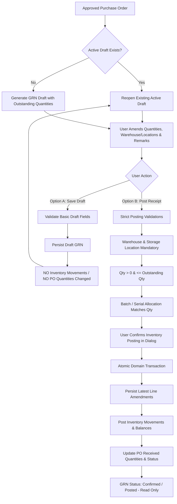

# ApexERP – Goods Receipt Note (GRN) Workflow Specification

## 1. Overview and Core Architectural Principle

In ApexERP, the Goods Receipt Note (GRN) process represents the critical transaction boundary where physical materials delivered by a vendor against an approved Purchase Order (PO) are verified, assigned to warehouse storage locations, and received into inventory.

### Core Architectural Principle
> **One GRN Draft, two permitted outcomes — Save as Draft or Post Receipt.**
> There is no separate or disconnected creation and posting pathway. Direct Post is a convenience action that executes the exact same draft creation and validation lifecycle, immediately followed by transactional stock posting and PO fulfillment.



---

## 2. Detailed Lifecycle and Permitted Workflows

### Option A: Amend and Save as Draft
1. **Initiate Receipt:** User selects *Receipt* from an Approved Purchase Order in the web application.
2. **Draft Reuse / Generation:** The system checks if an editable Draft already exists for `(TenantId, CompanyId, BranchId, PurchaseOrderId)`.
   - If an active draft exists: Reopens the existing draft, prefilling previously saved amendments and storage assignments.
   - If no active draft exists: Generates a new GRN Draft pre-populated with remaining outstanding PO quantities (`OrderedQuantity - PreviouslyReceivedQuantity`).
3. **Quantity Amendment:** The user modifies the actual received quantity (`receivedQuantityNow`).
4. **Header Details:** User enters the vendor delivery note reference (`deliveryNoteNumber`) and inspection remarks (`remarks`).
5. **Storage Assignment:** User selects the receiving warehouse and storage location/bin for each receipt line.
6. **Save Draft:** User clicks **Save as Draft** (requires `GRN.CREATE` or `GRN.EDIT`).
7. **Persistence:** The system validates and persists the GRN lines and header without posting inventory movements or updating PO received quantities.
8. **Reopening:** The draft remains open and can be reopened and edited repeatedly until ready for physical confirmation.

### Option B: Direct Post from Generated Draft
1. **Initiate Receipt:** User selects *Receipt* from an Approved Purchase Order.
2. **Draft Context:** System opens or creates the same GRN Draft used in Option A.
3. **Amendments:** User enters actual received quantities, delivery note, remarks, receiving warehouse, and storage location for every receipt line.
4. **Post Receipt Action:** User clicks **Confirm & Post Receipt** (requires `GRN.CONFIRM`).
5. **Confirmation Dialog:** A prominent confirmation dialog appears:
   - Displays PO order number and GRN reference.
   - Displays designated warehouse facility.
   - Summarizes total items and received quantities.
   - Warns that stock will be posted to inventory and PO received quantities updated.
6. **Atomic Execution:** On user confirmation, the client sends the latest amendments directly to `POST /goods-receipt-notes/{id}/confirm`.
7. **Transactional Commit:** In a single database transaction:
   - Any updated line quantities, delivery note, and storage locations are persisted to the GRN.
   - Receiving warehouse and location scopes are validated.
   - Tracking allocations (Batch/Serial) are validated against `Product.TrackingMode`.
   - Lines with `QuantityReceived > 0` generate `InventoryTransaction` entries and increment `InventoryBalance` records.
   - PO line item `ReceivedQuantity` values are incremented.
   - PO status updates to `Fulfilled` (if all lines are complete) or remains `Approved` (if partially received).
   - GRN status becomes `Confirmed`.

---

## 3. Duplicate Active-Draft Prevention and Concurrency Protection

Repeatedly selecting *Receipt* from the same approved Purchase Order must never create multiple orphan drafts in the database.

### Concurrency Protection Mechanism
1. **In-Memory Concurrency Locks:** The `GoodsReceiptNoteService` maintains a thread-safe `ConcurrentDictionary<string, SemaphoreSlim>` keyed by:
   `"grn-draft:{tenantId}:{companyId}:{branchId}:{purchaseOrderId}"`
   All draft creation requests for the same PO are synchronized through this lock.
2. **Repository Deduplication Query:**
   ```csharp
   Task<GoodsReceiptNote?> GetActiveDraftByPurchaseOrderIdAsync(
       Guid companyId,
       Guid branchId,
       Guid purchaseOrderId,
       CancellationToken cancellationToken = default);
   ```
   Filters by:
   - `TenantId == CurrentTenant`
   - `CompanyId == companyId`
   - `BranchId == branchId`
   - `PurchaseOrderId == purchaseOrderId`
   - `Status == GoodsReceiptNoteStatus.Draft`
   - `!IsDeleted`
3. **Reopening Strategy:**
   - If an active draft exists, `CreateDraftFromPoAsync` and `CreateManualDraftAsync` return or update the existing active draft instead of inserting a second row.
   - The frontend queries `GET /api/companies/{companyId}/branches/{branchId}/goods-receipt-notes/from-po/{poId}/draft`. If found, it automatically switches to editing the existing draft and informs the user with an informational banner.
4. **Subsequent Partial Receipts:**
   - Once a previous GRN is `Confirmed` or `Cancelled`, it is no longer in `Draft` status.
   - Selecting *Receipt* again on a partially fulfilled PO safely creates a brand-new Draft for the remaining unreceived balance.
   - Cancelled drafts are never reused for subsequent receipt operations.

---

## 4. Warehouse and Storage Location Integrity

Physical inventory cannot exist without an explicit destination warehouse and location.

### Mandatory Rules
1. **Line-Level Warehouse & Location Required:**
   Every GRN line with `QuantityReceived > 0` must have a valid `WarehouseId` and `WarehouseLocationId`. `Guid.Empty` and null are strictly rejected with HTTP 400 (`BadRequest`).
2. **No Automatic Defaulting:**
   The UI does not automatically pre-select the first arbitrary bin in a warehouse. The receiving user must deliberately assign the storage bin or accept the configured receiving warehouse.
3. **Multi-Tenancy & Scope Validation:**
   The backend verifies that:
   - The warehouse exists, belongs to the current Tenant, Company, and Branch, and is active.
   - The warehouse location exists, belongs to the selected warehouse, and is active.
   - Cross-branch and cross-tenant warehouse assignments are forbidden.

---

## 5. Quantity, Pricing, and Tracking Validation

### Server-Authoritative Price Protection
- Client-supplied prices and line totals in incoming requests are completely ignored.
- The backend authoritatively calculates line totals and unit costs by projecting directly from the approved PO line item:
  ```csharp
  decimal lineTotal = await CalculateReceiptValueAsync(tenantId, companyId, poItem, quantityInPoUom);
  decimal grnUnitCost = Math.Round(lineTotal / Math.Round(lineReq.QuantityReceived, 4, MidpointRounding.AwayFromZero), 2, MidpointRounding.AwayFromZero);
  ```
- Original PO unit prices, discount rates, and net values are preserved with 100% fidelity.

### Quantity Validation
- **Zero-Tolerance Over-Receipt:**
  `QuantityReceived` cannot exceed `OutstandingQuantity` (`OrderedQuantity - PreviouslyReceivedQuantity`). Violations are rejected with HTTP 409 (`Conflict`).
- **Partial Receipts:**
  Receipt quantities can be any positive decimal $\le$ outstanding quantity.
- **Zero-Received Lines:**
  Lines with `QuantityReceived == 0` do not produce inventory transactions or affect stock balances.

### Product Tracking (Batch / Serial)
Validated strictly against `Product.TrackingMode` prior to confirmation:
- `TrackingMode.None`: Batch and Serial numbers are cleared and ignored.
- `TrackingMode.Batch`: Every line requires a non-empty `BatchNumber`.
- `TrackingMode.Serial`: Every line requires quantity = 1 and a non-empty unique `SerialNumber`.
- `TrackingMode.BatchAndSerial`: Both batch and serial numbers are strictly validated.

---

## 6. Permissions and Role Separation

ApexERP enforces strict separation of duties across Procurement and Warehouse operations:

| Permission | Description | Permitted Actions |
| :--- | :--- | :--- |
| `GRN.VIEW` | View Goods Receipts | View receipt details, inspection registers, and history. |
| `GRN.CREATE` | Create GRN Drafts | Generate draft from approved PO; save new receipt drafts. |
| `GRN.EDIT` | Edit GRN Drafts | Update line quantities, locations, delivery note, and remarks on existing drafts. |
| `GRN.CONFIRM` | Post Inventory | Confirm receipt, commit inventory transactions, update PO received quantities. |

- Procurement users without `GRN.CONFIRM` can create and save Drafts (Option A) but cannot post stock.
- The web frontend conditionally disables the "Confirm & Post Receipt" button and displays a tooltip when the user lacks `GRN.CONFIRM`.
- The backend controller decorates confirmation with `[RequirePermission("GRN.CONFIRM")]`.

---

## 7. API Contract Reference

### 1. Get Active Draft for Purchase Order
`GET /api/companies/{companyId}/branches/{branchId}/goods-receipt-notes/from-po/{purchaseOrderId}/draft`
- **Response 200 OK:** Returns existing active `GoodsReceiptNoteDto`.
- **Response 404 NotFound:** No active draft exists for this PO.

### 2. Generate Draft from Purchase Order
`POST /api/companies/{companyId}/branches/{branchId}/goods-receipt-notes/from-po/{purchaseOrderId}`
- Query Parameters: `grnNumber`, `warehouseId`, `warehouseLocationId`, `remarks`.
- **Response 201 Created:** Returns newly created or existing active `GoodsReceiptNoteDto`.

### 3. Save / Update Manual Draft
`POST /api/companies/{companyId}/branches/{branchId}/goods-receipt-notes`
`PUT /api/companies/{companyId}/branches/{branchId}/goods-receipt-notes/{id}`
- Body: `CreateGoodsReceiptNoteRequest` / `UpdateGoodsReceiptNoteRequest`.
- **Response 200 OK / 201 Created:** Persists draft lines and header without inventory movements.

### 4. Confirm GRN and Post Stock (with optional atomic update)
`POST /api/companies/{companyId}/branches/{branchId}/goods-receipt-notes/{id}/confirm`
- Body: Optional `UpdateGoodsReceiptNoteRequest` containing final user amendments.
- **Response 200 OK:** Atomically applies amendments (if provided), posts stock to inventory, updates PO fulfillment status, and returns confirmed `GoodsReceiptNoteDto`.
